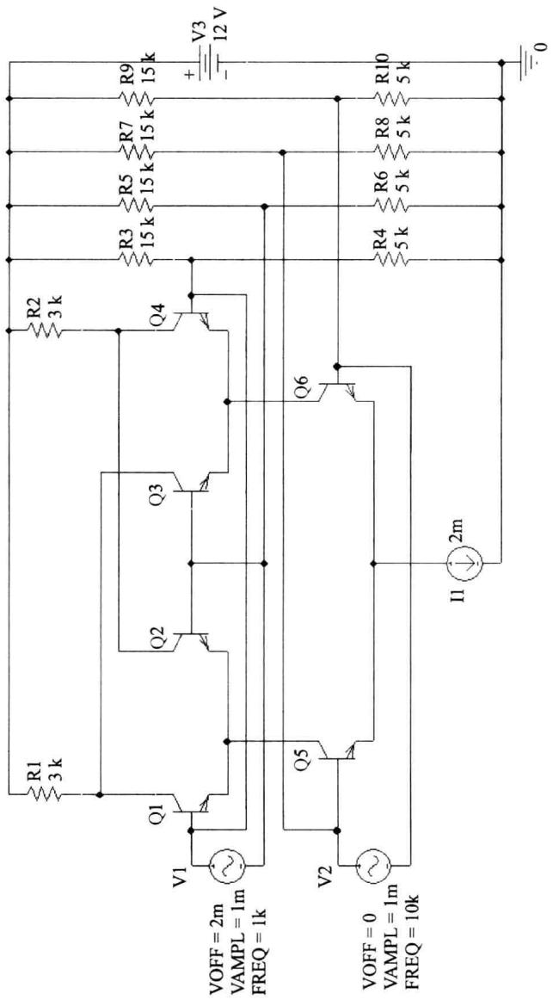
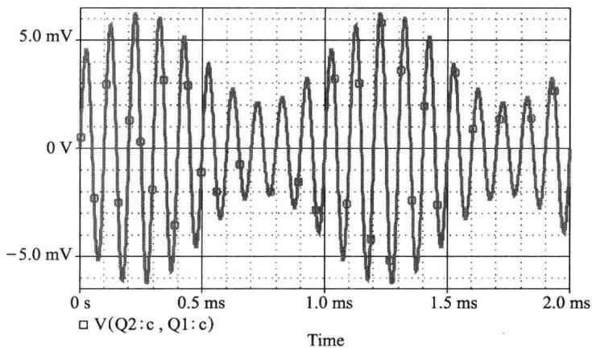
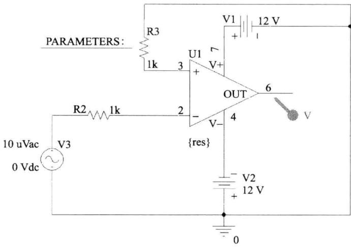
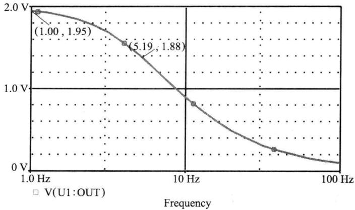
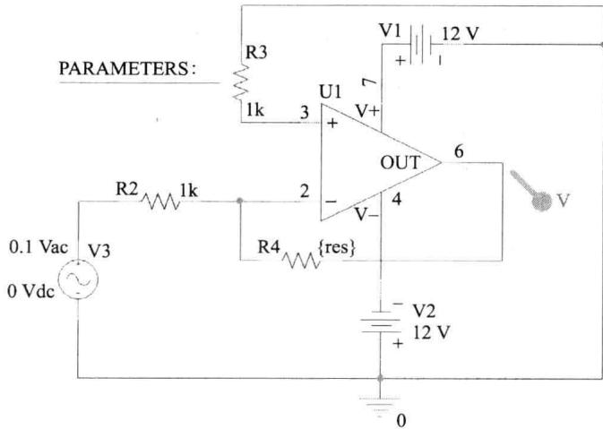
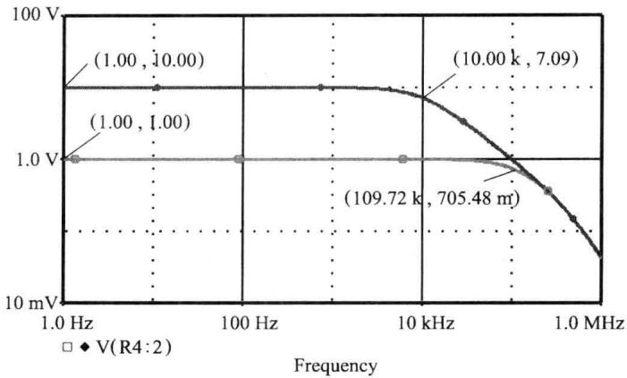

import Guide from '@/components/Guide.astro';
import Knowledge from '@/components/Knowledge.astro';
import Example from '@/components/Example.astro';
import Analysis from '@/components/Analysis.astro';
import Solution from '@/components/Solution.astro';
import Variant from '@/components/Variant.astro';
import Note from '@/components/Note.astro';
import Block from '@/components/Block.astro';
import Method from '@/components/Method.astro';
import Exercise from '@/components/Exercise.astro';

## 6.10.1 乘法器电路仿真

使用 OrCAD 对图 6.7.6 所示的双平衡四象限变跨导乘法器进行仿真分析, 当在两个输入端加入信号时, 输出应为两个输入信号乘积的函数。

使用 OrCAD 重新绘制的电路图如图 6.10.1 所示。

在仿真电路中需要说明以下几点。

  

图 6.10.1 使用 OrCAD 绘制的乘法器原理图

（1）晶体管可使用 EVAL 库中的任意一种 NPN 型小功率晶体管，本例中使用 Q2N2222。

(2) $R_{3}\sim R_{10}$ 用来分别为各晶体管提供直流偏置。

（3） $v_{1}$ 、 $v_{2}$ 对应图 6.7.6 中的 $v_{x}$ 、 $v_{y}$ 。 $v_{1}$ 为直流分量为 2 mV、交流信号幅度为 1 mV、频率为 1 kHz 的输入信号， $v_{2}$ 为直流分量为 0、交流信号幅度为 1 mV、频率为 10 kHz 的输入信号。

（4）输出信号为 Q1 与 Q2 的集电极电压之差，由于本图中并未使用双端到单端的变换电路，在观察时可使用差分电压探针或自行在 Probe 中添加相应的 Trace。读者也可在实验时自行添加相应的变换电路来进行分析。

图 6.10.1 中两个输入信号的数学表达式分别为

$$

\left\{ \begin{array}{l} v _ {1} = 2 + \cos (2 \pi \times 1 0 ^ {3} \times t) \mathrm{mV} \\ v _ {2} = \cos (2 \pi \times 1 0 \times 1 0 ^ {3} \times t) \mathrm{mV} \end{array} \right.\tag{6.10.1}

$$

根据式 $(6.7.14)$ ，即

$$

v _ {\mathrm{0}} = - \left(i _ {\mathrm{01}} - i _ {\mathrm{02}}\right) R _ {\mathrm{C}} \approx - \frac {I R _ {\mathrm{C}}}{4 V _ {T} ^ {2}} v _ {\mathrm{x}} v _ {\mathrm{y}} = k v _ {\mathrm{x}} v _ {\mathrm{y}}\tag{6.10.2}

$$

可知相乘后的结果为

$$

\begin{array}{r l} v _ {0} & = \frac {2 \times 1 0 ^ {- 3} \times 3 \times 1 0 ^ {3}}{4 \times (2 6 \times 1 0 ^ {- 3}) ^ {2}} \times [ 2 + \cos (2 \pi \times 1 0 ^ {3} \times t) ] \times 1 0 ^ {- 3} \times \\ & \quad \cos (2 \pi \times 1 0 \times 1 0 ^ {3} \times t) \times 1 0 ^ {- 3} \mathrm{mV} \\ & \approx 2. 2 [ 2 + \cos (2 \pi \times 1 0 ^ {3} \times t) ] \times \cos (2 \pi \times 1 0 \times 1 0 ^ {3} \times t) \mathrm{mV} \end{array}

$$

对该图进行瞬态仿真,并设置仿真时长为 $0 \sim 2 \, ms$ , 可得输出结果如图 6.10.2 所示的波形。

  

图 6.10.2 乘法器的仿真输出结果

分析仿真结果可以看到如下特点：

（1）输出信号仍然为具有一定周期的信号；

(2) 输出信号达到最大值的时间间隔为 $1 \, ms$ (事实上此即为 $v_{1}$ 的周期);

（3）输出信号每个波峰之间的时间间隔为 0.1 ms（事实上此即为 $v_{2}$ 的周期）；

（4）输出信号最大振幅约为 $6.6 \, mV$ [即 $2.2 \times (2 + 1)$ ]，最小振幅为 $2.2 \, mV$ [即 $2.2 \times (2 - 1)$ ]；

（5）若将输出信号的每个波峰（幅值为正或为负）连起来（包络），所得的波形为 $v_{1}$ 的波形。

在通信中把这种信号处理方式称为信号的幅度调制（调幅），其含义即为用低频调制信号（本例中为 $v_{1}$ ）来改变高频载波（本例中为 $v_{2}$ ）的振幅。通常情况下，若设调制信号为 $v_{\Omega}=V_{\Omega}\cos\Omega t$ ，载波信号为 $v_{c}=V_{c}\cos\omega_{c}t$ ，则调幅后的信号可用下式来表示

$$

v _ {0} = \left(V _ {\mathrm{c}} + k V _ {\Omega} \cos \Omega t\right) \cos \omega_ {\mathrm{c}} t\tag{6.10.3}

$$

可以看出,此时输出信号各点的振幅由 $v_{c}+kV_{\Omega}\cos\Omega t$ 决定,也即由调制信号控制。振幅的最大值变为 $V_{c}+kV_{\Omega}$ ,最小值变为 $V_{c}-kV_{\Omega}$ 。调幅信号的其余特点读者可参照以上分析和图6.10.2所示的曲线自行分析得出。

## 6.10.2 使用运算放大器宏模型分析负反馈电路的通频带

电路分析软件的器件库中会有一些常用电路的宏模型供调用,也可以根据需要对某些器件建立宏模型用于简化电路分析。以下使用 OrCAD 中 EVAL 库里的某运放的宏模型来验证负反馈对通频带的展宽作用。

首先对不加负反馈时的电路进行交流扫描,获得开环频率特性,电路如图6.10.3所示。交流分析结果如图6.10.4所示。

  

图 6.10.3 对运放进行开环交流分析的电路

从分析结果中可以看出,所使用运放的开环增益近似为 $1.95 \times 10^{5}$ , 此时的 3 dB 带宽为 5.19 Hz 左右。

下一步对加有深度负反馈的电路进行仿真,此时电路如图6.10.5所示。

图 6.10.5 中的电阻 $R_{4}$ 即为负反馈电阻。需要注意的是，为了查看不同反馈深度下的频带状况，该电阻的值并未固定为某一值，而是设置为 PARA 器件中的参数 $\{res\}$ 以便进行参数扫描仿真。在参数扫描仿真时,设置该电阻的值为10 kΩ和100 kΩ来观察频带的展宽程度。

  

图 6.10.4 开环交流分析结果

  

图 6.10.5 反相放大电路

根据前面所学过的负反馈展宽频带的公式,设运放的开环增益为 A, 开环3 dB带宽为 f, 反馈深度为 D, 闭环增益为 $A_{f}$ , 则可得

$$

\begin{array}{r l} & D \approx A / A _ {\mathrm{f}} \\ & f _ {\mathrm{f}} \approx D \times f \end{array}

$$

根据已经获得的开环增益 $(1.95\times10^{5})$ 及带宽,可以计算出

当 $R_{4} = 10\mathrm{k}\Omega$ 时， $A_{\mathrm{f10k}\Omega} = 10, f_{\mathrm{f10k}\Omega} = 101.205\mathrm{kHz}$

当 $R_{4} = 100\mathrm{k}\Omega$ 时， $A_{\mathrm{f100k}\Omega} = 100, f_{\mathrm{f100k}\Omega} = 10.1205\mathrm{kHz}$

图 6.10.6 所示为相应的仿真结果,需要注意的是,为了使得结果看起来更清晰,纵轴使用了对数坐标。

从图中可以看出,对应于 $R_{4}=10\ k\Omega$ 时, $f_{f10\ k\Omega}\approx109.72\ kHz$ ; 对应于 $R_{4}=100\ k\Omega$ 时, $f_{f100\ k\Omega}\approx10.0\ kHz$ 。可见仿真结果与理论分析结果非常接近。

  

图 6.10.6 反相放大电路频率特性仿真结果
