import Guide from '@/components/Guide.astro';
import Knowledge from '@/components/Knowledge.astro';
import Example from '@/components/Example.astro';
import Analysis from '@/components/Analysis.astro';
import Solution from '@/components/Solution.astro';
import Variant from '@/components/Variant.astro';
import Note from '@/components/Note.astro';
import Block from '@/components/Block.astro';
import Method from '@/components/Method.astro';
import Exercise from '@/components/Exercise.astro';

## 习题

<Exercise title="习题 6.5.1">
判断下列说法是否正确(在括号中画√或×):

（1）处于线性工作状态下的集成运放，反相输入端可按“虚地”来处理。（）

(2) 反相基本放大电路属于电压串联负反馈, 同相基本放大电路属于电压并联负反馈。( )

（3）处于线性工作状态的实际集成运放，在实现信号运算时，两个输入端对地的直流电阻必须相等，才能防止输入偏置电流 $I_{1B}$ 带来运算误差。（）

（4）在反相求和电路中，集成运放的反相输入端为“虚地”点，流过反馈电阻的电流基本上等于各输入电流之代数和。（）

（5）同相求和电路跟同相基本放大电路一样，各输入信号的电流几乎等于零。（）

<Solution>
(1) ×; (2) ×; (3) √; (4) √; (5) ×
</Solution>
</Exercise>

<Exercise title="习题 6.5.2">
在图题 6.5.2 中, 各集成运放均是理想的, 试写出各输出电压 $v_{0}$ 的值。

(f)  

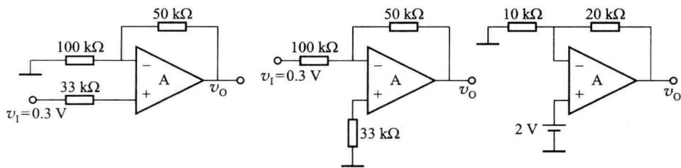

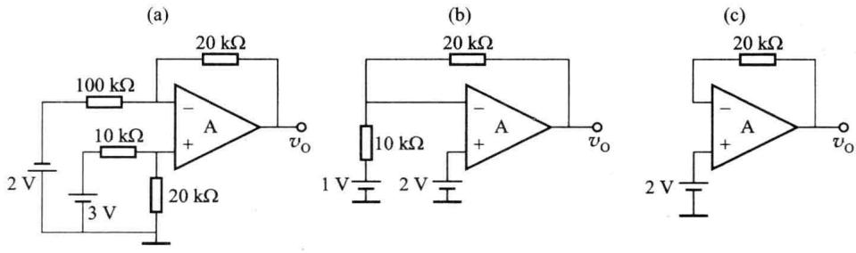  

(d)  

(e)

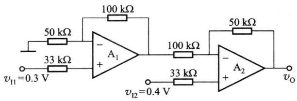

(g)  

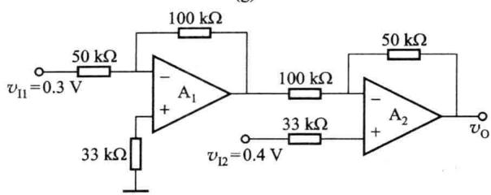  

(h)  

图题6.5.2

<Solution>
(a) $v_{0} = 0.45 \mathrm{~V}$ ; (b) $v_{0} = -0.15 \mathrm{~V}$ ; (c) $v_{0} = 6 \mathrm{~V}$ ; (d) $v_{0} = 10 \mathrm{~V}$

(e) $v_{0} = 4\mathrm{V}$ ; (f) $v_{0} = 2\mathrm{V}$ ; (g) $v_{0} = 0.15\mathrm{V}$ ; (h) $v_{0} = 0.9\mathrm{V}$
</Solution>
</Exercise>

<Exercise title="习题 6.5.3">
在图题 6.5.3 所示的电路中，A 为理想运放，D 为理想二极管，试分析 $v_{0}$ 与 $v_{1}$ 的函数关系。

<Solution>
$v_{0} = \left\{ \begin{array}{ll}0 & (v_{1}\geqslant 0)\\ -\frac{R_{\mathrm{F}}}{R_{1}} v_{1} & (v_{1} <   0) \end{array} \right.$
</Solution>
</Exercise>

<Exercise title="习题 6.5.4">
在图题 6.5.4 所示的电路中，A 为理想运放。

(1) 写出 $v_{0}$ 与 $v_{1}$ 的关系式；

(2) 流过电阻 $R_{2}$ 的电流 $I_{2}$ 为多少?

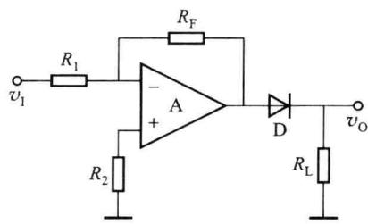  

图题6.5.3

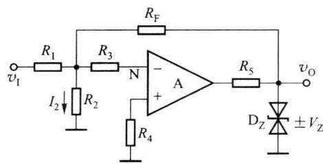  

图题6.5.4

<Solution>
$v_{0} = -\frac{R_{\mathrm{F}}}{R_{1}} v_{1};I_{2} = 0$
</Solution>
</Exercise>

<Exercise title="习题 6.5.5">
集成运放电路如图题 6.5.5 所示。设 A 为理想运放， $v_{1}=0.5\ V$ ，试求负载电阻 $R_{L}$ 上的电压 $v_{0}$ 、电流 $I_{L}$ 以及集成运放的输出电流 $i_{0}$ 。

<Solution>
$v_{0} = -1\mathrm{V}, I_{\mathrm{L}} = -0.1\mathrm{mA}, I_{0} = 0.11\mathrm{mA}$
</Solution>
</Exercise>

<Exercise title="习题 6.5.6">
请画出如图题 6.5.6 所示电路的电压传输特性曲线, 标出有关的电压数值, 假设所用集成运放为理想器件。

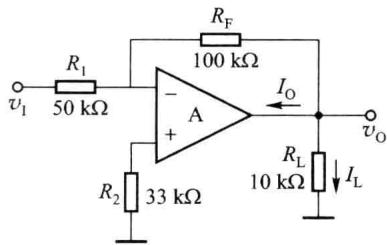  

图题6.5.5

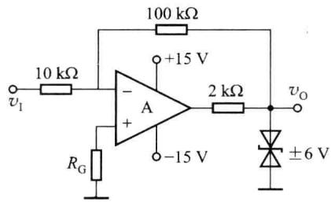  

图题6.5.6
</Exercise>

<Exercise title="习题 6.5.7">
分析图题 6.5.7 所示的电路,选择正确的答案填空。

（1）输出电压 $v_{0}$ 约为 \_\_\_\_。（a. -5.5 V, b. -7.5 V, c. -10 V, d. -12.5 V）

（2）电阻 $R_{G}$ 的值应约为 \_\_\_\_。（a.1 kΩ, b.1.7 kΩ, c.10 kΩ, d.2.3 kΩ）

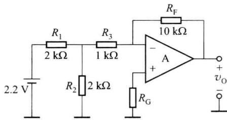

<Solution>
(1) a; (2) b
</Solution>
</Exercise>

<Exercise title="习题 6.5.8">
电路如图题 6.5.8(a) 所示。

(1) 写出电路的名称；

图题6.5.7

(2) 若输入信号波形如图题(b)所示,试画出输出电

压的波形，并标明有关的电压和所对应的时间数值。设 A 为理想运放，两个正、反串联稳压管的稳压值为 $\pm5 V$ 。

<Solution>
（1）带限幅的反相比例放大电路

(2) 当 $\left|v_{1}\right|\leqslant1\ V$ 时, 电路增益 $A_{vf}=-5$ ; 当 $\left|v_{1}\right|\geqslant1\ V$ 时, $\left|v_{0}\right|$ 被限制在 $5\ V$ 。 $v_{0}$ 波形图略
</Solution>
</Exercise>

<Exercise title="习题 6.5.9">
设图题 6.5.9 中的集成运放是理想的,试推导输出电压 $v_{0}$ 与输入电压 $v_{1}$ 之间的关系。

<Solution>
$\frac{v_{0}}{v_{1}} = -\frac{1}{R_{1}}\left(R_{2} + R_{3} + \frac{R_{2}R_{3}}{R_{4}}\right)$
</Solution>
</Exercise>

<Exercise title="习题 6.5.10">
在图题 6.5.10 中, A 为理想运放, 求 $\frac{v_{0}}{v_{1}}$ 。

<Solution>
$\frac{v_{\mathrm{o}}}{v_{\mathrm{I}}} = -25$
</Solution>
</Exercise>

<Exercise title="习题 6.5.11">
在图题 6.5.11 所示的电路中， $A_{1}$ 、 $A_{2}$ 为理想运放，求 $v_{0}$ 的表达式。

<Solution>
$v_{0} = -\frac{R_{2}(R_{3} + R_{4})}{R_{1}R_{4}} v_{1}$
</Solution>
</Exercise>

<Exercise title="习题 6.5.12">
图题 6.5.12 是某放大电路的电压传输特性。这个电路的输出与输入电压之间是何种运算关

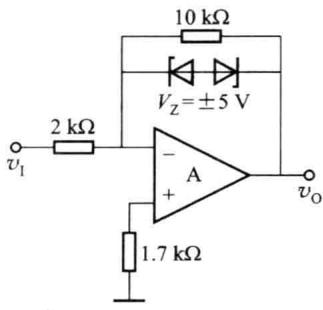

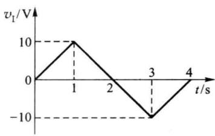  

图题6.5.8

系？电路的电压放大倍数是多大？输入正弦信号时最大不失真输出电压有效值有多大？

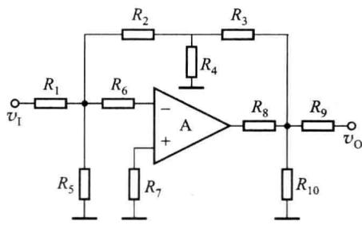  

图题6.5.9

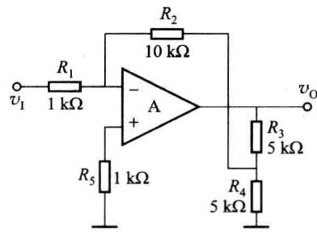  

图题6.5.10

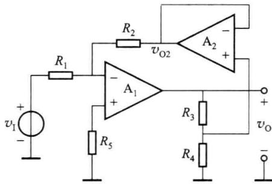  

图题6.5.11

<Solution>
反相比例运算关系,放大倍数为-40,最大不失真输出电压有效值为 $8/\sqrt{2}$ V
</Solution>
</Exercise>

<Exercise title="习题 6.5.13">
图题 6.5.13 所示的电路中，A 为理想运放。设 $R_{1}=R_{2}=R_{L}=10\ k\Omega, R_{3}=R_{F}=100\ k\Omega, v_{I}=0.55\ V$ ，求输出电压 $v_{0}$ 、负载电流 $i_{L}$ 及运放输出电流 $i_{0}$ 。

<Solution>
$v_{0} = 5.5\mathrm{V}, I_{\mathrm{L}} = 0.55\mathrm{mA}, I_{0} = 0.6\mathrm{mA}$
</Solution>
</Exercise>

<Exercise title="习题 6.5.14">
设图题 6.5.14 中的 $A_{1}$ 、 $A_{2}$ 均为理想运放。

(1) 写出 $v_{0}$ 与 $v_{1}$ 的关系式；

（2）若 $R_{1}=10\ k\Omega, R_{2}=100\ k\Omega, R=10\ k\Omega, v_{1}=0.25\ V$ ，求 $v_{0}$ 。

<Solution>
(1) $v_{0} = \frac{2R_{2}}{R_{1}} v_{1}$ ; (2) $v_{0} = 5\mathrm{V}$
</Solution>
</Exercise>

<Exercise title="习题 6.5.15">
电路如图题 6.5.15 所示, $A_{1}$ 、 $A_{2}$ 均为理想运放, 写出输出电压 $v_{0}$ 的表达式。

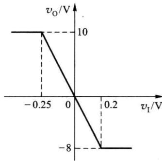

图题6.5.12  

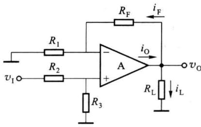  

图题6.5.13

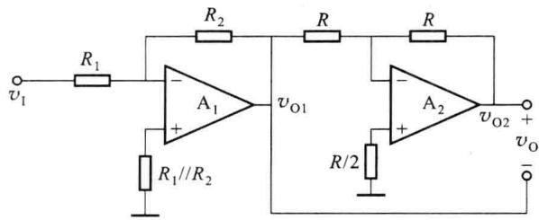  

图题6.5.14

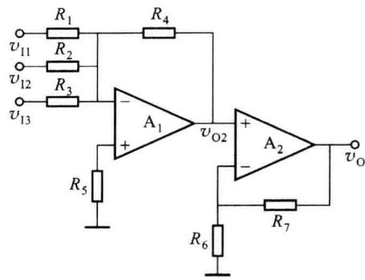  

图题6.5.15

<Solution>
$v_{0} = -\frac{R_{4}(R_{6} + R_{7})}{R_{6}}\left(\frac{v_{11}}{R_{1}} +\frac{v_{12}}{R_{2}} +\frac{v_{13}}{R_{3}}\right)$
</Solution>
</Exercise>

<Exercise title="习题 6.5.16">
计算图题 6.5.16 所示电路的输出电压 $v_{01}$ 和 $v_{0}$ 的值。设 $A_{1}$ 、 $A_{2}$ 为理想运放。

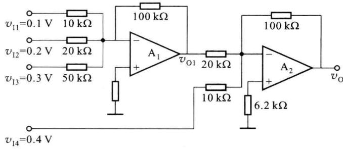  

图题6.5.16

<Solution>
$v_{01} = -2.6\mathrm{V}, v_{0} = 9\mathrm{V}$
</Solution>
</Exercise>

<Exercise title="习题 6.5.17">
一个理想运放组成的运算电路如图题 6.5.17 所示。当输入电压 $v_{11}=0.1\ V, v_{12}=0.2\ V$ 时，输出电压 $v_{0}=?$

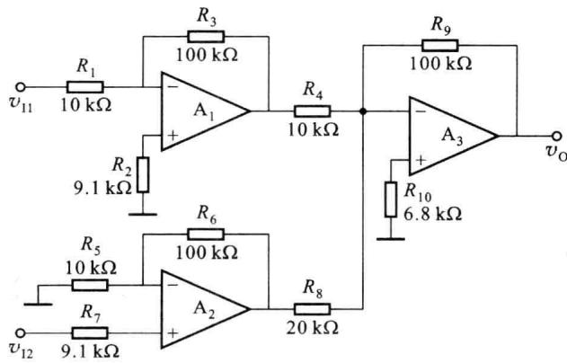  

图题6.5.17

<Solution>
$v_{0} = -1\mathrm{V}$
</Solution>
</Exercise>

<Exercise title="习题 6.5.18">
图题 6.5.18 中的 A 为理想运放, 写出输出电压 $v_{0}$ 与各输入电压之间的关系式。

<Solution>
$v_{0} = v_{12} + 4v_{13} - 4v_{11}$
</Solution>
</Exercise>

<Exercise title="习题 6.5.19">
电路如图题 6.5.19 所示, 设 $A_{1}$ 、 $A_{2}$ 、 $A_{3}$ 为理想运放, 试说明各运放分别组成何种电路, 并写出输出电压 $v_{0}$ 的表达式。

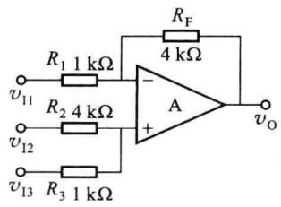

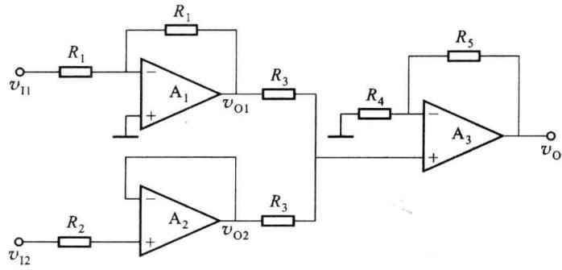  

图题6.5.18  

图题6.5.19

<Solution>
$A_{1}$ 为反相比例运算电路, $A_{2}$ 为电压跟随器, $A_{3}$ 为同相比例放大器

$$
v _ {0} = \frac {1}{2} \left(1 + \frac {R _ {5}}{R _ {4}}\right) (v _ {1 2} - v _ {1 1})
$$
</Solution>
</Exercise>

<Exercise title="习题 6.5.20">
图题 6.5.20 所示的电路中， $A_{1}$ 、 $A_{2}$ 均为理想运放。试求：

(1) $v_{01}$ 与 $v_{11}$ 、 $v_{12}$ 之间的关系式；

(2) $v_{0}$ 与 $v_{11}$ 、 $v_{12}$ 、 $v_{13}$ 之间的关系式。

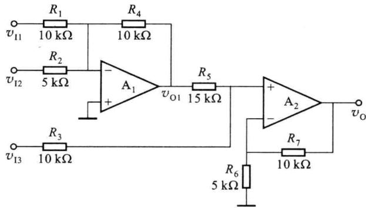  

图题6.5.20

<Solution>
(1) $v_{01} = -(v_{11} + 2v_{12})$ (2) $v_{0} = -\frac{6}{5} v_{11} - \frac{12}{5} v_{12} + \frac{9}{5} v_{13}$
</Solution>
</Exercise>

<Exercise title="习题 6.5.21">
电路如图题 6.5.21 所示, 运放及其他元件都具有理想特性, 请画出电路的传输特性。
</Exercise>

<Exercise title="习题 6.5.22">
设图题 6.5.22 中的 A 为理想运放, $R_{1} \parallel R_{2} \parallel R_{5} = R_{3} \parallel R_{4} \parallel R_{6}$ 。

（1）指出该电路具有的功能；

(2) 计算该电路的输出电压 $v_{0}$ 。

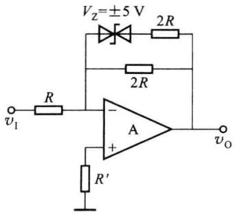  

图题6.5.21

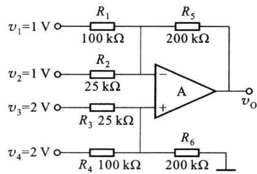  

图题6.5.22

<Solution>
(1) 加减运算电路; (2) $v_{0}=10\ V$
</Solution>
</Exercise>

<Exercise title="习题 6.5.23">
电路如图题 6.5.23 所示, A 为理想运放, $v_{1}=5\ V$ , 试计算 $v_{0}$ 。

<Solution>
$v_{0} = 10\mathrm{V}$
</Solution>
</Exercise>

<Exercise title="习题 6.5.24">
电路如图题6.5.24所示，已知A为理想运放，电阻 $R_{1}=10\ k\Omega,R_{2}=12.5\ k\Omega,R_{F}=50\ k\Omega$ ，输入电压为 $v_{1}=\sin\omega t\ V$ ，开关S按如下规律动作： $0\leqslant\omega t<\pi$ 时，S闭合； $\pi\leqslant\omega t\leqslant2\pi$ 时，S断开。请画出 $v_{0}$ 的波形。

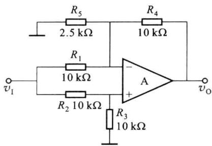  

图题6.5.23

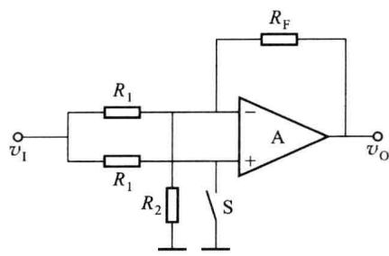  

图题6.5.24
</Exercise>

<Exercise title="习题 6.5.25">
电路如图题 6.5.25 所示, 设 $A_{1}$ 、 $A_{2}$ 均为理想运放。为了实现 $v_{0}=v_{11}-v_{12}$ 的减法运算, 电阻 $R_{1}$ 、 $R_{2}$ 、 $R_{3}$ 、 $R_{4}$ 之间应满足什么样的关系?

<Solution>
$R_{1}R_{3} = R_{2}R_{4}$
</Solution>
</Exercise>

<Exercise title="习题 6.5.26">
求图题 6.5.26 所示电路的电压放大倍数 $\frac{v_{0}}{v_{11}-v_{12}}$ ，设 $A_{1}$ 、 $A_{2}$ 都是理想运放。

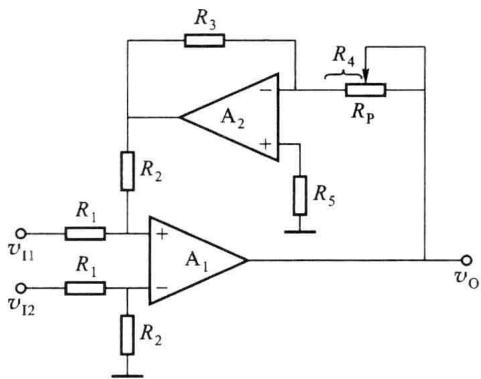  

图题6.5.25

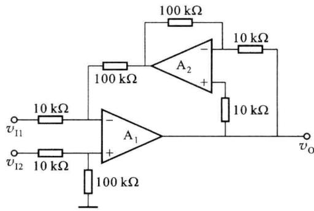  

图题6.5.26

<Solution>
电压放大倍数为-10
</Solution>
</Exercise>

<Exercise title="习题 6.5.27">
在图题 6.5.27 中， $A_{1}$ 、 $A_{2}$ 、 $A_{3}$ 均为理想运放，求输出电压 $v_{0}$ 的值。

<Solution>
$v_{0}=16\ mV$
</Solution>
</Exercise>

<Exercise title="习题 6.5.28">
电路如图题 6.5.28 所示。请问：

（1）欲实现 $v_{0}=K(v_{12}-v_{11})$ 的运算关系（K 为常数），电阻 $R_{1}$ 、 $R_{2}$ 、 $R_{3}$ 、 $R_{4}$ 之间应有什么关系（设 $A_{1}$ 、 $A_{2}$ 均为理想运放）？

(2) 在实际电路中, 输入电压 $v_{11}$ 、 $v_{12}$ 的大小应受什么限制?

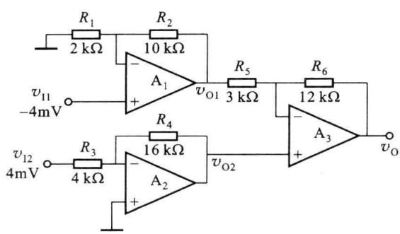  

图题6.5.27

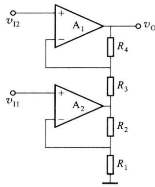  

图题6.5.28

<Solution>
(1) $R_{1}R_{3} = R_{2}R_{4}$ ; (2) $v_{11}, v_{12}$ 分别受 $\mathrm{A}_{1}, \mathrm{A}_{2}$ 的最大允许输入共模电压以及最大输出电压幅度的限制（与 $\mathrm{A}_{1}, \mathrm{A}_{2}$ 所采用的电源电压有关）
</Solution>
</Exercise>

<Exercise title="习题 6.5.29">
试写出图题 6.5.29 所示电路输出电压 $v_{0}$ 的表达式。设 $A_{1}$ 、 $A_{2}$ 、 $A_{3}$ 均为理想运放， $R_{1} \parallel R_{2} = R_{3} \parallel R_{4}$ 。

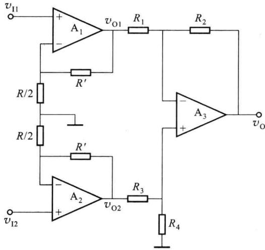  

图题6.5.29

<Solution>
$v_{0} = \left(1 + \frac{2R^{\prime}}{R}\right)\left(\frac{R_{2}}{R_{3}} v_{12} - \frac{R_{2}}{R_{1}} v_{11}\right)$
</Solution>
</Exercise>

<Exercise title="习题 6.5.30">
设图题 6.5.30 中的集成运放均为理想运放，试推导输出电压 $v_{0}$ 与输入电压 $v_{11}$ 、 $v_{12}$ 、 $v_{13}$ 之间的运算关系。

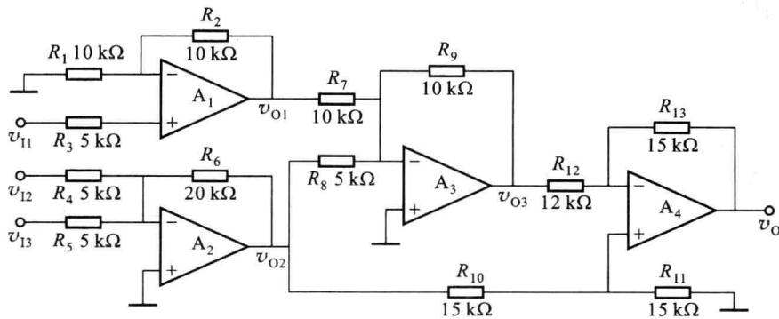  

图题6.5.30

<Solution>
$v_{0} = \frac{5}{2} v_{11} - \frac{29}{2} v_{12} - \frac{29}{2} v_{13}$
</Solution>
</Exercise>

<Exercise title="习题 6.5.31">
积分运算电路如图题 6.5.31 所示。已知初始状态 $v_{1}=0, v_{0}=0$ 。若 $v_{1}$ 突加 1 V 直流电压，求 1 s 后的输出电压值。设 A 为理想运放， $R_{1}=100\ k\Omega, C=2\ \mu F$ 。

<Solution>
$v_{0} = -5$ V
</Solution>
</Exercise>

<Exercise title="习题 6.5.32">
设图题 6.5.32 中的 A 为理想运放, $R_{1}=20\ k\Omega$ , $C=1\ \mu F$ , $v_{0}$ 的起始值为 0 V。现接入 $v_{1}=1\ V$ 的直流电压,问 $v_{0}$ 变到 -10 V 需用多少时间?请画出 $v_{0}$ 波形图。

<Solution>
当 t=0 时, $v_{0}=0$ ; 当 t=200 ms 时, $v_{0}=-10\ V$ 。波形图略

(1) $v_{0}(t) = \left\{ \begin{array}{ll} - \frac{1}{R_1C}\int_0^t v_{11}(t)\mathrm{d}t + v_0(0) & t <   2\mathrm{ms}\\ -\frac{2}{R_1C}\int_0^t v_{11}(t)\mathrm{d}t - \frac{1}{R_2C}\int_0^t v_{12}(t)\mathrm{d}t + v_0(0) & t > 2\mathrm{ms} \end{array} \right.$ ；(2） $v_{0}$ 的波形图略
</Solution>
</Exercise>

<Exercise title="习题 6.5.33">
已知图题 6.5.33(a) 所示电路中的 A 为理想运放, $R_{1}=50\ k\Omega$ , $C=1\ \mu F$ , 输入电压 $v_{1}$ 的波形为图题 6.5.33(b) 所示的方波, 试画出输出电压 $v_{0}$ 的波形。设 t=0 时, $v_{0}=0$ 。
</Exercise>

<Exercise title="习题 6.5.34">
积分运算电路如图题 6.5.34(a) 所示, 设集成运放 A 的最大输出电压为 $\pm12$ V, 其他方面的特性均是理想的。电阻 $R_{1}=10\ k\Omega$ , 电容 $C=0.1\ \mu F$ , 在初始时刻 t=0 时, 电容两端的电压 $v_{c}=0$ 。若输入信号分别如图题6.5.34(b)、(c)所示，试画出对应的 $v_{0}$ 波形，标明有关数值。

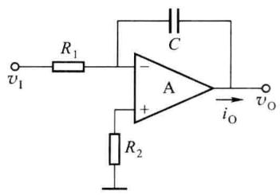  

图题6.5.31

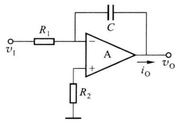  

图题6.5.32

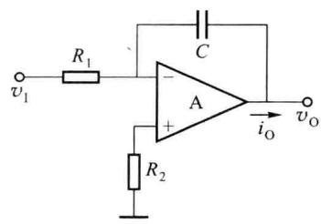  

(a)

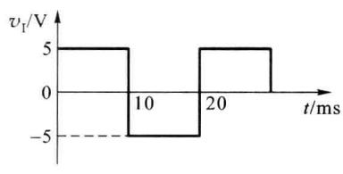  

(b)

图题6.5.33  

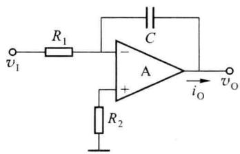  

(a)

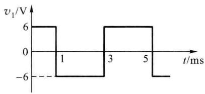  

(b)

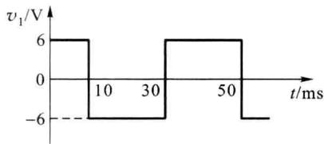  

(c)  

图题6.5.34
</Exercise>

<Exercise title="习题 6.5.35">
电路如图题 6.5.35(a) 所示, A 为理想运放。

(1) 求 $v_{0}$ 对 $v_{11}$ 、 $v_{12}$ 的运算式；

（2）若 $R_{1}=1\ k\Omega, R_{2}=2\ k\Omega, C=1\ \mu F, v_{11}$ 和 $v_{12}$ 的波形如图题 6.5.35(b) 所示，t=0 时 $v_{C}=0$ ，试画出 $v_{0}$ 的波形图，并标明电压数值。
</Exercise>

<Exercise title="习题 6.5.36">
分析图题 6.5.36(a) 所示的电路, 回答下列问题:

(1) $A_{1}$ 、 $A_{2}$ 、 $A_{3}$ 与相应的元件各组成何种电路？

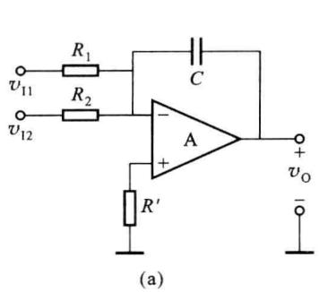

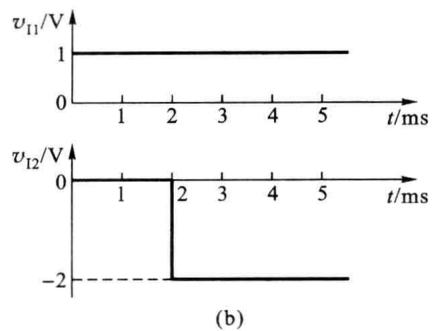  

图题6.5.35

(2) 设 $A_{1}$ 、 $A_{2}$ 、 $A_{3}$ 均为理想运放，输出电压 $v_{0}$ 与 $v_{11}$ 、 $v_{12}$ 有何种运算关系？

（3）设 t=0 时刻电容上的电压 $v_{c}(0)=0$ ，并已知 $v_{01}$ 的波形如图题 6.5.36(b) 所示， $R_{2}=100\ k\Omega, C=10\ \mu F$ ，问 $v_{0}$ 应有什么样的波形（画出波形图）？

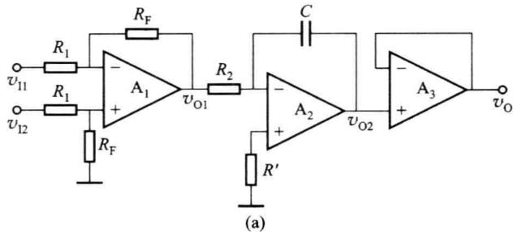

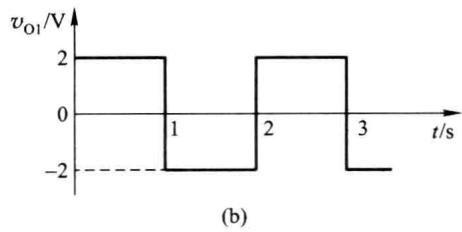  

图题6.5.36

<Solution>
（1） $A_{1}$ 组成减法器， $A_{2}$ 组成积分器， $A_{3}$ 组成电压跟随器

(2) $v_{0} = -\frac{R_{\mathrm{F}}}{R_{1}R_{2}C}\int_{0}^{t}(v_{12} - v_{11})\mathrm{d}t + v_{0}(0)$

(3) 波形图略
</Solution>
</Exercise>

<Exercise title="习题 6.5.37">
电路如图题 6.5.37 所示。

(1) 电阻 $R_{1}$ 、 $R_{2}$ 、 $R_{3}$ 应选多大？

(2) 输出电压 $v_{01}$ 、 $v_{02}$ 、 $v_{03}$ 分别为多少？

（3）设电容器初始电压为 2 V，极性如图题 6.5.37 中所示，求使 $v_{04} = -6 \, V$ 所需的时间 t？设所有的运放均可视为理想器件。

<Solution>
(1) $R_{1} \approx 2.2\mathrm{k}\Omega, R_{2} = 4.8\mathrm{k}\Omega, R_{3} = 100\mathrm{k}\Omega$

(2) $v_{01} = -5.2\mathrm{V}, v_{02} = -5\mathrm{V}, v_{03} = 0.2\mathrm{V}$

(3) $t = 2\mathrm{s}$
</Solution>
</Exercise>

<Exercise title="习题 6.5.38">
积分运算电路如图题 6.5.38 所示。设 A 为理想运放，电容 C 上的初始电压为零，且 $R_{1}=R_{2}=R, C_{1}=C_{2}=C$ 。

（1）当 $v_{11} = 0$ 时，推导 $v_{0}$ 与 $v_{12}$ 的关系式；

(2) 当 $v_{12}=0$ 时，推导 $v_{0}$ 与 $v_{11}$ 的关系式；

（3）当 $v_{11}$ 、 $v_{12}$ 同时作用时，写出 $v_{0}$ 与 $v_{11}$ 、 $v_{12}$ 的关系式。

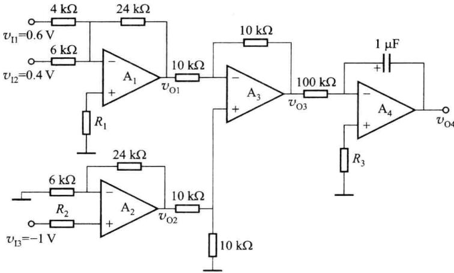  

图题6.5.37

<Solution>
(1) $v_{0} = \frac{1}{RC}\int_{0}^{t}v_{12}\mathrm{d}t$ ，为同相积分运算关系

(2) $v_{0}=-\frac{1}{RC}\int_{0}^{t}v_{11}\mathrm{d}t$ ，为反相积分运算关系

(3) $v_{0} = \frac{1}{RC}\int_{0}^{t}(v_{12} - v_{11})\mathrm{d}t$ ，为差分积分运算关系
</Solution>
</Exercise>

<Exercise title="习题 6.5.39">
在图题 6.5.39 所示电路中, 已知 A 为理想运放, 晶体管 $T_{1}$ 、 $T_{2}$ 的参数不完全相同, 但集电极电流都可表示为 $i_{C} \approx I_{S} e^{\frac{v_{BE}}{V_{T}}}$ , 设 $v_{11} > 0, v_{12} > 0$ , 求 $v_{0} = f(v_{11}, v_{12})$ 的表达式。

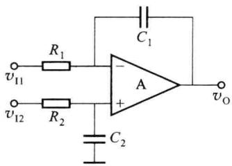  

图题6.5.38

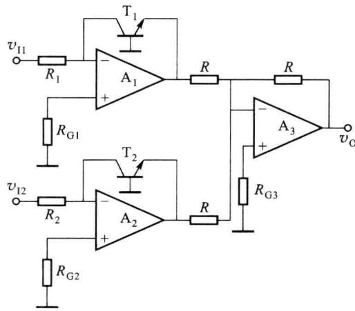  

图题6.5.39

<Solution>
$v_{0} = V_{T}\ln \frac{v_{11}v_{12}}{R_{1}R_{2}I_{\mathrm{S1}}I_{\mathrm{S2}}}$
</Solution>
</Exercise>

<Exercise title="习题 6.6.1">
在图题 6.6.1 中, $V_{10}$ 为集成运放的等效输入失调电压, A 为理想运放, 求输出电压 $v_{0}$ 。

<Solution>
$v_{0} = V_{10}\left(1 + \frac{R_{\mathrm{F}}}{R_{1}}\right) = 20\mathrm{mV}$

6. 6.2 (1) $v_{0} = -R_{2}\left(1 + \frac{R_{\mathrm{F}}}{R_{1}}\right)I_{\mathrm{B1}} + R_{\mathrm{F}}I_{\mathrm{B2}}$ ; (2) $R_{2} = \frac{R_{1}R_{\mathrm{F}}}{R_{1} + R_{\mathrm{F}}}$
</Solution>
</Exercise>

<Exercise title="习题 6.6.2">
电路如图题 6.6.2 所示, $I_{B1}$ 和 $I_{B2}$ 分别为集成运放同相输入端和反相输入端的静态偏置电流,设集成运放的其他参数都是理想的。

(1) 求输出电压 $v_{0}$ 的表达式。

(2) 为使静态时 $\left|v_{0}\right|$ 最小, 则 $R_{2}$ 应等于多少?

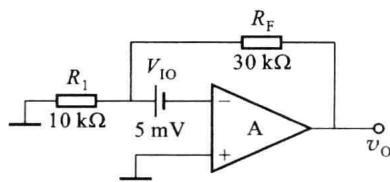
</Exercise>

<Exercise title="习题 6.7.1">
设图题 6.7.1 中运放和乘法器均具有理想特性， $V_{REF}>0$ ，求 $v_{0}$ 的表达式。

图题6.6.1

<Solution>
$v_{0} = -\frac{v_{11} + v_{12} - v_{13}}{kV_{\mathrm{REF}}}$
</Solution>
</Exercise>

<Exercise title="习题 6.7.2">
在图题 6.7.2 所示电路中运放和乘法器均具有理想特性。

(1) 写出 $v_{0}$ 与 $v_{1}$ 的关系式；

(2) 若 $R_{1}=R_{2}=R_{3}=R_{F}=10\ k\Omega, k=0.1\ V^{-1}, v_{1}=5\ V$ ，计算 $v_{0}$ 的值。

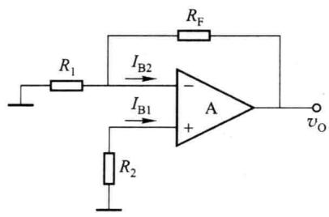  

图题6.6.2

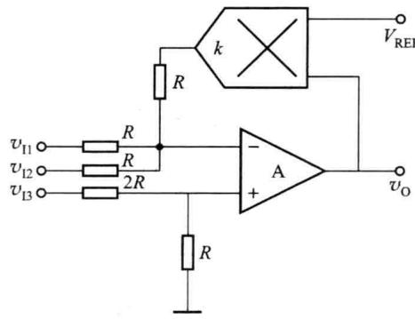  

图题6.7.1

  

图题6.7.2

<Solution>
(1) $v_{\mathrm{O}} = -R_{\mathrm{F}}\left(\frac{v_{\mathrm{I}}}{R_{1}} +\frac{1}{R_{2}} kv_{1}^{2} + \frac{1}{R_{3}} k^{2}v_{\mathrm{I}}^{2}\right);$ (2) $v_{\mathrm{O}} = -8.75\mathrm{V}$
</Solution>
</Exercise>

<Exercise title="习题 6.7.3">
在图题 6.7.3 中, 所有器件都是理想的, 试写出 $v_{01}$ 、 $v_{02}$ 、 $v_{03}$ 、 $v_{04}$ 和 $v_{0}$ 的表达式。

  

图题6.7.3

<Solution>
$v_{01} = kv_{11}^2; v_{02} = kv_{12}^2; v_{03} = -k(v_{11}^2 + v_{12}^2); v_{04} = k(v_{11}^2 + v_{12}^2); v_0 = \sqrt{v_{11}^2 + v_{12}^2}$
</Solution>
</Exercise>

<Exercise title="习题 6.8.1">
电路如图题 6.8.1 所示, 设 A 为理想运放。

(1) 写出 $v_{o}$ 与 $v_{i}$ 的关系式；

(2) 写出输入阻抗 $Z_{i}=v_{i}/i_{i}$ 的表达式；

(3) 写出等效输入电容 $C_{i}$ 的表达式；

（4）说明该电路的功能。

<Solution>
(1) $v_{0} = -\frac{R_{2}}{R_{1}} v_{1}$ ; (2) $Z_{i} = R_{1} // \frac{1}{j\omega C\left(1 + \frac{R_{1}}{R_{2}}\right)}$

（3）由上式可知 $C_{1}=C\left(1+\frac{R_{2}}{R_{1}}\right)$ ; (4) 该电路具有电容倍增功能
</Solution>
</Exercise>

<Exercise title="习题 6.8.2">
图题 6.8.2 所示为一模拟电感电路。设 $A_{1}$ 、 $A_{2}$ 为理想运放，图中所有电阻均相等且其值 R = 10 kΩ, C = 0.1 μF，试求所模拟的电感 L 是多大。

  

图题6.8.1

  

图题6.8.2

<Solution>
$Z_{\mathrm{i}} = \mathrm{j}\omega R^{2}C$ $L = R^2 C = 10\mathrm{H}$
</Solution>
</Exercise>

<Exercise title="习题 6.8.3">
图题 6.8.3 所示电路为有源滤波电路。

(1) 说出该电路的名称；

(2) 设 A 为理想运放, 求通带放大倍数 $A_{v0}$ 。

<Solution>
二阶压控低通滤波器; $A_{v0}=1+\frac{R_{F}}{R_{1}}$
</Solution>
</Exercise>

<Exercise title="习题 6.8.4">
图题6.8.4所示为二阶有源滤波器电路，试求该电路的传递函数 $\dot{A}_{\mathrm{v}}(s) = \frac{\dot{V}_{\mathrm{o}}(s)}{\dot{V}_{\mathrm{i}}(s)}$ 、通带增益 $A_{\mathrm{v0}}$ 、品质因数 $Q$ 的表达式（A为理想运放）。

  

图题6.8.3

  

图题6.8.4

<Solution>
传递函数 $\dot{A}_v(s) = \frac{\dot{V}_{\mathrm{o}}(s)}{\dot{V}_{\mathrm{i}}(s)} = \frac{s^2C_1C_2R_1R_2}{1 + sR_1(C_1 + C_2) + s^2C_1C_2R_1R_2}$

通带增益: $A_{v0}=1$

品质因数: $Q=\frac{\sqrt{C_{1}C_{2}R_{1}R_{2}}}{R_{1}(C_{1}+C_{2})}$
</Solution>
</Exercise>

<Exercise title="习题 6.8.5">
图题 6.8.5 所示为一有源滤波电路,试定性分析该电路具有什么样的滤波特性(低通、高通、带通、带阻)(A 为理想运放)。

<Solution>
带通
</Solution>
</Exercise>

<Exercise title="习题 6.9.1">
电路如图题 6.9.1(a)、(b) 所示。设 A 为理想运放，其最大输出幅度为 $\pm12\ V$ ，输入信号为一正弦电压 $v_{1}=\sin\omega t\ V$ ，试画出相应的输出波形。

<Solution>
两个过零比较器,波形图略
</Solution>
</Exercise>

<Exercise title="习题 6.9.2">
画出图题 6.9.2 所示电路的电压传输特性 $(v_{1}-v_{0}$ 关系) 曲线。如将电路中 $V_{REF}$ 和 $v_{1}$ 的位置互换，传输特性曲线有无变化？如何变？设运放 A 具有理想的特性，稳压管 $D_{z}$ 的稳压值为 6 V，正向电压降为 0.7 V，参考电压 $V_{REF}=2V$ 。
</Exercise>

<Exercise title="习题 6.9.3">
电路如图题 6.9.3 所示， $A_{1}$ 、 $A_{2}$ 为理想运放，其最大输出电压幅度为 $\pm V_{OM}$ 。

  

图题6.8.5

（1）指出 $A_{1}$ 、 $A_{2}$ 各组成什么电路，并说明 $D_{1}$ 、 $D_{2}$ 的作用；

(2) 画出该电路的电压传输特性。

  

(a)

  

(b)

  

图题6.9.2

图题6.9.1  

  

图题6.9.3

<Solution>
（1） $A_{1}$ 组成电压跟随器， $A_{2}$ 组成过零比较器， $D_{1}$ 、 $D_{2}$ 与 R 组成限幅电路，起输入保护作用，防止因共模输入信号过大而损坏运放器件；

(2) 传输特性略
</Solution>
</Exercise>

<Exercise title="习题 6.9.4">
已知电路及其输入波形如图题 6.9.4(a)、(b) 所示, 画出与输入电压相对应的输出电压 $v_{0}$ 的波形, 设运放 A 具有理想的特性。

  

(a)

  

(b)  

图题6.9.4
</Exercise>

<Exercise title="习题 6.9.5">
电路如图题 6.9.5 所示, 设 $A_{1}$ 、 $A_{2}$ 为理想运放, $D_{Z1}$ 和 $D_{Z2}$ 组合后的稳定电压为 $\pm6\ V$ , 电容 C 的初始电压 $v_{C}(0)=0$ , 输入正弦电压 $v_{1}$ 的周期 T=2 ms, 峰值 $V_{im}=1\ V$ 。

(1) 由 $v_{1}$ 画出 $v_{01}$ 、 $v_{0}$ 的波形；

(2) 计算 $v_{0}$ 的幅值。

  

图题6.9.5

<Solution>
（1）波形图略；（2） $v_{0}$ 的峰峰值 $V_{OP-P}=6\ V$
</Solution>
</Exercise>

<Exercise title="习题 6.9.6">
画出图题 6.9.6 所示电路的电压传输特性, 并标出有关的电压值。设所有集成运放为理想器件, 电源电压为 $\pm15\ V$ 。
</Exercise>

<Exercise title="习题 6.9.7">
电路如图题 6.9.7 所示，A 为理想运放， $R_{1}=5\ k\Omega$ ， $R_{2}=R_{3}=1\ k\Omega$ ，试分析并确定在 $v_{1}=2\ V$ 及 $v_{1}=-2\ V$ 时的 $v_{0}$ 值。

  

图题6.9.6

  

图题6.9.7

<Solution>
当 $v_{1}=2\ V$ 时, $v_{0}=-6\ V$ ; 当 $v_{1}=-2\ V$ 时, $v_{0}=+6\ V$
</Solution>
</Exercise>

<Exercise title="习题 6.9.8">
电路如图题6.9.8所示。设A为理想运放，稳压管 $\mathrm{D_Z}$ 的稳定电压 $V_{\mathrm{Z}} = \pm 9\mathrm{V}$ ，参考电压 $V_{\mathrm{REF}} = 3\mathrm{V}$ ，电阻 $R_{1} = 30\mathrm{k}\Omega, R_{2} = 15\mathrm{k}\Omega, R = 1\mathrm{k}\Omega$ ，试画出该电路的电压传输特性。
</Exercise>

<Exercise title="习题 6.9.9">
已知反相滞回比较器电路如图题 6.9.9 所示, A 为理想运放, 输出电压 $v_{0} = \pm V_{z} = \pm 5 \, V$ , D 为理想二极管, 输入电压为幅度为 10 V 的正弦波。试画出输出波形。

  

图题6.9.8

  

图题6.9.9

<Solution>
阈值电压: $V_{th1}=3.5\ V, V_{th2}=2\ V$
</Solution>
</Exercise>

<Exercise title="习题 6.9.10">
画出图题 6.9.10 所示电路的电压传输特性, 标出相关电压值。设 A 为理想运放, 电源电压为 $\pm15\ V$ 。

  

图题6.9.10

## 第七章 脉冲信号的产生与处理电路

波形产生与处理电路是电子技术中广泛使用的两类电路,波形产生电路是通过电路的自激,在无外加输入信号的作用下,能自动产生一定频率和幅度的交流信号;波形处理电路能把输入信号波形变换成指定波形。

本章从学习信号波形的基础知识开始,分析晶体管和场效应管在开关状态下的特点,讨论三种基本逻辑运算和对应的门电路,以及由门电路组成的双稳态触发器、单稳态触发器和施密特触发器。多谐振荡器是能产生矩形脉冲的自激振荡电路,可以由门电路构成,也可以采用石英晶体构成,其振荡频率取决于晶体的串联谐振频率。三角波发生器是能产生三角波的电路,由滞回比较器加上积分电路构成,通过改变积分电路的充、放电时间常数也可产生锯齿波。555定时器是一种将模拟功能和逻辑功能巧妙地结合在一起的集成电路,只需外接少量的元件就可以构成各种实用电路。

<Solution>
阈值电压: $V_{th} = \pm 3$ V
</Solution>
</Exercise>
