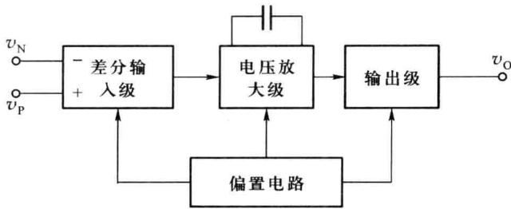
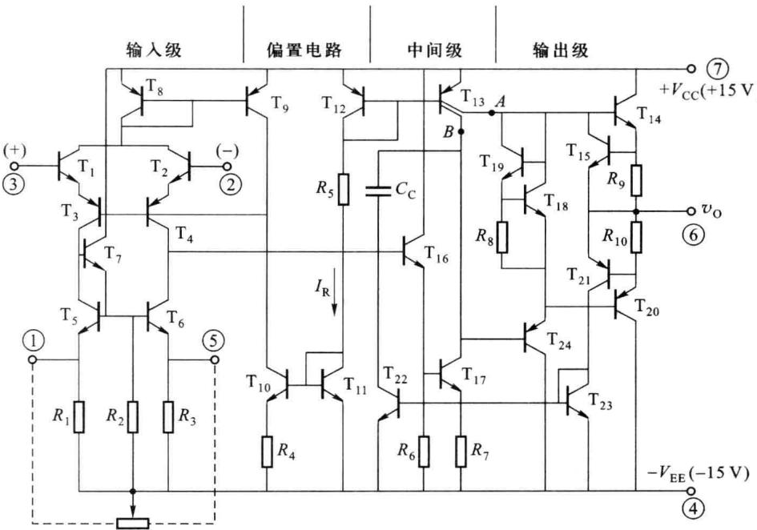
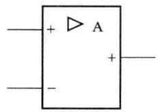
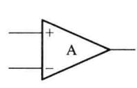
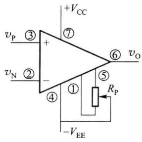
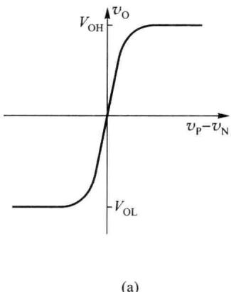
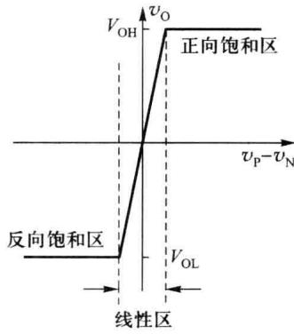
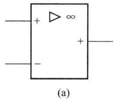
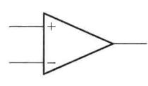
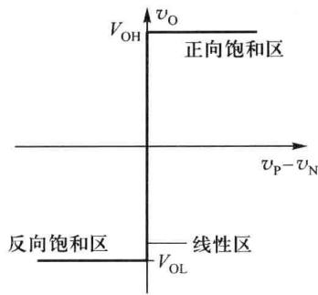

import Guide from '@/components/Guide.astro';
import Knowledge from '@/components/Knowledge.astro';
import Example from '@/components/Example.astro';
import Analysis from '@/components/Analysis.astro';
import Solution from '@/components/Solution.astro';
import Variant from '@/components/Variant.astro';
import Note from '@/components/Note.astro';
import Block from '@/components/Block.astro';
import Method from '@/components/Method.astro';
import Exercise from '@/components/Exercise.astro';

集成运算放大器是一种高电压增益、高输入电阻、低输出电阻的多级直接耦合的放大器，早期主要用于模拟计算电路，实现加、减、乘、除等数学运算，故运算放大器的名字沿用至今，通常简称为运放。

集成运放是用半导体集成工艺,将运算所需要的放大电路以及电阻、电容、晶体管或场效应管等元器件制作在同一块硅片上。与分立元件构成相同功能的放大电路相比,不但体积小,重量轻,而且性能好,故障率低,便于设计,工作更可靠,使用更加方便。

## 6.1.1 集成运算放大器的组成

集成运放的一般内部组成如图 6.1.1 框图所示, 主要由输入级、中间级、输出级三大部分组成。另外, 还有为各级提供偏置电流的公共偏置电路以及一些辅助电路, 例如过载保护电路、电位偏移电路及高频相位补偿电路等。

常用的运算放大器有双极型晶体管(BJT)运放、绝缘栅场效应管(MOS)运放以及双极型晶体管与场效应管混合(Bi\_FET)运放。在多数MOS运放内部只有两级放大电路。

  

图 6.1.1 集成运放的一般组成框图

## 一、典型的集成运算放大器

图 6.1.2 所示的是双极型通用集成运放 μA741 的内部电路。集成运放 μA741 是 1966 年美国仙童公司首先推出的，后有多家公司仿效，但型号都是 741，如：LM741（美国国家半导体公司）、MC741（摩托罗拉公司）、AD741（美国模拟器件公司）、CA741（美国无线电公司）等。由于 741 电路设计经典，性能良好，虽然推出已经有 40 多年的历史，但至今仍广泛使用。

  

图 6.1.2 μA741 的内部电路

μA741 的内部电路由 24 只双极型晶体管、10 个电阻和 1 个电容组成。

### 1. 输入级

输入级由晶体管 $T_{1}$ 、 $T_{3}$ 及 $T_{2}$ 、 $T_{4}$ 构成共集-共基组态的差放。 $T_{5}$ 、 $T_{6}$ 作为其有源负载，实现放大电路的高增益以及双端/单端变换。同时共集-共基组态有利于改善电路的频率相应。电路结构对称，具有很高的共模抑制比。从 $T_{1}$ 、 $T_{2}$ 基极输入的差模信号经放大后由 $T_{4}$

的集电极输出给中间级。

### 2. 中间级

中间级由 $T_{16}$ 、 $T_{17}$ 组成的复合管共射放大电路组成（也可认为是共集-共射两级放大）。放大电路的负载为 $T_{12}$ 、 $T_{13B}$ 构成的基本镜像恒流源电路，恒流源具有很高的输出阻抗，因此，该级有很高的电压增益。同时该级也有较高的输入阻抗，对输入级的影响较小。被放大的信号从 $T_{17}$ 的集电极输出。

### 3. 输出级

输出级由 $T_{24}$ 、 $T_{14}$ 、 $T_{20}$ 组成互补对称输出电路。其中 $T_{24}$ 为一射极跟随器，起输出级和中间级的隔离作用。射极跟随器的负载为 $T_{12}$ 、 $T_{13A}$ 构成的基本镜像恒流源电路，被放大的信号自 $T_{24}$ 的发射极提供给 $T_{14}$ 和 $T_{20}$ 的基极。

输出级中 $T_{18}$ 和 $T_{19}$ 为偏置电路，即 $T_{14}$ 、 $T_{20}$ 两晶体管的基极间的偏置电压为 $T_{18}$ 、 $T_{19}$ 的 $V_{BE}$ 之和，为输出级提供适当的静态工作点，以避免交越失真。

$T_{15}$ 、 $T_{21}$ 、 $T_{22}$ 、 $T_{23}$ 和电阻 $R_{9}$ 、 $R_{10}$ 构成保护电路，为了防止输入级信号过大或输出短路而造成器件损坏。在正常工作时， $T_{15}$ 、 $T_{21}$ 、 $T_{22}$ 、 $T_{23}$ 均不导通。当正向输出电流过大（由正电源通过 $T_{14}$ 到负载的电流），流过 $T_{14}$ 和 $R_{9}$ 的电流增大，将使 $R_{9}$ 两端的电压降增大到足以使 $T_{15}$ 管由截止状态进入导通状态，原流向 $T_{14}$ 基极的电流被 $T_{15}$ 分流，从而限制了 $T_{14}$ 的输出电流。在负向输出电流过大时，流过 $T_{20}$ 和 $R_{10}$ 的电流增加，将使 $R_{10}$ 两端电压增大到使 $T_{21}$ 由截止状态进入导通状态，从而使 $T_{23}$ 和 $T_{22}$ 均导通，降低了中间级的基极信号电压，减小了中间级输出电压幅度，因而限制了输出的电流，达到对输出级保护的目的。

### 4. 偏置电路

从图 6.1.2 中可以看到，由 $+V_{CC} \rightarrow T_{12} \rightarrow R_{5} \rightarrow T_{11} \rightarrow -V_{EE}$ 通路构成整个运放的参考电流 $I_{R}$ 。同时 $T_{11}$ 、 $T_{10}$ 构成微电流恒流源， $T_{10}$ 输出的电流又作为参考源提供给 $T_{8}$ 、 $T_{9}$ 组成的镜像恒流源， $T_{8}$ 的输出作为输入级的偏置电流。 $T_{12}$ 、 $T_{13}$ 组成的多输出镜像恒流源作为中间级和输出级的有源负载。

输入级的偏置电路具有直流反馈,可以稳定静态工作点。例如:当温度升高,使 $T_{1}$ 、 $T_{2}$ 的集电极电流上升,导致 $T_{8}$ 的集电极电流上升,从而使镜像电流源 $T_{9}$ 的集电极电流上升,由于 $T_{10}$ 的集电极电流不变,所以会使 $T_{3}$ 、 $T_{4}$ 的基极电流下降,从而使 $T_{1}$ 、 $T_{2}$ 的集电极电流下降(即: $T\uparrow\rightarrow I_{C1}$ 、 $I_{C2}\uparrow\rightarrow I_{C8}\uparrow\rightarrow I_{C9}\uparrow\rightarrow I_{B3}$ 、 $I_{B4}\downarrow\rightarrow I_{C1}$ 、 $I_{C2}\downarrow$ )。

### 5. 调零电路

整个电路要求当输入信号为零时输出也应为零，但由于器件的偏差等原因，在输入信号为零时，输出不为零。因此在电路的输入级中， $T_{5}$ 、 $T_{6}$ 发射极两端还可外接一电位器 $R_{p}$ ， $R_{p}$ 的中间滑动触点接 $-V_{EE}$ ，从而改变 $T_{5}$ 、 $T_{6}$ 的发射极电阻，通过调整 $R_{p}$ 以保证静态时输出为零。

### 6. 频率补偿

在中间级接有一小电容 $C_{c}$ ，以保证在外部电路有较深的负反馈时不产生自激。

## 二、运算放大器内部电路的特点

从以上对很有代表性的 $\mu A741$ 内部电路分析可以看到,一般的运放有这样的特点。

（1）由于输入级位于电路的最前端,要求有很高的输入阻抗和稳定性,电路的任何漂移、噪声,都会被后级电路依次放大,对整个电路造成严重影响。所以,输入级放大电路既要能够提供一定的电压增益、很高的输入阻抗，又要能适应不同的输入方式，同时电路的稳定性要好、温漂和噪声要小。因此，运放都选用差放作输入级，因为差放稳定性好，而且有两个输入端，可以适应各种输入方式，灵活地组成多种反馈组态。

（2）中间级主要作用是提供足够的电压放大倍数，整个运放的电压增益主要由中间级提供。中间级多由1\~2级高增益放大器组成，为了获得高增益，多采用共射或共源电路。

（3）输出级位于电路的最末端，要求带负载能力强，动态范围大，效率高。所以，为提高带负载能力，输出级电路多由互补输出的电路形式组成，以提供较低的输出电阻、较大的动态范围、较大的功率输出和较高的效率。

（4）偏置电路的作用是向上述三部分电路提供偏置电压或偏置电流，一般由各种电流源组成。用电流源进行直流偏置，以及用电流源作为有源负载代替无源元件（电阻 R），一可以保证工作的稳定性，二可以提高电路增益，三可以减小芯片面积、提高集成度。

（5）集成运放的级间耦合均采用直接耦合方式。因为大容量的电容器制作非常困难。

（6）电路中的二极管主要是用于温度补偿、电平偏移、提供偏置电压等，多使用双极型晶体管的发射结代替。

## 三、集成运算放大器的符号

虽然集成运放内部电路非常复杂,但对于外部连接来说,一般是非常简洁的。进行功能设计时可以用简单的电路符号表示。图6.1.3(a)所示的是运放的国标符号,图6.1.3(b)为过去常用符号,本书中仍使用常用符号。从符号中可以看到,运放主要有两个输入端,分别为同相输入端(+)和反相输入端(-);有一个输出端。除此以外还有电源端、调零端、补偿端等,这些端子在实际电路设计时需要连接外接元件,而在示意型功能设计时可不标出。图6.1.3(c)所示为μA741的常用符号及外接调零电路,对应内部电路可知各引脚的功能,例如:⑦脚为正电源输入端,④脚为负电源输入端,①和⑤脚为调零电位器的接入端。

  

(a)

  

(b)

  

(c)  

图 6.1.3 集成运放符号和 $\mu A741$ 外接电路举例

(a)

(b)

## 6.1.2 集成运算放大器的传输特性

从集成运放的电路符号和内部电路分析可知，它有两个输入端，一个输出端。标有“+”号的为同相输入端，表示输出电压 $v_{0}$ 与该输入端所加信号 $v_{P}$ 相位相同；标有“-”号的是反相输入端，表示输出电压 $v_{0}$ 与该输入端所加信号 $v_{N}$ 相位相反。运放两输入端所加信号电压之差 $v_{P}-v_{N}$ ，为差模输入电压。假定运放的共模抑制比非常高，其共模输出可以忽略，集成运放的开环差模电压增益用 $A_{vd}$ 表示，则运放在线性区的输出与输入的函数关系可用下式表示

$$

v _ {\mathrm{O}} = A _ {v \mathrm{d}} (v _ {\mathrm{P}} - v _ {\mathrm{N}})\tag{6.1.1}

$$

假设集成运放不考虑输入失调电压的影响,同时不考虑共模信号的影响,此时集成运放的近似直流传输特性如图6.1.4(a)所示,线性化近似直流传输特性如图6.1.4(b)所示。

  

图 6.1.4 直流传输特性

静态时，若差模输入电压 $v_{id}=v_{P}-v_{N}=0$ ，根据输入与输出的表达式可知，集成运放工作在传输特性的原点。差模输入电压 $v_{id}>0$ 之后，输出电压 $v_{0}$ 随输入信号的增加而线性增加，其斜率即为运放的开环差模电压增益 $A_{vd}$ ，也就是输出的电压值与输入差模电压值之比。

当输入电压 $v_{id}$ 增加到一定程度,由于受到电源电压等原因的限制,输出电压 $v_{0}$ 不能再增加了,传输特性出现了限幅特性,输出电压达到正向的最大值 $V_{OH}$ 或负的最大值 $V_{OL}$ ,即运放工作进入正向或负向饱和区。 $V_{OH}$ 和 $V_{OL}$ 的值取决于正、负电源电压及运放的内部电路。

由于 $A_{vd}$ 很大, 所以运放的输入电压的线性区很窄, 例如: 如果 $V_{OH}$ 和 $V_{OL}$ 的值为 $\pm10\ V$ , $A_{vd}=1\ 000\ 000$ , 则输入电压的线性区范围为 $\pm10\ \mu V$ 。

以上分析表明,运放的传输特性分为两个区域:线性区和饱和区。集成运放作线性放大器件使用时必须保证其工作在线性区。集成运放在线性区工作时,差模输入电压 $v_{\mathrm{id}}=v_{\mathrm{p}}-v_{\mathrm{N}}$ 很小,一般只有几微伏。

## 6.1.3 理想集成运算放大器模型

在工程上,为了简化分析过程,一般在分析集成运放应用电路时,尤其是分析其基本功能时,通常将实际运放视为理想运放进行估算。

(b)

## 一、理想集成运算放大器的技术参数

理想运放是指分析集成运放时将各种参数理想化。例如，输入电阻、输出电阻、放大倍数等，还有集成运放的输入级一般都是差放，对应差放的参数有共模抑制比、输入失调电流和输入失调电压等，这些技术参数（不局限于这些参数）理想化的集成运放称为理想运放。

理想集成运放的技术参数包括：

(1) 开环差模电压放大倍数 $A_{vd} \rightarrow \infty$ ;

(2) 差模输入电阻 $R_{id} \rightarrow \infty$ ;

(3) 输出电阻 $R_{o} \rightarrow 0$ ;

(4) 共模抑制比 $K_{CMR} \rightarrow \infty$ ;

(5) 输入失调电压 $V_{10} \rightarrow 0$ ;

(6) 失调电流 $I_{10} \rightarrow 0$ ;

(7) 输入失调的温漂→0;

(8) 输入偏置电流 $I_{IB} \rightarrow 0$ 。

除此以外还有其他的一些参数也看成理想的,这些参数将在下一节中介绍。

实际的集成运放无法达到上述理想化的技术指标。但是，由于集成运放制造工艺水平的不断改进，集成运放产品的各项性能指标越来越好，现代运放在低频工作时的性能已十分接近理想条件。因此，在工程上为了简化分析，一般在分析集成运放应用电路时，可将实际运放视为理想运放进行近似估算。

理想集成运放的电路符号如图 6.1.5 所示。

  

图 6.1.5 理想集成运放的符号

## 二、理想集成运算放大器工作在线性区时的特点

在集成运放应用电路中,集成运放的工作状态可分为两种情况:工作在线性区和工作在非线性区。

当集成运放工作在线性区时,其输出电压与运放两个输入端的电压之间存在着线性关系。一般情况下,运放在线性区工作时都加有较深的负反馈。或者说,通过深度负反馈使运放工作在线性区。

理想集成运放工作在线性区时有一些重要特点。

1. 理想集成运放的差模输入电压等于零

运放工作在线性区时， $v_{0}=A_{vd}(v_{\mathrm{P}}-v_{\mathrm{N}})$ 。而理想集成运放的 $A_{vd}=\infty$ ，当 $v_{0}$ 为有限值时，可以得到 $v_{P}-v_{N}=0$ ，即：集成运放同相输入端与反相输入端两点间的电压差等于零。

### 2. 理想集成运放的差模输入电流等于零

由于差模输入电压等于零,差模输入电阻为无穷大,所以差模输入电流为零。

这种同相输入端与反相输入端两点间的电压差等于零、电流为零的现象称为虚短和虚

断,即好像短路一样电压为零,但实际上这两点并未真正被短路,这时工作电流也为零。

因为实际集成运放的 $A_{vd}$ 不为无穷大，线性应用时 $v_{P}, v_{N}$ 不可能完全相等。然而，只要 $A_{vd}$ 足够大，运放在线性区工作时差模输入电压 $(v_{\mathrm{P}} - v_{\mathrm{N}})$ 的值就很小（微伏级），一般可以忽略不计。

线性应用时,由于深度负反馈的加入,运放的输出电阻将非常小,可近似看为零。

理想集成运放的直流传输特性曲线如图 6.1.6 所示。

  

图 6.1.6 理想集成运放的

直流传输特性曲线

除非特别说明,在本书后续章节的有关电路分析中,均将集成运放视为理想运放。
