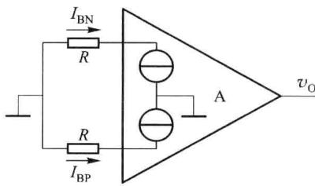
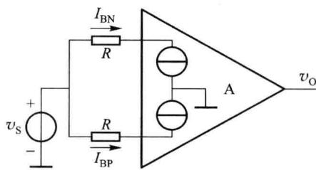
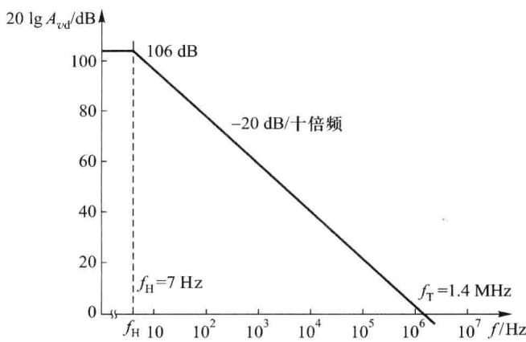
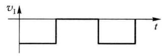
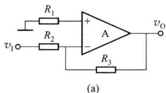
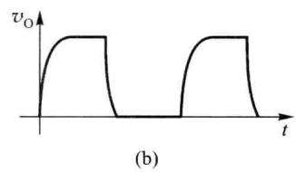
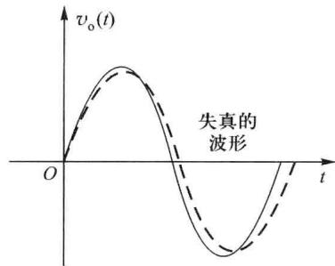

import Guide from '@/components/Guide.astro';
import Knowledge from '@/components/Knowledge.astro';
import Example from '@/components/Example.astro';
import Analysis from '@/components/Analysis.astro';
import Solution from '@/components/Solution.astro';
import Variant from '@/components/Variant.astro';
import Note from '@/components/Note.astro';
import Block from '@/components/Block.astro';
import Method from '@/components/Method.astro';
import Exercise from '@/components/Exercise.astro';

集成运放的应用场合不同,对集成运放的参数要求不同,比如:在测试仪表中,需要较高的输入阻抗、较低的失调和功耗;在某些高频率的场合,对带宽和动态参数要求较高。为了正确地挑选和使用集成运放,需要准确地了解各个参数的含义。

## 6.2.1 输入失调参数

## 一、输入失调电压 $V_{10}$

一个理想的集成运放，当输入电压为零时，输出电压也应为零（不加调零装置）。但实际上它的差分输入级很难做到完全对称，通常在输入电压为零时，输出端存在一定的输出电压。在室温(25℃)及标准电源电压下，输入电压为零时，为了使集成运放的输出电压为零，需要在输入端加补偿电压，这个电压叫做输入失调电压 $V_{10}$ 。实际上就是指输入电压 $v_{id}=0$ 时，输出电压 $v_{0}$ 折合到输入端的电压值，即 $V_{10}=v_{0}/A_{vd}$ 。 $V_{10}$ 的大小反映了运放制造中电路的对称程度和电位配合情况。 $V_{10}$ 值越大，说明电路的对称程度越差，一般情况下 $V_{10}$ 为 $\pm(1\sim10)\mathrm{mV}$ 。

$\mu \mathrm{A}741$ 的输入失调电压的典型值为 $V_{\mathrm{IO}} = 1\mathrm{mV}$ 。

## 二、输入偏置电流 $I_{IB}$

BJT 集成运放的两个输入端是差分对管的基极, 因此, 两个输入端总需要一定的输入电流 $I_{BN}$ 和 $I_{BP}$ 。输入偏置电流是指集成运放输出电压为零时, 两个输入端静态电流的平均值, 如图 6.2.1 所示。

当 $v_{0}=0$ 时, 输入偏置电流为

$$

I _ {\mathrm{IB}} = (I _ {\mathrm{BN}} + I _ {\mathrm{BP}}) / 2\tag{6.2.1}

$$

  

图 6.2.1 输入偏置电流

在电路外接电阻确定之后,输入偏置电流的大小主要取决于运放差分输入级 BJT 的性能,当 $\beta$ 值较小时,偏置电流较大。从使用角度来看,偏置电流越小,对信号源和外部电路的影响越小,且输入阻抗越高,所以多数运放的输入级使用复合晶体管,用于提高输入阻抗和其他性能。 $I_{IB}$ 是运放重要的技术指标,一般为 $10\ nA \sim 1\ \mu A$ 。

$\mu A741$ 输入偏置电流的典型值为 $I_{IB}=80\ nA$ 。

## 三、输入失调电流 $I_{10}$

输入失调电流 $I_{10}$ 定义为: 在集成运放中, 输出电压为零时流入运放两输入端的静态基极电流之差, 即

$$

I _ {\mathrm{IO}} = \mid I _ {\mathrm{BP}} - I _ {\mathrm{BN}} \mid

$$

由于输入端外接电阻的存在,或使用不同信号源时信号源内阻的存在, $I_{10}$ 会引起在输入端有一输入电压(例如,当两个输入端接同一信号源时,在两输入端处的电阻R上产生的电压降不同,如图6.2.2所示),破坏放大器的平衡,使放大器输出电压不为零。

所以,希望 $I_{10}$ 越小越好。 $I_{10}$ 反映了输入级差分对管的不对称程度,一般为 $1\ nA \sim 0.1\ \mu A$ 。

$\mu A741$ 输入失调电流 $I_{10}$ 的典型值为 $I_{10}=20\ nA$ 。

## 四、温度漂移

放大器的一些参数会随着时间、温度的变化而变化,产生参数的漂移。由于半导体器件对温度比较敏感,所以温度漂移图 6.2.2 输入失调电流 $I_{10}$ 的影响

(简称温漂)是漂移的主要来源。集成运放的应用中,输入失调电压和输入失调电流随温度的漂移是非常重要的两个参数。

### 1. 输入失调电压温漂 $\Delta V_{10}/\Delta T$

$\Delta V_{10}/\Delta T$ 是在规定温度范围内 $V_{10}$ 的温度系数，温度以℃为单位。 $\Delta V_{10}/\Delta T$ 是衡量电路温漂的重要指标。 $\Delta V_{10}/\Delta T$ 不能用外接调零装置的办法来补偿，因为不同的温度下，失调值是不同的。高质量的放大器常选用低漂移的器件来组成，一般值为 $\pm(10\sim20)\mu V/^{\circ}C$ 。

μA741 输入失调电压温漂的典型值为 $\Delta V_{10}/\Delta T=5\ \mu V/^{\circ}C$ 。

2. 输入失调电流温漂 $\Delta I_{10}/\Delta T$

$\Delta I_{10}/\Delta T$ 是在规定温度范围内 $I_{10}$ 的温度系数，是对放大电路电流漂移量度的重要指标。 $\Delta I_{10}/\Delta T$ 同样不能用外接调零装置来补偿。高质量集成运放的 $\Delta I_{10}/\Delta T$ 为 $1 \sim 10 \, pA/^{\circ}C$ 。

μA741 输入失调电流温漂的典型值为 $\Delta I_{10}/\Delta T=1\ nA/^{\circ}C$ 。

## 6.2.2 差模特性参数

## 一、最大差模输入电压 $V_{IDmax}$

$V_{IDmax}$ 是集成运放的反相输入和同相输入端之间所能承受的最大电压值。超过这个电压值，运放输入级某一侧的晶体管将出现发射结的反向击穿，从而使运放的性能显著恶化，甚至可能造成永久性损坏。利用平面工艺制成的 NPN 型晶体管的最大差模输入电压约为 $\pm5\ V$ 左右，而横向 BJT 可达 $\pm30\ V$ 以上。

## 二、最大输出电流 $I_{Omax}$

$I_{0max}$ 是运放所能输出的正向或负向的峰值电流。通常给出输出端短路的电流。

## 三、开环差模电压增益 $A_{vd}$

$A_{vd}$ 是集成运放工作在线性区、接入规定的负载、无负反馈情况下的直流差模电压增益。 $A_{vd}$ 与输出电压 $v_{0}$ 的大小有一定的关系，在一般的应用和分析中，通常认为是常数。 $A_{vd}$ 大多是在规定的输出电压幅度（如 $v_{0}=\pm10\ V$ ）测得的值。 $A_{vd}$ 也是频率的函数，频率高于某一数值后， $A_{vd}$ 的数值开始下降。 $\mu A741$ 运放的 $A_{vd}=106\ dB$ ，图6.2.3给出了 $\mu A741$ 运放 $A_{vd}$ 的频率响应。

  

图 6.2.3 μA741 运放 $A_{vd}$ 的近似频率响应

## 四、开环带宽 $BW(f_{\mathrm{H}})$

开环带宽 BW 一般指 3 dB 带宽，它是开环差模电压增益 $A_{vd}$ 从直流开始至下降 3 dB 时对应的频率 $f_{H}$ 之间的带宽。 $\mu$ A741 集成运放的频率响应如图 6.2.3 所示，由于电路增益很高，且电路中补偿电容 C 的作用，它的 $f_{H}$ 约为 7 Hz。

## 五、单位增益带宽 $BW_{\mathrm{G}}(f_{\mathrm{T}})$

$f_{T}$ 定义为当开环电压增益 $A_{vd}$ 随频率上升其增益下降到 $A_{vd}=1$ 时的频率，即 $A_{vd}$ 为 0 dB 时的信号频率。 $BW_{G}$ 是 f=0 到 $f_{T}$ 之间的带宽，它也是集成运放的重要参数。 $\mu A741$ 运放 $f_{T}\approx1.4MHz$ 。

## 6.2.3 共模特性参数

## 一、最大共模输入电压 $V_{ICmax}$

$V_{ICmax}$ 是运放输入端所能承受的最大共模输入电压。当输入超过 $V_{ICmax}$ 值，它的共模抑制比将显著下降。该参数一般定义为：运放在作电压跟随器使用时，使输出电压产生1%跟随误差的共模输入电压幅值，高质量的运放可达 $\pm13\ V$ 。

μA741 最大共模输入电压的典型值为 $V_{ICmax} = \pm 13 V$ 。

## 二、共模电压增益 $A_{vc}$

共模电压增益 $A_{vc}$ 是运放输入端加共模输入电压时的增益。

## 三、共模抑制比 $K_{CMR}$

共模抑制比为集成运放差模电压增益 $A_{vd}$ 与共模电压增益 $A_{vc}$ 比值的绝对值。即

$$

K _ {\mathrm{CMR}} = \left| \frac {A _ {v \mathrm{d}}}{A _ {v \mathrm{c}}} \right|\tag{6.2.2}

$$

用分贝表示为

$$

K _ {\mathrm{CMR}} (\text { 分贝 }) = 2 0 \lg \left| \frac {A _ {v \mathrm{d}}}{A _ {v \mathrm{c}}} \right| \quad (\mathrm{dB})\tag{6.2.3}

$$

集成运放的共模抑制比也是频率的函数,一般情况下共模抑制比的频率响应特性主要取决于输入级共模抑制比的频率响应特性,共模抑制比会随频率的增加而下降。所以,在信号频率稍高时就需要考虑 $K_{CMR}$ 的下降对电路性能的影响。

$\mu A741$ 共模抑制比的典型值为 $K_{CMR}=90\ dB$ 。

## 6.2.4 大信号动态特性

## 一、转换速率 $S_{\mathrm{R}}$

转换速率是指放大电路在闭环状态下,输入为大信号(例如阶跃信号)时,放大电路输出电压对时间的最大变化速率,也就是

$$

S _ {\mathrm{R}} = \frac {\mathrm{d} v _ {\mathrm{o}} (t)}{\mathrm{d} t} \Bigg | _ {\max}\tag{6.2.4}

$$

集成运放的频率响应和瞬态响应在大信号时与小信号时不同。大信号输入时，特别是阶跃信号加入时，运放可能会进入非线性区域，输入级会产生瞬时饱和或截止现象。所以大信号频带宽度总要比小信号时为窄。从瞬态响应来看，带宽的限制将使放大电路的输出电压不能即时地跟随阶跃输入电压变化。测试电路及输出电压变化如图6.2.4(a)所示，对应的输入、输出波形如图6.2.4(b)所示。

  

图 6.2.4 集成运放 $S_{R}$ 对输出电压波形的影响

由于转换速率与闭环电压增益有关,因此一般规定用集成运放在单位电压增益、单位时间内输出电压的变化值,来标定转换速率。最大转换速率出现在信号跳变的时刻。

转换速率的大小与许多因素有关,其中主要是与运放所加的补偿电容有关。选择运放时,通常要求运放的 $S_{R}$ 大于输入信号变化斜率的绝对值。

μA741 转换速率的典型值为 $S_{R}=0.5\ V/\mu s$ 。

## 二、全功率带宽 $BW_{\mathrm{p}}$

全功率带宽 $BW_{p}$ 用来表示运放在频域中的大信号特性，是转换速率的另一种表示形式。如在运放的输入端加一正弦电压 $v_{i}=V_{im}\sin\omega t$ ，输出电压 $v_{o}=-V_{om}\sin\omega t$ 。此时输出电压的最大变化速率为

$$

\frac {\mathrm{d} v _ {\mathrm{o}} (t)}{\mathrm{d} t} \Bigg | _ {t = 0} = V _ {\mathrm{om}} \omega \cos \omega t \Bigg | _ {t = 0} = 2 \pi f V _ {\mathrm{om}}\tag{6.2.5}

$$

为了使输出信号电压波形不因 $S_{R}$ 的限制而产生失真，要求 $2\pi fV_{om} \leqslant S_{R}$ ，即必须使运放的 $S_{R}$ 大于 $2\pi fV_{om}$ 。所以全功率带宽 $BW_{p}$ 定义为

$$

B W _ {\mathrm{P}} = \frac {S _ {\mathrm{R}}}{2 \pi V _ {\mathrm{om}}}\tag{6.2.6}

$$

μA741 运放的 $S_{R}$ 为 0.5 V/μs，当输出电压幅值 $V_{om}=10\ V$ 时，它的最大不失真频率应为 8 kHz。如果信号频率大于 8 kHz，输出波形将产生失真，如图 6.2.5 所示。

  

图6.2.5 因 $BW_{\mathrm{p}}$ 的限制

## 6.2.5 电源特性参数

而产生的信号失真

## 一、静态功耗 $P_{\mathrm{D}}$

静态功耗 $P_{D}$ 定义为信号为零时, 运放消耗的总功率, 即

$$

P _ {\mathrm{D}} = V _ {\mathrm{CC}} I _ {\mathrm{CC}} + V _ {\mathrm{EE}} I _ {\mathrm{EE}}\tag{6.2.7}

$$

## 二、电源电压抑制比 $K_{SVR}$

$K_{SVR}$ 描述了电源电压波动对输出电压影响的程度,通常定义为折合到输入端的失调电压变化与电源电压变化的比值,即

$$

K _ {\mathrm{SVR}} = \frac {\mathrm{d} V _ {\mathrm{IO}}}{\mathrm{d} (V _ {\mathrm{CC}} + V _ {\mathrm{EE}})}\tag{6.2.8}

$$

除上述参数外,还有最大输出电压、差模输入电阻、共模输入电阻、输出电阻、电源电压范围、电源电流和功耗(运放有输入信号和接有负载时,运放允许耗散的最大功率)等,这些参数的含义在前面各节已经介绍过,这里不再赘述。
