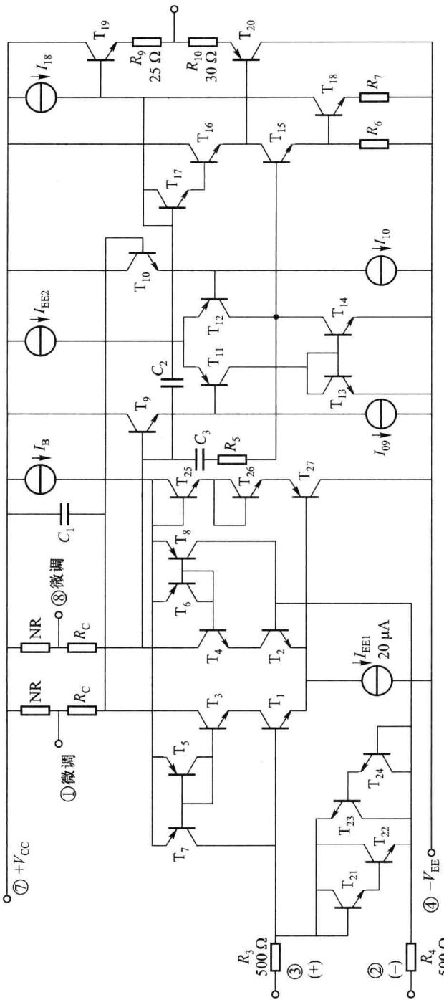
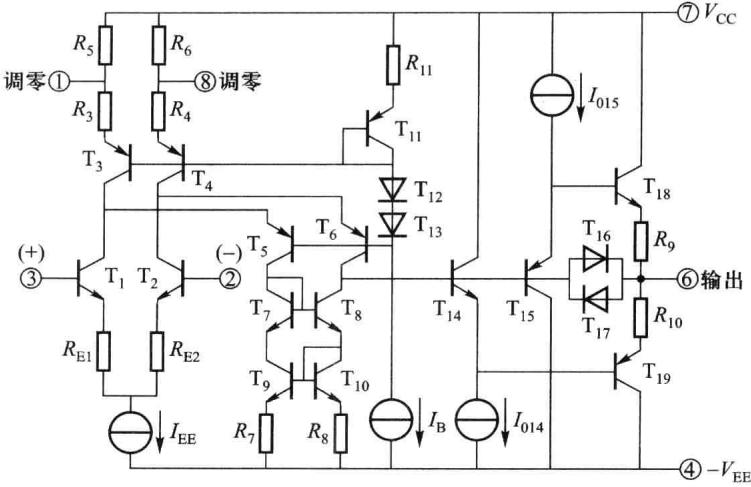
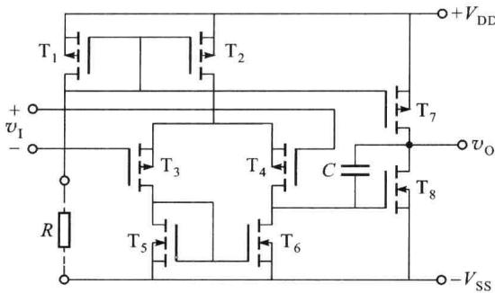
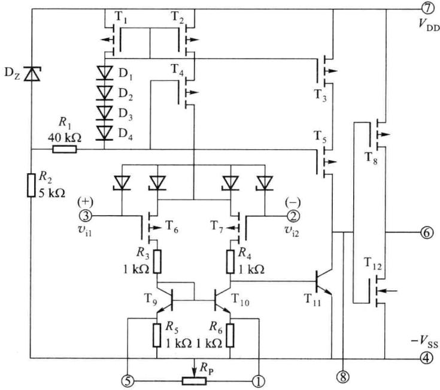

import Guide from '@/components/Guide.astro';
import Knowledge from '@/components/Knowledge.astro';
import Example from '@/components/Example.astro';
import Analysis from '@/components/Analysis.astro';
import Solution from '@/components/Solution.astro';
import Variant from '@/components/Variant.astro';
import Note from '@/components/Note.astro';
import Block from '@/components/Block.astro';
import Method from '@/components/Method.astro';
import Exercise from '@/components/Exercise.astro';

从20世纪60年代第一种模拟集成电路问世起，模拟集成电路发展非常迅速，新的品种层出不穷。如超高精度单片集成运放OP177，超低噪声精密高速运放LT1028，超高速运放AD9610，宽频带运放AD5539，超低偏置电流超高输入阻抗运放AD549，超低功耗精密运放OP22等。并且随着MOS集成工艺的改进，MOS运放和结合了双极型和MOS优点的Bi\_FET集成运放的应用不断增加。

本小节简单介绍几种不同类型的集成运放。

## 6.3.1 超高精度单片集成运算放大器 OP177

由于在超高精度单片集成运放 OP177 运算放大电路中采用了 CE-CB 组合差分输入级、偏置电流补偿电路、在片失调微调技术、低漂移调零网路等技术，使集成运放 OP177 的运算精度大大提高。

图 6.3.1 所示为超高精度单片集成运放 OP177 运算放大器简化的内部电路。

输入级放大电路中， $\mathrm{T}_{1}, \mathrm{T}_{3}$ 和 $\mathrm{T}_{2}, \mathrm{T}_{4}$ 构成共射-共基差放， $\mathrm{T}_{5}, \mathrm{T}_{7}$ 和 $\mathrm{T}_{6}, \mathrm{T}_{8}$ 为 $\mathrm{T}_{1}, \mathrm{T}_{3}$ 和 $\mathrm{T}_{2}, \mathrm{T}_{4}$ 提供一个比较精确的输入管所需的偏置电流，可以减小整体失调电流。输入端 $\mathrm{T}_{21} \sim \mathrm{T}_{24}$ 为限制输入端差模电压而设，使加到 $\mathrm{T}_{1}, \mathrm{T}_{2}$ 基极之间的电压不超过 $\mathrm{T}_{21}, \mathrm{T}_{22}$ （或 $\mathrm{T}_{23}, \mathrm{T}_{24}$ ）的两个发射结电压之和。

中间级放大电路中， $T_{9}$ 、 $T_{11}$ 和 $T_{10}$ 、 $T_{12}$ 构成共集-共射差放。 $T_{13}$ 、 $T_{14}$ 为第二级放大电路的有源负载。信号由 $T_{12}$ 的集电极输出到功率输出级。

功率输出级中，推动晶体管为 $T_{15}$ ， $T_{19}$ 、 $T_{20}$ 为互补输出晶体管。 $T_{16}$ 、 $T_{17}$ 为输出级提供两互补输出晶体管基极间所需要的电压，即使 $T_{19}$ 、 $T_{20}$ 的两基极之间的电压为 $T_{16}$ 、 $T_{17}$ 的两个发射结电压之和，以获得合适的静态工作点。

OP177 的主要典型值技术指标为(温度为 $25^{\circ}C$ , $V_{cc} = V_{EE} = 15V$ ):

输入失调电压 $V_{\mathrm{IO}}$ 4μV  

输入失调电压温漂 $\mathrm{d}V_{\mathrm{IO}} / \mathrm{dT}$ 0.03μV/℃  

输入失调电流 $I_{\mathrm{IO}}$ 0.3nA  

输入失调电流温漂 $\mathrm{d}I_{\mathrm{IO}} / \mathrm{dT}$ 1.5pA/℃  

开环差模电压增益 $A_{\mathrm{vd}}$ 142dB  

共模抑制比 $K_{\mathrm{CMR}}$ 140dB  

电源电压抑制比 $K_{\mathrm{SVR}}$ 125dB  

差模输入电阻 $R_{\mathrm{id}}$ 45MΩ  

输入偏置电流 $I_{\mathrm{IB}}$ 0.5nA  

单位增益带宽 $BW_{G}$ 0.6MHz  

转换速率 $S_{\mathrm{R}}$ 0.3V/μs

OP177 的直流和低频参数都很好, 是精度比较高的双极型集成运放。

## 6.3.2 高速宽带集成运算放大器 LT1226

展宽频带的主要方法是提高晶体管的 $f_{T}$ ，这需要采用先进集成工艺来实现。还有，在设计电路时要选用频率特性好的组合单元电路，例如采用共射-共基组合单元电路作为放大单元等。

图 6.3.2 所示为单片集成运放 LT1226 的内部简化电路。

LT1226 高速宽带集成运放由两级组成: $T_{1} \sim T_{13}$ 构成差分输入级; $T_{14} \sim T_{19}$ 为工作于甲乙类的互补输出级。

在输入级中， $\mathrm{T}_{1}$ 、 $\mathrm{T}_{5}$ 和 $\mathrm{T}_{2}$ 、 $\mathrm{T}_{6}$ 构成共射-共基差放，具有很好的高频特性。 $\mathrm{T}_{3}$ 、 $\mathrm{T}_{4}$ 组成电流源作为 $\mathrm{T}_{1}$ 、 $\mathrm{T}_{2}$ 的集电极有源负载。 $\mathrm{T}_{7} \sim \mathrm{T}_{10}$ 组成威尔逊电流源，作为 $\mathrm{T}_{5}$ 、 $\mathrm{T}_{6}$ 的集电极有源负载。

  

图 6.3.1 简化的 OP177 运算放大器的内部电路

  

图 6.3.2 集成运放 LT1226 的内部简化电路  

信号由 $T_{6}$ 的集电极（单端）输出，加至输出级 $T_{14}$ 、 $T_{15}$ 的基极。在输出级中， $T_{14}$ 、 $T_{15}$ 为射极跟随器，它们发射结的直流电压降为互补输出管 $T_{18}$ 、 $T_{19}$ 提供偏置。 $T_{16}$ 、 $T_{17}$ 是输出级的过流保护晶体管。

在 $T_{1}$ 、 $T_{2}$ 的射极串入负反馈电阻 $R_{E1}$ 、 $R_{E2}$ 的目的是减小差分输入级的互导增益，可提高转换速率 $S_{R}$ 。  

LT1226 的主要典型技术指标为:

<table><tr><td>输入失调电压  ${V}_{\mathrm{{IO}}}$ </td><td>0.3 mV</td></tr><tr><td>输入失调电压温漂  $\mathrm{d}{V}_{\mathrm{{IO}}}/\mathrm{d}T$ </td><td>6 μV/°C</td></tr><tr><td>输入失调电流  ${I}_{\mathrm{{IO}}}$ </td><td>100 nA</td></tr><tr><td>开环差模电压增益  ${A}_{\mathrm{{vd}}}$ </td><td>104 dB</td></tr><tr><td>共模抑制比  ${K}_{\mathrm{{CMR}}}$ </td><td>103 dB</td></tr><tr><td>电源电压抑制比  ${K}_{\mathrm{{SVR}}}$ </td><td>110 dB</td></tr><tr><td>单位增益带宽  $B{W}_{\mathrm{G}}$ </td><td>1 000 MHz</td></tr><tr><td>转换速率  ${S}_{\mathrm{R}}$ </td><td>400 V/μs</td></tr></table>

## 6.3.3 MC14573CMOS 集成运算放大器

在许多测量设备中,需要高输入电阻的集成运放,以提高测量精度。使用双极型集成运放时不易实现,可采用场效应管构成的集成运放。由于同时制作 N 沟道和 P 沟道互补对称管工艺较易实现,没有衬底调制效应,所以 CMOS 技术制造的集成运放得到广泛应用。CMOS 集成运放的输入电阻高达 $10^{10}$ Ω 以上,并可在很宽的电源电压范围内工作。芯片面积只是双极型运放的 1/3 \~ 1/5,因此 CMOS 电路的集成度更高。

MC14573 是将 4 个独立的运放封装在一个芯片上的器件。电路原理图如图 6.3.3 所示，电路结构与晶体管集成运放电路结构类似。

  

图 6.3.3 MC14573 电路结构

MC14573 是两级放大电路：

第一级是以 P 沟道管 $T_{3}$ 和 $T_{4}$ 作为差分放大管，N 沟道管 $T_{5}$ 和 $T_{6}$ 构成电流源作为有源负载，形成双端输入、单端输出的差放。

$T_{1}$ 、 $T_{2}$ 和 $T_{7}$ 构成多路电流源， $T_{2}$ 为输入级提供偏置电流， $T_{7}$ 作为 $T_{8}$ 的有源负载。利用外接电阻R可以选择基准电流 $I_{R}$ 的值。

第二级由 $T_{8}$ 构成共源放大电路,从漏极输出。

MC14573 输入级利用由较高输出阻抗的有源负载使其获得较大的增益。第二级是共源放大电路，以 N 沟道管 $T_{8}$ 为放大管，漏极带有源负载，因此也具有很强的电压放大能力。但它的输出电阻较大，因而带负载能力较差，电路是为带高阻抗负载而设计的。

MC14573 的主要典型技术指标为 $(V_{\mathrm{DD}} = V_{\mathrm{SS}} = 7.5 \mathrm{~V})$ :

输入失调电压 $V_{\mathrm{IO}}$ 20mV  

开环差模电压增益 $A_{vd}$ 66dB  

共模电压输入范围 $V_{\mathrm{IC}}$ 10V（峰-峰值）  

共模抑制比 $K_{\mathrm{CMR}}$ 60dB  

单位增益带宽 $BW_{G}$ 3.2MHz  

转换速率 $S_{\mathrm{R}}$ 8V/μs

## 6.3.4 Bi\_FET 单片集成运算放大器

以 MOS 管作差放输入级的运放可以获得极高的输入电阻和极小的输入偏置电流,而以双极型晶体管作电压放大级,可以获得较高的电压增益。如果将上述两类器件结合起来,可得到高性能的集成运放。

CF3130 运放的内部电路如图 6.3.4 所示。CF3130 集成运放由三级放大电路组成。

$T_{6}$ 、 $T_{7}$ 为PMOS差分放大管构成的差动输入级。 $T_{9}$ 、 $T_{10}$ 为镜像电流源，作 $T_{6}$ 、 $T_{7}$ 的有源负载，并完成双端输出到单端输出的转换。 $T_{2}$ 、 $T_{4}$ 及参考电流支路 $T_{1}$ 、 $D_{1}\sim D_{4}$ 及 $R_{1}$ 组成电流源，为输入级提供偏置电流。输入级的电压增益约为5倍。图中的4个稳压管是为了保护 $T_{6}$ 、 $T_{7}$ 栅极不被击穿而设置的保护电路。

中间级由 $T_{11}$ 、 $T_{3}$ 和 $T_{5}$ 组成。由于 $T_{11}$ 是晶体管共射放大组态，电流源 $T_{3}$ 、 $T_{5}$ 作为有源负载,有很高的输出电阻,且下一级 $\left(\mathrm{T}_{8},\mathrm{T}_{12}\right)$ 的输入电阻极大,因而该级的电压增益很高,可达75 dB左右。

输出级由 $T_{8}$ 、 $T_{12}$ 组成，为共源互补放大电路，电压增益约为 30 倍左右。

  

图 6.3.4 CF3130 运放的内部电路

CF3130 的主要典型值技术指标为：

输入失调电压 $V_{10}$ 8 mV

输入失调电流 $I_{10}$ 0.5 pA

开环差模电压增益 $A_{\mathrm{vd}}$ 110dB

共模抑制比 $K_{\mathrm{CMR}}$ 90dB

差模输入电阻 $R_{id}$ $1.5 \times 10^{12} \Omega$

输入偏置电流 $I_{IB}$ 5 pA

单位增益带宽 $BW_{\mathrm{G}}$ 15MHz

转换速率 $S_{R}$ 30 V/ $\mu$ s
