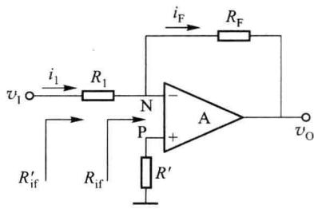
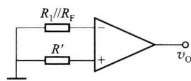
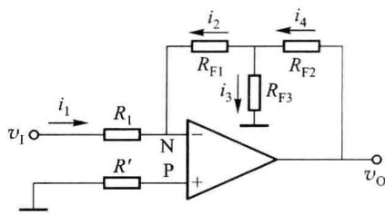
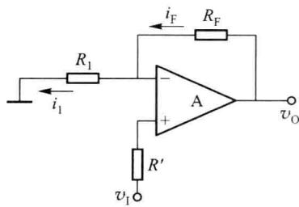
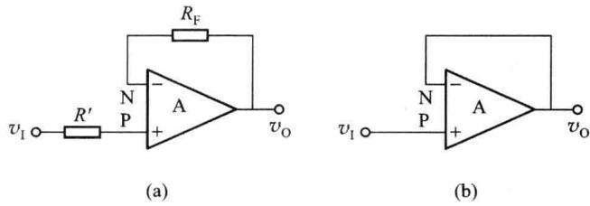
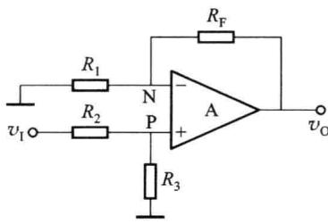

import Guide from '@/components/Guide.astro';
import Knowledge from '@/components/Knowledge.astro';
import Example from '@/components/Example.astro';
import Analysis from '@/components/Analysis.astro';
import Solution from '@/components/Solution.astro';
import Variant from '@/components/Variant.astro';
import Note from '@/components/Note.astro';
import Block from '@/components/Block.astro';
import Method from '@/components/Method.astro';
import Exercise from '@/components/Exercise.astro';

## 6.4.1 集成运算放大器的线性应用与非线性应用

从图 6.1.4 可以看出,运放的工作区域可分为 3 段,反向饱和区、线性工作区和正向饱和区。按照运放的工作区域(或称工作状态)不同,其应用可分为两大类:线性应用与非线性应用。

## 一、运放的线性应用

线性应用时，运放工作于传输特性的线性工作区，输出电压值为正向饱和电压 $V_{OH}$ 和反向饱和电压 $V_{OL}$ 之间，而运放的电压增益 $A_{vd}$ 非常大，此时运放的差模输入电压 $v_{id}$ 极小。一般情况下，为了保证运放工作在传输特性的线性区，需要以集成运放作为基本放大电路配合外部反馈网络，构成深度负反馈电路。由于运放的开环增益非常高，所以引入负反馈时满足深度负反馈条件。深度负反馈可使运放的净输入（差模输入电压 $v_{id}$ ）接近于零。由集成运放组成的运算电路和有源滤波电路等都属于运放的线性应用。

通过以上分析,可以得到集成运放线性应用的三个重要结论。

（1）为了保证运放工作在传输特性的线性区，需要以集成运放作为基本放大电路配合外部反馈网络，构成深度负反馈电路。

(2) 运放在线性区工作时,运放两输入端的差模输入电压近似为零,即

$$

v _ {\mathrm{P}} \approx v _ {\mathrm{N}}\tag{6.4.1}

$$

这种情况,通常称为运放的同向输入端和反相输入端之间为虚短,因为此时运放两输入端可近似看成等电位,但又不是真正的短路(因为流过的电流近似为零)。

（3）由于运放的输入阻抗非常高，运放线性应用时运放两输入端的输入电压近似为零，所以输入电流也近似为零，即

$$

i _ {\mathrm{P}} \approx i _ {\mathrm{N}} \approx 0\tag{6.4.2}

$$

这种情况,通常称为虚断,因为此时运放两输入端可视为不取电流,但不是真正的断开(因为在运放线性应用时,两输入端的电压近似为零)。

以上三个结论在分析电路时经常用到,即,只有在电路构成深度负反馈的情况下,才能利用虚短、虚断的概念求解实际电路的函数关系。一般进行功能分析时,运放可看成理想运放,所产生的误差一般可以忽略不计。

## 二、运放的非线性应用

运放非线性应用时，运放的差模输入电压较大，工作在传输特性的限幅区，输出电压为 $V_{OH}$ 或 $V_{OL}$ ，输入、输出之间成非线性关系。此时集成运放一般处于无反馈（开环）或正反馈的工作状态。

## 6.4.2 集成运算放大器的基本输入方式

## 一、反相输入

1. 基本反相输入放大电路。

图 6.4.1 所示是最简单的反相输入放大电路。信号 $v_{1}$ 通过电阻 $R_{1}$ 输入到运放的反相输

入端,电阻 $R_{F}$ 为电路的反馈电阻,对输出 $v_{0}$ 取样,反馈到运放的反相输入端,形成电压并联负反馈。一般使用运放构成放大电路时,均满足深度负反馈的条件,可以根据前面介绍的运放输入端虚短、虚断的概念对电路进行分析。

由于没有电流流过 $R'$ ，所以 P 点的电位为零，根据虚短的概念，在线性应用时，N 点的电位也为零。

  

图 6.4.1 反相输入放大电路

$$

i _ {1} = v _ {1} / R _ {1}

$$

$$

i _ {\mathrm{F}} = (0 - v _ {0}) / R _ {\mathrm{F}}\tag{6.4.3}

$$

(6.4.4)

且

$$

i _ {1} = i _ {\mathrm{F}}\tag{6.4.5}

$$

于是有

$$

A _ {v \mathrm{f}} = \frac {v _ {\mathrm{O}}}{v _ {\mathrm{I}}} = - \frac {R _ {\mathrm{F}}}{R _ {\mathrm{I}}}\tag{6.4.6}

$$

或

$$

v _ {\mathrm{O}} = - \frac {R _ {\mathrm{F}}}{R _ {\mathrm{I}}} v _ {\mathrm{I}}\tag{6.4.7}

$$

利用深度负反馈也可以得到上式。电路为电压并联负反馈，满足深度负反馈的条件，有

$$

F _ {g} = \frac {i _ {\mathrm{F}}}{v _ {\mathrm{O}}} = - \frac {1}{R _ {\mathrm{F}}}\tag{6.4.8}

$$

$$

v _ {1} = i _ {1} R _ {1} = i _ {\mathrm{F}} R _ {1}\tag{6.4.9}

$$

$$

A _ {r f} = \frac {1}{F _ {g}} = \frac {v _ {0}}{i _ {1}} = - R _ {\mathrm{F}}\tag{6.4.10}

$$

$$

A _ {v \mathrm{f}} = \frac {v _ {\mathrm{O}}}{v _ {\mathrm{I}}} = \frac {v _ {\mathrm{O}}}{i _ {1} R _ {1}} = \frac {A _ {r \mathrm{f}}}{R _ {1}} = - \frac {R _ {\mathrm{F}}}{R _ {1}}\tag{6.4.11}

$$

从以上分析可以看出反相输入基本放大电路有以下特点。

(1) 输出信号和输入信号的相位相反。

（2）由于电路是深度负反馈，从运放反相输入端看入的输入电阻 $R_{if} \approx 0$ （见图 6.4.1），且由于 N 点为零电位，整个反相放大电路的输入阻抗 $R_{if}'$ 为 $R_{1}$ 。

（3）由于电路是深度负反馈，且为电压取样，电路的输出阻抗 $R_{of}\approx0$ 。

（4）由于运放输入端为虚短，N 点为零电位，所以在如图 6.4.1 所示的反相放大电路当中，N 点称为“虚地”。

（5）运放两输入端电位均近似为零，只有差模信号输入到运放的输入端，无共模信号输入，因此对运放的共模抑制比参数没有特殊要求。

（6）运放同相输入端接的电阻 $R'$ ，称为直流平衡电阻，其作用是减小或消除静态时可能在运放输入端产生的附加差模输入电压。接入电阻 $R'$ 后，使运放两输入端往外看的直流电阻相等，保持两输入端电路的对称，如图 6.4.2 所示。

静态时， $v_{0}=0$ ，运放两个输入端的静态偏置电流 $I_{BP}=I_{BN}$ 。图 6.4.2 直流平衡电阻的作用当 $R^{\prime}=R_{1}\parallel R_{F}$ 时，在两个等效电阻上的电压降相等，输入偏置

电流不会在运放输入端产生附加的差模输入电压。因此在对运放电路进行设计时，应保持使从运放两输入端看出去的电阻相等。

### 2. T形反馈网络构成的反相放大器

基本反相输入放大电路中,放大器的输入电阻等于 $R_{1}$ ,要提高输入电阻,可以加大 $R_{1}$ 。但为了在提高输入电阻的同时,保持放大倍数不变,必须成比例加大 $R_{F}$ 。当要求的输入电阻较高,而且放大倍数也较大时, $R_{F}$ 的取值可能很大。由于工艺上及环境温度变化等原因,高阻值的电阻稳定性差。可以用一个 T 形网络代替 $R_{F}$ ，如图 6.4.3 所示。这样可以在保持相同的放大倍数的情况下，提高输入电阻，并使反馈网络的电阻阻值不会太大。

利用运放线性应用时输入端虚短、虚断的概念,可以求出图6.4.3所示电路的输出与输入的关系。

由于 N 点为“虚地”，所以

$$

i _ {1} = - i _ {2}\tag{6.4.12}

$$

且

$$

i _ {2} = i _ {4} - i _ {3}\tag{6.4.13}

$$

$$

i _ {1} = \frac {v _ {1}}{R _ {1}}

$$

图 6.4.3 T 形反馈网络反相放大器

(6.4.14)

$$

i _ {2} = \frac {v _ {\mathrm{O}}}{R _ {\mathrm{F2}} + \frac {R _ {\mathrm{F1}} R _ {\mathrm{F3}}}{R _ {\mathrm{F1}} + R _ {\mathrm{F3}}}} \cdot \frac {R _ {\mathrm{F3}}}{R _ {\mathrm{F1}} + R _ {\mathrm{F3}}} = \frac {R _ {\mathrm{F3}}}{R _ {\mathrm{F2}} (R _ {\mathrm{F1}} + R _ {\mathrm{F3}}) + R _ {\mathrm{F1}} R _ {\mathrm{F3}}} v _ {\mathrm{O}}\tag{6.4.15}

$$

有

$$

v _ {\mathrm{O}} = - \frac {R _ {\mathrm{F2}} (R _ {\mathrm{F1}} + R _ {\mathrm{F3}}) + R _ {\mathrm{F1}} R _ {\mathrm{F3}}}{R _ {\mathrm{F3}} R _ {\mathrm{I}}} v _ {\mathrm{I}}\tag{6.4.16}

$$

直流补偿电阻为

$$

R ^ {\prime} = R _ {1} / / (R _ {\mathrm{F1}} + R _ {\mathrm{F2}} / / R _ {\mathrm{F3}})\tag{6.4.17}

$$

## 二、同相输入

### 1. 基本同相输入放大电路

图 6.4.4 所示为基本同相输入放大电路。

输入信号电压通过直流补偿电阻 $R'$ 输入到运放的同相输入端。反馈网络为 $R_{F}$ 和 $R_{1}$ ，构成深度电压串联负反馈放大电路。

根据虚短和虚断的概念，有 $v_{P}=v_{N}=v_{1}$ ，且 $i_{1}=i_{F}$ ，而

$$

\left\{ \begin{array}{l} i _ {\mathrm{F}} = \frac {v _ {\mathrm{O}} - v _ {\mathrm{I}}}{R _ {\mathrm{F}}} \\ i _ {\mathrm{I}} = \frac {v _ {\mathrm{I}}}{R _ {\mathrm{I}}} \end{array} \right.\tag{6.4.18}

$$

所以

$$

v _ {\mathrm{O}} = \left(1 + \frac {R _ {\mathrm{F}}}{R _ {\mathrm{I}}}\right) v _ {\mathrm{I}}\tag{6.4.19}

$$

图 6.4.4 同相输入放大电路

利用深度负反馈算法也可得到如上结论。由于电

路是深度电压串联负反馈放大电路，反馈网络为 $R_{\mathrm{F}}$ 和 $R_{1}$ ，反馈电压 $v_{\mathrm{F}}$ 是 $v_{0}$ 在 $R_{1}$ 上的分压， $F_{v} = \frac{R_{1}}{R_{1} + R_{\mathrm{F}}}$ ，有 $A_{vf} = \frac{1}{F_v} = 1 + \frac{R_{\mathrm{F}}}{R_1}$ 。

电路中的直流补偿电阻

$$

R ^ {\prime} = R _ {1} / / R _ {\mathrm{F}}

$$

同相放大电路有如下主要特点。

  

电阻的同相放大电路  

图 6.4.6 电压跟随器的两种形式

(1) 输入电阻很高 $R_{if} \rightarrow \infty$ ，输出电阻 $R_{of} \rightarrow 0$ 。

（2）电路不存在“虚地”点。由于 $v_{P}=v_{N}=v_{I}$ ，集成运放有共模输入信号，且共模输入电压等于输入电压 $v_{1}$ ，因而对运放的共模抑制比参数有较高的要求，这是该电路的缺点。

### 2. 几种常用的同相放大电路

(1) 输入端接有分压电阻的同相放大电路

图 6.4.5 所示电路是运放电路分析中常见的一种电路形式。输入信号通过电阻 $R_{2}$ 和

$R_{3}$ 分压后送入运放的同相输入端,由于从同相输入端看入的阻抗接近无穷大,可不考虑运放输入电阻的负载作用,直接在同相放大电路的输入输出表达式中加一个分压比即可。即

$$

v _ {0} = \frac {R _ {3}}{R _ {2} + R _ {3}} \left(1 + \frac {R _ {\mathrm{F}}}{R _ {1}}\right) v _ {1}\tag{6.4.20}

$$

为保证运放两输入端的直流电阻平衡,应有: $R_{2}$ $\parallel R_{3}=R_{1}\parallel R_{F}$ 。

图 6.4.5 输入端接有分压

### (2) 电压跟随器

在基本同相输入放大电路中，若令 $R_{1}=\infty$ ，或同时 $R_{F}=0$ ，则有 $A_{ef}=1$ ，此时电路便成为电压跟随器，如图 6.4.6(a) 所示。由于电路中 $R_{F}$ 和 $R'$ 上都不会有电流流过，电阻上的电压为零，所以也可以将两电阻短路，形成的电路如图 6.4.6(b) 所示。与射极跟随器相比，集成运放构成的电压跟随器特性更好，输入电阻更高，输出电阻更低。
