import Guide from '@/components/Guide.astro';
import Knowledge from '@/components/Knowledge.astro';
import Example from '@/components/Example.astro';
import Analysis from '@/components/Analysis.astro';
import Solution from '@/components/Solution.astro';
import Variant from '@/components/Variant.astro';
import Note from '@/components/Note.astro';
import Block from '@/components/Block.astro';
import Method from '@/components/Method.astro';
import Exercise from '@/components/Exercise.astro';

利用集成运放作基本放大电路,引入各种不同的反馈,使用不同的外围器件,可构成具有不同功能的运算电路。在模拟运算电路中,当输入电压变化时,输出电压将按一定的数学规律随之变化。为了实现模拟运算,集成运放必须工作于线性区,在深度负反馈条件下,利用不同的反馈网络可以实现不同的运算关系。而这些运算功能电路都是在上一节提及的两种基本输入方式放大电路的基础上组合和演变而来的。

## 6.5.1 加法运算电路

## 一、反相加法电路

图 6.5.1 所示为两个输入信号的反相加法电路。

图 6.5.1 所示电路中,由于 N 点为“虚地”,很容易得到

$$

i _ {1} = \frac {v _ {1 1}}{R _ {1}}\tag{6.5.1}

$$

$$

i _ {2} = \frac {v _ {1 2}}{R _ {2}}\tag{6.5.2}

$$

$$

i _ {\mathrm{F}} = \frac {- v _ {\mathrm{O}}}{R _ {\mathrm{F}}}\tag{6.5.3}

$$

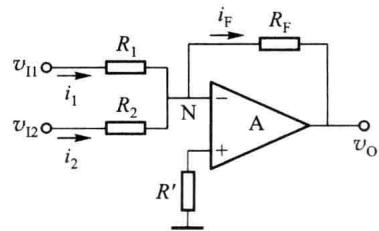  

图 6.5.1 两个输入信号的反相加法电路

且有

$$

i _ {1} + i _ {2} = i _ {\mathrm{F}}

$$

可以得到

$$

\frac {v _ {\mathrm{I1}}}{R _ {1}} + \frac {v _ {\mathrm{I2}}}{R _ {2}} = \frac {- v _ {\mathrm{O}}}{R _ {\mathrm{F}}}\tag{6.5.4}

$$

即

$$

v _ {\mathrm{O}} = - \left(\frac {R _ {\mathrm{F}}}{R _ {1}} v _ {\mathrm{I1}} + \frac {R _ {\mathrm{F}}}{R _ {2}} v _ {\mathrm{I2}}\right)\tag{6.5.5}

$$

从而实现了两输入信号的反相比例相加。若取 $R_{1} = R_{2}$ ，则有

$$

v _ {\mathrm{O}} = - \frac {R _ {\mathrm{F}}}{R _ {\mathrm{I}}} (v _ {\mathrm{I1}} + v _ {\mathrm{I2}})\tag{6.5.6}

$$

根据运放两输入端直流电阻平衡的要求,应使

$$

R ^ {\prime} = R _ {1} / / R _ {2} / / R _ {\mathrm{F}}\tag{6.5.7}

$$

反相相加运算电路可以推广到对多个信号的求和。读者可以根据需求和上面介绍的分析方法进行设计。

## 二、同相加法电路

图 6.5.2 所示电路是实现两个输入信号同相相加的加法电路。很明显只要求出 P 点电压与输入电压的关系，代入同相放大电路的公式即可。

根据图 6.5.2 电路, 有 $i_{1} + i_{2} = i_{3}$ , 即

$$

\frac {v _ {\mathrm{I1}} - v _ {\mathrm{P}}}{R _ {2}} + \frac {v _ {\mathrm{I2}} - v _ {\mathrm{P}}}{R _ {3}} = \frac {v _ {\mathrm{P}}}{R _ {4}}\tag{6.5.8}

$$

式中， $v_{p}$ 为 P 点对地电位，可以得到

$$

v _ {\mathrm{p}} = R _ {\mathrm{p}} \left(\frac {v _ {\mathrm{II}}}{R _ {2}} + \frac {v _ {\mathrm{I2}}}{R _ {3}}\right)\tag{6.5.9}

$$

式中， $R_{P}=R_{2}\parallel R_{3}\parallel R_{4}$ 。所以电路总的输出和输入的关系为

$$

v _ {\mathrm{O}} = \left(1 + \frac {R _ {\mathrm{F}}}{R _ {1}}\right) R _ {\mathrm{P}} \left(\frac {v _ {1 1}}{R _ {2}} + \frac {v _ {1 2}}{R _ {3}}\right)\tag{6.5.10}

$$

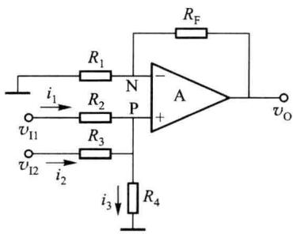  

图 6.5.2 两个输入信号同相加法电路

在满足运放输入端直流电阻平衡, 即 $R_{1} \parallel R_{F} = R_{2} \parallel R_{3} \parallel R_{4}$ 时, 输出的表达式变为

$$

v _ {\mathrm{O}} = \frac {R _ {\mathrm{F}}}{R _ {2}} v _ {\mathrm{I1}} + \frac {R _ {\mathrm{F}}}{R _ {3}} v _ {\mathrm{I2}}\tag{6.5.11}

$$

## 6.5.2 减法运算电路

## 一、差分输入减法电路

图 6.5.3 所示为差分输入减法电路的原理图。两路输入信号 $v_{11}$ 和 $v_{12}$ 分别通过电阻 $R_{2}$

和 $R_{1}$ 接至运放的同相输入端与反相输入端, 为一个同相放大电路和一个反相放大电路的组合。

输出电压 $v_{0}$ 通过反馈电阻 $R_{F}$ 反馈回反相输入端，形成深度负反馈，对输入信号 $v_{11}$ 而言，为电压串联负反馈，对输入信号 $v_{12}$ 而言，为电压并联负反馈。

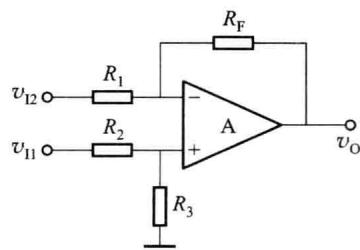

应用叠加定理以及前面对同相输入、反相输入放大电路的分析结果, 当 $v_{12}=0$ 时不难求出

$$

v _ {\mathrm{O1}} = \frac {R _ {3}}{R _ {2} + R _ {3}} \left(1 + \frac {R _ {\mathrm{F}}}{R _ {1}}\right) v _ {\mathrm{II}}\tag{6.5.12}

$$

图 6.5.3 差分输入减法电路

当 $v_{\mathrm{II}} = 0$ 时

$$

v _ {\mathrm{O2}} = - \frac {R _ {\mathrm{F}}}{R _ {\mathrm{I}}} v _ {\mathrm{I2}}\tag{6.5.13}

$$

叠加后有

$$

v _ {\mathrm{O}} = v _ {\mathrm{O1}} + v _ {\mathrm{O2}} = \frac {R _ {3}}{R _ {2} + R _ {3}} \left(1 + \frac {R _ {\mathrm{F}}}{R _ {1}}\right) v _ {\mathrm{I1}} - \frac {R _ {\mathrm{F}}}{R _ {1}} v _ {\mathrm{I2}}\tag{6.5.14}

$$

在满足运放输入端直流电阻平衡, 即 $R_{1} \parallel R_{F} = R_{2} \parallel R_{3}$ 时, 同时令 $R_{1} = R_{2}, R_{3} = R_{F}$ , 输出的表达式变为

$$

v _ {\mathrm{O}} = \frac {R _ {\mathrm{F}}}{R _ {\mathrm{I}}} (v _ {\mathrm{II}} - v _ {\mathrm{I2}})\tag{6.5.15}

$$

该电路实现输出电压 $v_{0}$ 与两个输入信号之差 $(v_{11}-v_{12})$ 成正比，完成模拟减法运算。

上面介绍的差分减法运算电路有如下缺点:一是电阻的选取和调整不够方便;二是对每个信号源输入电阻均较小。因此,必要时可用两个运放来设计减法运算电路,如图6.5.4所示。

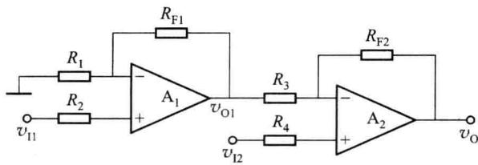  

图 6.5.4 两级运放构成的高输入阻抗减法电路

由于第一级的输出电阻近似为零,因而后级对它的负载作用可以忽略,故两级的输出与输入的关系可以直接分开计算,即,不考虑后级的输入电阻对本级的负载作用,也不考虑本级的输出电阻对后级的影响。

$$

v _ {\mathrm{O1}} = \left(1 + \frac {R _ {\mathrm{F1}}}{R _ {\mathrm{I}}}\right) v _ {\mathrm{II}}\tag{6.5.16}

$$

$$

v _ {\mathrm{O}} = \left(1 + \frac {R _ {\mathrm{F2}}}{R _ {3}}\right) v _ {\mathrm{I2}} - \frac {R _ {\mathrm{F2}}}{R _ {3}} v _ {\mathrm{O1}} = \left(1 + \frac {R _ {\mathrm{F2}}}{R _ {3}}\right) v _ {\mathrm{I2}} - \frac {R _ {\mathrm{F2}}}{R _ {3}} \left(1 + \frac {R _ {\mathrm{F1}}}{R _ {1}}\right) v _ {\mathrm{I1}}\tag{6.5.17}

$$

若取 $R_{1} = R_{\mathrm{F2}}, R_{\mathrm{F1}} = R_{3}$ 时，表达式变为

$$

v _ {\mathrm{O}} = \left(1 + \frac {R _ {\mathrm{F2}}}{R _ {3}}\right) (v _ {\mathrm{I2}} - v _ {\mathrm{II}})\tag{6.5.18}

$$

关于运放输入端直流平衡电阻 $R_{2}$ 、 $R_{4}$ 的取值，可按前面的方法确定。

## 二、反相求和减法电路

将某一输入信号反相后加到前面介绍的加法电路中,也可以构成减法电路,如图6.5.5所示。

根据图 6.5.5 所示电路可以得到

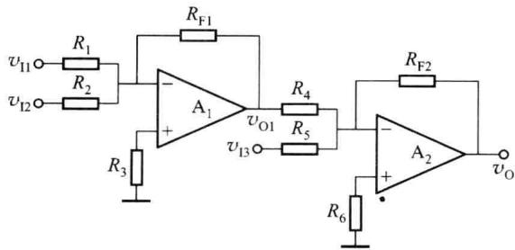  

图 6.5.5 反相求和减法电路

$$

v _ {\mathrm{O1}} = - \left(\frac {R _ {\mathrm{F1}}}{R _ {1}} v _ {\mathrm{I1}} + \frac {R _ {\mathrm{F1}}}{R _ {2}} v _ {\mathrm{I2}}\right)\tag{6.5.19}

$$

$$

v _ {\mathrm{O}} = - \left(\frac {R _ {\mathrm{F2}}}{R _ {4}} v _ {\mathrm{O1}} + \frac {R _ {\mathrm{F2}}}{R _ {5}} v _ {\mathrm{I3}}\right)\tag{6.5.20}

$$

当取 $R_{\mathrm{F1}} = R_4$ ，且 $R_{1} = R_{2} = R_{5}$ 时，有

$$

v _ {\mathrm{O}} = \frac {R _ {\mathrm{F2}}}{R _ {\mathrm{I}}} (v _ {\mathrm{II}} + v _ {\mathrm{I2}} - v _ {\mathrm{I3}})\tag{6.5.21}

$$

运放输入端直流平衡电阻 $R_{3}$ 、 $R_{6}$ 的取值，请读者自己确定。

## 6.5.3 积分运算电路

## 一、基本积分电路

图 6.5.6 所示为基本积分电路,与反相放大电路相似,但反馈元件为电容,该电路的输出电压与输入电压为积分运算关系。

图 6.5.6 电路中 N 点电位 $v_{N}=0$ ，为“虚地”。电阻 R 中的电流

$$

i _ {_ {R}} = \frac {v _ {_ {1}}}{R}\tag{6.5.22}

$$

流过电容 C 的电流为

$$

i _ {c} = C \frac {\mathrm{d} v _ {c}}{\mathrm{d} t} = - C \frac {\mathrm{d} v _ {0}}{\mathrm{d} t}\tag{6.5.23}

$$

两电流相等,即

$$

\frac {v _ {\mathrm{I}}}{R} = - C \frac {\mathrm{d} v _ {\mathrm{0}}}{\mathrm{d} t}\tag{6.5.24}

$$

通过上式,可解出

$$

v _ {0} = - \frac {1}{R C} \int_ {0} ^ {t} v _ {1} (t) \mathrm{d} t + v _ {0} (t _ {0})\tag{6.5.25}

$$

式(6.5.25)中 $v_{0}(t_{0})$ 为积分的初始条件,也就是 $t_{0}$ 时刻的输出电压值。

假设输入信号 $v_{1}$ 是一个如图 6.5.7 所示的阶跃信号，且在 t=0 时刻，电容上的电压为零，也就是 $v_{0}(t_{0})=0$ 。

当 $t \geqslant 0$ 时，有

$$

v _ {\mathrm{O}} = - \frac {1}{R C} \int_ {0} ^ {t} V _ {\mathrm{m}} \mathrm{d} t = - \frac {V _ {\mathrm{m}}}{R C} t \quad (\text {当} | v _ {\mathrm{O}} | <   | V _ {\mathrm{OL}} | \text {时})\tag{6.5.26}

$$

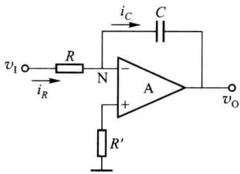  

图 6.5.6 基本积分电路

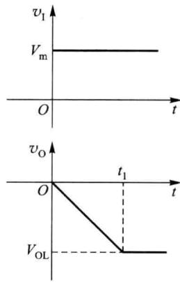  

图 6.5.7 $v_{1}$ 为阶跃信号时输出波形

这是由于电容 C 以恒定电流 $i_{R}=v_{1}/R$ 充电，所以输出电压 $v_{0}$ 负向线性增加。当 $v_{0}$ 达到运放的反向限幅区时，运放进入非线性工作状态，输出保持不变，积分作用停止。可见，要保持正常的积分关系，对积分时间应有所限制。积分时间限制的值为 $t_{1}$ （如图 6.5.7 所示），即

$$

t _ {1} = - \frac {V _ {\mathrm{OL}}}{V _ {\mathrm{m}}} R C\tag{6.5.27}

$$

式中， $V_{OL}$ 为一负值。

以上是对积分电路在时域进行分析,也可在频域对其进行分析,得到其传输函数。

由于电容 C 的正弦稳态容抗可表示为 $\frac{1}{j\omega C}$ ，根据反相放大电路的传输函数公式，可以写出

$$

\dot {V} _ {\mathrm{o}} (\mathrm{j} \omega) = - \frac {\frac {1}{\mathrm{j} \omega C}}{R} \dot {V} _ {\mathrm{i}} (\mathrm{j} \omega) = - \frac {1}{\mathrm{j} \omega R C} \dot {V} _ {\mathrm{i}} (\mathrm{j} \omega)\tag{6.5.28}

$$

式 $(6.5.28)$ 也表明,在时域中输出电压正比于输入电压的积分。

利用积分电路,可以把方波电压信号变换为三角波电压信号,这部分内容将会在讲解波形发生器时介绍。

## 二、同相输入积分电路

同相输入积分电路如图 6.5.8 所示。对其进行正弦稳态分析可得

$$

\dot {I} _ {\mathrm{i}} (\mathrm{j} \omega) = \frac {\dot {V} _ {\mathrm{i}} (\mathrm{j} \omega) - \dot {V} _ {\mathrm{p}} (\mathrm{j} \omega)}{R}\tag{6.5.29}

$$

$$

\dot {I} _ {2} (\mathrm{j} \omega) = \frac {\dot {V} _ {\mathrm{o}} (\mathrm{j} \omega) - \dot {V} _ {\mathrm{p}} (\mathrm{j} \omega)}{R}\tag{6.5.30}

$$

$$

\dot {I} _ {3} (\mathrm{j} \omega) = \frac {\dot {V} _ {\mathrm{p}} (\mathrm{j} \omega)}{\frac {1}{\mathrm{j} \omega C}} = \mathrm{j} \omega C \dot {V} _ {\mathrm{p}} (\mathrm{j} \omega)\tag{6.5.31}

$$

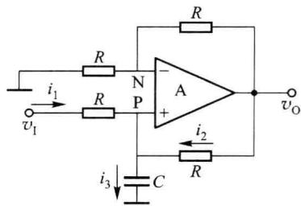  

图 6.5.8 同相输入积分电路

由于 $\dot{I}_3(\mathrm{j}\omega) = \dot{I}_2(\mathrm{j}\omega) + \dot{I}_1(\mathrm{j}\omega)$ ，有

$$

\mathrm{j} \omega C \dot {V} _ {\mathrm{p}} (\mathrm{j} \omega) = \frac {\dot {V} _ {\mathrm{i}} (\mathrm{j} \omega) - \dot {V} _ {\mathrm{p}} (\mathrm{j} \omega)}{R} + \frac {\dot {V} _ {\mathrm{o}} (\mathrm{j} \omega) - \dot {V} _ {\mathrm{p}} (\mathrm{j} \omega)}{R}\tag{6.5.32}

$$

根据运放线性应用时， $\dot{V}_{\mathrm{p}}(\mathrm{j}\omega)=\dot{V}_{\mathrm{N}}(\mathrm{j}\omega)=\frac{1}{2}\dot{V}_{\mathrm{o}}(\mathrm{j}\omega)$ ，可以得到

$$

\dot {V} _ {\mathrm{o}} (\mathrm{j} \omega) = \frac {2}{\mathrm{j} \omega R C} \dot {V} _ {\mathrm{i}} (\mathrm{j} \omega)\tag{6.5.33}

$$

<Example title="例 6.5.1">
电路如图 6.5.9 所示, 设各运放为理想运放, $R_{1}=100\ k\Omega$ , $R=10\ k\Omega$ , $C=1\ \mu F$ ; $v_{11}=v_{12}=-2.5\ V$ , $v_{13}=5.1\ V$ , 运放的供电电源为 $\pm15\ V$ , 运放的 $V_{OH}=13\ V$ , $V_{OL}=-13\ V$ ; 当 t=0 时, $v_{C}=0\ V$ 。

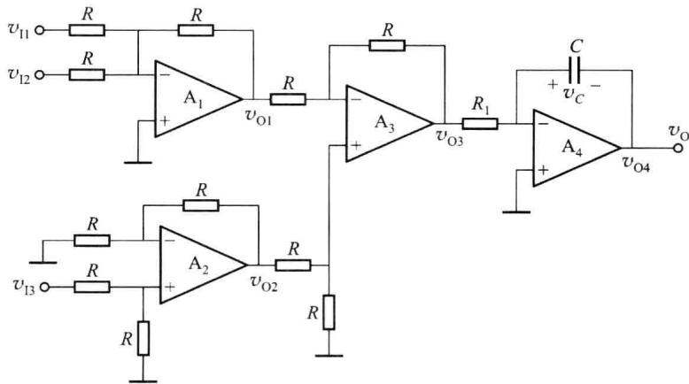  

图6.5.9 例6.5.1电路

请问运放 $A_{1} \sim A_{4}$ 各组成什么电路？

如果在 t=0 时刻接入输入信号和电源, 求 $t=4.9\ s$ 时各运放的输出电压。

在 t=15.5 s 时, 各运放的输出电压为多少?

<Solution title="解">
(1) $A_{1}$ 构成反相输入加法电路; $A_{2}$ 构成同相放大电路(输入端有电阻分压); $A_{3}$ 构成

差分输入的减法电路； $A_{4}$ 构成反相积分电路。

(2) 当 t=4.9 s 时, 有

$$

v _ {0 1} = - \left(v _ {1 1} + v _ {1 2}\right) = - (- 2. 5 - 2. 5) \mathrm{V} = 5 \mathrm{V}

$$

$$

v _ {0 2} = \frac {R}{R + R} \Big (1 + \frac {R}{R} \Big) v _ {1 3} = v _ {1 3} = 5. 1 \mathrm{V}

$$

$$

v _ {0 3} = \frac {R}{R + R} \Big (1 + \frac {R}{R} \Big) v _ {0 2} - \frac {R}{R} v _ {0 1} = (5. 1 - 5) \mathrm{V} = 0. 1 \mathrm{V}

$$

$$

v _ {0 4} = - \frac {1}{R _ {1} C} \int_ {0} ^ {t} v _ {0 3} \mathrm{d} t = - \frac {v _ {0 3}}{R _ {1} C} t = - 4. 9 \mathrm{V}

$$

(3) 当 t=15.5 s 时, 有

$$

v _ {0 1} = - \left(v _ {1 1} + v _ {1 2}\right) = - (- 2. 5 - 2. 5) \mathrm{V} = 5 \mathrm{V}

$$

$$

v _ {0 2} = \frac {R}{R + R} \Big (1 + \frac {R}{R} \Big) v _ {1 3} = v _ {1 3} = 5. 1 \mathrm{V}

$$

$$

v _ {0 3} = \frac {R}{R + R} \Big (1 + \frac {R}{R} \Big) v _ {0 2} - \frac {R}{R} v _ {0 1} = (5. 1 - 5) \mathrm{V} = 0. 1 \mathrm{V}

$$

如果假设 t=15.5 s 时, 积分电路仍在线性区, 有

$$

v _ {0 4} = - \frac {1}{R _ {1} C} \int_ {0} ^ {t} v _ {0 3} \mathrm{d} t = - \frac {v _ {0 3}}{R _ {1} C} t = - 1 5. 5 \mathrm{V}

$$

显然积分电路超过积分时间限制,所以输出为 $V_{OL}$ , 则

$$

v _ {0 4} = - 1 3 \mathrm{V}

$$
</Solution>
</Example>

## 6.5.4 微分运算电路

微分运算是积分运算的逆运算。将基本积分运算电路中的电阻 R 与电容 C 的位置互换, 就可以构成基本微分运算电路, 如图 6.5.10 所示。

由于运放工作于线性区，N点为“虚地”。流过电容的电流 $i_{C}=C\frac{dv_{1}}{dt}$ ；流过反馈电阻的电流 $i_{F}=-\frac{v_{0}}{R}$ ；由于 $i_{C}=i_{F}$ ，可以得到 $v_{0}=-RC\frac{dv_{1}}{dt}$ ，即输出电压与输入电压的微分成正比。

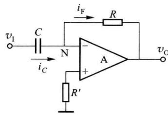  

图 6.5.10 基本微分运算电路

进行正弦稳态分析时有

$$

\dot {V} _ {\mathrm{o}} (\mathrm{j} \omega) = - \frac {R}{\frac {1}{\mathrm{j} \omega C}} \dot {V} _ {\mathrm{i}} (\mathrm{j} \omega) = - \mathrm{j} \omega R C \dot {V} _ {\mathrm{i}} (\mathrm{j} \omega)\tag{6.5.34}

$$

上述基本微分电路存在以下问题。

（1）电路中的 RC 环节对反馈信号有滞后作用，使环路增益的附加相移加大，相位裕度减小，可能不满足电路稳定性的要求，甚至引起自激振荡。

（2）当输入信号突变时，输出立刻进入限幅区。为保证电路正常工作，实现微分功能，需要对输入信号的频率(或变化速率)进行限制。

## 6.5.5 对数与反对数运算电路

## 一、对数运算电路

### 1. 基本对数运算电路

图 6.5.11 所示为采用二极管和运放构成的对数运算电路。由前述可知，流过二极管的正向电流与加在二极管上的电压之间近似为指数关系，或者说二极管上的正向电压与流过的电流为近似对数关系。

根据图 6.5.11 所示电路,为使二极管导通,输入电压 $v_{1}$ 应大于零。因为 N 点为“虚地”,可以得到

$$

i _ {R} = \frac {v _ {\mathrm{I}}}{R}\tag{6.5.35}

$$

$$

i _ {\mathrm{D}} \approx I _ {\mathrm{S}} \mathrm{e} ^ {\frac {v _ {\mathrm{D}}}{V _ {T}}} = i _ {R}\tag{6.5.36}

$$

因此有

$$

v _ {\mathrm{O}} = - v _ {\mathrm{D}} \approx - V _ {T} \ln \frac {v _ {1}}{I _ {\mathrm{s}} R}\tag{6.5.37}

$$

式(6.5.37)表明输出电压与输入电压之间为对数关系。但在公式中 $V_{T}$ 和 $I_{s}$ 的存在说明运算精度受温度的影响，并且二极管在电流较小时内部载流子的复合运动不可忽略，在电流较大时内阻不可忽略，所以，仅在一定的电流范围内才满足指数特性。为了相对扩大输入电压的动态范围，实用电路中常用晶体管取代二极管。

利用晶体管的对数运算电路如图 6.5.12 所示。实用时常把晶体管的集电极与基极短路，接成二极管形式，则发射结电压 $v_{BE}$ 与集电极电流 $i_{C}$ 之间在相当宽的范围内（如 $10^{-9} \sim 10^{-3} A$ ），具有较精确的对数关系。

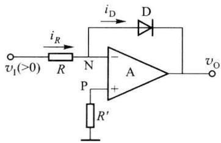  

图 6.5.11 基本对数运算电路

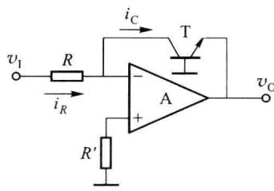  

图 6.5.12 利用晶体管构成的对数运算电路

因为运放反相输入端为“虚地”，晶体管基极接地，所以基极与集电极同电位。可以得到

$$

i _ {_ R} = \frac {v _ {_ I}}{R}\tag{6.5.38}

$$

$$

i _ {\mathrm{C}} \approx I _ {\mathrm{ES}} \mathrm{e} ^ {\frac {v _ {\mathrm{BE}}}{V _ {T}}} = i _ {R}\tag{6.5.39}

$$

因此有

$$

v _ {\mathrm{O}} = - v _ {\mathrm{BE}} \approx - V _ {T} \ln \frac {v _ {\mathrm{I}}}{I _ {\mathrm{ES}} R}\tag{6.5.40}

$$

虽然用晶体管替代二极管后性能有所提高,但运算精度仍受温度的影响。

### 2. 集成对数运算电路

在集成对数运算电路中,根据差分电路的基本原理,利用特性相同的两只晶体管(设两只晶体管的特性一致)进行补偿,消去 $I_{ES}$ 对运算关系的影响。型号为ICL8048的对数运算电路如图6.5.13所示,框内为集成电路,框外为外接元件。

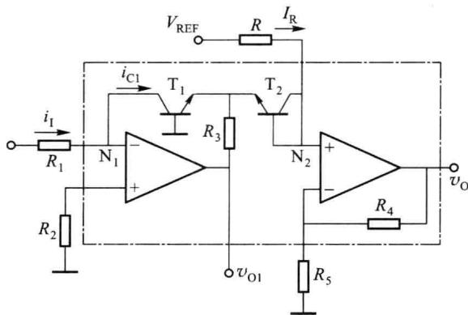  

图 6.5.13 ICL8048 集成对数运算电路

由于图 6.5.13 电路中 $N_{1}$ 点为“虚地”，可以得到

$$

i _ {\mathrm{C1}} = i _ {\mathrm{I}} = \frac {v _ {\mathrm{I}}}{R _ {\mathrm{I}}} \approx I _ {\mathrm{ES}} \mathrm{e} ^ {\frac {v _ {\mathrm{BE1}}}{V _ {T}}}\tag{6.5.41}

$$

因而

$$

v _ {\mathrm{BE1}} \approx V _ {T} \ln \frac {v _ {\mathrm{I}}}{I _ {\mathrm{ES}} R _ {\mathrm{I}}}\tag{6.5.42}

$$

在节点 $N_{2}$ ，由于运放两输入端流过的电流为零，有

$$

i _ {\mathrm{C2}} \approx I _ {\mathrm{R}} \approx I _ {\mathrm{ES}} \mathrm{e} ^ {\frac {v _ {\mathrm{BE2}}}{V _ {T}}}\tag{6.5.43}

$$

因而

$$

v _ {\mathrm{BE2}} \approx V _ {T} \ln \frac {I _ {\mathrm{R}}}{I _ {\mathrm{ES}}}\tag{6.5.44}

$$

节点 $\mathbf{N}_2$ 的电位为

$$

v _ {\mathrm{N} _ {2}} = v _ {\mathrm{BE2}} - v _ {\mathrm{BE1}} \approx - V _ {T} \ln \frac {v _ {1}}{I _ {\mathrm{R}} R _ {1}}\tag{6.5.45}

$$

因此输出为

$$

v _ {\mathrm{O}} \approx - \left(1 + \frac {R _ {4}}{R _ {5}}\right) V _ {T} \ln \frac {v _ {\mathrm{I}}}{I _ {\mathrm{R}} R _ {1}}\tag{6.5.46}

$$

式(6.5.46)中仍有 $V_{T}$ 存在,与温度有关,可将外接电阻 $R_{5}$ 选为具有正温度系数的热敏电阻,以补偿 $V_{T}$ 的温度特性。当环境温度升高时, $R_{5}$ 阻值增大,使得放大倍数减小,以补偿 $V_{T}$ 随温度升高的增加,使 $v_{0}$ 在 $v_{1}$ 不变时基本稳定。

## 二、指数运算电路

将图 6.5.12 所示对数运算电路中的电阻和晶体管互换,便可得到指数运算电路,如图 6.5.14 所示。

因为集成运放反相输入端为“虚地”，为使晶体管导通， $V_{BE}$ 必须正偏，所以 $v_{1}$ 应大于零，且只能在发射结导通电压范围内，故输入信号的变化范围也较小。

根据图 6.5.14 所示电路, 反相输入端为“虚地”, 可以得到

$$

\begin{array}{r l} & v _ {\mathrm{I}} = v _ {\mathrm{BE}} \\ & i _ {\mathrm{F}} = i _ {\mathrm{E}} \approx I _ {\mathrm{ES}} \mathrm{e} ^ {\frac {v _ {\mathrm{I}}}{V _ {T}}} \end{array}\tag{6.5.47}

$$

(6.5.48)

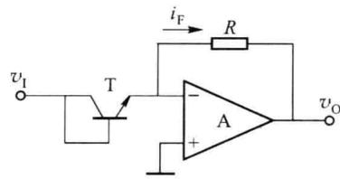  

图 6.5.14 指数运算电路

输出电压为

$$

v _ {\mathrm{O}} = - i _ {\mathrm{F}} R \approx - R I _ {\mathrm{ES}} \mathrm{e} ^ {\frac {v _ {1}}{V _ {T}}}\tag{6.5.49}

$$

从式(6.5.49)可以看出,输出 $v_{0}$ 与输入 $v_{1}$ 是指数关系,同时运算结果与受温度影响较大的 $V_{T}, I_{ES}$ 有关,因而指数运算的精度也与温度有关。

## 三、利用指数、对数运算电路构成乘法、除法器

利用指数、对数运算电路构成乘法器的框图如图 6.5.15 所示, 具体电路如图 6.5.16 所示。

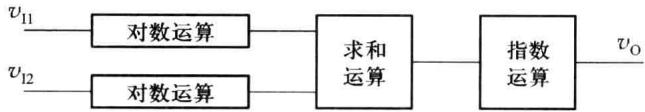

图 6.5.15 指数、对数运算电路构成乘法器框图  

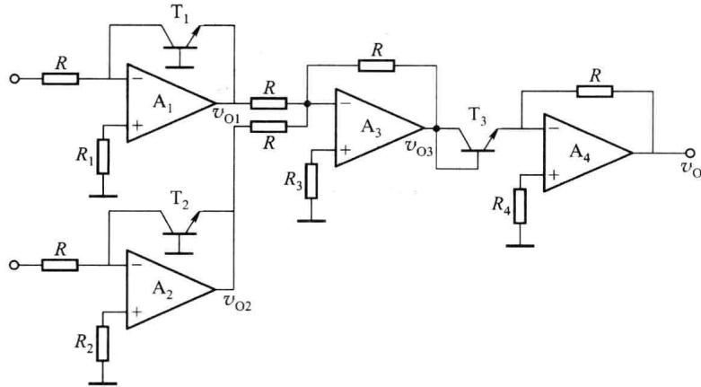  

图 6.5.16 指数、对数运算电路构成的乘法器电路

图6.5.16中

$$

v _ {\mathrm{O1}} \approx - V _ {T} \ln \frac {v _ {\mathrm{II}}}{I _ {\mathrm{ES}} R}\tag{6.5.50}

$$

$$

v _ {\mathrm{O2}} \approx - V _ {T} \ln \frac {v _ {\mathrm{I2}}}{I _ {\mathrm{ES}} R}\tag{6.5.51}

$$

$$

v _ {\mathrm{03}} = - \left(v _ {\mathrm{01}} + v _ {\mathrm{02}}\right) \approx - V _ {T} \ln \frac {v _ {\mathrm{11}} v _ {\mathrm{12}}}{\left(I _ {\mathrm{ES}} R\right) ^ {2}}\tag{6.5.52}

$$

$$

v _ {\mathrm{O}} \approx - I _ {\mathrm{S}} R \mathrm{e} ^ {\frac {v _ {\mathrm{03}}}{V _ {T}}} \approx - \frac {v _ {\mathrm{I1}} v _ {\mathrm{I2}}}{I _ {\mathrm{ES}} R} = k (v _ {\mathrm{I1}} \cdot v _ {\mathrm{I2}})\tag{6.5.53}

$$

可见, 输出 $v_{0}$ 与输入 $v_{11}$ 、 $v_{12}$ 之间为乘法关系。只要将图 6.5.16 中的加法电路改为减法器, 就可以得到除法运算电路。
