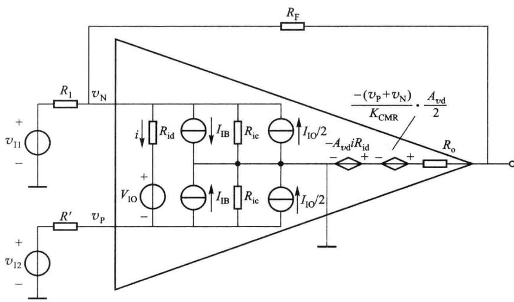
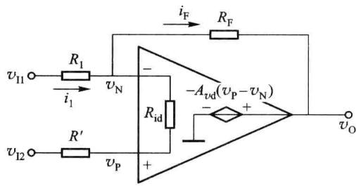
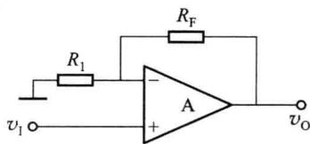
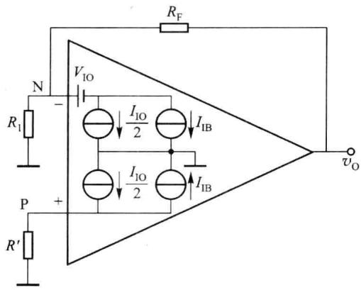

import Guide from '@/components/Guide.astro';
import Knowledge from '@/components/Knowledge.astro';
import Example from '@/components/Example.astro';
import Analysis from '@/components/Analysis.astro';
import Solution from '@/components/Solution.astro';
import Variant from '@/components/Variant.astro';
import Note from '@/components/Note.astro';
import Block from '@/components/Block.astro';
import Method from '@/components/Method.astro';
import Exercise from '@/components/Exercise.astro';

## 6.6.1 实际集成运算放大器的等效模型

任何实际集成运放都是非理想的。要建立一个考虑到所有非理想参数的模型很难，也没有必要。例如，在实际应用中，某些应用需求只对输入电阻或增益要求较高，可以只考虑输入电阻或增益对运算产生的误差即可。闭环反相放大电路是集成运放线性应用的基本形式。对闭环反相放大电路建立等效模型，可以推广到其他电路形式，也适用于多数对误差分析的场合。

图 6.6.1 所示模型为闭环反相放大电路的直流或低频等效模型。

  

图 6.6.1 闭环反相放大电路的直流或低频等效模型

考虑到差模和共模输入,反相端和同相端分别加信号 $v_{I1}$ 、 $v_{I2}$ 。 $v_{I1}$ 、 $v_{I2}$ 是直流信号或低频信号(运放参数均为实数)。

模型中因 $R_{o}$ 一般在几十至几百欧，而共模输入阻抗 $R_{ic}$ 的典型值在 100 MΩ 以上，通常比 $R_{id}$ 大两个数量级以上，故等效模型中可以忽略 $R_{o}$ 及 $R_{ic}$ 。这样，等效模型中主要考虑实际集成运放的有限增益 $A_{vd}$ 、 $K_{CMR}$ 、 $R_{id}$ 、 $V_{IO}$ 、 $I_{IB}$ 、 $I_{IO}$ 等 6 个误差因素。

模型中

$$

\left\{ \begin{array}{l} I _ {\mathrm{IB}} = \frac {1}{2} (I _ {\mathrm{B1}} + I _ {\mathrm{B2}}) \\ I _ {\mathrm{IO}} = I _ {\mathrm{B1}} - I _ {\mathrm{B2}} \end{array} \right.\tag{6.6.1}

$$

或

$$

\left\{ \begin{array}{l} I _ {\mathrm{B1}} = I _ {\mathrm{IB}} + \frac {1}{2} I _ {\mathrm{IO}} \\ I _ {\mathrm{B2}} = I _ {\mathrm{IB}} - \frac {1}{2} I _ {\mathrm{IO}} \end{array} \right.\tag{6.6.2}

$$

$$

v _ {\mathrm{O}} = - A _ {v \mathrm{d}} i R _ {\mathrm{id}} - \frac {A _ {v \mathrm{d}}}{K _ {\mathrm{CMR}}} \left(\frac {v _ {\mathrm{P}} + v _ {\mathrm{N}}}{2}\right)\tag{6.6.3}

$$

其中

$$

i = \frac {v _ {\mathrm{N}} - v _ {\mathrm{P}} - V _ {\mathrm{IO}}}{R _ {\mathrm{id}}}\tag{6.6.4}

$$

## 6.6.2 $A_{\mathrm{vd}}, R_{\mathrm{id}}$ 为有限值引起闭环增益的误差

如果只考虑 $A_{vd}$ 、 $R_{id}$ 为有限值所引起的闭环增益误差，其模型可简化为如图 6.6.2 所示的电路。

  

图 6.6.2 $A_{vd}$ 、 $R_{id}$ 为有限值时的简化模型

由图6.6.2可列出如下方程组

$$

\left\{ \begin{array}{l} v _ {\mathrm{P}} = v _ {\mathrm{I2}} + (i _ {1} - i _ {\mathrm{F}}) R ^ {\prime} \\ v _ {\mathrm{N}} = v _ {\mathrm{II}} - R _ {1} i _ {1} \\ v _ {\mathrm{O}} = A _ {\mathrm{rd}} (v _ {\mathrm{P}} - v _ {\mathrm{N}}) \\ v _ {\mathrm{N}} - v _ {\mathrm{P}} = (i _ {1} - i _ {\mathrm{F}}) R _ {\mathrm{id}} \\ v _ {\mathrm{N}} - v _ {\mathrm{O}} = i _ {\mathrm{F}} R _ {\mathrm{F}} \end{array} \right.\tag{6.6.5}

$$

解以上方程组可以得到

$$

v _ {\mathrm{O}} = \frac {R _ {\mathrm{F}}}{1 + \frac {R _ {\mathrm{F}} (R _ {1} ^ {\prime} + R ^ {\prime} + R _ {\mathrm{id}})}{A _ {v \mathrm{d}} R _ {\mathrm{id}} R _ {1} ^ {\prime}}} \left(\frac {v _ {\mathrm{I2}}}{R _ {1} ^ {\prime}} - \frac {v _ {\mathrm{II}}}{R _ {1}}\right)\tag{6.6.6}

$$

式中， $R_{1}^{\prime}=R_{1}\parallel R_{F}$ 。

（1）令 $v_{12}=0$ 就可以得到反相放大电路的输出表达式

$$

v _ {\mathrm{O}} = - \frac {R _ {\mathrm{F}}}{R _ {\mathrm{l}}} \cdot \frac {1}{1 + \frac {R _ {\mathrm{F}} (R _ {\mathrm{l}} ^ {\prime} + R ^ {\prime} + R _ {\mathrm{id}})}{A _ {\mathrm{vd}} R _ {\mathrm{id}} R _ {\mathrm{l}} ^ {\prime}}} v _ {\mathrm{ll}}\tag{6.6.7}

$$

由于 $A_{\mathrm{vd}}R_{\mathrm{id}}R_1' >> R_{\mathrm{F}}(R_1' + R' + R_{\mathrm{id}})$ ，利用近似公式 $1 / (1 + x) \approx 1 - x$ ，得

$$

A _ {v \mathrm{f}} \approx - \frac {R _ {\mathrm{F}}}{R _ {\mathrm{l}}} \left[ 1 - \frac {R _ {\mathrm{F}} (R _ {\mathrm{l}} ^ {\prime} + R ^ {\prime} + R _ {\mathrm{id}})}{A _ {v \mathrm{d}} R _ {\mathrm{id}} R _ {\mathrm{l}} ^ {\prime}} \right]\tag{6.6.8}

$$

闭环增益的相对误差为

$$

\delta = \frac {A _ {v f} - A _ {v f} ^ {\prime}}{A _ {v f} ^ {\prime}} = - \frac {R _ {\mathrm{F}} (R _ {1} ^ {\prime} + R ^ {\prime} + R _ {\mathrm{id}})}{A _ {v d} R _ {\mathrm{id}} R _ {1} ^ {\prime}}\tag{6.6.9}

$$

式中， $A_{vf}^{\prime}$ 为运放为理想运放时的反馈增益。

通过表达式可以看出, $A_{vd}$ 、 $R_{id}$ 越大,反馈深度越深,误差越小。

(2) 令 $v_{II}=0$ 就可以得到同相放大电路的输出表达式

$$

v _ {0} = \frac {R _ {\mathrm{F}}}{R _ {1} ^ {\prime}} \left[ \frac {1}{1 + \frac {R _ {\mathrm{F}} (R _ {1} ^ {\prime} + R ^ {\prime} + R _ {\mathrm{id}})}{A _ {\mathrm{vd}} R _ {\mathrm{id}} R _ {1} ^ {\prime}}} \right] v _ {1 2}\tag{6.6.10}

$$

与反相放大电路的误差相同。

## 6.6.3 共模抑制比 $K_{\mathrm{CMR}}$ 为有限值引起闭环增益的误差

同相放大电路中存在较大的共模输入分量,因此可以研究同相放大电路在 $K_{CMR}$ 为有限

值时对输出的影响以及所造成的误差。电路如图6.6.3所示。

$$

v _ {\mathrm{O}} = A _ {v \mathrm{d}} v _ {\mathrm{ID}} + A _ {v \mathrm{c}} v _ {\mathrm{IC}}\tag{6.6.11}

$$

由于差模增益不是无穷大,运放的两个输入端不能使用虚短概念。列出电路的方程

  

图 6.6.3 $K_{CMR}$ 为有限值时的分析电路

$$

\left\{ \begin{array}{l} v _ {\mathrm{ID}} = v _ {\mathrm{P}} - v _ {\mathrm{N}} = v _ {\mathrm{I}} - \frac {R _ {\mathrm{I}}}{R _ {\mathrm{I}} + R _ {\mathrm{F}}} v _ {\mathrm{O}} \\ v _ {\mathrm{IC}} = \frac {1}{2} (v _ {\mathrm{P}} + v _ {\mathrm{N}}) = \frac {1}{2} v _ {\mathrm{I}} + \frac {R _ {\mathrm{I}}}{2 (R _ {\mathrm{I}} + R _ {\mathrm{F}})} v _ {\mathrm{O}} \end{array} \right.\tag{6.6.12}

$$

输出电压为

$$

v _ {\mathrm{O}} = A _ {\mathrm{rd}} \left(v _ {\mathrm{I}} - \frac {R _ {\mathrm{I}}}{R _ {\mathrm{I}} + R _ {\mathrm{F}}} v _ {\mathrm{O}}\right) + A _ {\mathrm{vc}} \left[ \frac {1}{2} v _ {\mathrm{I}} + \frac {R _ {\mathrm{I}}}{2 \left(R _ {\mathrm{I}} + R _ {\mathrm{F}}\right)} v _ {\mathrm{O}} \right]\tag{6.6.13}

$$

将式 $(6.6.13)$ 整理后,得

$$

A _ {v \mathrm{f}} = \frac {v _ {\mathrm{O}}}{v _ {\mathrm{I}}} = \left(1 + \frac {R _ {\mathrm{F}}}{R _ {\mathrm{I}}}\right) \cdot \frac {1 + 1 / (2 K _ {\mathrm{CMR}})}{1 + [ (R _ {\mathrm{I}} + R _ {\mathrm{F}}) / R _ {\mathrm{I}} ] \cdot 1 / A _ {v \mathrm{d}} - 1 / (2 K _ {\mathrm{CMR}})}\tag{6.6.14}

$$

利用理想情况下 $A_{vf}=\frac{v_{0}}{v_{1}}=\left(1+\frac{R_{F}}{R_{1}}\right)$ ，可以算出相对误差。从式中可以看出， $K_{\mathrm{CMR}}(A_{\mathrm{vd}})$ 越大，误差越小。

## 6.6.4 输入失调参数 $I_{\mathrm{IB}}$ 、 $V_{\mathrm{IO}}$ 、 $I_{\mathrm{IO}}$ 引起输出电压的误差

输入失调参数 $I_{1B}$ 、 $V_{10}$ 、 $I_{10}$ 引起输出电压误差的等效电路如图 6.6.4 所示。

  

图 6.6.4 $I_{IB}$ 、 $V_{10}$ 、 $I_{10}$ 引起输出电压误差的等效电路

考虑到通常运放两个输入端的直流平衡电阻相等, 即 $R' = R_{1} // R_{F}$ , 所以, $I_{IB}$ 不会对输出产生影响。对电路分析可以得到

$$

\left\{ \begin{array}{l} v _ {\mathrm{P}} = \frac {I _ {\mathrm{10}}}{2} R ^ {\prime} \\ v _ {\mathrm{N}} = \frac {R _ {\mathrm{1}}}{R _ {\mathrm{1}} + R _ {\mathrm{F}}} v _ {\mathrm{O}} - V _ {\mathrm{10}} - \frac {I _ {\mathrm{10}}}{2} R ^ {\prime} \end{array} \right.\tag{6.6.15}

$$

可以解出

$$

v _ {\mathrm{O}} = \left(1 + \frac {R _ {\mathrm{F}}}{R _ {\mathrm{I}}}\right) (V _ {\mathrm{IO}} + I _ {\mathrm{IO}} R ^ {\prime})\tag{6.6.16}

$$

由上式可以看出, $V_{10}$ 、 $I_{10}$ 越大,引起的误差电压越大。电路的闭环增益越大,误差电压也越大。为了减小误差电压除了选用失调小的集成运放外,直流平衡电阻 $R'$ 应尽可能小些。

$V_{10}$ 、 $I_{10}$ 对 $v_{0}$ 的影响可由调零电路予以补偿。但要注意，对它们的温漂是不能用调零或补偿方法来抵消的。也就是说利用调零电路补偿以后，当温度再发生变化时，同样也会产生误差输出电压。

## 6.6.5 运算放大器的开环带宽对闭环增益的影响

集成运放的开环带宽一般较低,比如 $\mu A741$ 的 3 dB 开环带宽只有 7 Hz。假设集成运放的开环增益函数只有一个主极点,它的开环增益函数可表示为

$$

\dot {A} _ {v \mathrm{d}} \approx \frac {A _ {v \mathrm{d}}}{1 + \mathrm{j} f / f _ {\mathrm{H}}}\tag{6.6.17}

$$

该式表明其幅频特性为每增加十倍频程下降20 dB。因此，在对频率较高的信号进行运算时，除了低频时开环增益带来的运算误差外，还需要考虑随频率的升高增益下降带来的误差。
