import Guide from '@/components/Guide.astro';
import Knowledge from '@/components/Knowledge.astro';
import Example from '@/components/Example.astro';
import Analysis from '@/components/Analysis.astro';
import Solution from '@/components/Solution.astro';
import Variant from '@/components/Variant.astro';
import Note from '@/components/Note.astro';
import Block from '@/components/Block.astro';
import Method from '@/components/Method.astro';
import Exercise from '@/components/Exercise.astro';

模拟乘法器是实现两个模拟量相乘的非线性电子器件，利用模拟乘法器以及运放可以方便地实现乘法、除法、乘方、开方运算等电路。模拟乘法器广泛地应用于广播电视、通信、仪表和自动控制系统之中，例如，进行模拟信号的处理、调制解调等。所以模拟乘法器是模拟集成电路中的一个重要部分。

## 6.7.1 模拟乘法器简介

模拟乘法器有两个输入端,一个输出端。图 6.7.1 所示是模拟乘法器的符号。

模拟乘法器的输入信号为两个互不相关的模拟物理量,输出电压是它们的乘积,即

$$

v _ {\mathrm{O}} = k v _ {\mathrm{x}} v _ {\mathrm{y}}\tag{6.7.1}

$$

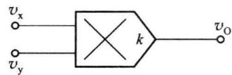

式中，k 是乘积系数，也称乘积增益或标尺因子。

理想模拟乘法器至少应具备如下条件：

图 6.7.1 模拟乘法器的符号

(1) 输入端的输入阻抗 $R_{ix}, R_{iy}$ 为无穷大；

(2) 输出阻抗 $R_{0}$ 为零；

（3）乘积系数 k 为常数，不随信号幅值、信号频率而变化；

（4）当 $v_{x}$ 或 $v_{y}$ 为零时 $v_{0}$ 为零，电路没有失调电压、失调电流。

图 6.7.2 所示为模拟乘法器的等效电路。在等效电路中考虑了输入电阻和输出电阻。在本小节中，除特殊说明，一般在分析电路功能时，模拟乘法器均看成理想器件。

由于输入信号的极性可正可负,因此输入信号 $v_{x}$ 和 $v_{y}$ 的极性有 4 种组合,对应 4 个象限,如图 6.7.3 所示。按照允许输入信号的极性,模拟乘法器有单象限、二象限和四象限之分。

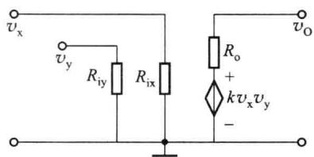  

图 6.7.2 模拟乘法器的等效电路

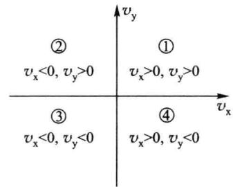  

图6.7.3 $v_{\mathrm{x}}$ 和 $v_{\mathrm{y}}$ 的极性所确定的4个象限

## 6.7.2 变跨导型模拟乘法器的工作原理

变跨导型模拟乘法器利用输入电压控制差放差分管的发射极电路,使之跨导作相应的变化,从而达到与输入差模信号相乘的目的。

## 一、变跨导二象限乘法器

差分放大电路的差模传输特性在第二章介绍差放时已经介绍过,电路如图6.7.4所示。

在差模信号作用下,输出电流与输入电压的函数关系为

$$

i _ {\mathrm{O}} = i _ {\mathrm{C1}} - i _ {\mathrm{C2}} = I _ {\mathrm{EE}} \mathrm{th} \frac {v _ {\mathrm{x}}}{2 V _ {T}}\tag{6.7.2}

$$

输出电压与输入电压的函数关系为

$$

v _ {\mathrm{O}} = R _ {\mathrm{C}} I _ {\mathrm{EE}} \mathrm{th} \frac {v _ {\mathrm{x}}}{2 V _ {T}}\tag{6.7.3}

$$

对于双曲函数 $\operatorname{th} x$ ，当 $x$ 很小时 $\operatorname{th} x \approx x$ 。也就是当式 (6.7.3) 中 $v_x \ll 2V_T$ 时，表达式可写成

$$

v _ {\mathrm{O}} = R _ {\mathrm{C}} I _ {\mathrm{EE}} \frac {v _ {\mathrm{x}}}{2 V _ {T}}

$$

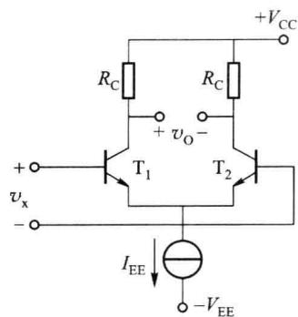  

图 6.7.4 差分放大电路

(6.7.4)

将图 6.7.4 中的恒流源用一晶体管替代, 得到图 6.7.5, 根据图示电路可以得到

$$

i _ {\mathrm{C3}} = I _ {\mathrm{EE}} = \frac {v _ {\mathrm{y}} - v _ {\mathrm{BE3}}}{R _ {\mathrm{E}}}\tag{6.7.5}

$$

当 $v_{y} \gg v_{BE3}$ 时,有

$$

i _ {\mathrm{C3}} = I _ {\mathrm{EE}} \approx \frac {v _ {\mathrm{y}}}{R _ {\mathrm{E}}}\tag{6.7.6}

$$

将该式代入 $v_{0}=R_{c}I_{EE}\frac{v_{x}}{2V_{T}}$ ，有

$$

v _ {\mathrm{O}} \approx R _ {\mathrm{C}} \frac {v _ {\mathrm{y}}}{R _ {\mathrm{E}}} \frac {v _ {\mathrm{x}}}{2 V _ {T}} = \frac {R _ {\mathrm{C}}}{2 V _ {T} R _ {\mathrm{E}}} v _ {\mathrm{x}} v _ {\mathrm{y}} = k v _ {\mathrm{x}} v _ {\mathrm{y}}\tag{6.7.7}

$$

式中， $v_{x}$ 可正可负，但 $v_{y}$ 必须大于零，所以图 6.7.5 所示电路为二象限模拟乘法器。该电路有如下缺点：

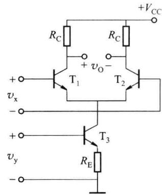

(1) $v_{x}$ 的值必须小于 $2V_{T}$ ;

(2) $v_{y}$ 的值越小,运算误差越大;

图 6.7.5 变跨导二象限乘法器

(3) $v_{0}$ 与 $V_{T}$ 有关,即受温度变化的影响;

(4) 电路只能工作在二象限。

## 二、双平衡四象限变跨导乘法器

双平衡四象限变跨导乘法器如图 6.7.6 所示。

根据差分放大电路及变跨导二象限乘法器推导得到的结论,可以得到

$$

i _ {1} - i _ {2} = i _ {5} \mathrm{th} \frac {v _ {\mathrm{x}}}{2 V _ {T}}\tag{6.7.8}

$$

$$

i _ {4} - i _ {3} = i _ {6} \mathrm{th} \frac {v _ {\mathrm{x}}}{2 V _ {T}}\tag{6.7.9}

$$

$$

i _ {5} - i _ {6} = I \mathrm{th} \frac {v _ {\mathrm{y}}}{2 V _ {T}}\tag{6.7.10}

$$

所以有

$$

i _ {0 1} - i _ {0 2} = \left(i _ {1} + i _ {3}\right) - \left(i _ {4} + i _ {2}\right) = \left(i _ {1} - i _ {2}\right) - \left(i _ {4} - i _ {3}\right)\tag{6.7.11}

$$

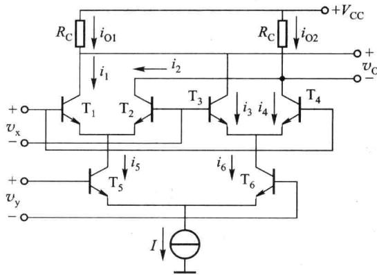  

图 6.7.6 双平衡四象限变跨导乘法器

$$

i _ {0 1} - i _ {0 2} = (i _ {5} - i _ {6}) \mathrm{th} \frac {v _ {\mathrm{x}}}{2 V _ {T}} = I \cdot \mathrm{th} \frac {v _ {\mathrm{y}}}{2 V _ {T}} \cdot \mathrm{th} \frac {v _ {\mathrm{x}}}{2 V _ {T}}\tag{6.7.12}

$$

当 $v_{x} \ll 2V_{T}$ ，同时 $v_{y} \ll 2V_{T}$ 时，有

$$

i _ {\mathrm{O1}} - i _ {\mathrm{O2}} \approx \frac {1}{4 V _ {T} ^ {2}} v _ {\mathrm{x}} v _ {\mathrm{y}}\tag{6.7.13}

$$

输出电压为

$$

v _ {\mathrm{0}} = - \left(i _ {\mathrm{01}} - i _ {\mathrm{02}}\right) R _ {\mathrm{C}} \approx - \frac {I R _ {\mathrm{C}}}{4 V _ {T} ^ {2}} v _ {\mathrm{x}} v _ {\mathrm{y}} = k v _ {\mathrm{x}} v _ {\mathrm{y}}\tag{6.7.14}

$$

图 6.7.6 所示电路的输出信号为双端输出, 可使用图 6.7.7 所示电路将图 6.7.6 的双

端输出变换为单端输出,乘法器的乘积系数 k 值可通过 $R_{F}$ 进行调节。

图 6.7.6 所示双平衡四象限变跨导乘法器电路的输入信号的最大值受到限制 ( $v_{x} \ll 2V_{T}, v_{y} \ll 2V_{T}$ )，可以通过在发射极串入电阻增大输入电压的范围，虽然乘积系数会变小，但可以通过调整双端到单端变换电路的增益来解决。

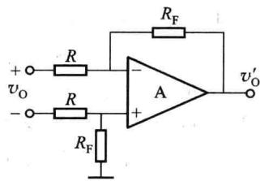  

图6.7.7 双端输出到单端输出的变换电路

## 6.7.3 模拟乘法器的应用

## 一、乘方运算电路

利用四象限模拟乘法器能够非常方便地实现平方、3次方、4次方运算电路，分别如图6.7.8(a)、(b)、(c)所示。

图6.7.8(a)中

图 6.7.8(b) 中

图6.7.8(c)中

$$

\begin{array}{r} v _ {\mathrm{O}} = k v _ {\mathrm{I}} ^ {2} \\ v _ {\mathrm{O1}} = k ^ {\prime} v _ {\mathrm{I}} ^ {3} \\ v _ {\mathrm{O2}} = k ^ {\prime \prime} v _ {\mathrm{I}} ^ {4} \end{array}

$$

## 二、除法运算电路

将模拟乘法器连接在集成运放的反馈通路中,可构成除法运算电路,如图6.7.9所示。

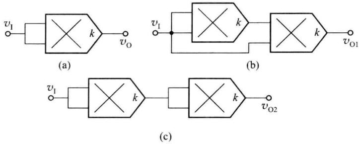  

图 6.7.8 乘方运算电路

在运算电路中,必须保证电路引入的是负反馈,才能正常工作,即 $v_{0}$ 与 $v_{0}^{\prime}$ 必须是同相的。因而要求,当模拟乘法器的 k 为正值时, $v_{12}$ 必须为正值。这样电路引入的才是负反馈。电路分析如下:

设集成运放和模拟乘法器均为理想器件,运放反相输入端为“虚地”,有

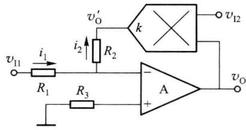  

图 6.7.9 除法运算电路

$$

\frac {v _ {\mathrm{I1}}}{R _ {1}} = - \frac {v _ {\mathrm{O}} ^ {\prime}}{R _ {2}} = - \frac {k v _ {\mathrm{I2}} v _ {\mathrm{O}}}{R _ {2}}

$$

(6.7.15)

整理上式,得到输出电压

$$

v _ {0} = - \frac {R _ {2}}{k R _ {1}} \cdot \frac {v _ {1 1}}{v _ {1 2}}\tag{6.7.16}

$$

由于 $v_{12}$ 的极性受限制, 所以图 6.7.9 所示电路为二象限除法运算电路。

## 三、开方运算电路

### 1. 平方根运算电路

利用乘方运算电路作为集成运放的反馈通路,就可构成开方运算电路。平方根运算电路如图6.7.10所示。

先设电路引入的是负反馈,运放工作于线性区,则运放反相输入端为“虚地”,有

$$

\frac {v _ {\mathrm{O}} ^ {\prime}}{R _ {2}} = - \frac {v _ {\mathrm{I}}}{R _ {1}}

$$

$$

v _ {\mathrm{O}} ^ {\prime} = - \frac {R _ {2}}{R _ {1}} v _ {\mathrm{I}} = k v _ {\mathrm{O}} ^ {2}\tag{6.7.17}

$$

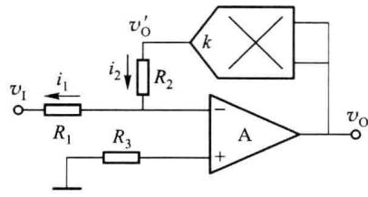

(6.7.18)

图 6.7.10 平方根运算电路

所以

$$

v _ {0} = \sqrt {- \frac {R _ {2}}{k R _ {1}} v _ {1}}

$$

$$

(k \text {为正值}, v _ {1} <   0)\tag{6.7.19}

$$

由于 $v_{0}$ 为大于零的值, 所以 $v_{1}$ 必须小于零, 且根号下的值必须为正, 所以要求 k 值为正。

### 2. 立方根运算电路

将3次方电路作为集成运放的反馈通路，可实现立方根运算电路，如图6.7.11所示。图中使用两级模拟乘法器，所以 $k^2$ 大于零，且 $v_{0}$ 与 $v_{0}^{\prime}$ 同相，所以反馈电路对于运放来说引入的是负反馈。运放工作于线性区，则运放反相输入端为“虚地”，有

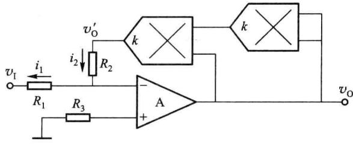  

图 6.7.11 立方根运算电路

$$

\frac {v _ {\mathrm{O}} ^ {\prime}}{R _ {2}} = - \frac {v _ {\mathrm{I}}}{R _ {1}}\tag{6.7.20}

$$

$$

v _ {\mathrm{O}} ^ {\prime} = - \frac {R _ {2}}{R _ {1}} v _ {\mathrm{I}} = k ^ {2} v _ {\mathrm{O}} ^ {3}\tag{6.7.21}

$$

所以

$$

v _ {0} = \sqrt [ 3 ]{- \frac {R _ {2}}{k ^ {2} R _ {1}} v _ {1}}\tag{6.7.22}

$$

<Example title="例 6.7.1">
某运算电路如图 6.7.12 所示, 运放及乘法器均可看成理想器件, 乘法器的乘积系数为 0.1。求输出与输入间的运算关系。

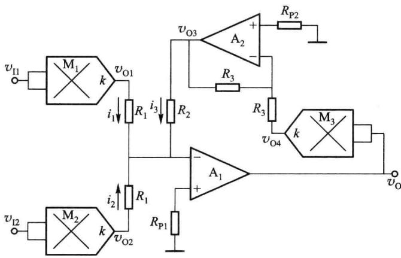  

图6.7.12 例6.7.1电路图

<Solution title="解">
运放 $A_{1}$ 的反相输入端为“虚地”，所以有

$$

\frac {v _ {\mathrm{01}}}{R _ {1}} + \frac {v _ {\mathrm{02}}}{R _ {1}} = - \frac {v _ {\mathrm{03}}}{R _ {2}}\tag{6.7.23}

$$

$$

v _ {\mathrm{01}} = k v _ {\mathrm{II}} ^ {2}\tag{6.7.24}

$$

$$

v _ {\mathrm{O2}} = k v _ {\mathrm{I2}} ^ {2}\tag{6.7.25}

$$

$$

v _ {0 3} = - \frac {R _ {2}}{R _ {1}} (v _ {0 1} + v _ {0 2}) = - k v _ {0} ^ {2}\tag{6.7.26}

$$

根据式 $(6.7.24)$ 、式 $(6.7.25)$ 、式 $(6.7.26)$ 可得

$$

v _ {\mathrm{O}} = \sqrt {\frac {R _ {2}}{k R _ {1}} (v _ {\mathrm{O} 1} + v _ {\mathrm{O} 2})} = \sqrt {\frac {R _ {2}}{k R _ {1}} (k v _ {1 1} ^ {2} + k v _ {1 2} ^ {2})} = \sqrt {\frac {R _ {2}}{R _ {1}} (v _ {1 1} ^ {2} + v _ {1 2} ^ {2})}\tag{6.7.27}

$$

电路的两个输入信号 $v_{11}$ 和 $v_{12}$ 可以是任意极性。图中 $A_{2}$ 接成反相放大是为了保证电路为负反馈。
</Solution>
</Example>
