import Guide from '@/components/Guide.astro';
import Knowledge from '@/components/Knowledge.astro';
import Example from '@/components/Example.astro';
import Analysis from '@/components/Analysis.astro';
import Solution from '@/components/Solution.astro';
import Variant from '@/components/Variant.astro';
import Note from '@/components/Note.astro';
import Block from '@/components/Block.astro';
import Method from '@/components/Method.astro';
import Exercise from '@/components/Exercise.astro';

滤波器是一种能让有用频率信号通过而同时抑制(或衰减)无用频率信号的电子装置。工程上常用它来实现信号处理、数据传送和抑制干扰等功能。滤波器广泛用于通信、广播、电视、计算机等几乎全部电子设备中。

20世纪初直至20世纪60年代，滤波器主要由无源元件 $R, L, C$ 构成，称为无源滤波器。为了提高无源滤波器的质量，要求所用的电感元件具有较高的品质因数 $Q$ ，但同时又要求有一定的电感量，这就必然增加电感元件的体积、重量与成本，这种矛盾在低频时尤为突出。为了解决这一矛盾，20世纪50年代有人提出用由电阻、电容与晶体管组成的有源网络替代电感元件，由此产生了用有源元件和无源元件（一般是 $R$ 和 $C$ )共同组成的电滤波器，称为有源滤波器。20世纪60年代末由分立元件组成的有源滤波器得到应用。20世纪70年代以来，由薄膜电容、薄膜电阻和集成运放构成的薄膜混合集成电路提供了大量质优价廉的小型和微型有源 $RC$ 滤波器。集成电路技术的出现和迅速发展给有源滤波器赋予了巨大的生命力。由集成电路构成的有源滤波器不但从根本上克服了 $R, L, C$ 无源滤波器在低频时存在的体积和重量上的问题，而且成本低、质量可靠、便于集成。与无源滤波器相比，它的设计和调整过程较简便，还能提供增益。当然，有源滤波器也有缺点：

（1）由于有源元件固有的带宽限制，使绝大多数有源滤波器仅限于在低频范围内应用，而无源滤波器可用于频率较高的场合；

(2) 生产工艺和环境变化所造成的元件偏差对有源滤波器的影响较大;

(3) 有源元件要消耗功率。

## 6.8.1 滤波器简介

## 一、滤波器的基本概念

滤波器的一般结构如图 6.8.1 所示。图中的 $v_{i}(t)$ 为滤波器的输入信号， $v_{o}(t)$ 为滤波器的输出信号。

假设滤波电路是一个线性时不变网络,则在复频域内滤波器的电压传输函数为

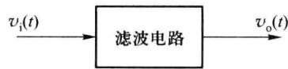

$$

\dot {A} (s) = \frac {\dot {V} _ {\mathrm{o}} (s)}{\dot {V} _ {\mathrm{i}} (s)}\tag{6.8.1}

$$

图 6.8.1 滤波器一般结构

对于实际频率来说,式(6.8.1)可以写为

$$

\dot {A} (\mathrm{j} \omega) = | \dot {A} (\mathrm{j} \omega) | \mathrm{e} ^ {\mathrm{j} \varphi (\omega)}\tag{6.8.2}

$$

$|\dot{A}(j\omega)|$ 为传输函数的模， $e^{j\varphi(\omega)}$ 为传输函数的相位角。在滤波电路中还有一个参数是时延 $\tau(\omega)$ ， $\tau(\omega)$ 定义为

$$

\tau (\omega) = - \frac {\mathrm{d} \varphi (\omega)}{\mathrm{d} \omega}\tag{6.8.3}

$$

分析滤波器时多用幅频响应来表征一个滤波电路的特性,如果要求信号通过滤波器后的失真很小,则相位和时延响应必须考虑。当相位响应 $\varphi(\omega)$ 作线性变化,即时延响应 $\tau(\omega)$ 为常数时,输出信号才可能不产生失真。

## 二、滤波器的种类

对于幅频响应,通常把能够通过的信号频率范围定义为通带,而把受阻或衰减的信号频率范围称为阻带,通带和阻带的界限频率称为截止频率。

理想滤波器在通带内应具有零衰减的幅频响应和线性的相位响应,而在阻带内信号将不能通过滤波器,即具有无限大的幅度衰减。按照通带和阻带的相互位置不同,滤波器通常可分为以下几类。

（1）低通滤波器 设截止角频率为 $\omega_{H}$ ，则角频率低于 $\omega_{H}$ 的信号可以通过（通带），高于 $\omega_{H}$ 的信号被衰减（阻带）。其幅频响应如图 6.8.2 所示，图中 $A_{0}$ 表示低频增益的幅值。带宽 $BW = \omega_{H}$ 。

（2）高通滤波器 设截止角频率为 $\omega_{L}$ ，则角频率高于 $\omega_{L}$ 的信号可以通过，低于 $\omega_{L}$ 的信号被衰减，其幅频响应如图 6.8.3 所示。从理论上来说，高通滤波器的带宽 $BW = \infty$ 。但实际上，由于受到器件（尤其是有源器件）带宽的限制，高通滤波电路的带宽也是有限的。

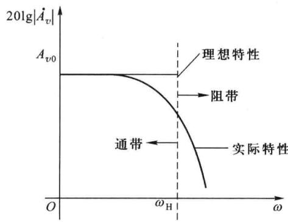  

图 6.8.2 低通滤波器幅频特性

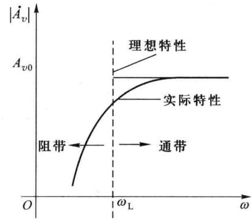  

图 6.8.3 高通滤波器幅频特性

（3）带通滤波器 带通滤波器幅频响应如图6.8.4所示。设低频段的截止角频率为 $\omega_{\mathrm{L}}$ ，高频段的截止角频率为 $\omega_{\mathrm{H}}$ ，频率为 $\omega_{\mathrm{L}}\sim \omega_{\mathrm{H}}$ 之间的信号可以通过，低于 $\omega_{\mathrm{L}}$ 或高于 $\omega_{\mathrm{H}}$ 的信号被衰减。带通滤波器有两个阻带： $0 <   \omega <  \omega_{\mathrm{L}}$ 和 $\omega >\omega_{\mathrm{H}}$ ，通带为 $\omega_{\mathrm{L}} <   \omega <  \omega_{\mathrm{H}}$ 。因此带宽 $BW =$ $\omega_{\mathrm{H}} - \omega_{\mathrm{L}}$ 。 $\omega_0$ 为带通中心角频率。

（4）带阻滤波器 带阻滤波器幅频响应如图6.8.5所示。设高端低频截止角频率为 $\omega_{\mathrm{L}}$ ，低端高频截止角频率为 $\omega_{\mathrm{H}}$ ，频率为 $\omega_{\mathrm{H}}\sim \omega_{\mathrm{L}}$ 之间的信号被衰减，高于 $\omega_{\mathrm{L}}$ 或低于 $\omega_{\mathrm{H}}$ 的信号被允许通过。带阻滤波器有两个通带： $0 <   \omega <  \omega_{\mathrm{H}}$ 和 $\omega >\omega_{\mathrm{L}}$ ，高频端的通带由于受有源器件的带宽影响，通带的宽度是有限的。带阻滤波器抑制频带中点所在角频率 $\omega_0$ 称为带阻中心角频率。

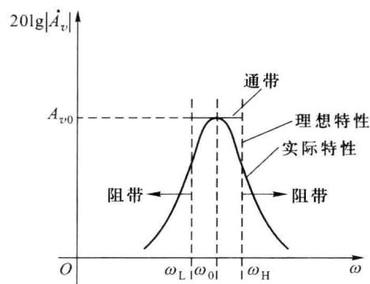  

图 6.8.4 带通滤波器幅频特性

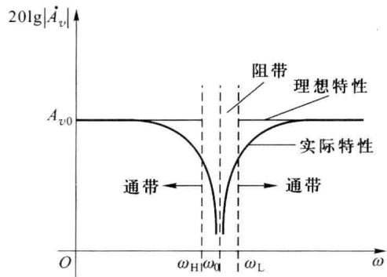  

图 6.8.5 带阻滤波器幅频特性

（5）全通滤波器全通滤波器没有阻带，它的通带是从零到无穷大，但相移的大小随频率改变，如图6.8.6所示。

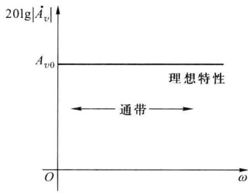  

图 6.8.6 全通滤波器幅频特性

前面介绍的是滤波电路的理想情况,实际上,各种滤波电路的实际频率响应特性与理想情况是有差别的,设计的任务就是力求向理想特性靠近。

## 6.8.2 有源低通滤波器

## 一、简单一阶低通滤波器

图 6.8.7 所示为一阶无源 RC 低通滤波电路。当不考虑 $R_{L}$ 的作用时，传输函数为

$$

\dot {A} _ {\mathrm{v}} (s) = \frac {\dot {V} _ {\mathrm{o}} (s)}{\dot {V} _ {\mathrm{i}} (s)} = \frac {\frac {1}{s C}}{R + \frac {1}{s C}} = \frac {1}{1 + s R C}\tag{6.8.4}

$$

正弦稳态时的电压传输函数可写成

$$

\dot {A} _ {v} (\mathrm{j} \omega) = \frac {\dot {V} _ {\mathrm{o}} (\mathrm{j} \omega)}{\dot {V} _ {\mathrm{i}} (\mathrm{j} \omega)} = \frac {\frac {1}{\mathrm{j} \omega C}}{R + \frac {1}{\mathrm{j} \omega C}} = \frac {1}{1 + \mathrm{j} \omega R C}\tag{6.8.5}

$$

对应的上限截止角频率为 $\omega_{H}=\frac{1}{RC}$ 。如果考虑 $R_{L}$ 的影响，则上限截止角频率将发生变化。为了使负载不影响滤波特性，可在无源滤波电路和负载之间加一个高输入电阻、低输出电阻的隔离电路，最简单的方法是加一个电压跟随器或同相放大电路，如图6.8.8所示。

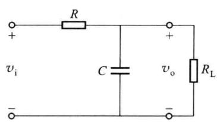  

图 6.8.7 一阶无源 RC 低通滤波电路

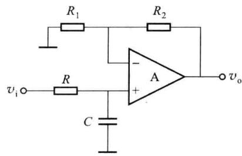  

图6.8.8 一阶有源 $RC$ 低通滤波电路

在理想运放的条件下,由于电压跟随器的输入电阻为无穷大,输出电阻为零,因此上限截止频率仅取决于 RC 的取值,与输出端接的负载大小无关。

根据前面学过的知识,可以求出图6.8.8所示电路的正弦稳态电压传输函数

$$

\begin{array}{r l} \dot {A _ {\mathrm{v}}} (\mathrm{j} \omega) & = \frac {\dot {V _ {\mathrm{o}}} (\mathrm{j} \omega)}{\dot {V _ {\mathrm{i}}} (\mathrm{j} \omega)} = \left(1 + \frac {R _ {2}}{R _ {1}}\right) \frac {\frac {1}{\mathrm{j} \omega C}}{R + \frac {1}{\mathrm{j} \omega C}} = \left(1 + \frac {R _ {2}}{R _ {1}}\right) \frac {1}{1 + \mathrm{j} \omega R C} \\ & = A _ {\mathrm{v0}} \frac {1}{1 + \mathrm{j} \omega R C} \end{array}\tag{6.8.6}

$$

低频电压增益为

$$

A _ {v 0} = \left(1 + \frac {R _ {2}}{R _ {1}}\right)\tag{6.8.7}

$$

上限截止角频率为

$$

\omega_ {\mathrm{H}} = \frac {1}{R C}\tag{6.8.8}

$$

上限截止频率为

$$

f _ {\mathrm{H}} = \frac {1}{2 \pi R C}\tag{6.8.9}

$$

## 二、压控电压源二阶低通滤波电路

一阶电路的过渡带较宽,幅频特性的最大衰减斜率仅为-20 dB/十倍频。如果增加RC环节,可加大衰减斜率。

图 6.8.9 所示电路为压控电压源二阶低通滤波器。电路中既引入了负反馈，又引入了正反馈。当信号频率趋于零时，由于 $C_{1}$ 的电抗趋于无穷大，因而正反馈很弱。当信号频率趋于无穷大时，由于 $C_{2}$ 的电抗趋于零，因而 P 点电位趋于零。只要正反馈引入得当，可使电压放大倍数数值增大，且不会因正反馈过强而产生自激振荡。

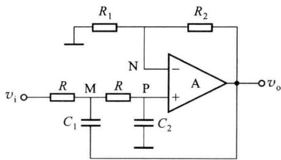  

图 6.8.9 压控电压源二阶低通滤波器

设电路中 $C_{1}=C_{2}=C$ ，则在 M 点的电流方程为

$$

\frac {\dot {V} _ {\mathrm{i}} (s) - \dot {V} _ {\mathrm{M}} (s)}{R} = \frac {\dot {V} _ {\mathrm{M}} (s) - \dot {V} _ {\mathrm{O}} (s)}{\frac {1}{s C}} + \frac {\dot {V} _ {\mathrm{M}} (s) - \dot {V} _ {\mathrm{P}} (s)}{R}\tag{6.8.10}

$$

P 点的电流方程为

$$

\frac {\dot {V} _ {\mathrm{M}} (s) - \dot {V} _ {\mathrm{P}} (s)}{R} = \frac {\dot {V} _ {\mathrm{P}} (s)}{\frac {1}{s C}}\tag{6.8.11}

$$

通过式 $(6.8.10)$ 和式 $(6.8.11)$ 可解出传输函数

$$

\dot {A} _ {v} (s) = \frac {A _ {v 0}}{1 + (3 - A _ {v 0}) s R C + (s R C) ^ {2}}\tag{6.8.12}

$$

式(6.8.12)中 $A_{v0}$ 为通带的增益，即 $A_{v0}=\left(1+\frac{R_{2}}{R_{1}}\right)$ 。当 $A_{v0}<3$ 时，分母中 s 的一次项系数大于零，电路才能稳定工作。

对于正弦稳态电路，令 $s = j\omega, \omega_{H} = \frac{1}{RC}$ ，则电压增益为

$$

\dot {A} _ {v} (\mathrm{j} \omega) = \frac {A _ {v 0}}{1 - \left(\frac {\omega}{\omega_ {\mathrm{H}}}\right) ^ {2} + \mathrm{j} (3 - A _ {v 0}) \frac {\omega}{\omega_ {\mathrm{H}}}}\tag{6.8.13}

$$

若令 $Q = \frac{1}{3 - A_{v0}}$ ，则在 $\omega = \omega_{\mathrm{H}}$ 时

$$

\mid \dot {A} _ {v} (\mathrm{j} \omega) \mid = \left| \frac {A _ {v 0}}{3 - A _ {v 0}} \right| = \mid Q A _ {v 0} \mid\tag{6.8.14}

$$

Q 为品质因数, 在低通滤波器中, Q 的物理意义为: 在 $\omega = \omega_{H}$ 时电压增益与通带增益之比。

当 $2<|A_{v0}|<3$ 时， $|\dot{A}_{v}(\mathrm{j}\omega)|_{\omega=\omega_{H}}>|A_{v0}|$ 。图 6.8.10 所示为 Q 值不同时的幅频特性示意图。压控电压源二阶低通滤波器当 $\omega\gg\omega_{H}$ 时以 -40 dB/十倍频下降。

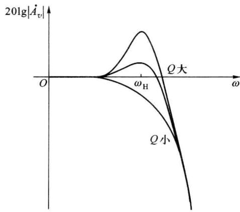  

图 6.8.10 Q 值不同时压控电压源二阶低通滤波器的幅频特性

## 6.8.3 有源高通滤波器

## 一、压控电压源二阶高通滤波器

电路如图 6.8.11 所示, 压控电压源二阶高通滤波器传输函数为

$$

\begin{array}{r l} \dot {A} _ {v} (s) & = \frac {A _ {v 0} s ^ {2}}{s ^ {2} + \left(\frac {1}{R _ {2} C _ {1}} + \frac {1}{R _ {2} C _ {2}} + (1 - A _ {v 0}) \frac {1}{R _ {1} C _ {1}}\right) s + \frac {1}{C _ {1} C _ {2} R _ {1} R _ {2}}} \\ & = \frac {A _ {v 0} s ^ {2}}{s ^ {2} + \frac {\omega_ {\mathrm{L}}}{Q} s + \omega_ {\mathrm{L}} ^ {2}} \end{array}\tag{6.8.15}

$$

式中,截止角频率

$$

\omega_ {\mathrm{L}} = \frac {1}{\sqrt {R _ {1} R _ {2} C _ {1} C _ {2}}} = 2 \pi f _ {\mathrm{L}}\tag{6.8.16}

$$

品质因数

$$

Q = \frac {\omega_ {\mathrm{L}}}{\frac {1}{R _ {2} C _ {1}} + \frac {1}{R _ {2} C _ {2}} + (1 - A _ {v 0}) \frac {1}{R _ {1} C _ {1}}}\tag{6.8.17}

$$

通带增益

$$

A _ {v 0} = 1 + \frac {R _ {4}}{R _ {3}}\tag{6.8.18}

$$

图 6.8.12 所示为 Q 值不同时压控电压源二阶高通滤波器的幅频特性。

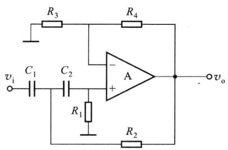  

图 6.8.11 压控电压源二阶高通滤波器

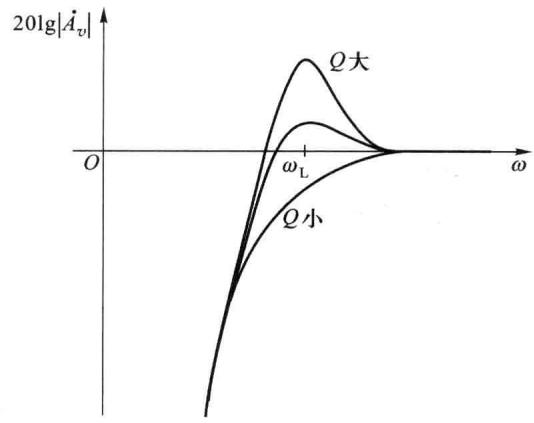  

图 6.8.12 Q 值不同时压控电压源二阶  

高通滤波器的幅频特性

## 二、无限增益多路负反馈二阶高通滤波器

无限增益多路负反馈二阶滤波电路的特点是运放为反相接法，由于放大器的开环增益无限大，反相输入端可视为“虚地”，输出端通过电容和电阻形成两条反馈支路。其优点是：输出电压与输入电压的相位相反，元件较少，但增益调节不方便。

无限增益多路负反馈二阶高通滤波器如图6.8.13所示，该电路的传输函数为

$$

\dot {A} _ {\mathrm{r}} (s) = \frac {- \frac {C _ {1}}{C _ {3}} s ^ {2}}{s ^ {2} + \frac {1}{R _ {2}} \left(\frac {C _ {1}}{C _ {2} C _ {3}} + \frac {1}{C _ {3}} + \frac {1}{C _ {2}}\right) s + \frac {1}{C _ {2} C _ {3} R _ {1} R _ {2}}} = \frac {A _ {\mathrm{r0}} s ^ {2}}{s ^ {2} + \frac {\omega_ {\mathrm{L}}}{Q} s + \omega_ {\mathrm{L}} ^ {2}}\tag{6.8.19}

$$

式中，通带增益

$$

A _ {v 0} = - \frac {C _ {1}}{C _ {3}}\tag{6.8.20}

$$

截止角频率

$$

\omega_ {\mathrm{L}} = \frac {1}{\sqrt {R _ {1} R _ {2} C _ {3} C _ {2}}} = 2 \pi f _ {\mathrm{L}}\tag{6.8.21}

$$

品质因数 $Q$

$$

Q = \frac {\omega_ {\mathrm{L}}}{\frac {1}{R _ {2}} \left(\frac {C _ {1}}{C _ {2} C _ {3}} + \frac {1}{C _ {2}} + \frac {1}{C _ {3}}\right)}\tag{6.8.22}

$$

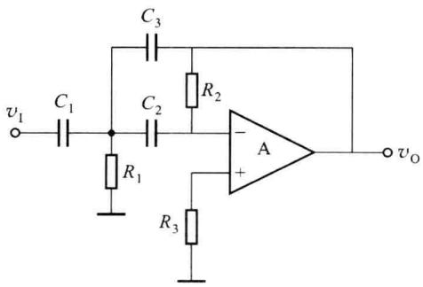  

图 6.8.13 无限增益多路负反馈二阶高通滤波器

## 6.8.4 有源带通滤波器

## 一、压控电压源二阶带通滤波器

压控电压源二阶带通滤波器电路如图 6.8.14 所示。

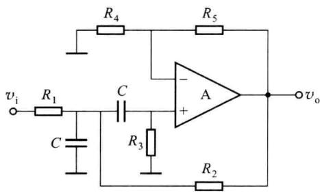  

图 6.8.14 压控电压源二阶带通滤波器

图 6.8.14 所示电路的传输函数为

$$

\begin{array}{r l} \dot {A} _ {v} (s) & = \frac {\frac {A _ {\mathrm{f}}}{R _ {1} C} s}{s ^ {2} + \frac {1}{C} \left[ \frac {2}{R _ {3}} + \frac {1}{R _ {1}} + \frac {1}{R _ {2}} (1 - A _ {\mathrm{f}}) \right] s + \frac {1}{R _ {3} C ^ {2}} \left(\frac {1}{R _ {1}} + \frac {1}{R _ {2}}\right)} \\ & = \frac {A _ {v 0} \frac {\omega_ {0}}{Q} s}{s ^ {2} + \frac {\omega_ {0}}{Q} s + \omega_ {0} ^ {2}} \end{array}\tag{6.8.23}

$$

式 $(6.8.23)$ 中,带通滤波器的中心角频率为

$$

\omega_ {0} = \sqrt {\omega_ {\mathrm{H}} \omega_ {\mathrm{L}}} = \sqrt {\frac {1}{R _ {3} C ^ {2}} \left(\frac {1}{R _ {1}} + \frac {1}{R _ {2}}\right)}\tag{6.8.24}

$$

式(6.8.24)中, $\omega_{H}$ 、 $\omega_{L}$ 分别为带通滤波器的上限、下限截止角频率。

$A_{f}$ 为

$$

A _ {\mathrm{f}} = 1 + \frac {R _ {5}}{R _ {4}}\tag{6.8.25}

$$

品质因数

$$

Q = \frac {\omega_ {0}}{\frac {1}{C} \left[ \frac {2}{R _ {3}} + \frac {1}{R _ {1}} + \frac {1}{R _ {2}} (1 - A _ {\mathrm{f}}) \right]}\tag{6.8.26}

$$

中心角频率 $\omega_{0}$ 处的电压放大倍数

$$

A _ {t 0} = \frac {A _ {\mathrm{f}}}{R _ {1} \left[ \frac {1}{R _ {1}} + \frac {1}{R _ {2}} (1 - A _ {\mathrm{f}}) + \frac {1}{R _ {3}} \right]}\tag{6.8.27}

$$

通带带宽可由下面推导得到

根据传输函数 $\dot{A}_v(s) = \frac{A_{v0}\frac{\omega_0}{Q}s}{s^2 + \frac{\omega_0}{Q}s + \omega_0^2}$ ，其正弦稳态传输方程为

$$

\dot {A} _ {v} (\mathrm{j} \omega) = \frac {A _ {v 0} \mathrm{j} \frac {\omega_ {0}}{Q} \omega}{(\mathrm{j} \omega) ^ {2} + \mathrm{j} \frac {\omega_ {0}}{Q} \omega + \omega_ {0} ^ {2}} = \frac {A _ {v 0}}{1 + \mathrm{j} Q \left(\frac {\omega}{\omega_ {0}} - \frac {\omega_ {0}}{\omega}\right)}\tag{6.8.28}

$$

令分母虚部为 1, 可以得到 $BW = f_{H} - f_{L}$ , 即

$$

B W = \frac {\omega_ {0}}{2 \pi Q} = \frac {1}{2 \pi C} \left[ \frac {2}{R _ {3}} + \frac {1}{R _ {1}} + \frac {1}{R _ {2}} (1 - A _ {\mathrm{f}}) \right]\tag{6.8.29}

$$

图 6.8.15 所示为 Q 值不同时压控电压源二阶带通滤波器的幅频特性示意图。

## 二、无限增益多路负反馈二阶带通滤波器

无限增益多路负反馈二阶带通滤波器电路如图 6.8.16 所示。

图 6.8.16 所示电路的传输函数为

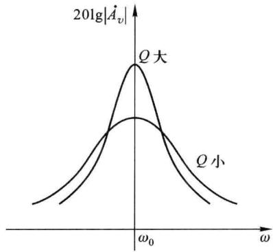  

图 6.8.15 Q 值不同时压控电压源二阶带通滤波器的幅频特性

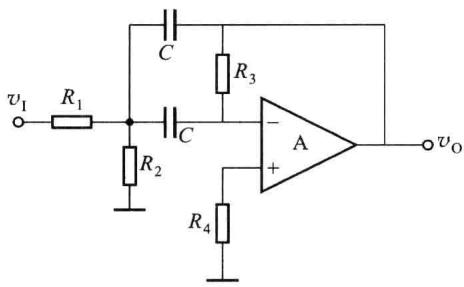  

图 6.8.16 无限增益多路负反馈有源二阶带通滤波器

$$

\dot {A} _ {v} (s) = \frac {- \frac {1}{R _ {1} C} s}{s ^ {2} + \frac {2}{R _ {3} C} s + \frac {1}{C ^ {2} R _ {3}} \left(\frac {1}{R _ {1}} + \frac {1}{R _ {2}}\right)} = \frac {A _ {v 0} \frac {\omega_ {0}}{Q} s}{s ^ {2} + \frac {\omega_ {0}}{Q} s + \omega_ {0} ^ {2}}\tag{6.8.30}

$$

式中,带通滤波器的中心角频率

$$

\omega_ {0} = \sqrt {\frac {1}{R _ {3} C ^ {2}} \left(\frac {1}{R _ {1}} + \frac {1}{R _ {2}}\right)}\tag{6.8.31}

$$

通带中心角频率 $\omega_{0}$ 处的电压放大倍数

$$

A _ {v 0} = - \frac {R _ {3}}{2 R _ {1}}\tag{6.8.32}

$$

品质因数

$$

Q = \frac {\omega_ {0} C R _ {3}}{2}\tag{6.8.33}

$$

## 6.8.5 有源二阶带阻滤波器

## 一、压控电压源二阶带阻滤波器

压控电压源二阶带阻滤波器电路如图 6.8.17 所示。电路的传输函数为

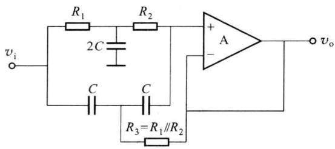  

图 6.8.17 压控电压源二阶带阻滤波器

$$

\dot {A} _ {v} (s) = \frac {A _ {\mathrm{f}} \left(s ^ {2} + \frac {1}{C ^ {2} R _ {1} R _ {2}}\right)}{s ^ {2} + \frac {2}{R _ {2} C} s + \frac {1}{R _ {1} R _ {2} C ^ {2}}} = \frac {A _ {v 0} (\omega_ {0} ^ {2} + s ^ {2})}{s ^ {2} + \frac {\omega_ {0}}{Q} s + \omega_ {0} ^ {2}}\tag{6.8.34}

$$

式中,通带电压放大倍数

$$

A _ {v 0} = A _ {\mathrm{f}} = 1\tag{6.8.35}

$$

电阻 $R_{3}$ 的阻值与 $R_{1}$ 和 $R_{2}$ 的关系为

$$

\frac {1}{R _ {3}} = \frac {1}{R _ {1}} + \frac {1}{R _ {2}}\tag{6.8.36}

$$

阻带中心处的角频率

$$

\omega_ {0} = \sqrt {\frac {1}{R _ {1} R _ {2} C ^ {2}}} = 2 \pi f _ {0}\tag{6.8.37}

$$

阻带带宽

$$

B W = \frac {\omega_ {0}}{2 \pi Q} = \frac {2}{2 \pi R _ {2} C}\tag{6.8.38}

$$

品质因数

$$

Q = \frac {1}{2} \sqrt {\frac {R _ {2}}{R _ {1}}}\tag{6.8.39}

$$

品质因数决定了阻带的带宽,图 6.8.18 所示为 Q 值不同时压控电压源二阶带阻滤波器的幅频特性示意图。

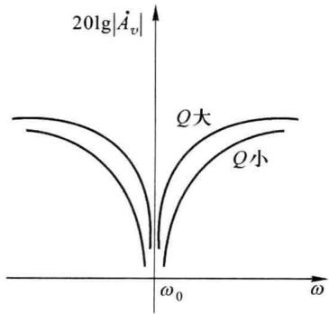  

图 6.8.18 Q 值不同时带阻滤波器的幅频特性示意图

## 二、无限增益多路负反馈二阶带阻滤波器

该电路由二阶带通滤波器和一个加法器组成,如图6.8.19所示。电路的传输函数为

$$

\begin{array}{r l} \dot {A} _ {v} (s) & = \frac {- \frac {R _ {6}}{R _ {4}} \left[ s ^ {2} + \frac {1}{C ^ {2} R _ {3}} \left(\frac {1}{R _ {1}} + \frac {1}{R _ {2}}\right) \right]}{s ^ {2} + \frac {2}{R _ {3} C} s + \frac {1}{R _ {3} C ^ {2}} \left(\frac {1}{R _ {1}} + \frac {1}{R _ {2}}\right)} = \frac {A _ {v 0} (\omega_ {0} ^ {2} + s ^ {2})}{s ^ {2} + \frac {\omega_ {0}}{Q} s + \omega_ {0} ^ {2}} \\ & R _ {3} R _ {4} = 2 R _ {1} R _ {5} \end{array}\tag{6.8.40}

$$

式中

通带电压放大倍数

$$

A _ {v 0} = - \frac {R _ {6}}{R _ {4}} = - \frac {R _ {3} R _ {6}}{2 R _ {1} R _ {5}}\tag{6.8.41}

$$

阻带中心角频率

$$

\omega_ {0} = \sqrt {\frac {1}{R _ {3} C ^ {2}} \left(\frac {1}{R _ {1}} + \frac {1}{R _ {2}}\right)}\tag{6.8.42}

$$

品质因数

$$

Q = \frac {\omega_ {0} R _ {3} C}{2}\tag{6.8.43}

$$

阻带带宽

$$

B W = \frac {\omega_ {0}}{2 \pi Q} = \frac {1}{\pi R _ {3} C}\tag{6.8.44}

$$

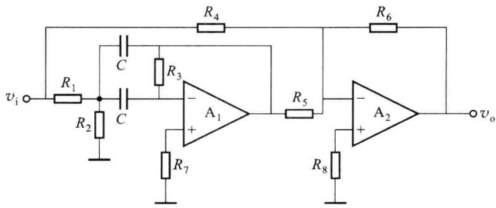  

图 6.8.19 无限增益多路负反馈二阶带阻滤波器
