import Guide from '@/components/Guide.astro';
import Knowledge from '@/components/Knowledge.astro';
import Example from '@/components/Example.astro';
import Analysis from '@/components/Analysis.astro';
import Solution from '@/components/Solution.astro';
import Variant from '@/components/Variant.astro';
import Note from '@/components/Note.astro';
import Block from '@/components/Block.astro';
import Method from '@/components/Method.astro';
import Exercise from '@/components/Exercise.astro';

## 6.9.1 电压比较器的基本特性

集成电压比较器与集成运放相似,是一种模拟输入、数字输出的接口电路,它一般用来比较两个模拟信号电压的大小。因此可以称它是高增益、快速、开环工作、无相位补偿的一类特殊运放。在要求不高的情况下,一般集成运放可以作为电压比较器使用。

集成电压比较器与集成运放基本相同,但集成电压比较器的传输特性的输出电平可根据需要通过不同的外接元件的连接方式进行选择。集成电压比较器的符号与运放的符号相同,如图6.9.1所示,理想集成电压比较器的传输特性如图6.9.2所示。图6.9.2中 $V_{OH}$ 和

$V_{OL}$ 的值可根据电路的需要设计成 TTL 电平、ECL 电平或其他任意电平。

集成电压比较器的技术参数大多与集成运放相同，如 $V_{10}$ 、 $I_{IB}$ 、 $I_{10}$ 、 $A_{vd}$ 、 $A_{vc}$ 、 $K_{CMR}$ 等。为适应数字接口和应用要求，有些集成电压比较器还设置了一些定时、控制接口，因此还有一些定时和接口参数。由于在比较器实际应用中，比较关注信号的转换和转换速度，所以比较关注的两个重要参数是灵敏度和响应速度。

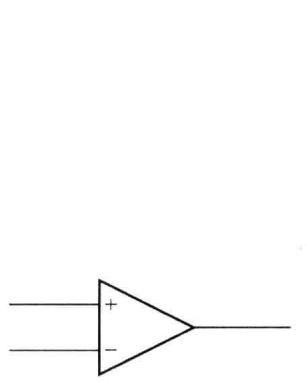  

图 6.9.1 集成电压比较器的符号

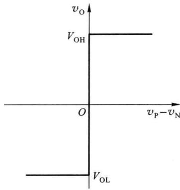  

图 6.9.2 理想集成电压  

比较器的传输特性

图 6.9.3 所示为实际电压比较器的传输特性曲线, 输出电压 $v_{0}$ 从一个电平变到另一个电平并不是理想阶跃, 而是要经过线性区渐变。

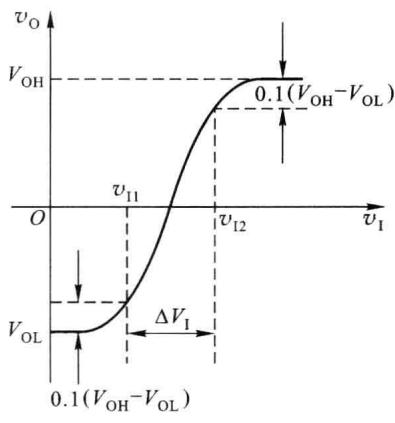  

(a)

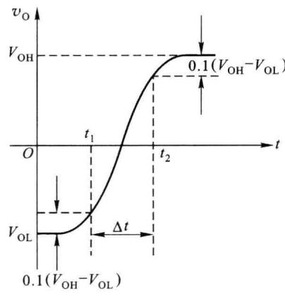  

(b)  

图 6.9.3 实际电压比较器的传输特性曲线

图 6.9.3(a) 中线性区边缘所对应的两个输入电压值 $v_{11}$ 、 $v_{12}$ 的差值 $\Delta v_{1}$ 称为比较器的灵敏度。 $\Delta v_{1}$ 越小，灵敏度越高。因为 $\Delta v_{1}$ 越小，线性区越窄，很小的输入电压变化就能改变比较器的输出状态。因此，灵敏度 $\Delta v_{1}$ 标志着比较器对输入信号电压的分辨能力。

为了提高灵敏度,应选择开环电压增益大、失调与温漂小的集成运放或集成比较器组成电压比较器电路。

若在比较器的输入端加理想阶跃信号,其输出电压 $v_{0}$ 从一个电平变到另一个电平也不是理想跳变,也需要一定的时间,如图6.9.3(b)所示。图中 $\Delta t$ 称为比较器的响应时间。 $\Delta t$ 越小,响应速度越快。为了提高响应速度,应选择高速、宽带集成运放或高速、超高速集成电压比较器来组成电压比较器电路。

在实际应用中,为了保护集成电压比较器的安全、提高工作速度或得到所需要的准确的输出电平,在比较器电路中常常施加限幅措施,常用的限幅电路如图6.9.4所示。

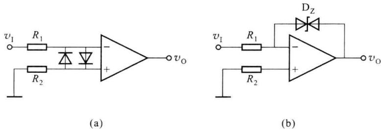  

图6.9.4 常用的限幅电路

在图 6.9.4(a) 所示电路中, 电阻 $R_{1}$ 、 $R_{2}$ 及并联于比较器的两输入端之间的二极管 $D_{1}$ 、 $D_{2}$ , 构成输入限幅电路, 将输入级的差模输入电压限制在 $\pm V_{D}$ 之内, 使得集成比较器或运放的输入电压不会过大, 内部晶体管处于深度饱和或截止状态, 提高速度; 或防止因差模输入电压过高使器件损坏。

在图 6.9.4(b) 所示电路中，稳压二极管（简称稳压管） $D_{z}$ 作为反馈元件接于比较器的输出端与反相输入端之间。选择 $V_{z}$ 的值小于集成比较器或运放的饱和和输出电压 $V_{\mathrm{OH}}(V_{\mathrm{OL}})$ ，在输出电压到达 $\pm V_{z}$ 时 $D_{z}$ 导通，使 $D_{z}$ 工作于稳压状态，构成了深度负反馈，比较器工作于线性状态。流过电阻 $R_{1}$ 的电流就是稳压管的工作电流。所以， $v_{p} \approx v_{N} \approx 0$ ，输出电压 $v_{0} = \pm V_{z}$ 。这种电路的主要优点是工作速度快。因为比较器工作于线性区，在比较器输出状态变化时，内部晶体管也工作于线性状态，内部电路不需要从截止到饱和，或从饱和到截止的转换过程，所以状态转换所需的开关时间较短。

由于运放和集成比较器的内部电路结构不同，在同样的外部供电电压下，输出的 $V_{\mathrm{OL}}$ 、 $V_{\mathrm{OH}}$ 也会有些区别，而在用比较器和其他电路构成诸如脉冲信号发生器等电路时，对比较器的输出电平会有较严格的要求。所以可以在比较器的输出端加一个由稳压管构成的限幅电路，形成较稳定、精确的输出电平。电路如图6.9.5所示。

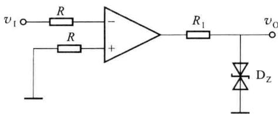  

图 6.9.5 比较器的输出限幅电路

在图 6.9.5 所示电路中，限流电阻 $R_{1}$ 和两只反向串联的稳压管 $D_{z}$ 接于运放或集成比较器的输出端，构成输出限幅电路。输出的电平为 $v_{0} = \pm V_{z}$ 。合理地选择 $V_{z}$ 可得到所需的

(a)

高、低电平值，而且高、低电平值稳定性好，受电源电压变化的影响很小。如果要求比较器输出高、低电平的绝对值不相等，则可选用两只特性不相同的稳压管反向串联使用。

## 6.9.2 单片集成电压比较器

集成电压比较器有精密电压比较器、高速电压比较器、超高速电压比较器之分。精密电压比较器具有较低的输入失调、较高的增益和较高的共模抑制比；高速电压比较器和超高速电压比较器具有较低的传输延时和较快的响应速度。

下面以 LT685(AM685) 比较器为例, 介绍其原理与特性。

图 6.9.6(a) 所示为超高速 LT685 电压比较器原理电路, 图 6.9.6(b) 所示为图 6.9.6(a) 电路的框图。

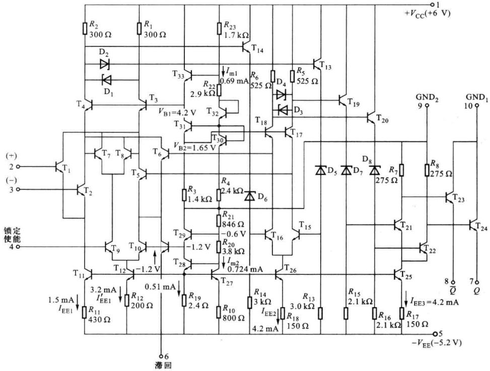

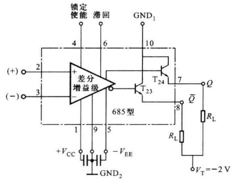  

(b)  

图 6.9.6 LT685 电压比较器原理电路和框图

LT685差分增益级由三级差放组成。差分输入电压放大级中 $\mathrm{T}_{1} \sim \mathrm{T}_{4}$ 构成共射-共基串联差放， $\mathrm{T}_{11}$ 为偏置电流源（ $I_{\mathrm{EE1}} = 1.5 \mathrm{~mA}$ ）， $R_{1}$ 和 $R_{2}$ 为负载， $\mathrm{D}_{1}, \mathrm{D}_{2}$ 齐纳管起限幅和加速转换作用。 $\mathrm{T}_{13}$ 和 $\mathrm{T}_{14}$ 以及齐纳管 $\mathrm{D}_{5}, \mathrm{D}_{6}, R_{13}, R_{14}$ 构成射极跟随隔离级并完成电平移动。 $\mathrm{T}_{15} \sim \mathrm{T}_{18}$ 以及 $\mathrm{D}_{3}, \mathrm{D}_{4}, R_{5}, R_{6}, R_{26}$ 构成第二差分电压放大级，也称为共射-共基宽带放大电路， $\mathrm{T}_{26}$ 提供偏置电流 $I_{\mathrm{EE2}} = 4.2 \mathrm{~mA}$ 。 $\mathrm{T}_{19}, \mathrm{T}_{20}$ 及 $\mathrm{D}_{7}, \mathrm{D}_{8}, R_{15}, R_{16}$ 构成差分射极跟随器，起缓冲与电平移动作用。 $\mathrm{T}_{21}$ 和 $\mathrm{T}_{22}$ 的射极偏置电流源由 $\mathrm{T}_{25}$ 提供，即 $I_{\mathrm{EE3}} = 4.2 \mathrm{~mA}$ ， $\mathrm{T}_{21}$ 和 $\mathrm{T}_{22}$ 构成第三差分电压放大级，它的差模输出信号经 $\mathrm{T}_{23}$ 和 $\mathrm{T}_{24}$ 的射极开路输出端 $\overline{Q}$ 和 $Q$ 输出。但实际应用时（输出电平为ECL电平），在引脚7和8必须外接负载 $R_{\mathrm{L}}$ 到 $V_{\mathrm{T}} = -2 \mathrm{~V}$ ，以使其输出与ECL电平兼容（ $V_{\mathrm{OH}} = -0.81 \mathrm{~V}, V_{\mathrm{OL}} = -1.85 \mathrm{~V}$ ），LT685比较器能驱动50Ω负载。

接在 $+V_{\mathrm{CC}}(+6\mathrm{~V})$ 到 $GND_{2}$ 端之间的正偏置电路由 $T_{30}\sim T_{33}$ 及电阻 $R_{3},R_{4},R_{22},R_{23}$ 组成，偏置电流 $I_{m1}=0.69\mathrm{~mA}$ ，分别为第一差放共基管 $T_{3},T_{4}$ 提供偏置电压 $V_{B1}=4.2\mathrm{~V}$ ，为第二差放共基管 $T_{17},T_{18}$ 提供偏置电压 $V_{B2}=1.65\mathrm{~V}$ 。接在 $GND_{2}$ 到 $-V_{EE}(-5.2\mathrm{~V})$ 之间的负偏置电路由 $T_{27}\sim T_{29}$ 及电阻 $R_{10},R_{19}\sim R_{21}$ 构成，偏置电流 $I_{m2}=0.724\mathrm{~mA}$ 。 $T_{27}$ 与 $T_{11},T_{12},T_{25},T_{26}$ 构成比例电流源组，分别为 $I_{EE1}=1.5\mathrm{~mA},I'_{EE1}=3.2\mathrm{~mA},I_{EE2}=4.2\mathrm{~mA},I_{EE3}=4.2\mathrm{~mA}$ 。这些电流源分别为各级提供偏置电流。

差分对管 $T_{5}$ 、 $T_{6}$ 对第二级差放 ( $T_{15}$ 、 $T_{16}$ 集电极) 的差模输出电压取样，并把信号反馈到第一差放 $T_{1}$ 、 $T_{2}$ 的集电极，构成一个正反馈回路，其作用有两个：只需在 6 脚到 5 脚 ( $-V_{EE}$ ) 间外接一电阻 ( $100\ \Omega \sim 2\ k\Omega$ )，便使 LT685 型比较器内部具有 3～70 mV 的滞回特性；当 4 脚接 ECL 逻辑低电平时，完成锁定功能。

当不需要锁定功能时，锁定使能端4接 $\mathrm{GND}_2$ 端或ECL逻辑高电平，此时 $\mathrm{T}_{9}$ 导通， $I_{\mathrm{C9}} = I_{\mathrm{EE1}} = 3.2\mathrm{mA},\mathrm{T}_7,\mathrm{T}_8$ 导通，工作电流为 $I_{\mathrm{C7}} = I_{\mathrm{C8}} = 1.6\mathrm{mA}$ ，但同时 $\mathrm{T}_{10}$ 截止， $\mathrm{T}_{5},\mathrm{T}_{6}$ 此时仅由 $\mathrm{T}_{34}$ 偏置。若6脚到5脚电阻为 $R_{\mathrm{H}} = 1\mathrm{k}\Omega$ ，则 $I_{\mathrm{C34}} = 3.4\mathrm{mA}$ 。 $\mathrm{T}_{5},\mathrm{T}_{6},\mathrm{T}_{7},\mathrm{T}_{8}$ 均参与正反馈， $R_{\mathrm{H}} = 1\mathrm{k}\Omega$ 时，可得滞回电压范围为 $10\mathrm{mV}$ 。当6脚开路时 $\mathrm{T}_{5},\mathrm{T}_{6}$ 截止，正反馈失效，滞回电压为零。

当比较器需要对输入信号取样并保持输出高电平或低电平状态时,则在4脚加入电平值为ECL低电平的负阶跃电压,使Q或 $\overline{Q}$ 保持不变。

## 6.9.3 电压比较器的应用电路

## 一、单限电压比较器

### 1. 过零电压比较器

当运放或集成电压比较器开环应用且某一输入端接地、另一个输入端接输入信号时，就构成过零比较器。反相输入过零比较器电路如图6.9.7(a)所示。集成运放（或集成电压比较器）工作在开环状态时，输出电压为 $V_{\mathrm{OH}}$ 或 $V_{\mathrm{OL}}$ 。当输入电压 $v_{1}<0\mathrm{~V}$ 时， $v_{0}=V_{\mathrm{OH}}$ ；当输入电压 $v_{1}>0\mathrm{~V}$ 时， $v_{0}=V_{\mathrm{OL}}$ ，其电压传输特性如图6.9.7(b)所示。

图 6.9.7(a) 所示的反相输入过零比较器电路中, 若将运放反相输入端接地, 信号从同相输入端输入, 可获得与图 6.9.7(b) 所示跃变方向相反的 $v_{0}$ 电压传输特性。

加有限制比较器输入级差模输入电压、输出端稳压管限幅电路的反相输入过零比较器如图 6.9.8 所示。

### 2. 一般单限电压比较器

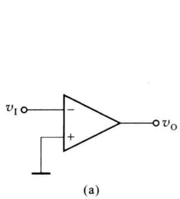

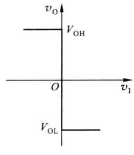  

(b)

图 6.9.7 反相输入过零比较器及其传输特性  

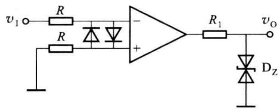  

图 6.9.8 输入、输出限幅的反相输入过零比较器

如果将图 6.9.8 中的同相输入端接一固定参考电压 $V_{REF}$ ，可得到输出跳变点不在零点的一般单限电压比较器（反相输入），如图 6.9.9(a) 所示。

根据 $v_{P}>v_{N}$ 时， $v_{0}=V_{OH}$ ; $v_{P}<v_{N}$ 时， $v_{0}=V_{OL}$ ，得到传输特性如图 6.9.9(b) 所示。

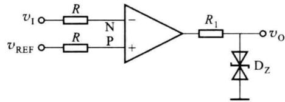  

(a)

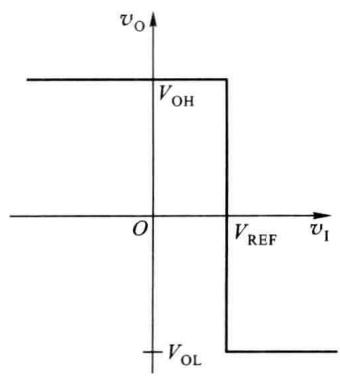  

(b)  

图 6.9.9 一般反相输入单限电压比较器及其传输特性

(b)

如果将 $V_{REF}$ 和 $v_{I}$ 交换可得如图 6.9.10 所示的电路及其传输特性。

(a)  

(b)  

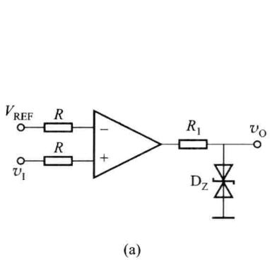

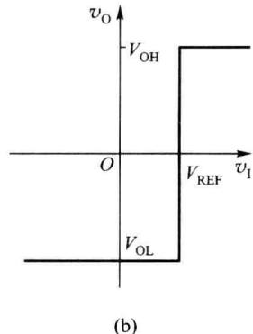  

图 6.9.10 一般同相输入单限电压比较器及其传输特性

通常称输出跳变时所对应的输入电压值为阈值电压 $V_{th}$ ，显然，过零比较器的阈值电压 $V_{th}=0$ ，一般单限电压比较器的阈值电压 $V_{th}=V_{REF}$ 。当 $V_{REF}$ 变化时， $V_{OH}$ 到 $V_{OL}$ 的跳变点（阈值电压 $V_{th}$ ）将在横轴上左右变化。

参考电压也可以与 $v_{1}$ 加在同一个输入端, 电路如图 6.9.11(a) 所示。

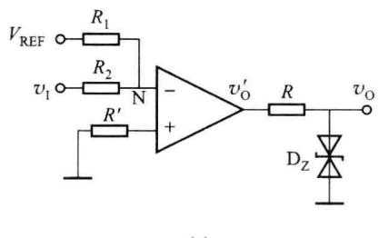

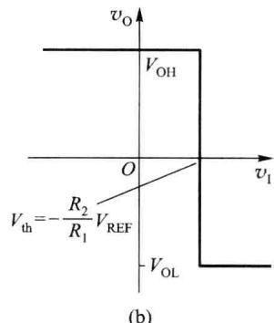  

图 6.9.11 $V_{REF}$ 与 $v_{1}$ 加在同一个输入端的单限电压比较器及其传输特性

根据叠加定理,集成运放反相输入端的电位为

$$

v _ {\mathrm{N}} = \frac {R _ {1}}{R _ {1} + R _ {2}} v _ {1} + \frac {R _ {2}}{R _ {1} + R _ {2}} V _ {\mathrm{REF}}\tag{6.9.1}

$$

令 $v_{N}=v_{P}=0$ ，则求出阈值电压

$$

V _ {\mathrm{th}} = - \frac {R _ {2}}{R _ {1}} V _ {\mathrm{REF}}\tag{6.9.2}

$$

当 $v_{I}$ 变化使 $v_{N}<v_{P}$ ，有 $v_{0}=+V_{Z}$ ，当 $v_{I}$ 变化使 $v_{N}>v_{P}$ ，有 $v_{0}=-V_{Z}$ 。电路的电压传输特性如图 6.9.11(b) 所示。

根据式(6.9.2)可知,只要改变参考电压的大小和极性,或改变电阻 $R_{1}$ 和 $R_{2}$ 的阻值,就可以改变阈值电压的大小和极性。若要改变 $v_{I}$ 过 $V_{th}$ 时 $v_{0}$ 的跃变方向，则应将集成运放的同相输入端和反相输入端所接外电路互换即可。

<Example title="例 6.9.1">
分析图 6.9.12 所示电路的功能, 当输入信号为正弦波时, 画出输出波形。已知, AD711 为工作于线性工作区的运算放大器, AD790 为电压比较器。场效应管工作于开关状态。

<Solution title="解">
AD790 组成反相输入的过零比较器，输出电平控制 MOS 管 T，使 MOS 管起开关作用。在输入电压 $v_{i}$ 为正半周时，比较器输出为低电平，T 截止，则

$$

v _ {\mathrm{O}} = - \frac {R _ {\mathrm{F}}}{R _ {1}} v _ {\mathrm{i}} + \left(1 + \frac {R _ {\mathrm{F}}}{R _ {1}}\right) v _ {\mathrm{i}} = v _ {\mathrm{i}}\tag{6.9.3}

$$

在输入电压 $v_{i}$ 为负半周时, 比较器输出为高电平, MOS 管 T 导通, 将运放的同相输入端接地, 则

$$

v _ {\mathrm{O}} = - \frac {R _ {\mathrm{F}}}{R _ {\mathrm{I}}} v _ {\mathrm{i}} = - v _ {\mathrm{i}}\tag{6.9.4}

$$

所以，电路的输出、输入关系为 $v_{0}=|v_{i}|$ 实现了精密全波整流功能。该电路能对低至几毫伏大至 10 V 的信号实现整流，输出波形如图 6.9.13 所示。

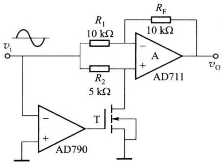  

图 6.9.12 例 6.9.1 电路

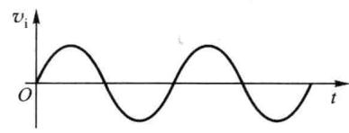

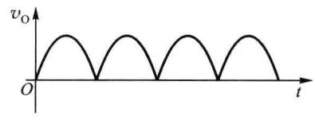  

图 6.9.13 例 6.9.1 电路的输出波形
</Solution>
</Example>

## 二、滞回电压比较器

滞回电压比较器(也称施密特触发器)是通过引入正反馈形成具有迟滞特性的比较器。从集成运放(或集成比较器)反相输入端输入的滞回比较器电路如图6.9.14(a)所示。

由于集成运放(或集成比较器)输出端加有限幅电路,所以输出电压 $v_{0}=\pm V_{z}$ 。集成运放反相输入端电位 $v_{N}=v_{I}$ ，同相输入端电位为

$$

v _ {\mathrm{P}} = \pm \frac {R _ {1}}{R _ {1} + R _ {2}} V _ {\mathrm{Z}}

$$

由于运放在 $v_{N}=v_{P}$ 时发生输出跳变, 所以 $v_{I}=v_{P}$ 时的输入电压值就是阈值电压, 因此得出

下限阈值电压

$$

V _ {\mathrm{th1}} = - \frac {R _ {1}}{R _ {1} + R _ {2}} V _ {\mathrm{z}}

$$

上限阈值电压

$$

V _ {\mathrm{th2}} = + \frac {R _ {1}}{R _ {1} + R _ {2}} V _ {\mathrm{z}}

$$

(b)  

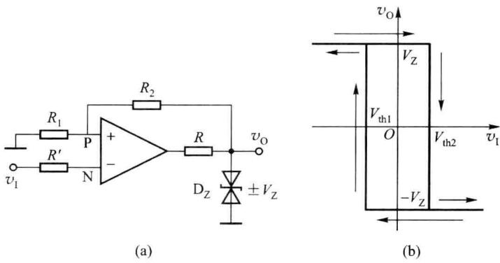  

图 6.9.14 反相输入端输入的滞回比较器电路及其传输特性

当 $v_{1}<V_{th1}$ 时， $v_{0}=+V_{Z}$ ，此时 $v_{P}=V_{th2}$ ，所以 $v_{1}$ 增加到 $V_{th1}$ 时，输出仍保持为高电平 $v_{0}=+V_{Z}$ 。直到 $v_{1}$ 增加到 $V_{th2}$ 时，输出跳变为低电平 $v_{0}=-V_{Z}$ 。

同样，当 $v_{I}>V_{th2}$ 时， $v_{0}=-V_{Z}$ ，此时 $v_{P}=V_{th1}$ ，所以 $v_{I}$ 减小到 $V_{th2}$ 时，输出仍保持为低电平 $v_{0}=-V_{Z}$ 。直到 $v_{I}$ 减小到 $V_{th1}$ 时，输出跳变为高电平 $v_{0}=+V_{Z}$ 。传输特性曲线如图 6.9.14(b) 所示。

若将电阻 $R_{1}$ 的接地端接参考电压 $V_{REF}$ ，则上、下限阈值电压值将发生变化，如图 6.9.15(a)、(b) 所示。

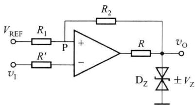  

(a)

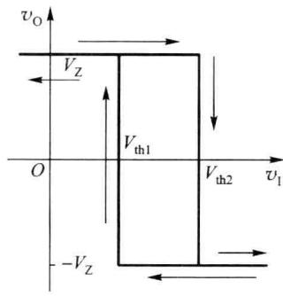  

图 6.9.15 有 $V_{REF}$ 的反相输入滞回比较器电路及其传输特性

根据叠加定理可以求出集成运放同相输入端的电位

$$

v _ {\mathrm{P}} = \frac {R _ {2}}{R _ {1} + R _ {2}} V _ {\mathrm{REF}} \pm \frac {R _ {1}}{R _ {1} + R _ {2}} V _ {\mathrm{Z}}

$$

运放在 $v_{N}=v_{P}$ 时发生输出跳变， $v_{I}=v_{P}$ 时的值就是阈值电压，有

下限阈值电压

$$

V _ {\mathrm{th1}} = \frac {R _ {2}}{R _ {1} + R _ {2}} V _ {\mathrm{REF}} - \frac {R _ {1}}{R _ {1} + R _ {2}} V _ {\mathrm{Z}}

$$

上限阈值电压

$$

V _ {\mathrm{th2}} = \frac {R _ {2}}{R _ {1} + R _ {2}} V _ {\mathrm{REF}} + \frac {R _ {1}}{R _ {1} + R _ {2}} V _ {\mathrm{Z}}

$$

显然,在加了参考电压后,传输特性曲线在横轴上产生了一个偏移,偏移量为 $\frac{R_{2}}{R_{1}+R_{2}}\cdot V_{REF}$ 。改变 $V_{REF}$ 的大小和极性可以改变偏移量的大小和方向。

通过以上分析可以得出以下结论。

（1）滞回比较器的传输特性具有两个分支，形状类似于磁滞回线。它有两个不同的阈值电压 $V_{th1}$ 、 $V_{th2}$ ，因而形成滞回特性。

（2）两个阈值之差 $\Delta V_{th} = V_{th2} - V_{th1}$ ，称为“回差”电压。引起滞回特性的原因是引入了正反馈，反馈越深，回差电压 $\Delta V_{th}$ 越大。

（3） $V_{th2}$ 、 $V_{th1}$ 的值与 $V_{REF}$ 有关，而回差电压大小与 $V_{REF}$ 大小无关。说明 $V_{REF}$ 的作用是改变 $V_{th2}$ 、 $V_{th1}$ 的值，使传输特性在横轴上左右移动。

（4）由于运放或集成比较器的增益有限，输出电压从一个电平变到另一个电平要经过线性区，需要一定的时间。滞回比较器引入正反馈，可以加速输出状态的转换过程。这种正反馈过程使输出电压跳变边沿变陡，缩短了比较器的响应时间。

（5）滞回比较器与单限电压比较器相比还有一个明显的优点，即抗干扰能力较强，不易产生误动作。这是因为，当输出电压一旦跳变后，只要在跳变点附近输入电压上叠加的干扰电压大小不超过 $\Delta V_{th}$ ，输出电压的值就可保持稳定不变， $\Delta V_{th}$ 值越大，抗干扰能力越强。

滞回比较器也可以接成同相输入方式,即将图6.9.15(a)中 $V_{REF}$ 和 $v_{I}$ 的位置互换即可,其电路和传输特性如图6.9.16所示。读者可自己分析它的工作原理。

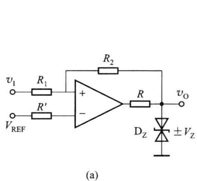

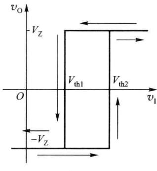  

图 6.9.16 同相输入的滞回比较器电路及其传输特性

在单限比较器中,输入电压在阈值电压附近的任何微小变化,都将引起输出电压的跃变,不管这种微小变化是来源于输入信号还是外部干扰。因此,虽然单限比较器很灵敏,但是抗干扰能力差。滞回比较器具有滞回特性,因而也就具有一定的抗干扰能力。

看一个简单的例子,比较单限电压比较器与滞回比较器的抗干扰能力。单限电压比较器如图6.9.10(a)所示,滞回比较器如图6.9.16(a)所示。假设远处传输过来的信号为一脉冲波形,幅度为0\~5 V,如图6.9.17(a)所示。经过传输后,由于干扰,第一个脉冲波形已经严重变差,如图6.9.17(b)所示。

(a)

图 6.9.17(c) 所示为使用单限电压比较器对信号进行整形(再生)后得到的结果。阈值电压 $V_{th} = 2.5 \, V$ 。可以看到，由于干扰过大，无论阈值电压选取何值，都无法恢复原有的波形。

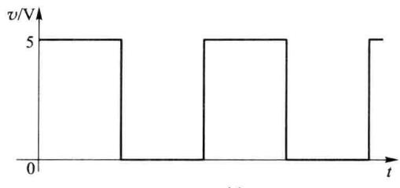

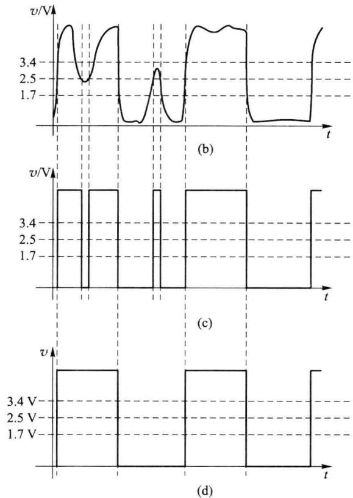  

图 6.9.17 单限电压比较器与滞回比较器的抗干扰能力比较

图 6.9.17(d) 所示为使用滞回电压比较器对信号进行整形(再生)后得到的结果。阈值电压 $V_{th1}=1.7\ V, V_{th2}=3.4\ V$ 。可以看到，虽然输入信号已经变得很差，但输出基本可以得到原有的波形，去除了干扰。

## 三、窗口比较器

窗口比较器是用于判断输入电压是否处于两个已知电平之间或在某一段已知电平之外的电压比较器。单限比较器和滞回比较器在输入电压单一方向变化时（如从低电平到高电平变化时），输出电压只跃变一次，因而不能检测出输入电压是否在两个给定电压之间，而窗口比较器具有这一功能，所以也称双限比较器。窗口比较器可用于自动测试、故障检测等系统。

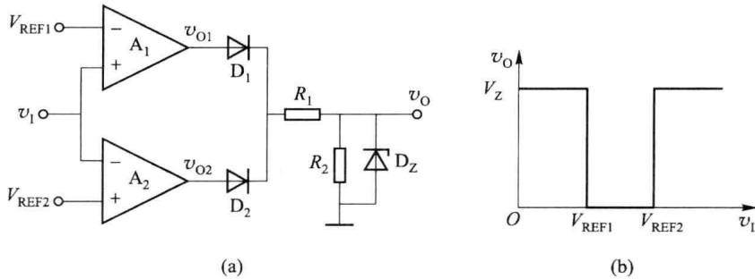  

图 6.9.18 窗口比较器的原理电路及其电压传输特性

图 6.9.18(a) 所示是由两个运放（或集成比较器）组成的窗口比较器的原理电路，图 6.9.18(b) 为其电压传输特性。

图 6.9.18 中，假设外加参考电压 $V_{REF1} > V_{REF2}$ ，电阻 $R_{1}$ 、 $R_{2}$ 和稳压管 $D_{Z}$ 构成限幅电路。

当输入电压 $v_{1}$ 大于 $V_{REF1}$ 时，必然大于 $V_{REF2}$ ，所以集成运放 $A_{1}$ 的输出电压 $v_{01} = V_{OH}$ ， $A_{2}$ 的输出电压 $v_{02} = V_{OL}$ 。使得二极管 $D_{1}$ 导通， $D_{2}$ 截止，输出为高电平，稳压管 $D_{Z}$ 工作于稳压状态，输出电压 $v_{0} = +V_{Z} (V_{Z}$ 小于运放输出电压 $V_{OH}$ 。

当输入电压 $v_{1}$ 小于 $V_{REF2}$ 时，必然小于 $V_{REF1}$ ，集成运放 $A_{1}$ 的输出电压 $v_{01}=V_{0L}$ ， $A_{2}$ 的输出电压 $v_{02}=V_{0H}$ 。使得二极管 $D_{2}$ 导通， $D_{1}$ 截止，稳压管 $D_{Z}$ 仍工作于稳压状态，输出电压仍为高电平电压 $v_{0}=+V_{Z}$ 。

当输入电压 $v_{1}$ 大于 $V_{REF2}$ ，并小于 $V_{REF1}$ 时，集成运放 $A_{1}$ 的输出为低电平电压 $v_{01} = V_{0L}$ ， $A_{2}$ 的输出也是低电平电压 $v_{02} = V_{0L}$ 。使得二极管 $D_{1}$ 、 $D_{2}$ 都截止，运放的输出为低电平电压 $V_{0L} = 0 \, V$ 。

通过以上三种电压比较器的分析,可得出如下结论。

（1）在电压比较器中，集成运放主要工作在非线性区，输出电压只有高电平和低电平两种可能的情况。

(2) 电压比较器一般用电压传输特性来描述输出电压与输入电压的函数关系。

（3）电压传输特性的三个基本要素是输出电压的高低电平值、阈值电压值和输出电压的跃变方向。输出电压的高、低电平决定于限幅电路；阈值电压为 $v_{N}=v_{P}$ 时对应的输入电压；输出电压的跃变方向取决于输入电压加在运放的同相输入端还是反相输入端。
