import Guide from '@/components/Guide.astro';
import Knowledge from '@/components/Knowledge.astro';
import Example from '@/components/Example.astro';
import Analysis from '@/components/Analysis.astro';
import Solution from '@/components/Solution.astro';
import Variant from '@/components/Variant.astro';
import Note from '@/components/Note.astro';
import Block from '@/components/Block.astro';
import Method from '@/components/Method.astro';
import Exercise from '@/components/Exercise.astro';

## 习题

<Exercise title="习题 7.1.1">
什么是脉冲波？什么是占空比？方波的占空比是多少？
</Exercise>

<Exercise title="习题 7.2.1">
电路如图题7.2.1所示，晶体管发射结导通电压降 $v_{\mathrm{BE}} = 0.7\mathrm{V}$ ，分别计算当输入端接 $0\mathrm{V}, 5\mathrm{V}$ 和悬空时，输出电压 $v_{0}$ 的数值。

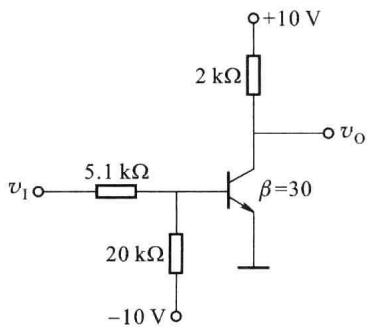  

(a)

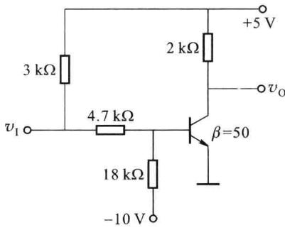  

(b)  

图题7.2.1

<Solution>
(a) $+10\mathrm{V}, + 0.3\mathrm{V}, + 10\mathrm{V}$ (b) $+5\mathrm{V}, + 0.3\mathrm{V}, + 5\mathrm{V}$
</Solution>
</Exercise>

<Exercise title="习题 7.2.2">
电路如图题 7.2.2 所示, 其中晶体管的 $\beta=100$ , 发射结导通电压降 $v_{BE}=0.7\ V, V_{CC}=12\ V$ 。

（1）设 $R_{c}=2\ k\Omega$ ，当输入电压 $v_{1}$ 由 0 V 跳变到 4 V 时，晶体管能否从截止转为饱和？

(2) 若 $R_{c}=1\ k\Omega$ ，晶体管能否从截止转为饱和？

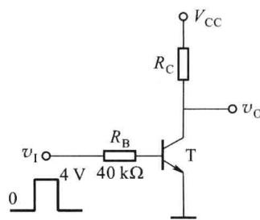

<Solution>
(1) 能；(2) 不能
</Solution>
</Exercise>

<Exercise title="习题 7.2.3">
两种晶体管反相器电路如图题7.2.3所示，负载电容 $C_{L}=100\ pF,v_{11},v_{12}$ 为反相输入信号， $v_{0}$ 为反相器的输出端。设各晶体管的参数相同，导通时基极驱动电流相等，试分析这两种电路输出电压的边沿变化情况，比较它们的工作速度。

图题7.2.2  

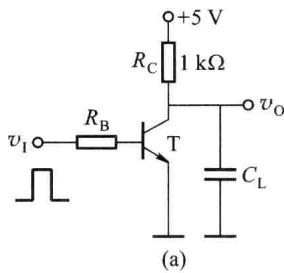

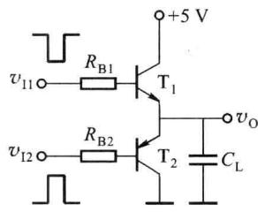  

(b)  

图题7.2.3

<Solution>
（b）高低电平都是低阻输出，边沿好，速度快
</Solution>
</Exercise>

<Exercise title="习题 7.3.1">
在设计数字电路时,是否可以将与非门、或非门当作反相器(非门)使用?若可以,电路应如何连接?

<Solution>
可以
</Solution>
</Exercise>

<Exercise title="习题 7.3.2">
异或逻辑是一种复合逻辑, 即 $F = A \oplus B = A \overline{B} + \overline{A}B$ , 试问两输入异或门能否作为可控反相器使用?

<Solution>
可以
</Solution>
</Exercise>

<Exercise title="习题 7.3.3">
由与或非门组成的双稳态触发器如图题7.3.3所示，请写出触发器的状态方程，作出触发器的功能表。当 $G = 1$ 时触发器处于什么状态？ $G = 0$ 时呢？

<Solution>
当 G=1 时， $Q^{n+1}=Q^{n}$ ; 当 G=0 时， $Q^{n+1}=\bar{B}+AQ^{n}$
</Solution>
</Exercise>

<Exercise title="习题 7.3.4">
开关在转换时,由于簧片的颤动,会引起输出信号的抖动,因此实际使用时要加上防抖动电路。RS 触发器是常用的电路之一,如图题 7.3.4 所示,试说明其工作原理。

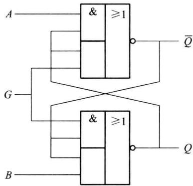  

图题7.3.3

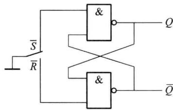  

图题7.3.4
</Exercise>

<Exercise title="习题 7.4.1">
用TTL与非门组成的单稳态触发器如图题7.4.1所示。

（1）为保证稳态时 $v_{01}$ 输出低电平， $v_{02}$ 输出高电平， $R_{d}$ 和 R 应如何选取？

(2) 画出 $v_{01}$ 、 $v_{02}$ 的波形。

（3）设与非门截止时输出电阻为 $R_{o}$ ，求输出脉宽 $t_{w}$ 。

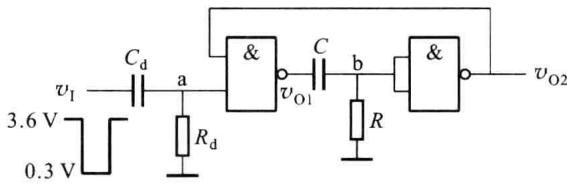  

图题7.4.1

<Solution>
(1) $R_{\mathrm{d}}$ 大于 $2\mathrm{k}\Omega ,R$ 小于 $700\Omega$
</Solution>
</Exercise>

<Exercise title="习题 7.4.2">
用 CMOS 或非门组成的微分型单稳态触发器电路如图题 7.4.2 所示。

(1) 试分析其工作原理。

(2) 画出 a、b 点电压及 $v_{0}$ 的波形。

(3) 求输出脉冲宽度 $t_{w}$ 。

<Solution>
$t_{\mathrm{W}} \approx 0.7R_{\mathrm{B}}C_{1}$
</Solution>
</Exercise>

<Exercise title="习题 7.5.1">
用施密特触发器能否存储 1 位二值数据？说明理由。
</Exercise>

<Exercise title="习题 7.5.2">
由 TTL 门电路组成的施密特触发器如图题 7.5.2 所示, 试分析电路的工作原理, 画出 $v_{01}$ 和 $v_{0}$ 的电压传输特性。

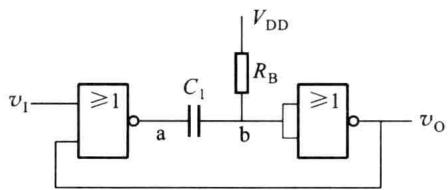  

图题7.4.2

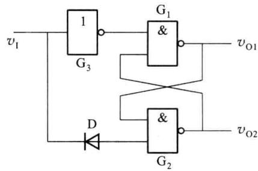  

图题7.5.2
</Exercise>

<Exercise title="习题 7.5.3">
由集成施密特触发器和集成单稳态触发器 74121 构成的电路如图题 7.5.3 所示，已知施密特电路的 $V_{DD} = 10 \, V$ ，单稳态触发器 $V_{T+} = 6.3 \, V, V_{T-} = 2.7 \, V$ 。

(1) 计算 $v_{01}$ 的周期和 $v_{02}$ 的脉冲宽度；

(2) 画出 $v_{C}$ 、 $v_{01}$ 、 $v_{02}$ 的波形。

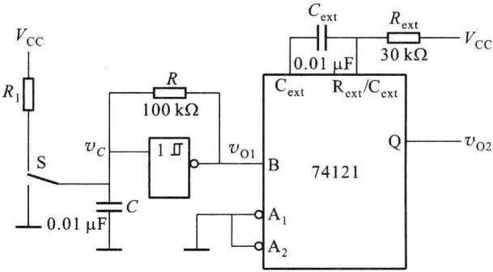  

图题7.5.3

<Solution>
(1) $1.53 \times 10^{-3} \mathrm{~s}, 0.21 \times 10^{-3} \mathrm{~s}$
</Solution>
</Exercise>

<Exercise title="习题 7.6.1">
利用门电路固有的传输延迟,将奇数个非门首尾相接,可组成多谐振荡器,常称为环形振荡器。图题7.6.1所示电路是由3个TTL非门构成的环形振荡器,设各门的传输延迟时间相同。试画出各输出端的波形,并计算振荡周期和频率。
</Exercise>

<Exercise title="习题 7.6.2">
电路如图题 7.6.2 所示, 已知 $V_{1}$ 为大于零的直流电压, $A_{1}$ 、 $A_{2}$ 为理想运放, 电容 C 上的初始电压为零, 当 $v_{02}$ 输出高电平时开关 S 闭合, 当 $v_{02}$ 输出低电平时开关 S 断开。

(1) 画出 $v_{01}$ 和 $v_{02}$ 的波形, 标明电压的幅值;

(2) 推导振荡频率与 $V_{1}$ 的关系；

(3) 说明电路的功能。

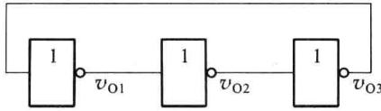  

图题7.6.1

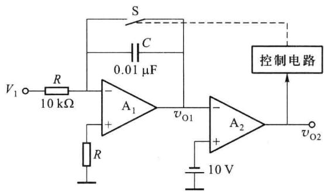  

图题7.6.2

<Solution>
(2) $T \approx T_{1} = \frac{10RC}{V_{1}}$ , 因此 $f = \frac{1}{T} \approx \frac{V_{1}}{10RC}$

## (3) 电压频率转换电路
</Solution>
</Exercise>

<Exercise title="习题 7.7.1">
在图题 7.7.1 所示的方波发生器中, 设 A 为理想运放, 试画出输出电压 $v_{0}$ 和电容 C 上电压的波形, 并计算振荡周期 T。

<Solution>
$T\approx 4.4~\mathrm{ms}$
</Solution>
</Exercise>

<Exercise title="习题 7.7.2">
在图题 7.7.2 中, 设 A 为理想运放, $D_{1}$ 、 $D_{2}$ 为理想二极管, 试证明调节 $R_{p}$ 改变占空比时, 周期 T 保持不变。

<Solution>
$T = T_{1} + T_{2} = (2R + R_{\mathrm{P}})C\ln \left(1 + \frac{2R_{1}}{R_{2}}\right)$
</Solution>
</Exercise>

<Exercise title="习题 7.7.3">
三角波发生器电路如图题 7.7.3 所示, 其中 $A_{1}$ 、 $A_{2}$ 、 $A_{3}$ 均为理想运放。

(1) 计算输出电压 $v_{0}$ 的幅值和振荡周期 T;

(2) 画出 $v_{01}$ 、 $v_{02}$ 和 $v_{0}$ 的波形。

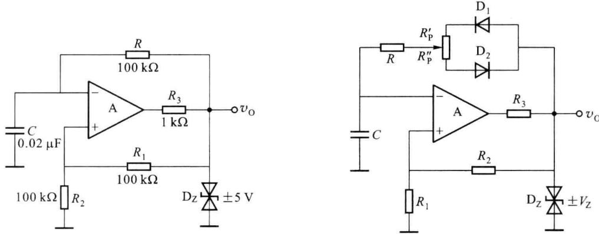  

图题7.7.1  

图题7.7.2

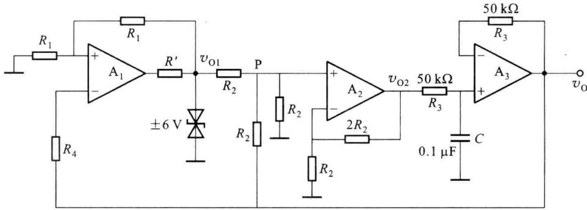  

图题7.7.3

<Solution>
3 V,10 ms
</Solution>
</Exercise>

<Exercise title="习题 7.7.4">
电路如图题 7.7.4 所示, 其中 $A_{1}$ 、 $A_{2}$ 、 $A_{3}$ 均为理想运放, 场效应管 T 为理想开关。

(1) 说明 $A_{1}$ 、 $A_{2}$ 组成电路的功能；

(2) 设 t=0 时 $v_{01}=6\ V, v_{02}=4\ V$ ，画出 $v_{01}$ 和 $v_{02}$ 的波形；

（3）设场效应管的夹断电压 $V_{\mathrm{GS(off)}} = -4 \, \mathrm{V}$ ，画出 $v_{0}$ 的波形。

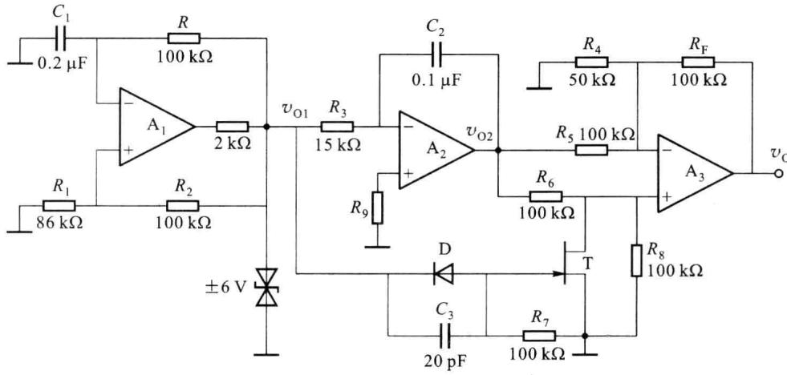  

图题7.7.4

<Solution>
（1） $A_{1}$ 组成方波发生电路； $A_{2}$ 组成反相积分器

(2) $T = 2RC_{1}\ln \left(1 + \frac{2R_{1}}{R_{2}}\right)\approx 4\mathrm{ms}$
</Solution>
</Exercise>

<Exercise title="习题 7.7.5">
图题 7.7.5 所示电路是一个锯齿波发生电路, 其中 -V 为恒定的负电压, 电阻 $R' \ll R$ 。

(1) 分析电路的工作原理, 画出 $v_{0}$ 的波形;

(2) 若要求输出电压范围 $0 \sim V_{m}$ ，求 $V_{REF}$ 和 $V_{m}$ 之值；

(3) 计算扫描正程的时间；

（4）说明如何调节锯齿波的频率。

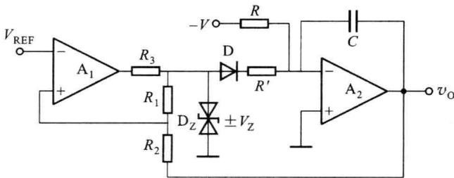  

图题7.7.5

<Solution>
(2) $V_{\mathrm{REF}} = \frac{R_2}{R_1 + R_2} V_Z, V_{\mathrm{m}} = \frac{2R_2}{R_1} V_Z$

(3) $T_{1} = \frac{2R_{2}RC}{R_{1}}\times \frac{V_{z}}{V}$

(4) 调节 V、R 及 C
</Solution>
</Exercise>

<Exercise title="习题 7.8.1">
555定时器接成多谐振荡器如图题7.8.1所示，已知 $R_{1} = 18\mathrm{k}\Omega ,R_{2} = 56\mathrm{k}\Omega ,C = 0.022~\mu \mathrm{F}$ ，试计算输出波形的周期和频率。
</Exercise>

<Exercise title="习题 7.8.2">
由555定时器构成的多谐振荡器如图题7.8.2所示，其输出波形的占空比取决于哪些参数？若要求占空比为 $50\%$ ，应如何选择这些参数？

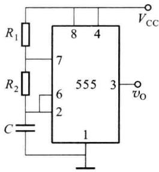  

图题7.8.1

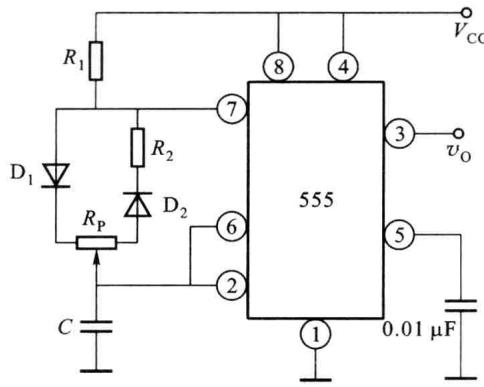  

图题7.8.2
</Exercise>

<Exercise title="习题 7.8.3">
555 定时器接法如图题 7.8.3 所示, $R = 500 \mathrm{k}\Omega, C = 10 \mu \mathrm{F}$ , 画出 $v_{0}$ 的波形, 并计算 $v_{0}$ 的下降沿比 $v_{1}$ 下降沿延迟了多长时间。

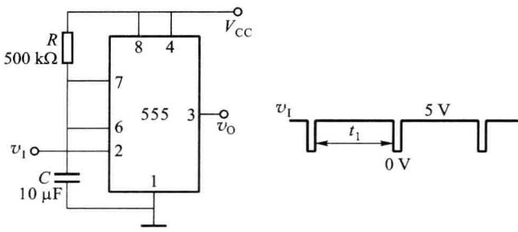  

图题7.8.3
</Exercise>

<Exercise title="习题 7.8.4">
用 555 定时器和适当的阻容元件, 设计一个可调矩形波信号发生器, 输出频率为 10\~20 kHz。
</Exercise>

<Exercise title="习题 7.8.5">
用 555 定时器组成的过压监测电路如图题 7.8.5 所示。当被检测电压 $v_{x}$ 超过一定值时，发光二极管发出闪烁的报警信号，试分析电路的工作原理；假设晶体管发射结导通电压为 0.7 V，被监测电压 $v_{x}$ 超过多少伏，发光二极管发出报警信号？

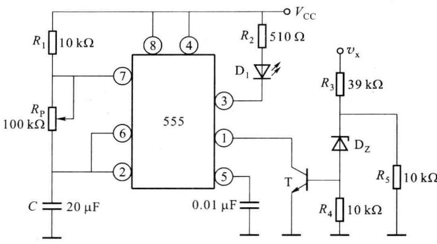  

图题7.8.5
</Exercise>

<Exercise title="习题 7.8.6">
某工程抢修车报警电路能产生“鸣-鸣”的声音,其主频率为 $300 \, Hz$ , 发声的持续和间断时间分别为 $0.5 \, s$ 和 $0.3 \, s$ , 试用 555 定时器设计该电路。
</Exercise>

<Exercise title="习题 7.8.7">
分析图题 7.8.7 所示电路的组成和工作原理, 当 $V_{cc} = 12 \, V$ 时, 555 定时器输出的高、低电平分别为 10.6 V 和 0.1 V, 输出电阻小于 100 Ω, 可以忽略不计。试计算扬声器发出声音的高、低频率及高、低音持续的时间。

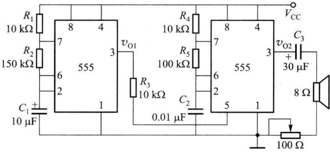  

图题7.8.7
</Exercise>
