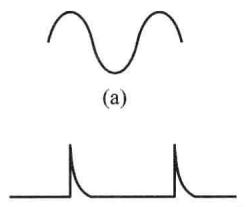
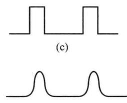
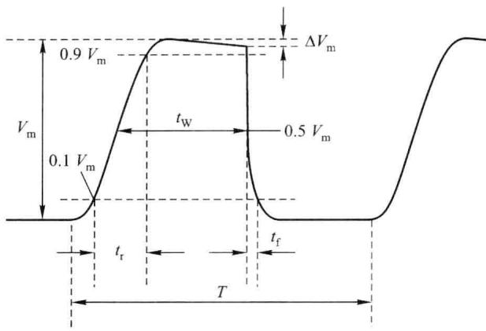

import Guide from '@/components/Guide.astro';
import Knowledge from '@/components/Knowledge.astro';
import Example from '@/components/Example.astro';
import Analysis from '@/components/Analysis.astro';
import Solution from '@/components/Solution.astro';
import Variant from '@/components/Variant.astro';
import Note from '@/components/Note.astro';
import Block from '@/components/Block.astro';
import Method from '@/components/Method.astro';
import Exercise from '@/components/Exercise.astro';

在电子技术领域,信号的波形一般分为正弦波和非正弦波两大类,凡是按正弦规律变化的波形都称为正弦波,凡是按非正弦规律变化的波形都称为非正弦波或脉冲波。图7.1.1所示为一些常见的波形,其中图(a)是按正弦规律变化的波形,属于正弦波,图(b)\~图(f)是按非正弦规律变化的波形,属于脉冲波,分别称为方波、矩形波、尖顶波、锯齿波和钟形波。这些波形都是时间的函数,正弦波幅值的变化是连续的,脉冲波幅值的变化有突变点,有缓慢变化的部分和快速变化的部分。

  

图 7.1.1 常用信号波形

在数字电路中,最常见的脉冲波是矩形脉冲波(如矩形波、方波),理想矩形脉冲波的突变部分是瞬时的,即瞬间完成高、低电平的跳变。但是,实际的矩形脉冲波无论从低电平跳变到高电平还是从高电平跳变到低电平,都不是理想跳变,都需要一定的时间。图7.1.2给出了矩形脉冲波的实际波形,其参数描述如下。

脉冲幅度 $V_{m}$ : 指脉冲高、低电平之差, 表示脉冲信号的最大变化幅度。

上升时间 $t_{r}$ : 脉冲上升沿从 $0.1V_{m}$ 上升至 $0.9V_{m}$ 所需的时间。

  

图 7.1.2 实际的矩形脉冲波形

下降时间 $t_{f}$ : 脉冲下降沿从 $0.9V_{m}$ 下降至 $0.1V_{m}$ 所需的时间。

脉冲周期 T: 脉冲波形上相邻两个对应点之间的时间间隔, 它的倒数称为信号的频率。

平均脉宽 $t_{w}$ : 脉冲前沿上升至 $0.5V_{m}$ 处和后沿下降至 $0.5V_{m}$ 处的时间间隔。 $t_{w}$ 是脉冲信号的持续时间， $T-t_{w}$ 则称为脉冲休止期。

占空比 D: 平均脉宽 $t_{w}$ 和脉冲周期 T 的比值, 方波的占空比为 50%。

顶部倾斜: 图 7.1.2 中的 $\Delta V_{m}$ 之值。

频谱分析表明,矩形脉冲的前后沿变化速度快,集中了信号的高频成分;顶部和底部变化速度慢,集中了信号的低频成分。将脉冲信号加至放大电路的输入端,如果输出信号波形的边沿很陡,说明放大电路能够放大快速变化的信号,有很高的上限截止频率;如果输出信号的顶部和底部很平,说明放大电路能放大缓慢变化的信号,有很低的下限截止频率。
