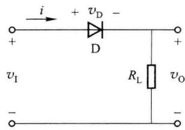
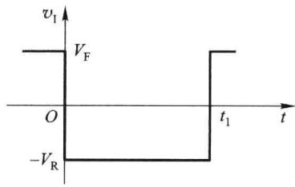
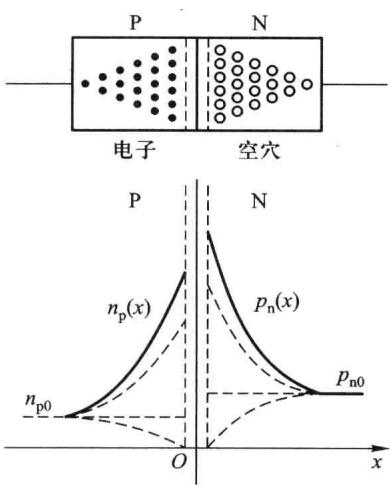
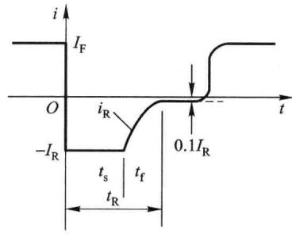
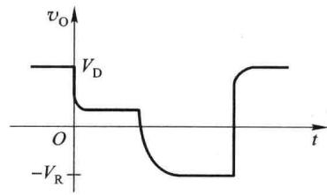
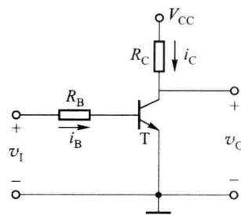
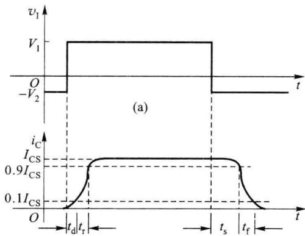
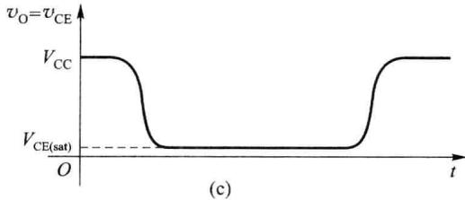

import Guide from '@/components/Guide.astro';
import Knowledge from '@/components/Knowledge.astro';
import Example from '@/components/Example.astro';
import Analysis from '@/components/Analysis.astro';
import Solution from '@/components/Solution.astro';
import Variant from '@/components/Variant.astro';
import Note from '@/components/Note.astro';
import Block from '@/components/Block.astro';
import Method from '@/components/Method.astro';
import Exercise from '@/components/Exercise.astro';

在放大电路中,晶体管工作在放大状态,实现信号的线性放大。在脉冲和数字电路中,由于输入和输出信号均为脉冲信号,电路中的半导体二极管、晶体管和场效应管通常都工作在开关状态,下面讨论半导体器件的开关特性。

## 7.2.1 二极管开关特性

前面讨论二极管的开关模型时曾经指出,在大信号的情况下,二极管相当于理想的开

关,外加正向电压时导通,外加反向电压时截止,二极管开关过程是瞬时的。实际上,二极管由导通到截止,以及由截止到导通都不能瞬间完成,都需要一定的过渡时间。图7.2.1是一个典型的二极管开关电路,下面讨论二极管的开关特性。

二极管由导通状态变为截止状态所需的时间称为反向恢复时间 $t_{R}$ 。当输入电压 $v_{I}=V_{F}$ 时，二极管导通，产生正向电流 $I_{\mathrm{F}}=(V_{\mathrm{F}}-v_{\mathrm{D}})/R_{\mathrm{L}}$ ，其中 $v_{D}$ 为二极管两端的正向电压降。PN 结处于正偏状态，空间电荷区变窄，多数载流子的扩散运动得到加强，P 区中的空穴和 N 区中的电子不断向对方区域扩散，并在对方区域内建立起一定的非平衡载流子浓度梯度分布，如图 7.2.2 所示。正向电流越大，浓度梯度越陡，PN 结两侧中性区域内存储的非平衡载流子数目越多，这种非平衡载流子的积累现象称为电荷存储效应。

  

图 7.2.1 二极管开关电路

  

图 7.2.2 存储电荷分布变化图

  

图7.2.3 二极管的开关特性

在 t=0 时刻, 外加电压从 $V_{F}$ 跳变为 $-V_{R}$ , 如图 7.2.3 所示。此时, PN 结两侧存储的电荷不能瞬间消失, 由于这些存储电荷的存在, PN 结继续维持正偏, 仍呈低阻状态。在反向电压 $-V_{R}$ 的作用下, 这些存储电荷形成反向漂移电流, 即反向电流 $I_{R}$ , 其值约为 $\frac{-V_{R}}{R_{L}}$ 。反向漂移电流使 PN 结两侧存储电荷减少, 非平衡载流子浓度梯度分布曲线逐渐下降。在这些存储电荷消散之前, PN 结仍处于正偏状态, 空间电荷区依然很窄, 反向电流 $I_{R}$ 基本恒定, 这段时间称为维持时间或存储时间 $t_{s}$ 。经过 $t_{s}$ 时间之后, P 区与 N 区存储的多余电荷已显著减少, 反向电流不仅使存储电荷继续消散, 而且使空间电荷区逐渐变宽, PN 结由正偏转为反偏, 反向电流也基本上趋于恒定值 (反向饱和电流 $I_{S}$ ), 这段时间称为下降时间 $t_{f}$ 。二极管的反向恢复时间是存储时间 $t_{s}$ 与下降时间 $t_{f}$ 之和, 即 $t_{R}=t_{s}+t_{f}$ 。

二极管的反向恢复过程主要是由电荷的存储效应引起的,反向恢复时间实际上就是存储电荷消散所需的时间。

二极管由截止转为正向导通所需的时间称为开通时间。它是在正向电压作用下，PN 结空间电荷区由宽变窄,载流子扩散到对方区域,并在对方区域内建立起相应的浓度梯度所需的时间。PN 结在导通过程中和导通之后,正向电压降都很小,电路中的电流几乎与二极管无关,所以二极管的开通时间很短,可以忽略不计。

## 7.2.2 晶体管开关特性

在脉冲和数字电路中,晶体管工作在开关状态,图7.2.4所示为由双极型晶体管构成的

共射电路,在脉冲信号 $v_{1}$ 的作用下,晶体管交替工作在饱和区和截止区,输出也是脉冲信号,而且输出信号和输入信号的相位相反,因此该电路也称为晶体管反相器。

同二极管一样,晶体管作为开关元件时,截止与饱和两种工作状态的转换也不可能瞬间完成,在开关过程中晶体管内部依然存在着电荷的建立和消失过程,如图7.2.5所示,开关过程依然需要一定的时间。

当 $v_{1}=-V_{2}$ 时，晶体管 T 截止，此时 $i_{B}=0, i_{C}=0, C, E$ 之间相当于断开的开关，输出 $v_{0}=v_{CE}=V_{CC}$ 。一般近似认为当 $v_{1}<V_{th}$ 时，晶体管已处于截止状态。

图 7.2.4 晶体管反相器  

(b)  

  

图 7.2.5 晶体管的开关特性

当 $v_{I}=V_{1}$ 时，晶体管进入饱和区，此时 $i_{\mathrm{B}}=(V_{1}-V_{\mathrm{BE}})/R_{\mathrm{B}}$ ，C、E 之间的电压降很小，晶体管相当于闭合的开关，输出 $v_{0}=V_{\mathrm{CE(sat)}}$ （硅管 $V_{\mathrm{CE(sat)}}\approx0.3\ V$ ，深度饱和时通常认为 $V_{\mathrm{CE(sat)}}\approx0.1\ V$ ）。在饱和状态，集电极电流 $i_{\mathrm{C}}=(V_{\mathrm{CC}}-V_{\mathrm{CE(sat)}})/R_{\mathrm{C}}$ ，此时基极电流 $i_{B}$ 和集电极电流 $i_{C}$ 之间可能不存在 $\beta$ 倍的关系，通常 $i_{C}<\beta i_{B}$ ，即晶体管有一定饱和深度。

将晶体管进入临界饱和状态时的集电极和基极电流分别记为 $I_{CS}$ 、 $I_{BS}$ ，则

$$

I _ {\mathrm{CS}} = \frac {V _ {\mathrm{CC}} - V _ {\mathrm{CE(sat)}}}{R _ {\mathrm{C}}} \approx \frac {V _ {\mathrm{CC}}}{R _ {\mathrm{C}}}\tag{7.2.1}

$$

$$

I _ {\mathrm{BS}} = \frac {I _ {\mathrm{CS}}}{\beta}\tag{7.2.2}

$$

在临界饱和状态,晶体管处在饱和区和放大区的边缘,输出低电平。如果外部负载稍微灌入电流,晶体管便脱离饱和状态进入放大状态,输出电压开始升高。因此,为了使晶体管可靠地工作在饱和状态,提高电路的带负载能力,要求晶体管的基极电流

$$

i _ {\mathrm{B}} > I _ {\mathrm{BS}} = \frac {I _ {\mathrm{CS}}}{\beta}\tag{7.2.3}

$$

习惯上用 $N=i_{B}/I_{BS}$ 来表示晶体管的饱和深度, N 越大, 饱和越深。

在脉冲信号的作用下，晶体管的开关过程与二极管类似，也包含电荷的建立与消散过程，因而也需要一定的过渡时间，下面讨论晶体管的开关特性。电路如图7.2.4所示，假设输入信号为矩形脉冲，波形如图7.2.5(a)所示，则集电极电流 $i_{\mathrm{C}}$ 和输出电压 $v_{0}$ 的波形如图7.2.5(b)、(c)所示。当 $v_{1}$ 从 $-V_{2}$ 跳至 $+V_{1}$ 时，晶体管不能立即导通，而是要经过延迟时间 $t_{\mathrm{d}}$ 和上升时间 $t_{\mathrm{r}}$ ， $i_{\mathrm{C}}$ 才接近最大值 $I_{\mathrm{CS}}$ ，通常把这段时间称为晶体管的开通时间 $t_{\mathrm{on}} = t_{\mathrm{d}} + t_{\mathrm{r}}$ 。同样，当 $v_{1}$ 从 $+V_{1}$ 跳至 $-V_{2}$ 时，晶体管不能立即截止，而是要经过存储时间 $t_{\mathrm{s}}$ 和下降时间 $t_{\mathrm{f}}$ ， $i_{\mathrm{C}}$ 才能下降至零，这段时间称为关断时间 $t_{\mathrm{off}} = t_{\mathrm{s}} + t_{\mathrm{f}}$ 。下面分段加以讨论。

（1）延迟时间 $t_{d}$ : 当输入 $v_{1} = -V_{2}$ 时，发射结反偏，空间电荷区比较宽，晶体管处于截止状态。当 $v_{1}$ 从 $-V_{2}$ 跳至 $+V_{1}$ 时，空间电荷区由宽变窄，存储的电荷量由多变少，等效于结电容放电，发射结逐渐由反偏变为正偏，发射区开始向基区注入载流子，载流子在基区内因浓度差扩散到集电结，并被集电区所收集，形成集电极电流，该过程所需的时间即为延迟时间 $t_{d}$ 。延迟时间的长短取决于晶体管内部的结构和电路工作条件，发射结面积越小，势垒电容越小，充放电时间越快，延迟时间越短；正向驱动电流越大，延迟时间越短。晶体管在截止状态时，反偏越大，空间电荷区越宽，延迟时间越长。

（2）上升时间 $t_{r}$ ：在正向电压作用下，晶体管由截止状态到导通状态，发射区不断向基区注入载流子，并向集电区扩散，集电极电流开始上升，通常把集电极电流从 $0.1I_{Cmax}$ 上升到 $0.9I_{Cmax}$ 所需的时间称为上升时间 $t_{r}$ 。上升时间的长短也取决于晶体管的结构和电路工作条件，晶体管基区宽度越小，正向驱动能力越大，上升时间越短。

（3）存储时间 $t_{s}$ ：为使晶体管可靠地工作在饱和区，基极电流 $i_{B}$ 应该大于 $I_{BS}$ ，而此时集电极电流 $i_{C}$ 已达到饱和值 $I_{CS}$ ，集电区不能收集从发射区注入到基区的全部载流子，多余的载流子就在基区内不断积累，直至单位时间内注入到基区的多余载流子与复合掉的载流子数目相等，电路达到动态平衡状态。当晶体管由饱和状态转为截止状态时，多余的电荷不能立即消散，而是需要一定的时间，其消散时间就称为存储时间。存储时间的长短也与晶体管的结构和工作情况有关，晶体管基区宽度越小，基区存储电荷越少，存储时间越短；晶体管饱和程度越深，多余的电荷越多，存储时间越长。

（4）下降时间 $t_{f}$ : 集电结两侧的多余存储电荷消散后，集电结由正偏开始转为反偏，基极反向电流使基区内电荷浓度越来越低。此过程和上升过程相反，下降时间指的是集电极电流从 $0.9I_{Cmax}$ 下降到 $0.1I_{Cmax}$ 所需的时间 $t_{f}$ 。下降时间的长短也取决于晶体管的结构和电路工作条件，晶体管基区宽度越小，反向驱动能力越大，下降时间就越短。

由上述讨论可以看出,以上的四个参数都是以集电极电流的变化情况测定的。通常 $t_{d}$ 较小, $t_{s}$ 随饱和深度而变化。当饱和深度较深时, $t_{s}$ 较大,成为影响工作速度的主要因素。
