import Guide from '@/components/Guide.astro';
import Knowledge from '@/components/Knowledge.astro';
import Example from '@/components/Example.astro';
import Analysis from '@/components/Analysis.astro';
import Solution from '@/components/Solution.astro';
import Variant from '@/components/Variant.astro';
import Note from '@/components/Note.astro';
import Block from '@/components/Block.astro';
import Method from '@/components/Method.astro';
import Exercise from '@/components/Exercise.astro';

数字系统采用二进制,在数字电路中,输入和输出都是脉冲信号,分别用高、低电平来表示。高、低电平代表两种不同的状态,一般将高电平称为逻辑1,低电平称为逻辑0。

在数字系统中,基本的逻辑运算有与、或、非三种,任何复杂的逻辑运算均可由这三种基本逻辑运算复合而成。在逻辑表达式中,逻辑非的优先级最高,其次是逻辑与运算,逻辑或运算的优先级最低,可以通过加括号改变运算次序。实现与、或、非三种基本运算的电路分别称为逻辑与门、逻辑或门和逻辑非门。

## 7.3.1 基本逻辑运算和逻辑门

## 一、与运算和与门

逻辑与运算可以用图 7.3.1 所示电路来表示, 只有当开关 A 和 B 都闭合的情况下, 灯 F 才能亮。这种灯亮与开关 A、B 闭合的关系就是逻辑与关系。逻辑与的数学意义是, 仅当决定事件 F 发生的所有条件都具备时, 该事件才发生。逻辑与的数学表达式为

$$

F = A \cdot B = A B

$$

式中，用符号“·”表示逻辑与运算，“·”也可省略，习惯上称为逻辑乘。逻辑与运算也常用表7.3.1所示的表格来表示，该表格列举了所有输入组合对应的输出，完整地表达了输入和输出的逻辑关系，这种表格称为真值表。在数字电路中，实现逻辑与运算的电路称为逻辑与门，符号如图7.3.2所示。

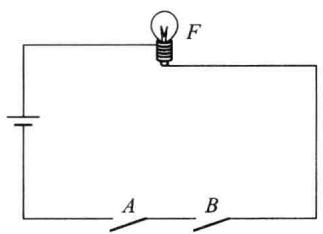

表 7.3.1 与逻辑的真值表

<table><tr><td>A</td><td>B</td><td>F</td></tr><tr><td>0</td><td>0</td><td>0</td></tr><tr><td>0</td><td>1</td><td>0</td></tr><tr><td>1</td><td>0</td><td>0</td></tr><tr><td>1</td><td>1</td><td>1</td></tr></table>

图7.3.1 与逻辑关系  

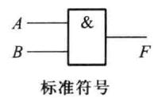

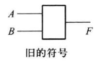  

图 7.3.2 逻辑与门符号

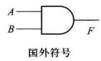

表 7.3.1 完全确定了逻辑与运算的规律, 这种规律是从逻辑推理而来的, 故称之为公理。

## 二、或运算和或门

逻辑或运算可以用图 7.3.3 所示电路来表示, 只要开关 A 和 B 有一个闭合, 灯 F 就亮。

这种灯亮与开关 A、B 闭合的关系就是逻辑或关系。逻辑或的数学意义是，当决定事件 F 发生的各种条件中，只要有一个或一个以上的条件具备，这个事件就发生。逻辑或的数学表达式为

$$

F = A + B

$$

式中，用符号“+”表示逻辑或运算，习惯上称为逻辑加。逻辑或运算也可以用表7.3.2所示的真值表来表示。实现这种功能的电路称为逻辑或门，符号如图7.3.4所示。

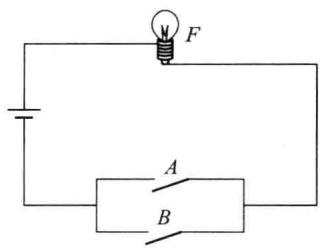  

图7.3.3 或逻辑关系

表 7.3.2 或逻辑的真值表

<table><tr><td>A</td><td>B</td><td>F</td></tr><tr><td>0</td><td>0</td><td>0</td></tr><tr><td>0</td><td>1</td><td>1</td></tr><tr><td>1</td><td>0</td><td>1</td></tr><tr><td>1</td><td>1</td><td>1</td></tr></table>

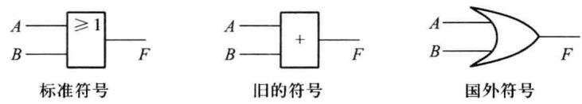  

图 7.3.4 逻辑或门符号

## 三、非运算和非门

逻辑非运算可以用图7.3.5所示电路来表示，由图7.3.5可知，只有开关 $A$ 断开，灯 $F$ 才会亮；开关 $A$ 闭合，灯反而熄灭。这种灯亮与开关 $A$ 闭合的关系就是逻辑非关系。逻辑非的数学意义是，结果总是同条件相反。逻辑非的数学表达式可以写成

$$

F = \overline {{A}}

$$

式中，用符号“-”表示逻辑非运算，A 读作“A 非”或“A 补”。逻辑非运算也可以用表 7.3.3 所示的真值表来表示。实现这种功能的电路称为逻辑非门或反相器，符号如图 7.3.6 所示。

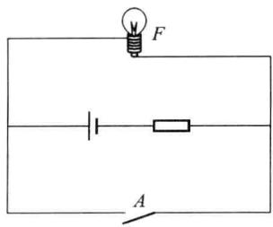  

图7.3.5 逻辑非关系

表 7.3.3 非逻辑的真值表

<table><tr><td>A</td><td>F</td></tr><tr><td>0</td><td>1</td></tr><tr><td>1</td><td>0</td></tr></table>

除了与、或、非三种最基本的逻辑运算之外，人们还推导出与非、或非、与或非、异或、同或等许多复合逻辑，并生产出与之相对应的集成逻辑门电路。任何复合逻辑均可由与、或、

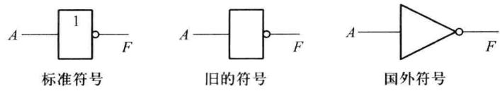  

图 7.3.6 逻辑非门符号

非三种基本逻辑运算导出。

## 四、与非逻辑

与非逻辑是与逻辑和非逻辑的组合,它的真值表如表7.3.4所示,其逻辑表达式为

$$

F = A \cdot B

$$

由真值表可见, 只要有一个输入为 0, 输出就为 1; 只有当输入全是 1 时, 输出才是 0。

## 五、或非逻辑

或非逻辑是或逻辑和非逻辑的组合,它的真值表如表7.3.5所示,其逻辑表达式为

$$

F = \overline {{A + B}}

$$

由真值表可见, 只要有一个输入为 1, 输出就为 0; 只有当输入全是 0 时, 输出才是 1。

表 7.3.4 与非逻辑的真值表

<table><tr><td>A</td><td>B</td><td>F</td></tr><tr><td>0</td><td>0</td><td>1</td></tr><tr><td>0</td><td>1</td><td>1</td></tr><tr><td>1</td><td>0</td><td>1</td></tr><tr><td>1</td><td>1</td><td>0</td></tr></table>

表 7.3.5 或非逻辑的真值表

<table><tr><td>A</td><td>B</td><td>F</td></tr><tr><td>0</td><td>0</td><td>1</td></tr><tr><td>0</td><td>1</td><td>0</td></tr><tr><td>1</td><td>0</td><td>0</td></tr><tr><td>1</td><td>1</td><td>0</td></tr></table>

## 六、与或非逻辑

与或非逻辑是将与、或、非三种逻辑组合在一起构成的，它的逻辑表达式为

$$

F = \overline {{A B + C D + E F}}

$$

读者可自己作出其真值表。

上述三种复合逻辑门的逻辑符号如图 7.3.7 所示。

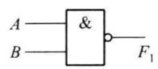  

(a) 与非门

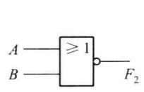  

(b) 或非门

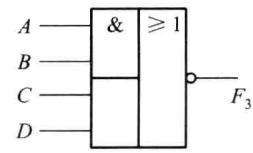  

(c) 与或非门  

图 7.3.7 复合逻辑符号

## 7.3.2 由门电路组成的双稳态触发器

双稳态触发器有两个稳定的状态,分别用逻辑0和逻辑1表示,在适当输入信号作用下,它可以从一个稳态转换到另一个稳态;输入信号撤销以后,它能维持在新的稳态不变,因此双稳态触发器具有记忆功能,一个双稳态触发器可以记忆1位二进制数。

最基本的双稳态触发器是 $RS$ 触发器，又称置位-复位（Set-Reset）触发器，它由两个或非门或两个与非门首尾连接而成，图7.3.8所示是由两个或非门组成的基本 $RS$ 触发器，其中 $R, S$ 为输入端， $Q^{n+1}$ 和 $\overline{Q}^{n+1}$ 为互补输出端。触发器的现态和次态是两个重要的概念，输入信号发生变化之前触发器所处的状态称为触发器的现态，用 $Q^n$ 和 $\overline{Q}^n$ 来表示，输入信号发生变化之后触发器所进入的状态，称为下一状态或次态，用 $Q^{n+1}$ 和 $\overline{Q}^{n+1}$ 表示。触发器的次态是现态和输入的函数，即

$$

Q ^ {n + 1} = f (Q ^ {n}, R, S)\tag{7.3.1}

$$

式(7.3.1)称为触发器的特征方程或状态方程。通过分析图7.3.8所示电路,可推导出RS触发器的特征方程如下

$$

\left\{ \begin{array}{l} Q ^ {n + 1} = S + \overline {{R}} Q ^ {n} \\ R S = \mathbf {0} \end{array} \right.\tag{7.3.2}

$$

式中，RS=0 称为基本 RS 触发器的约束条件，即 R 和 S 不能同时为 1。

分析 RS 触发器的特征方程(7.3.2)，可以得出 RS 触发器的特性。

（1）当输入 RS=00 时， $Q^{n+1}=Q^{n}$ ，表明当 RS=00 时，触发器维持原状态不变。

（2）当输入 RS=01 时， $Q^{n+1}=1$ ，即无论触发器原来是什么状态；当输入 RS=01 时，触发器一定进入 $Q^{n+1}=1$ 和 $\overline{Q}^{n+1}=0$ 状态，触发器置位。

（3）当输入 RS=10 时， $Q^{n+1}=0$ ，即无论触发器原来是什么状态；当输入 RS=10 时，触发器一定进入 $Q^{n+1}=0$ 和 $\overline{Q}^{n+1}=1$ 状态，触发器复位。

（4）当输入 RS=11 时，不符合约束条件，这时触发器的两个输出端不再满足互补关系，这种输入组合在正常工作时是不允许的。

由以上分析可得出由或非门构成的 RS 触发器的功能表, 如表 7.3.6 所示。功能表在形式上与前面的真值表类似, 不同之处在于此时输出取值除了 0 和 1 之外, 还有反映电路历史输入结果的 $Q^{n}$ 。

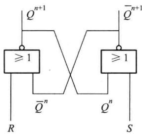

表 7.3.6 RS 触发器的功能表

<table><tr><td>R</td><td>S</td><td> $Q^{n+1}$ </td><td>功能说明</td></tr><tr><td>0</td><td>0</td><td> $Q^n$ </td><td>保持</td></tr><tr><td>0</td><td>1</td><td>1</td><td>置1</td></tr><tr><td>1</td><td>0</td><td>0</td><td>置0</td></tr><tr><td>1</td><td>1</td><td>×</td><td>不允许</td></tr></table>

图 7.3.8 由或非门组成的 RS 触发器

RS 触发器也可以用与非门首尾相连而成, 如图 7.3.9 所示, 其功能表见表 7.3.7。与非门是低电平控制器件, 此时输入信号写成了 $\overline{R}$ 、 $\overline{S}$ 的形式。输入信号这种带非的表示方法代表输入信号低电平有效, 采用这种表示法, 能够保证由与非门构成的基本 RS 触发器和由或

非门构成的 RS 触发器特征方程的一致性。

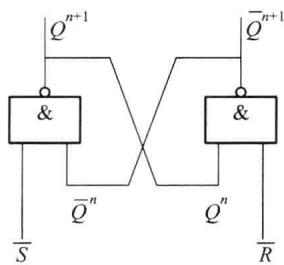

表 7.3.7 RS 触发器的功能表

<table><tr><td> $\overline{R}$ </td><td> $\overline{S}$ </td><td> $Q^{n+1}$ </td></tr><tr><td>0</td><td>0</td><td>不允许</td></tr><tr><td>0</td><td>1</td><td>0</td></tr><tr><td>1</td><td>0</td><td>1</td></tr><tr><td>1</td><td>1</td><td> $Q^n$ </td></tr></table>

图 7.3.9 由与非门组成的 RS 触发器
