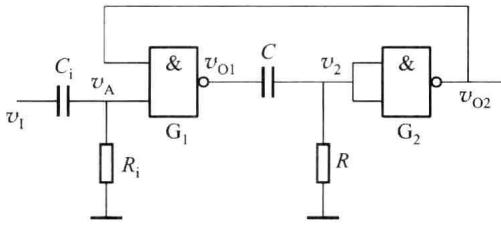
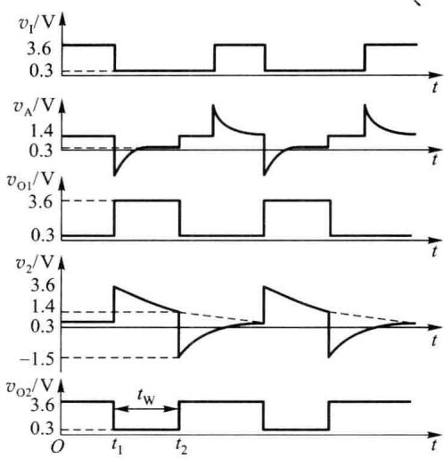
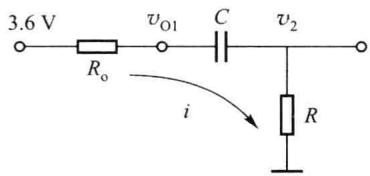
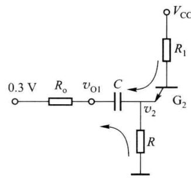
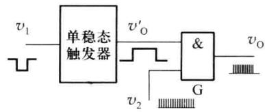
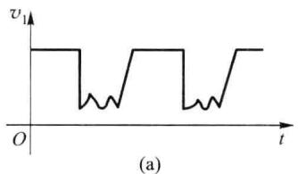
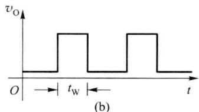

import Guide from '@/components/Guide.astro';
import Knowledge from '@/components/Knowledge.astro';
import Example from '@/components/Example.astro';
import Analysis from '@/components/Analysis.astro';
import Solution from '@/components/Solution.astro';
import Variant from '@/components/Variant.astro';
import Note from '@/components/Note.astro';
import Block from '@/components/Block.astro';
import Method from '@/components/Method.astro';
import Exercise from '@/components/Exercise.astro';

单稳态触发器广泛应用于脉冲波形的变换、延时和定时电路中，它具有稳态和暂稳态两个不同的工作状态，在外界触发脉冲的作用下，单稳态触发器能够从稳态翻转到暂稳态，暂稳态是不能长久保持的状态，持续一段时间之后，又自动翻转到稳态。暂稳态的持续时间取决于 RC 元件的数值。

## 7.4.1 由门电路组成的单稳态触发器

微分型单稳态触发器可由或非门或与非门构成，图7.4.1所示是由与非门组成的单稳态触发器电路，其中， $R_{i}$ 、 $C_{i}$ 为输入微分环节，RC为单稳态触发器的定时电路，两个与非门 $G_{1}$ 和 $G_{2}$ 的输出端引出作为触发器的输出，工作波形如图7.4.2所示。

  

图 7.4.1 由与非门组成的单稳态触发器的典型电路

稳态时，触发输入端无触发信号， $v_{1}$ 为高电平。电阻 $R_{i}$ 的阻值一般大于 2 kΩ，电阻 R 的阻值一般小于 700 Ω，以保证稳态时 $G_{1}$ 输出低电平 $V_{\mathrm{OL}}$ （约 0.3 V）， $G_{2}$ 输出高电平 $V_{\mathrm{OH}}$ （约 3.6 V）。

在 $t=t_{1}$ 时刻，触发脉冲的下降沿到来，经 $R_{i}C_{i}$ 产生一个负尖峰脉冲，使与非门 $G_{1}$ 关闭， $v_{01}$ 上跳至高电平 $V_{0H}$ ，由于电容 C 上的电压不能突变， $v_{2}$ 跳变为高电平，与非门 $G_{2}$ 打开，输出低电平， $v_{02}=V_{0L}$ ，触发器进入暂稳态。

在暂稳态期间， $v_{01}=V_{0H}$ ，通过R给电容C充电，充电等效电路如图7.4.3所示， $R_{o}$ 为 $G_{1}$ 的输出电阻，约为 $100\Omega,v_{2}$ 按指数规律下降。当 $v_{2}$ 下降到 $G_{2}$ 的阈值电压 $V_{th}$ 时，与非门 $G_{2}$ 关闭，输出 $v_{02}$ 上跳至高电平，由于电阻 $R_{i}>2k\Omega$ ，使与非门 $G_{1}$ 打开，输出低电平，暂稳态结

  

图 7.4.2 单稳态触发器的工作波形

束，电路回到稳态。

暂稳态结束后， $v_{01}$ 输出低电平 $V_{0L}$ ， $v_{02}$ 输出高电平 $V_{0H}$ ，恢复过程开始，电容 C 放电，放电的等效电路如图 7.4.4 所示。

  

图 7.4.3 电容充电等效电路

  

图 7.4.4 电容放电等效电路

很明显，暂稳态持续时间即是电容 C 的充电时间，充电时间常数近似等于 RC。 $v_{2}$ 的初始值 $v_{2}(t_{1}) \approx (V_{\mathrm{OH}} - V_{\mathrm{OL}}) + v_{2}(0)$ ， $v_{2}(0)$ 为稳态时 $v_{2}$ 的值， $v_{2}$ 的终值 $v_{2}(\infty) = 0$ ，C 充电到 $t_{2}$ 时刻使 $v_{2}(t_{2}) = V_{\mathrm{th}}$ 时暂稳态结束，因此暂稳态时间或输出脉冲的宽度为

$$

t _ {\mathrm{w}} \approx R C \ln \frac {v _ {2} (t _ {1}) - v _ {2} (\infty)}{v _ {2} (t _ {2}) - v _ {2} (\infty)} = R C \ln \frac {(V _ {\mathrm{OH}} - V _ {\mathrm{OL}}) + v _ {2} (0)}{V _ {\mathrm{th}}}

$$

作为近似估算, $t_{w}$ 一般在 $(0.7\sim1.3)RC$ 范围内。在定时电路中,为了调整 $t_{w}$ ,通常以改变C作为粗调,改变R作为细调。

集成单稳态触发器根据其电路工作状态的不同,分为可重触发和不可重触发两类。可重触发的单稳态触发器在暂稳态期间可以接收新的触发脉冲,如果有新的触发脉冲到来,电路重新开始暂稳态过程,输出脉冲宽度 $t_{w}$ 从新的触发脉冲到来时开始。不可重复触发的单稳态触发器在暂稳态期间将不接受新的触发脉冲的作用,只有当电路暂稳态结束后,输入触发脉冲才会影响电路的状态。

## 7.4.2 单稳态触发器的主要应用

单稳态触发器是数字系统中常用的基本单元电路,典型应用如下。

## 一、定时

由前面的分析可知,单稳态触发器在触发脉冲的作用下,能产生一定宽度 $t_{w}$ 的矩形脉冲,如果利用该矩形脉冲作为定时信号去控制某电路,

冲,如果利用该矩形脉冲作为定时信号去控制某电路,可使其在 $t_{w}$ 内动作。例如,用单稳态触发器输出的正脉冲控制与门G,如图7.4.5所示,则只有在这个 $t_{w}$ 时间内,高频信号 $v_{2}$ 才能通过与门G传输到输出端,在其余时间里,信号 $v_{2}$ 被单稳态触发器输出的低电平禁止。

  

图 7.4.5 单稳态触发器的定时作用

## 二、延时

从图 7.4.2 所示的微分型单稳态触发器的工作波形不难看出, 输出电压 $v_{01}$ 的上升沿相对输入信号 $v_{1}$ 的上升沿延迟了一段时间, 单稳态触发器具有延时作用。单稳态触发器的这种延时作用常用于时序控制。

## 三、整形

利用单稳态触发器的触发、定时功能，还可以实现波形的整形。例如，将图7.4.6(a)所示的不规则脉冲作为单稳态触发器的触发脉冲，则它的输出就成为具有确定宽度 $t_{\mathrm{w}}$ 和幅度、边沿陡峭的同频率矩形波，如图7.4.6(b)所示，这种作用便是波形的整形。

  

图 7.4.6 单稳态触发器的整形作用
