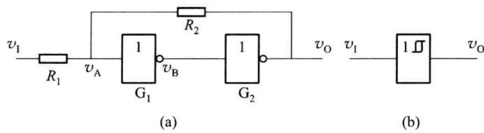
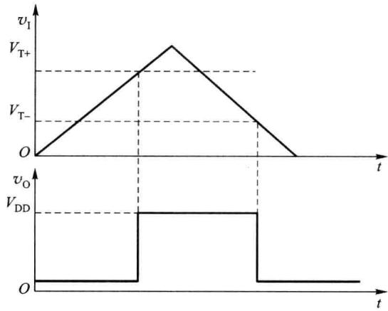
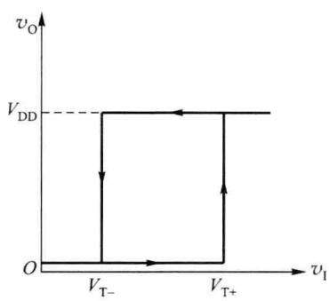
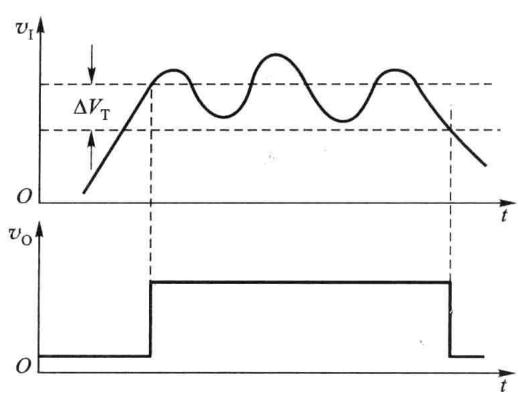
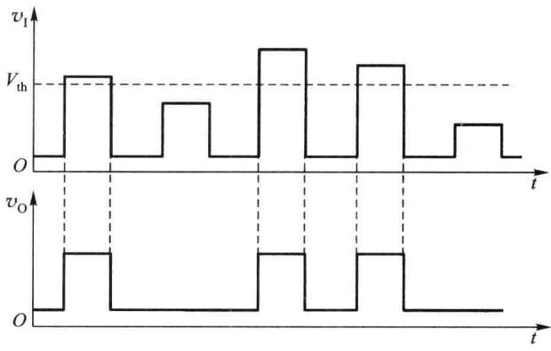

import Guide from '@/components/Guide.astro';
import Knowledge from '@/components/Knowledge.astro';
import Example from '@/components/Example.astro';
import Analysis from '@/components/Analysis.astro';
import Solution from '@/components/Solution.astro';
import Variant from '@/components/Variant.astro';
import Note from '@/components/Note.astro';
import Block from '@/components/Block.astro';
import Method from '@/components/Method.astro';
import Exercise from '@/components/Exercise.astro';

前面曾讨论过由集成运放构成的滞回比较器,这里将介绍数字电子技术中常用的施密特触发器。施密特触发器属于电平触发,同滞回比较器一样,电路有两个不同的阈值电压,当输入信号变化到某一阈值时,输出会发生跳变,即施密特触发器发生状态翻转。

## 7.5.1 门电路组成施密特触发器

由两级 CMOS 反相器组成的施密特触发器如图 7.5.1(a) 所示, 图 7.5.1(b) 为其逻辑符号。电路中两个 CMOS 反相器串联在一起, 输出电压通过分压电阻 $R_{1}$ 、 $R_{2}$ 反馈到输入端, 其中 $R_{1} < R_{2}$ 。

由图 7.5.1 可知, 门 $G_{1}$ 的输入电平 $v_{A}$ 决定着电路的状态, 根据叠加定理, 有

  

图 7.5.1 门电路组成施密特触发器

$$

v _ {\mathrm{A}} = \frac {R _ {2}}{R _ {1} + R _ {2}} v _ {1} + \frac {R _ {1}}{R _ {1} + R _ {2}} v _ {0}\tag{7.5.1}

$$

当输入 $v_{1}=0$ 时，门 $G_{1}$ 关闭， $v_{B}=1$ ，门 $G_{2}$ 打开， $v_{0}=0$ ，这是施密特触发器的第一种稳定状态，此时 $v_{A}\approx0\ V$ 。

假定电路中 CMOS 反相器的阈值电压 $V_{th} \approx V_{DD}/2$ ，输入信号 $v_{I}$ 为三角波。如图 7.5.2 所示，当输入电压从 0 V 开始增加时，只要 $v_{I} < V_{th}$ ，电路 $v_{O} = 0$ 保持不变。

  

图 7.5.2 施密特触发器的工作波形

当 $v_{I}$ 上升到 $v_{A}=V_{th}$ 时，电路开始发生状态转换，此时 $v_{I}$ 的值即为输入信号正向增加时的阈值电压，称为正向阈值电压或上限触发电平，记为 $V_{T+}$ ，即

$$

\begin{array}{r l} v _ {\mathrm{A}} & = V _ {\mathrm{th}} = \frac {R _ {2}}{R _ {1} + R _ {2}} v _ {1} + \frac {R _ {1}}{R _ {1} + R _ {2}} v _ {\mathrm{O}} \\ & \approx \frac {R _ {2}}{R _ {1} + R _ {2}} V _ {\mathrm{T+}} + \frac {R _ {1}}{R _ {1} + R _ {2}} 0 \\ & = \frac {R _ {2}}{R _ {1} + R _ {2}} V _ {\mathrm{T+}} \end{array}

$$

因此

$$

V _ {\mathrm{T+}} \approx \left(1 + \frac {R _ {1}}{R _ {2}}\right) V _ {\mathrm{th}}\tag{7.5.2}

$$

此时,随着 $v_{A}$ 的上升, $v_{B}$ 开始下降, $v_{0}$ 开始上升,电路的状态很快转换为 $v_{0} \approx V_{DD}$ ,正反馈过程如下:

$$

\begin{array}{c}v _ {\mathrm{A}} \uparrow \rightarrow v _ {\mathrm{B}} \downarrow \rightarrow v _ {\mathrm{O}} \uparrow\\\uparrow\end{array}

$$

当 $v_{A}>V_{th}$ 时，电路状态稳定在 $v_{0}\approx V_{DD}$ 不变。

输入电压 $v_{1}$ 继续上升至最大值后开始下降，当 $v_{A}=V_{th}$ 时电路再次发生状态转换，此时 $v_{1}$ 的值即为输入信号减小时的阈值电压，称为负向阈值电压或下限触发电平，记为 $V_{T-}$ ，即

$$

\begin{array}{r l} v _ {\mathrm{A}} = V _ {\mathrm{th}} & = \frac {R _ {2}}{R _ {1} + R _ {2}} v _ {1} + \frac {R _ {1}}{R _ {1} + R _ {2}} v _ {\mathrm{O}} \\ & \approx \frac {R _ {2}}{R _ {1} + R _ {2}} V _ {\mathrm{T-}} + \frac {R _ {1}}{R _ {1} + R _ {2}} V _ {\mathrm{DD}} \\ & = \frac {R _ {2}}{R _ {1} + R _ {2}} V _ {\mathrm{T-}} + \frac {R _ {1}}{R _ {1} + R _ {2}} 2 V _ {\mathrm{th}} \end{array}

$$

因此

$$

V _ {\mathrm{T-}} \approx \left(1 - \frac {R _ {1}}{R _ {2}}\right) V _ {\mathrm{th}}\tag{7.5.3}

$$

随着 $v_{A}$ 的下降, $v_{B}$ 开始上升, $v_{0}$ 开始下降, 电路的状态很快转换为 $v_{0} \approx 0 \, V$ , 正反馈过程如下:

$$

\begin{array}{c}v _ {\mathrm{A}} \downarrow \rightarrow v _ {\mathrm{B}} \uparrow \rightarrow v _ {\mathrm{O}} \downarrow\\\uparrow\end{array}

$$

当 $v_{I}<V_{T-}$ 时，电路状态稳定在 $v_{0}\approx0\ V$ 不变。

施密特触发器的正向阈值电压 $V_{T+}$ 和负向阈值电压 $V_{T-}$ 的差值称为回差电压 $\Delta V_{T}$ ，即

$$

\Delta V _ {\mathrm{T}} = V _ {\mathrm{T+}} - V _ {\mathrm{T-}} = 2 \frac {R _ {1}}{R _ {2}} V _ {\mathrm{th}}\tag{7.5.4}

$$

可见,当电源电压一定时,回差电压 $\Delta V_{T}$ 与 $\frac{R_{1}}{R_{2}}$ 成正比,改变 $R_{1}$ 和 $R_{2}$ 的大小可以调整施密特电路回差电压值的大小。电路的传输特性曲线如图 7.5.3 所示。

图 7.5.3 施密特触发器的传输特性曲线

## 7.5.2 施密特触发器的应用

施密特触发器的用途很广,下面举几个典型的应用。

## 一、波形变换

施密特触发器有两个阈值,利用施密特触发器的滞回特性可以实现波形变换,图7.5.2中输入为三角波,输出为矩形波。同样,利用图7.5.1所示的施密特触发器,也可以将输入的正弦波、锯齿波等变换成矩形波,读者可自行分析。

## 二、波形整形

在数字系统中,矩形脉冲经过传输后可能会发生波形畸变,使波形的上升沿和下降沿明显变坏,高、低电平期间窜入干扰信号;从传感器来的信号,经过放大后可能也是不规则的波形,这些波形都需要经过施密特触发器的整形。图 7.5.4 所示的输入信号 $v_{1}$ 不仅波形上升

沿和下降沿变坏，且波形顶部干扰严重，选择具有合适回差电压 $\Delta V_{T}$ 的施密特触发器对其整形，输出信号波形电压 $v_{0}$ 又变为矩形脉冲。需注意的是，如果回差电压选择不合适，由于干扰噪声的影响，输出波形 $v_{0}$ 可能会不正常，如在图 7.5.4 中，若回差电压选择过小，顶部干扰将造成不良影响。

## 三、幅度鉴别

利用施密特触发器的输出信号 $v_{0}$ 取决于输入信号 $v_{1}$ 幅度的特点, 可以通过调整触发器的上限触发电平 $V_{T+}$ 到规定的幅度 $V_{th}$ , 使某些信号被鉴别出来。例如, 将一系列幅度各异的

  

图 7.5.4 施密特触发器用于波形整形

脉冲信号加到施密特触发器的输入端 $v_{1}$ ，只有那些幅度大于上限触发电平 $V_{T+}$ 的脉冲才产生输出信号，因此可以选出幅度大于 $V_{th}$ 的信号，消除了幅度较小的脉冲信号，如图 7.5.5 所示，故施密特触发器具有幅度鉴别能力。

  

图 7.5.5 施密特触发器用于脉冲幅度鉴别
