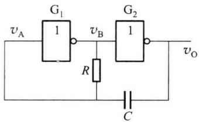
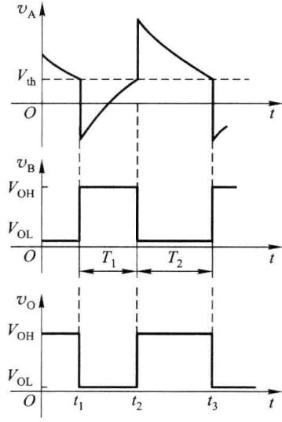
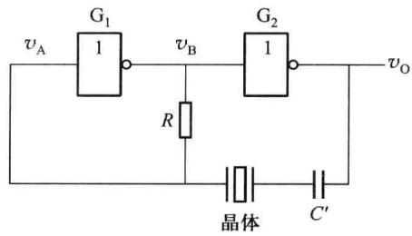
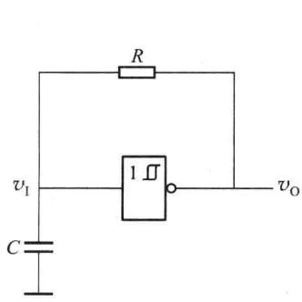
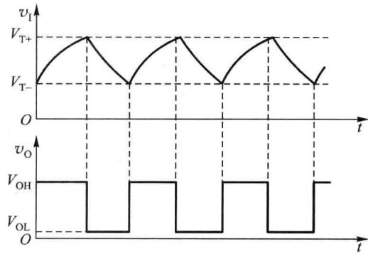
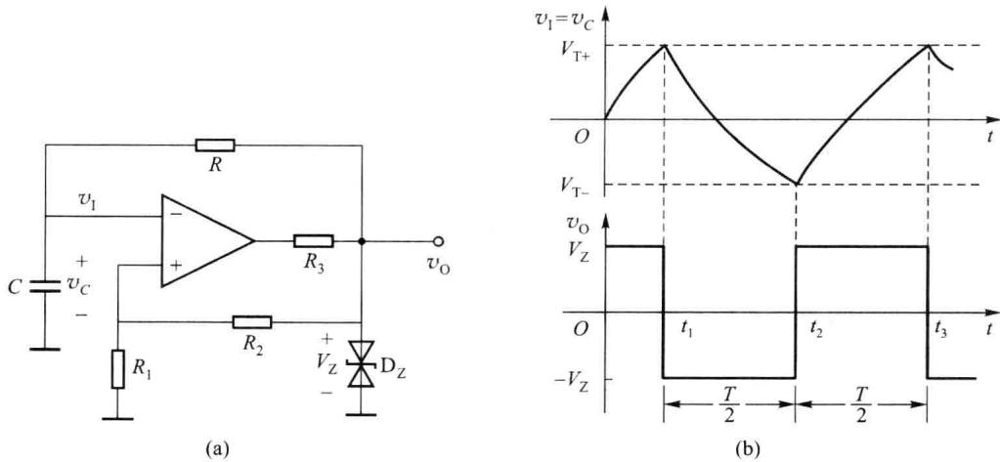
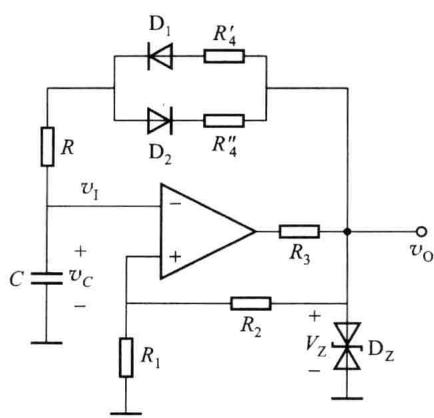

import Guide from '@/components/Guide.astro';
import Knowledge from '@/components/Knowledge.astro';
import Example from '@/components/Example.astro';
import Analysis from '@/components/Analysis.astro';
import Solution from '@/components/Solution.astro';
import Variant from '@/components/Variant.astro';
import Note from '@/components/Note.astro';
import Block from '@/components/Block.astro';
import Method from '@/components/Method.astro';
import Exercise from '@/components/Exercise.astro';

在实用电路中,除了常见的正弦波发生器外,多谐振荡器也是一类常用电路。多谐振荡器是能产生矩形脉冲或方波的自激振荡电路。多谐振荡器没有稳态,只有两个暂稳态,故又称为无稳态电路。

多谐振荡器的电路形式很多,但它们都有一些共同特点:第一,电路中含有开关元件,如门电路、电压比较器、模拟开关等,这些元件主要用于产生高、低电平;第二,电路中含有反馈网络,反馈网络将输出电压反馈给开关元件,使之改变输出状态;第三,电路中含有定时环节,以获得所需的振荡频率,定时环节可以利用 RC 电路的充放电特性实现,也可以利用器件本身的延迟等方式实现。

多谐振荡器在接通电源后无需外接触发信号就能产生一定频率和幅值的信号。

## 7.6.1 由门电路组成的多谐振荡器

门电路附加一些元件, 就可以构成多种形式的多谐振荡器, 图 7.6.1(a) 所示为电容正反馈多谐振荡器, 它的工作波形如图 7.6.1(b) 所示。

  

(a)  

(b)  

图 7.6.1 由门电路组成的多谐振荡器及其工作波形

这种多谐振荡器主要依靠电容 C 的充、放电，引起电压 $v_{A}$ 的变化来实现振荡，当 $v_{A}$ 达到 TTL 门的阈值电压 $V_{th}$ 时，引起反相器状态的翻转。现在从 $t_{1}$ 时刻开始分析，假设此时 $v_{A}$ 正好降至反相器的阈值电压 $V_{th}$ ， $v_{B}$ 由低电平 $V_{OL}$ 跳变至高电平 $V_{OH}$ ， $v_{O}$ 由高电平 $V_{OH}$ 跳变至低电平 $V_{OL}$ ，跳变值均为 $V_{OH}-V_{OL}$ ，经电容 C 耦合，使 $v_{A}$ 从 $V_{th}$ 下跳了 $V_{OH}-V_{OL}$ 。此时门 $G_{1}$ 输出高电平，门 $G_{2}$ 输出低电平。

当 $t > t_{1}$ 时，门 $G_{1}$ 通过电阻 R 给电容 C 充电，使 $v_{A}$ 逐渐上升，当 $v_{A}$ 上升至门 $G_{1}$ 的 $V_{th}$ 时，电路发生正反馈翻转，门 $G_{1}$ 输出低电平 $V_{OL}$ ，门 $G_{2}$ 输出高电平 $V_{OH}$ 。由于电容 C 两端的电压不能突变，所以通过电容 C 耦合，使 $v_{A}$ 从 $V_{th}$ 上跳了 $V_{OH} - V_{OL}$ 。

当 $t > t_{2}$ 时，电容 C 开始放电，使 $v_{A}$ 按指数规律下降，当 $v_{A}$ 下降至门 $G_{1}$ 的阈值电平 $V_{th}$ 时，电路又发生正反馈翻转，门 $G_{1}$ 输出高电平 $V_{OH}$ ，门 $G_{2}$ 输出低电平 $V_{OL}$ 。通过电容 C 耦合，使 $v_{A}$ 从 $V_{th}$ 下跳了 $V_{OH} - V_{OL}$ ，电路又回到 $t_{1}$ 时刻的状态。如此循环，形成自激振荡，输出矩形脉冲。

由 $v_{A}$ 的波形可知，在 $T_{1}$ 期间电容 C 充电，时间常数为 RC，初值为 $V_{\mathrm{th}} - (V_{\mathrm{OH}} - V_{\mathrm{OL}})$ ，终值为 $V_{\mathrm{OH}}, v_{\mathrm{A}}(t_{2}) = V_{\mathrm{th}}$ ，由此得

$$

T _ {\mathrm{l}} = R C \ln \frac {V _ {\mathrm{th}} - (V _ {\mathrm{OH}} - V _ {\mathrm{OL}}) - V _ {\mathrm{OH}}}{V _ {\mathrm{th}} - V _ {\mathrm{OH}}}\tag{7.6.1}

$$

在 $T_{2}$ 期间电容 C 反向充电， $v_{A}$ 从 $V_{\mathrm{th}} + (V_{\mathrm{OH}} - V_{\mathrm{OL}})$ 开始按指数规律下降，到 $t = t_{3}$ 时， $v_{A}$ 下降

至 $V_{\mathrm{th}}$ ，由此得

$$

T _ {2} = R C \ln \frac {\left[ V _ {\mathrm{th}} + (V _ {\mathrm{OH}} - V _ {\mathrm{OL}}) \right] - V _ {\mathrm{OL}}}{V _ {\mathrm{th}} - V _ {\mathrm{OL}}}\tag{7.6.2}

$$

振荡周期

$$

T = T _ {1} + T _ {2}

$$

为了使电路容易起振,电阻 R 取值不宜过大,典型值为 $500 \Omega \sim 1 \, k\Omega$ ,电容 C 可根据振荡频率的要求选择,典型值为 $100 \, pF \sim 100 \, \mu F$ 。

由式(7.6.1)和式(7.6.2)可知,这种多谐振荡器的振荡周期与时间常数RC、门电路的阈值电压 $V_{th}$ 均有关系,频率稳定性较差。在对频率稳定性要求较高的场合,可以采用石英晶体组成的石英晶体振荡器,如图7.6.2所示,其中电容 $C'$ 为隔直电容。石英晶体的选频特性非常好,它有一个极稳定的串联谐振频率 $f_{s}$ ,且等效品质因数Q值很高,只有频率为 $f_{s}$ 的信号最容易通过,而其他频率的信

  

图 7.6.2 石英晶体振荡器

号均会被晶体衰减。石英晶体振荡器的振荡频率取决于晶体的串联谐振频率，因而振荡频率非常稳定，为了改善输出波形，增加带负载的能力，通常在振荡器的输出端再加一级反相器。

## 7.6.2 由施密特触发器组成的多谐振荡器

前面的多谐振荡器是由门电路作开关元件。利用施密特触发器作开关，配以 RC 定时元件也可以构成多谐振荡器，其原理电路如图 7.6.3 所示。

假设初始状态电容 C 上的电压为 $V_{T-}$ ，施密特触发器输出 $v_{0}$ 为高电平，此时 $v_{0}$ 通过电阻 R 对电容 C 充电， $v_{I}$ 开始上升，当 $v_{I}$ 达到 $V_{T+}$ 时，施密特触发器发生翻转，输出 $v_{0}$ 变为低电平，此后电容 C 又开始通过电阻 R 放电， $v_{I}$ 开始下降，当 $v_{I}$ 达到 $V_{T-}$ 时，施密特触发器再次发生翻转，输出高电平，如此周而复始形成振荡，其输入、输出波形如图 7.6.4 所示。

  

图 7.6.3 用施密特触发器构成  

多谐振荡器的原理电路

  

图 7.6.4 多谐振荡器的波形

图 7.6.5(a) 所示是采用模拟集成运放构成的施密特触发器, 配以 RC 网络构成多谐振

荡器, RC 网络起反馈和延迟作用, 输入电压 $v_{1}$ 等于电容上的电压 $v_{C}$ 。

  

图 7.6.5 由施密特触发器组成的多谐振荡器及其工作波形

施密特触发器的两个阈值电压分别为

$$

V _ {\mathrm{T+}} = \frac {R _ {1}}{R _ {1} + R _ {2}} V _ {\mathrm{Z}}

$$

$$

V _ {\mathrm{T-}} = - \frac {R _ {1}}{R _ {1} + R _ {2}} V _ {\mathrm{Z}}

$$

电源刚接通时，电容 C 上的电压 $v_{C}=0$ ，即 $v_{1}$ 电位较低，输出 $v_{0}$ 为高电平， $v_{0}=V_{z}$ ，集成运放同相输入端的电位 $v_{P}=V_{T+}$ 。此时 $v_{0}$ 通过电阻 R 给电容 C 充电，时间常数为 RC，使 $v_{C}$ 按指数规律上升，当 $v_{C}$ 上升至 $V_{T+}$ 时，施密特触发器的状态发生翻转，输出 $v_{0}$ 由高电平 $V_{z}$ 跳变为低电平 $-V_{z}$ ，同时运放同相输入端的电位变为 $v_{P}=V_{T-}$ 。

由于此时 $v_{0} = -V_{z}$ ，电容 C 通过电阻 R 放电，放电时间常数也是 RC，使 $v_{c}$ 按指数规律下降，当 $v_{c}$ 下降至 $V_{T-}$ 时，施密特触发器的状态再次发生翻转，输出 $v_{0}$ 由 $-V_{z}$ 跳变为 $V_{z}$ ，电路回到初始状态。之后电容 C 又充电，如图 7.6.5(b) 所示，如此循环产生自激振荡，输出方波。

由图7.6.5(b)可知，电容的充、放电时间常数是一样的，电容的放电时间是振荡周期的一半，放电时 $v_{C}$ 初始值 $v_{C}(t_{1}^{+}) = V_{\mathrm{T + }} = R_{1} / (R_{1} + R_{2})\times V_{\mathrm{Z}},v_{C}$ 的终值 $v_{C}(\infty) = -V_{\mathrm{Z}}$ ，在 $t = t_2$ 时 $v_{C}(t_{2}) = V_{\mathrm{T - }} = -R_{1} / (R_{1} + R_{2})\times$ $V_{\mathrm{Z}}$ ，放电时间常数为 $RC$ ，据此可得振荡周期

$$

T = 2 R C \ln \left(1 + \frac {2 R _ {1}}{R _ {2}}\right)

$$

可以通过调节 RC 或 $R_{1}/R_{2}$ 的值来调节振荡频率，输出方波的脉冲幅度取决于稳压二极管的稳压值。

显然,为了改变输出方波的占空比,应改变电容器 C 的充电和放电时间常数。占空比可调的矩形波电路如图 7.6.6 所示。

  

图 7.6.6 占空比可调的矩形波发生电路

电容 C 充电时，充电电流流经电阻 $R_{4}^{\prime}$ 、二极管 $D_{1}$ 、R，充电时间常数为 $\tau_{1}=(R+r_{\mathrm{d}1}+R_{4}^{\prime})C$ ，其中 $r_{d1}$ 是二极管 $D_{1}$ 导通电阻；电容 C 放电时，放电电流流经 R、二极管 $D_{2}$ 、 $R_{4}^{\prime\prime}$ ，放电时间常数为 $\tau_{2}=(R+r_{\mathrm{d}2}+R_{4}^{\prime\prime})C$ ，其中 $r_{d2}$ 是二极管 $D_{2}$ 导通电阻，矩形脉冲的占空比为

$$

\frac {T _ {1}}{T} = \frac {\tau_ {1}}{\tau_ {1} + \tau_ {2}}

$$

改变 $R_{4}^{\prime}$ 和 $R_{4}^{\prime\prime}$ 的阻值即可调整占空比。
