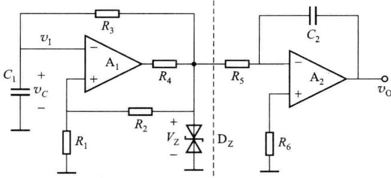
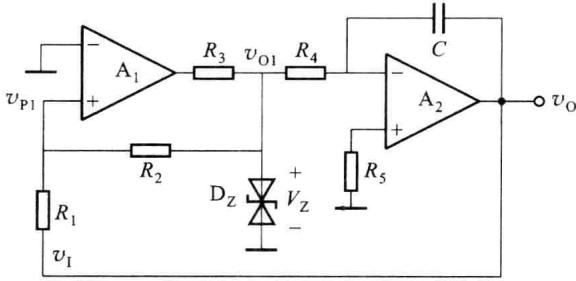
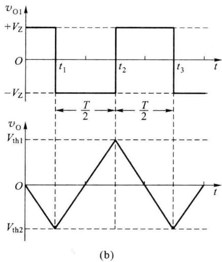
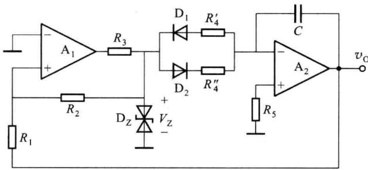
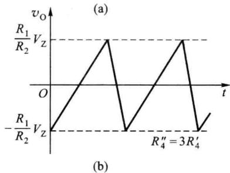

import Guide from '@/components/Guide.astro';
import Knowledge from '@/components/Knowledge.astro';
import Example from '@/components/Example.astro';
import Analysis from '@/components/Analysis.astro';
import Solution from '@/components/Solution.astro';
import Variant from '@/components/Variant.astro';
import Note from '@/components/Note.astro';
import Block from '@/components/Block.astro';
import Method from '@/components/Method.astro';
import Exercise from '@/components/Exercise.astro';

三角波和锯齿波是实验和电子设备中经常用到的波形,方波发生器产生的方波信号,经过适当的波形变换,即可得到三角波和锯齿波信号。

## 7.7.1 三角波发生器

图 7.7.1 所示是通过波形变换方法产生三角波信号的电路,该电路左半部分是由施密特触发器组的成多谐振荡器,产生方波信号,右半部分是积分电路。将方波电压作为积分电路的输入,在积分电路的输出端就可以得到三角波电压,因此三角波发生器可以由方波发生器加上积分电路组成。

  

图 7.7.1 采用波形变换方法产生三角波

在实用电路中,一般不采用上述波形变换的方法获得三角波,三角波发生器的电路如图7.7.2所示。它是由滞回比较器和积分电路闭环组合而成的,积分电路的输出反馈给滞回比较器,作为滞回比较器的 $V_{REF}$ 。

根据叠加定理,由图 7.7.2(a) 可知,滞回比较器的同相输入端电位为

$$

v _ {\mathrm{P1}} = \frac {R _ {2}}{R _ {1} + R _ {2}} v _ {\mathrm{I}} + \frac {R _ {1}}{R _ {1} + R _ {2}} v _ {\mathrm{O1}}\tag{7.7.1}

$$

滞回比较器的反相输入端接地，即 $v_{N1}=0$ ，令 $v_{P1}=v_{N1}=0$ ，并将 $A_{1}$ 的输出电压 $v_{O1}=\pm V_{Z}$ 代入式(7.7.1)，求出 $v_{1}$ ，即得阈值电压

$$

V _ {\mathrm{th1}} = + \frac {R _ {1}}{R _ {2}} V _ {\mathrm{z}}

$$

$$

V _ {\mathrm{th2}} = - \frac {R _ {1}}{R _ {2}} V _ {\mathrm{z}}

$$

下面分析该电路的工作原理，假设 t=0 时， $v_{01}=+V_{Z}$ ，积分电容 C 两端的电压为零，即 $v_{0}=0$ 。当 t>0 时，电容 C 恒流充电， $v_{0}$ 线性下降。到 $t_{1}$ 时刻， $v_{0}$ 下降至 $V_{th2}$ ， $A_{1}$ 发生状态翻转， $v_{01}$ 从 $+V_{Z}$ 跳变至 $-V_{Z}$ ，积分电路开始对 $v_{01}=-V_{Z}$ 积分，输出电压 $v_{0}$ 从 $V_{th2}$ 开始线性上升。到 $t=t_{2}$ 时刻， $v_{0}$ 上升至 $V_{th1}$ ， $A_{1}$ 再次发生状态翻转， $v_{01}$ 从 $-V_{Z}$ 跳变至 $+V_{Z}$ ，积分电路开始对 $v_{01}=+V_{Z}$ 积分，输出电压 $v_{0}$ 从 $V_{th1}$ 又开始线性下降，如此循环，电路便产生自激振荡。

  

(a)

  

图 7.7.2 三角波发生器及其工作波形

由于电容 C 的充、放电回路相同，充、放电时间常数相等，积分电路输出电压 $v_{0}$ 的上升、下降时间相等，充、放电电流恒定，斜率绝对值也相等，故输出 $v_{0}$ 为三角波。

下面求该电路的振荡周期,如图 7.7.2(b) 所示,在 $t_{1} \sim t_{2}$ 期间,电容 C 恒流放电,放电电流为 $i_{C} = -\frac{V_{Z}}{R_{4}}$ ,电压变化量为 $\Delta v_{C} = -\frac{2R_{1}}{R_{2}} V_{Z}$ ,因此可求得放电时间常数

$$

T _ {1} = C \frac {\Delta v _ {c}}{i _ {c}} = 2 R _ {4} C \frac {R _ {1}}{R _ {2}}

$$

即放电时间常数与 RC 成正比。

在 $t_2 \sim t_3$ 期间，电容 $C$ 恒流充电，充电电流为 $i_C = \frac{V_Z}{R_4}$ ，电压变化量为 $\Delta v_C = \frac{2R_1}{R_2} V_Z$ ，因此可求得充电时间常数

$$

T _ {2} = C \frac {\Delta v _ {C}}{i _ {C}} = 2 R _ {4} C \frac {R _ {1}}{R _ {2}}

$$

即充电时间常数也与 RC 成正比。

因此,该电路的振荡周期为

$$

T = T _ {1} + T _ {2} = \frac {4 R _ {1} R _ {4} C}{R _ {2}}

$$

## 7.7.2 锯齿波发生器

三角波信号的上升时间和下降时间是相同的，而锯齿波信号的上升时间和下降时间不同，锯齿波电路广泛用于电视、雷达、数控及测量仪表等设备中。锯齿波发生器的电路如图7.7.3(a)所示，显然为了获得锯齿波，应改变积分电路的充、放电时间常数，利用二极管 $\mathrm{D}_1$ 、 $\mathrm{D}_2$ 的单向导电性（设二极管导通时的等效电阻忽略不计），使充电时间常数为 $R_{4}^{\prime \prime}C$ ，而放电时间常数为 $R_{4}^{\prime}C$ 。图7.7.3(b)为锯齿波电路的输出波形，该电路振荡周期的计算方法与三角波电路类似。

  

图 7.7.3 锯齿波发生器及其工作波形

根据三角波发生电路振荡周期的计算方法,可得出上升时间

$$

T _ {1} \approx 2 R _ {4} ^ {\prime} C \frac {R _ {1}}{R _ {2}}

$$

下降时间

$$

T _ {2} \approx 2 R _ {4} ^ {\prime \prime} C \frac {R _ {1}}{R _ {2}}

$$

因此,该电路的振荡周期为

$$

T = T _ {1} + T _ {2} = \frac {2 R _ {1} (R _ {4} ^ {\prime} + R _ {4} ^ {\prime \prime}) C}{R _ {2}}

$$

调整 $R_{1}$ 和 $R_{2}$ 的阻值, 可以改变锯齿波的幅值, 调整 $R_{1}$ 、 $R_{2}$ 、 $R_{4}^{\prime}$ 、 $R_{4}^{\prime\prime}$ 和电容 C 可以改变振荡周期, 以及锯齿波上升和下降的斜率。
