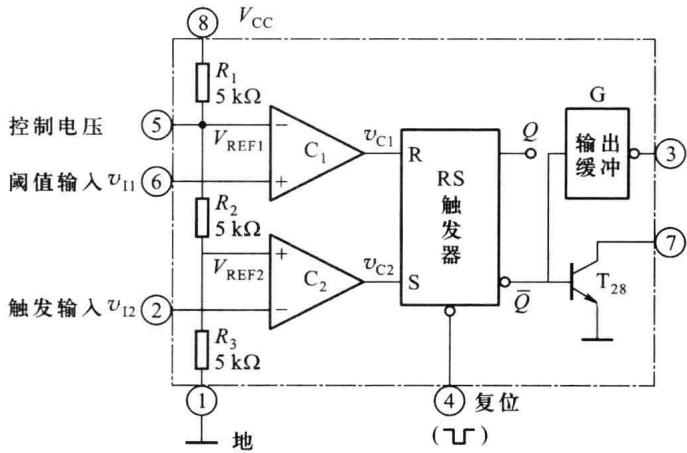
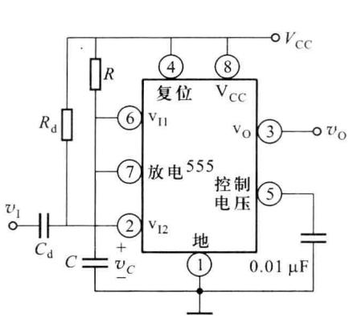
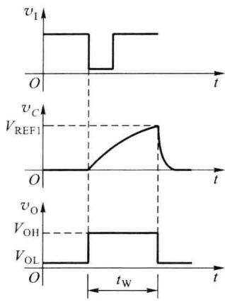
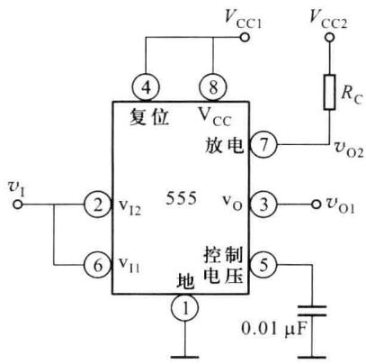
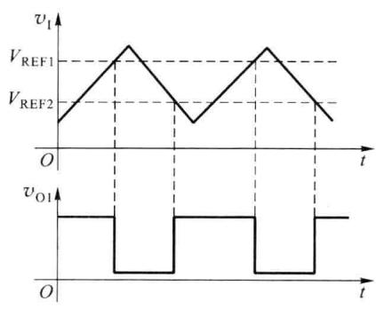
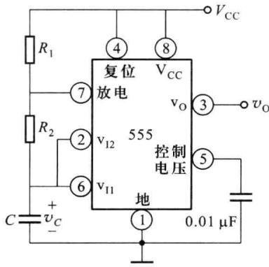
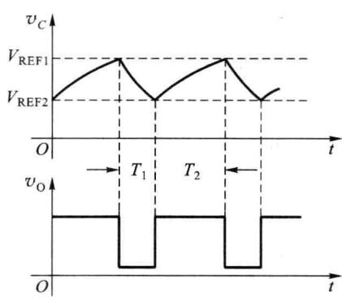

import Guide from '@/components/Guide.astro';
import Knowledge from '@/components/Knowledge.astro';
import Example from '@/components/Example.astro';
import Analysis from '@/components/Analysis.astro';
import Solution from '@/components/Solution.astro';
import Variant from '@/components/Variant.astro';
import Note from '@/components/Note.astro';
import Block from '@/components/Block.astro';
import Method from '@/components/Method.astro';
import Exercise from '@/components/Exercise.astro';

555 定时器是一种多用途单片集成电路,该电路将模拟功能和逻辑功能巧妙地结合在一起,只需外接少量的电容和电阻等元件就可以构成单稳态触发器、多谐振荡器、施密特触发器等电路,广泛应用于信号的产生、变换、检测与控制等领域。

## 7.8.1 555 定时器的结构及工作原理

目前生产的 555 定时器有双极型和 CMOS 型两种, 如 5G555 和 C7555 等型号, 它们的结构及工作原理基本相同。图 7.8.1 所示为 555 定时器的内部组成框图, 它由分压器、两个电压比较器 $C_{1}$ 和 $C_{2}$ 、基本 RS 触发器、放电 (泄放) 管 $T_{28}$ 和输出缓冲器 G 组成, 其中, 分压器由三个阻值为 5 kΩ 的电阻组成, 晶体管 $T_{28}$ 为集电极开路输出的泄放晶体管。

  

图 7.8.1 555 定时器内部组成框图

比较器 $C_{1}$ 、 $C_{2}$ 的基准偏置电压由电阻 $R_{1} \sim R_{3}$ 分压提供， $C_{1}$ 的基准电压为 $V_{REF1} \approx 2 V_{CC}/3$ ， $C_{2}$ 的基准电压为 $V_{REF2} \approx V_{CC}/3$ 。外部控制电压通过 5 脚输入，其功能是调整 $C_{1}$ 和 $C_{2}$ 的基准电压，如果 5 脚外接固定直流电压，则上述两个比较器的基准电压也将发生变化。外部输入 $v_{11}$ 通过 6 脚接于比较器 $C_{1}$ 的同相输入端，称为阈值输入；外部输入 $v_{12}$ 通过 2 脚接于比较器 $C_{2}$ 的反相输入端，称为触发输入。

定时器的工作状态由 RS 触发器的状态所决定。比较器 $C_{1}$ 、 $C_{2}$ 的输出控制 RS 触发器的状态，并通过触发器的 $\overline{Q}$ 端控制放电管 $T_{28}$ 的工作状态。4 脚为触发器的异步复位端，低电平有效，当 4 脚负脉冲到来时，RS 触发器被立即复位， $\overline{Q}$ 输出高电平，放电管 $T_{28}$ 导通。

当 $v_{11}<V_{REF1}, v_{12}<V_{REF2}$ 时，比较器 $C_{1}$ 输出低电平， $C_{2}$ 输出高电平，RS=01，触发器被置位， $\overline{Q}$ 为低电平，3 脚输出高电平，放电管 $T_{28}$ 截止。

当 $v_{I1}>V_{REF1}, v_{I2}>V_{REF2}$ 时，比较器 $C_{1}$ 输出高电平， $C_{2}$ 输出低电平，RS=10，触发器被复位， $\overline{Q}$ 为高电平，3 脚输出低电平，放电管 $T_{28}$ 导通。

当 $v_{11}<V_{REF1},v_{12}>V_{REF2}$ 时，比较器 $C_{1}$ 输出低电平， $C_{2}$ 输出也为低电平，RS=00，触发器维持原状态不变， $\overline{Q}$ 的状态保持以前的状态。综上分析，555 定时器的功能表见表 7.8.1。

表 7.8.1 555 定时器的功能表

<table><tr><td colspan="3">输入</td><td colspan="2">输出</td></tr><tr><td>阈值输入 $v_{11}$ </td><td>触发输入 $v_{12}$ </td><td>复位输入(4脚)</td><td>输出 $v_0$ (3脚)</td><td>放电管 $T_{28}$ </td></tr><tr><td>×</td><td>×</td><td>0</td><td>0</td><td>导通</td></tr><tr><td> $<V_{REF1}$ </td><td> $<V_{REF2}$ </td><td>1</td><td>1</td><td>截止</td></tr><tr><td> $>V_{REF1}$ </td><td> $>V_{REF2}$ </td><td>1</td><td>0</td><td>导通</td></tr><tr><td> $<V_{REF1}$ </td><td> $>V_{REF2}$ </td><td>1</td><td>不变</td><td>不变</td></tr></table>

555 定时器可以在很宽的电源电压范围内工作，并可承受较大的负载电流，双极型 555 定时器的电源电压范围为 5～16 V，最大负载电流可达 200 mA，CMOS 型 555 定时器的电源电压范围为 3～18 V，最大负载电流可达 4 mA。

## 7.8.2 由 555 定时器组成的单稳态触发器

由 555 定时器组成的单稳态触发器及其工作波形如图 7.8.2 所示, 其中 R、C 为定时元件, $v_{1}$ 为外部触发脉冲, 通过 2 脚接于比较器 $C_{2}$ 的反相输入端, 稳态时输入 $v_{1}$ 为高电平, 比较器 $C_{2}$ 输出低电平, 触发器置位信号 S=0。 $R_{d}$ 和 $C_{d}$ 为输入回路的微分环节, 如果输入的负触发脉冲小于单稳态触发器的输出脉宽, 微分环节可以省略。

电源刚接通时， $V_{cc}$ 通过电阻 R 给电容 C 充电，当电容上的电压上升到 $V_{REF1}$ 时，555 定时器内部的比较器 $C_{1}$ 输出高电平，由于此时无触发脉冲，比较器 $C_{2}$ 输出低电平，即 RS=10，基本 RS 触发器被复位， $v_{0}$ 输出低电平，同时放电管 $T_{28}$ 导通，将电容 C 上的电荷迅速放掉，使得比较器 $C_{1}$ 输出低电平，此时，RS=00，基本 RS 触发器处于保持状态，输出不再发生变化，电路进入稳定状态。

若在单稳态触发器输入端 $v_{1}$ 施加触发脉冲，当触发脉冲的下降沿到来时，由于2脚电位低于 $V_{REF2}$ ，比较器 $C_{2}$ 输出高电平，此时RS=01，基本RS触发器被置位， $\overline{Q}$ 输出低电平，电路开始进入暂稳态， $v_{0}$ 输出高电平，放电管 $T_{28}$ 截止。 $V_{CC}$ 通过电阻R开始给电容C充电，电容上的电压 $v_{C}$ 按指数规律上升，当 $v_{C}$ 上升到 $V_{REF1}$ 时，比较器 $C_{1}$ 输出高电平，由于此时外部触发脉冲已经撤销，比较器 $C_{2}$ 输出低电平，即RS=10，基本RS触发器被复位，暂稳态过程结束，电路又自动返回到初始稳态， $v_{0}$ 变为低电平，放电管 $T_{28}$ 导通。

如果忽略晶体管 $T_{28}$ 的饱和压降, 则暂稳态持续的时间即是电容从零充电至 $V_{REF1}$ 所需的时间, 因此

$$

t _ {\mathrm{w}} = R C \ln \frac {V _ {\mathrm{cc}}}{V _ {\mathrm{cc}} - 2 V _ {\mathrm{cc}} / 3} = R C \ln 3 \approx 1. 1 R C

$$

这种电路产生的脉冲宽度可以从几微秒到数分钟,精度可达1%。图7.8.2(a)中控制电压输入端(5脚)通过0.01 $\mu$ F电容接地,以防止脉冲干扰。

  

(a) 电路图

  

(b) 工作波形  

图 7.8.2 由 555 定时器构成的单稳态触发器

## 7.8.3 由 555 定时器组成的施密特触发器

将 555 定时器的阈值输入端(6 脚)和触发输入端(2 脚)连接在一起,便构成了施密特触发器,如图 7.8.3(a) 所示,其中放电管 $T_{28}$ 的集电极经上拉电阻 $R_{C}$ 接至 $V_{CC2}$ ,此时输出电压 $v_{O2}$ 的高电平可通过电阻 $R_{C}$ 和 $V_{CC2}$ 调整,实现电平转换。

由图7.8.1可知，比较器 $\mathrm{C}_1$ 、 $\mathrm{C}_2$ 阈值电压分别为 $V_{\mathrm{REF1}} = 2V_{\mathrm{CC1}} / 3$ 和 $V_{\mathrm{REF2}} = V_{\mathrm{CC1}} / 3$ 。输入信号 $v_{1}$ 的波形如图7.8.3(b)所示，在 $t = 0$ 时刻， $v_{1} < V_{\mathrm{REF2}}$ ，此时比较器 $\mathrm{C}_1$ 输出低电平， $\mathrm{C}_2$ 输出高电平， $RS = 01$ ，初始状态RS触发器置位， $v_{01}$ 输出高电平，如图7.8.3(b)所示。当输入信号 $v_{1}$ 增加到 $V_{\mathrm{REF2}}$ 时，比较器 $\mathrm{C}_2$ 输出变为低电平， $RS = 00$ ，触发器维持原状态不变， $v_{01}$ 继续输出高电平；输入信号 $v_{1}$ 增加到 $V_{\mathrm{REF1}}$ 时，比较器 $\mathrm{C}_1$ 输出变为高电平， $RS = 10$ ，触发器翻转， $v_{01}$ 输出低电平；输入 $v_{1}$ 继续增加，上述状态保持不变。

  

(a) 电路图

  

(b) 工作波形  

图 7.8.3 由 555 定时器构成的施密特触发器

当 $v_{I}$ 从 $V_{CC}$ 开始下降时，只要 $v_{I} > V_{REF2}, v_{01}$ 输出保持低电平；当 $v_{I}$ 下降到 $V_{REF2}$ 时，触发器发生翻转， $v_{01}$ 输出变为高电平；若输入 $v_{I}$ 继续减小，上述状态保持不变。当输入为三角波形时，从施密特触发器的 $v_{01}$ 端可输出方波。

触发器的回差电压 $\Delta V_{th} = V_{REF1} - V_{REF2} = V_{CC1}/3$ ，若 5 脚外加直流控制电压，可以改变阈值电压 $V_{REF1}$ 和 $V_{REF2}$ ，因而可用来调节回差电压的大小。

## 7.8.4 由555定时器组成的多谐振荡器

由 555 定时器构成的多谐振荡器如图 7.8.4(a) 所示, 图 7.8.4(b) 为其工作波形。

接通电源后， $V_{CC}$ 通过电阻 $R_{1}$ 、 $R_{2}$ 给电容 C 充电，充电时间常数为 $(R_{1}+R_{2})C$ ，电容上的电压 $v_{C}$ 按指数规律上升，当 $v_{C}$ 上升到 $V_{REF1}=2V_{CC}/3$ 时，比较器 $C_{1}$ 输出高电平， $C_{2}$ 输出低电平，RS=10，触发器被复位，放电管 $T_{28}$ 导通，此时 $v_{0}$ 输出低电平，电容 C 开始通过 $R_{2}$ 放电，放电时间常数约为 $R_{2}C$ ， $v_{C}$ 下降，当 $v_{C}$ 下降到 $V_{REF2}=V_{CC}/3$ 时，比较器 $C_{1}$ 输出低电平， $C_{2}$ 输出高电平，RS=01，触发器被置位，放电管 $T_{28}$ 截止， $v_{0}$ 输出高平，电容 C 又开始充电，当 $v_{C}$ 上升到 $V_{REF1}=2V_{CC}/3$ 时，触发器又开始发生翻转。如此周而复始，输出矩形脉冲。

  

(a) 电路图

  

(b) 工作波形  

图 7.8.4 由 555 定时器构成的多谐振荡器

由图 7.8.4(b) 可知, 电容 C 放电所需的时间是 $v_{C}$ 从 $V_{REF1}=2V_{CC}/3$ 下降到 $V_{REF2}=V_{CC}/3$ 所需的时间, 因此

$$

T _ {1} = R _ {2} C \ln 2 \approx 0. 7 R _ {2} C

$$

电容 C 充电所需的时间是 $v_{c}$ 从 $V_{REF2}=V_{CC}/3$ 上升到 $V_{REF1}=2V_{CC}/3$ 所需的时间, 因此

$$

T _ {2} = (R _ {1} + R _ {2}) C \ln 2 \approx 0. 7 (R _ {1} + R _ {2}) C

$$

因而，振荡周期为

$$

T = T _ {1} + T _ {2} \approx 0. 7 (R _ {1} + 2 R _ {2}) C

$$

这种振荡器输出波形的占空比为

$$

D = \frac {T _ {2}}{T} = \frac {R _ {1} + R _ {2}}{R _ {1} + 2 R _ {2}}

$$

上面仅讨论了 555 定时器的几种简单应用,实际上,由于 555 定时器功能灵活,输出驱动电流大,在电子技术中获得广泛应用,限于篇幅,这里就不再一一枚举了,感兴趣的同学可

查阅相关参考书。
