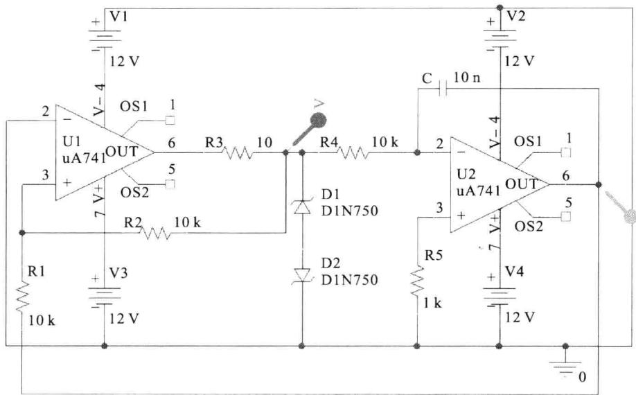
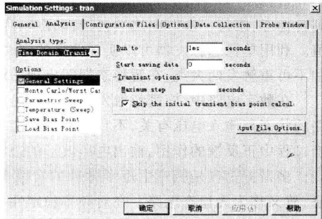
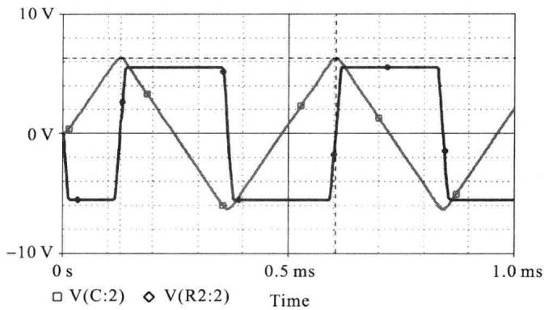

import Guide from '@/components/Guide.astro';
import Knowledge from '@/components/Knowledge.astro';
import Example from '@/components/Example.astro';
import Analysis from '@/components/Analysis.astro';
import Solution from '@/components/Solution.astro';
import Variant from '@/components/Variant.astro';
import Note from '@/components/Note.astro';
import Block from '@/components/Block.astro';
import Method from '@/components/Method.astro';
import Exercise from '@/components/Exercise.astro';

下面通过 OrCAD 仿真来演示使用运放构成的方波和三角波发生电路, 图 7.9.1 所示即为使用 OrCAD 绘制的电路原理图。

  

图 7.9.1 方波与三角波发生电路的仿真原理图

在图 7.9.1 中, 使用稳压管 DIN750 来进行滞回比较器的输出双向限幅, 查阅 OrCAD 中

的相关 PSpice 模型可知,此时滞回比较器的输出电压为 $\pm5.5\ V$ 左右。利用公式 $T=\frac{4R_{1}R_{4}C}{R_{2}}$ 可知振荡周期约为 0.4 ms,故在仿真时可设置时长至 1 ms。需要注意的是,在做时域仿真时应选择“Skip the initial transient bias point calculation”选项(参照图 7.9.2 所示),否则无法获得正确的输出结果。

在完成以上各项设置后即可启动时域仿真,输出结果如图 7.9.3 所示。

  

图 7.9.2 时域仿真时的注意事项

从图 7.9.3 中可以看出：

（1）输出信号的重复周期约为0.47 ms，与计算值存在一定的差别，这是由于所使用的仿真算法的原因而造成的（读者可自行设置参数为 $R_{1}=20\ k\Omega,R_{2}=12\ k\Omega,R_{4}=15\ k\Omega,C=0.01\ \mu F$ ，此时的振荡周期为1 ms，但仿真结果为1.07 ms左右）。

（2）输出信号在突变时的速度较慢，这是由于所使用的运放（即 $\mu A741$ ）的开环带宽过低而造成的。

  

图7.9.3 时域仿真的输出结果
