import Guide from '@/components/Guide.astro';
import Knowledge from '@/components/Knowledge.astro';
import Example from '@/components/Example.astro';
import Analysis from '@/components/Analysis.astro';
import Solution from '@/components/Solution.astro';
import Variant from '@/components/Variant.astro';
import Note from '@/components/Note.astro';
import Block from '@/components/Block.astro';
import Method from '@/components/Method.astro';
import Exercise from '@/components/Exercise.astro';

## 附录 1.1 电子 CAD 软件 OrCAD 简介

电子线路设计就是根据给定的功能和特性指标要求,通过各种方法,确定使用的线路原理图以及各个元器件的参考值,最终将设计好的线路转换为印制板电路版图(Printed Circuit Board,PCB)。要完成上述设计任务,一般需要经过提出设计方案、验证和修改三个阶段,有时甚至要反复好几次,才能较好地完成设计任务。

在早期,电子线路的设计方式主要以人工设计为主,这是一种传统的设计方法,其中设计方案的验证一般都采用搭接实验电路的方式进行。这种方法花费高、效率低。随着大规模集成电路和计算机技术的发展,电子电路分析和设计的方法发生了重大的改变。以手工估算和搭电路实验为基础的传统设计方法,在验证的速度和验证电路的能力上,都无法适应现有集成电路级和PCB级设计的需要。因此,计算机辅助分析与设计(CAD)的方法在集成电路和PCB的设计中得到越来越广泛的使用。

计算机辅助设计(CAD)就是在电子线路设计过程中,借助于计算机来迅速准确地完成设计任务。CAD 是一种通用技术,在机械、建筑等各行业也得到了广泛应用。在电子行业中,CAD 技术不但应用面广,而且发展很快,在实现设计自动化(Design Automation, DA)方面取得了突破性的进展,并且已出现了一些电路设计自动化软件。但目前能实现设计自动

化的情况并不多,还处于 CAD 向 DA 过渡的进程中,人们将其统称为电子设计自动化(EDA)。

目前,使用比较广泛的电子 CAD 软件是 Cadence 公司的 OrCAD 系列的 EDA 软件。OrCAD 软件系统中的每一部分可以根据需要单独使用,相互之间又共同构成完整的 EDA 系统,对设计项目实施统一管理。OrCAD 软件系统中主要包括以下软件:

（1）OrCAD/Capture CIS（工业标准的原理图设计软件）；

(2) OrCAD/PSpice A/D(数模混合信号仿真);

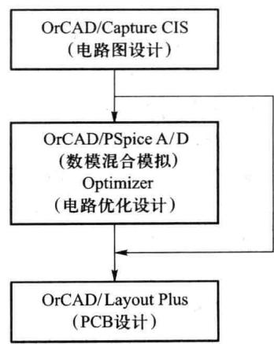

(3) OrCAD/Layout Plus(PCB 设计软件)。

它们的关系如图附 1.1.1 所示。

图附 1.1.1 OrCAD 系统结构框图

## 附录 1.1.1 OrCAD 的模块和工作流程简介

在 OrCAD 中, 把原理图绘制、仿真、电路板绘制等功能分布在不同的程序中, 各个部分完成不同的功能; 但总的来说, 通过使用 OrCAD/Cadence 所提供的各种工具, 能够完成从原理图设计到 PCB 设计过程中所需的全部功能。使用 OrCAD 进行工作的简单流程如图附 1.1.2 所示。

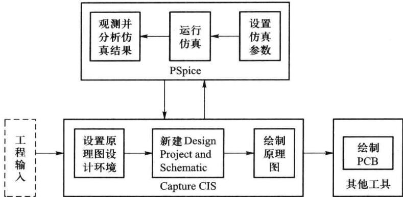  

图附1.1.2 OrCAD进行工作的简单流程

从图附 1.1.2 中可以看出, 在设计电路时, 首先使用 Capture CIS 进行原理图的绘制, 此后根据需要决定是否使用 PSpice 进行仿真验证, 最后使用各种其他工具进行 PCB 的绘制。本书中介绍前两步, 即原理图的绘制及 PSpice 的仿真。通过对这两步的介绍, 希望本书的读者能够据此对本书中所提到的各种电路进行仿真验证, 以更好地验证所学到的理论知识及其应用方法。

以下对 OrCAD 中 Capture CIS 和 PSpice 模块的功能和特性进行简单介绍, 对这两者的更详细介绍将在相关小节中展开。

## 一、Capture CIS

OrCAD Capture CIS 是一个设计入口程序, 通过该程序可以准备需要进行仿真的电路, 例如:

\- 放置和连接元件符号

\- 定义元件值和其他属性

\- 定义输入波形

\- 设置一个或多个分析选项

\- 在电路中标识出需要看到结果的点

同时, OrCAD Capture 也是在仿真设计流中运行其他程序的控制者。Capture 与 OrCAD 的其他 EDA 工具集成在一起, 可以通过 Capture 调用其他相关的程序, 包括进行 PSpice 仿真、PCB 设计等。

## 二、PSpice

PSpice 软件的前身是 SPICE, SPICE(Simulation Program with Integrated Circuit Emphasis) 是美国加州大学伯克利(Berkeley)分校 1972 年开发研制的程序, 其基础为电路理论、数值计算方法和计算机技术。随后其版本不断更新, 功能也不断增强和完善。SPICE 奠定了目前计算机模拟电子电路软件的基础, 已于 1988 年被定为美国国家工业标准。现在世界上享有盛誉的许多模拟电路仿真软件均以 SPICE 为基础, 如美国 Cadence 公司的 PSpice、加拿大 Interactive Image Technologies 公司的 EWB(Electronics Workbench) 和 Multisim 系列、中国台湾 Avant! 公司的 HSpice 等。

PSpice(Popular SPICE)是由SPICE发展而来的用于微机系列的通用电路分析程序。目前微机上广泛使用的 PSpice 是由美国 MicroSim 公司开发并于 1984 年首次推出的。它在保持了 SPICE 原有功能的基础上，在输入输出图形处理、算法的可靠性和收敛性、仿真速度、模拟功能扩展以及模型参数库和宏模型库等方面都有所改善和扩充。经过多年的发展及公司购并，目前 PSpice 产品由美国 Cadence 公司所有，其版本已经到达了 V10.5。在本书中，我们使用的是基于 OrCAD 10.0 Demo 版，该版本相对于正式的商业版本来说存在着一些功能和性能上的限制，但从基本功能和使用方法上来说，与正式的商业版并没有本质区别，且本附录的主要目的是为了使读者能够运用其完成原理图的绘制和仿真工作，并不影响到对 OrCAD 基本原理和使用方法的学习。

PSpice 具有三个不同的版本: PSpice A/D、PSpice A/D Basics、PSpice。PSpice A/D 能够完成对模拟电路、数字电路和数模混合电路的仿真, 而 PSpice A/D Basics 和 PSpice 则是 PSpice A/D 的功能受限版本。通过使用 PSpice A/D, 能够分析和验证设计者所提供的电路, 从而评估电路性能并据此对电路进行参数的优化。

一般来说,在完成电路设计和仿真准备后,OrCAD Capture 会产生包括电路网表以及分析命令在内的电路文件集,PSpice A/D 将读取这些文件进行仿真。在完成仿真之后,PSpice A/D 可以调用图形化的显示工具(Probe)以便于设计者进行查看。

## 附录 1.1.2 OrCAD 10.0 Demo 版的获取与安装

从 http://www.orcad.com/download.orcaddemo.aspx 处可以获得 OrCAD 10.0 的 Demo 版。

OrCAD 10.0 的 Demo 版的安装非常简单, 完全安装大约需要 450MB, 与普通软件安装基本一样。在完成安装之后, 可从菜单中调用 OrCAD 10.0 Demo 所提供的各种功能, 如图附 1.1.3 所示。

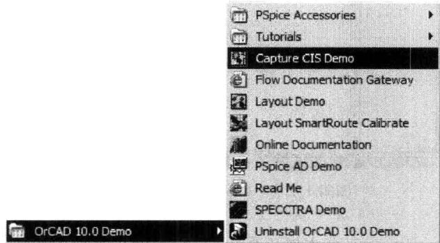  

图附 1.1.3 OrCAD 10.0 Demo 的菜单条

## 附录 1.1.3 OrCAD 部分文档类型

在 OrCAD 中部分常用的文档类型如下：

\- \*.opj——项目管理文件

\- \*.dsn——电路图文件

\- \*.olb——图形符号库文件

\- \*.lib——仿真模型描述库文件

\- \*.mnl——网络表文件

OrCAD 软件包含的部分库如下：

\- \*.olb——Capture专用的图形符号库，又分为两种。

只有电气特性而没有仿真特性的库,此类库没有相应的 \*.lib 库,且器件属性中没有 PSpiceTemplate 属性;

能够利用 PSpice 进行仿真的库,此类库有相应的 \*.lib 库,且器件属性中有 PSpiceTemplate 属性。

\- \*.lib——PSpice 仿真库,利用 SPICE 语言对 Capture 中的图形符号进行功能定义与描述,可以编辑。

## 附录 1.2 使用 Capture CIS 进行原理图的绘制

## 附录1.2.1 Capture操作环境

单击图附 1.1.3 中所示的菜单条, 即可运行 Capture CIS Demo 程序。通常程序运行之后屏幕的显示如图附 1.2.1 所示。

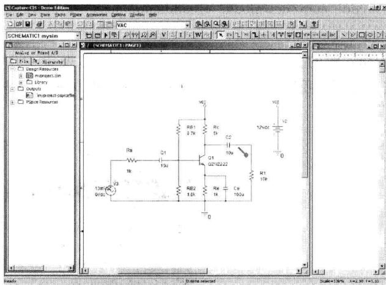  

图附 1.2.1 Capture CIS 界面示意

可以看出, Capture CIS 有三个主要工作窗口, 均位于屏幕的中央。

\- 项目管理视窗:管理与原理图相关的一系列文件,相当于资源管理器。

\- Schematic 窗口: 原理图窗口, 相当于一张图纸。该窗口以图形的方式显示了各种元器件、器件之间的连接关系及其他相关内容。

\- 信息查看窗口(Session Log):用于显示相关操作的提示或出错信息。

除此之外，在这些窗口的上方，还有菜单条和工具栏，在窗口下方有状态栏。

## 附录 1.2.2 电路图绘制基本过程的快速入门

下面以图附 1.2.2 所示的带有发射极负反馈的分压式工作点稳定电路为例,说明绘制

电路原理图并进行相关仿真的相应方法与步骤,请各位读者按照本流程进行相应操作。

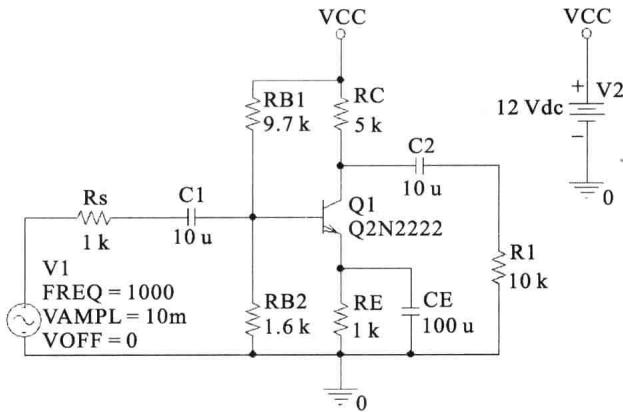  

图附 1.2.2 带有发射极负反馈的分压式工作点稳定电路

## 一、示例电路图说明

图附 1.2.2 所示电路为一带有发射极负反馈的分压式工作点稳定电路。从图中可以看出，该图中三极管接为共射放大，信号源内阻为 $1 \, k\Omega$ ，信号源与放大电路之间、放大电路与负载之间均通过电容值为 $10 \, \mu F$ 的电容做阻容耦合，放大电路采用由 $R_{B1}$ 、 $R_{B2}$ 以及发射极电阻 $R_{E}$ 构成的电路提供工作点，并且在 $R_{E}$ 两端还并联了一个大的电容 $C_{E}$ 从而在交流时能够旁路掉 $R_{E}$ 。此外，该电路的集电极接有阻值为 $5 \, k\Omega$ 的电阻 $R_{C}$ ，负载阻值为 $10 \, k\Omega$ ，信号源 $V_{CC}$ 的电压为 $12 \, V$ 。

综上,该电路中元器件的类型和数目见表附 1.2.1。

表附 1.2.1 示例电路图中的元器件

<table><tr><td>元件类型</td><td>数目(个)</td><td>元件类型</td><td>数目(个)</td></tr><tr><td>NPN型晶体管</td><td>1</td><td>电阻</td><td>6</td></tr><tr><td>信号源</td><td>1</td><td>电容</td><td>3</td></tr><tr><td>直流电源</td><td>1</td><td>地(公共点)</td><td>2</td></tr></table>

## 二、项目的建立与设置

## 打开 OrCAD/Capture CIS 软件

依次打开“开始菜单->OrCAD 10.0 Demo->Capture CIS Demo”即可进入电路原理图绘制阶段。

➢ 从菜单中选择新建设计项目：“File->New->Project”，从而出现图附 1.2.3 所示的界面。

图附 1.2.3 中包括三项设置。

(1) “Name”框 该项代表新建的设计项目名称,在此输入“myproject”即可。

(2) “Create a New Project Using”选项 该项说明了所要建立的项目的类型, 缺省情况下的选择为第一项“Analog or Mixed A/D”。由于建立项目的目的是为了进行后续的 PSpice

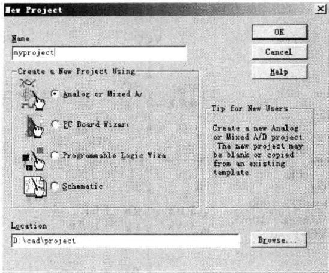  

图附 1.2.3 新建项目设置对话框

仿真,因此不需要对该项做出改动。

事实上，从图中可以看到新建设计项目有四个类型可供选择。其中，若要对绘制的电路图进行 PSpice 电路模拟仿真，应选择图中第一项“Analog or Mixed A/D”。若电路图要用于印制电路板设计，则应选择图中的第二项“PC Board Wizard”。若电路图将用于 CPLD 或者 FPGA 设计，则选择图中的第三项“Programmable Logic Wizard”。如果只是绘制一般的电路图，并不专用于上述几种电路设计，应选择第四项“Schematic”。

（3）“Location”框 该项代表保存新建设计项目的子目录，图中已经将路径设置为“D:\cad\project”目录。读者可以在该框中输入自己所需的其他路径，也可以单击右边的“Browse...”按钮通过浏览器选择路径。

在完成这三项设置之后,单击右上方的“OK”按钮即可弹出下一个窗口,如图附1.2.4所示。

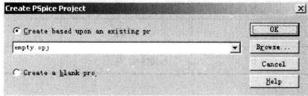  

图附1.2.4 项目继承选择窗口

图附 1.2.4 所示窗口的含义是让用户选择新建项目将依据已有项目继续或是创建一个空白的项目。在目前情况下，可以直接使用图中的缺省选项而直接单击右上方的“OK”按钮以进入下一步骤。

在某些情况下,会出现图附 1.2.5 所示的窗口。该窗口的含义是提示使用者 Demo 版本中存在的一些限制,并不会影响使用。需要注意的是,该窗口可能连续出现几次,并且在后续的使用过程中也可能出现,此时直接单击“确定”即可。

在完成相应单击之后,出现图附 1.2.6 所示的窗口,此时已完成项目的建立,可以进行

原理图绘制的后续工作。

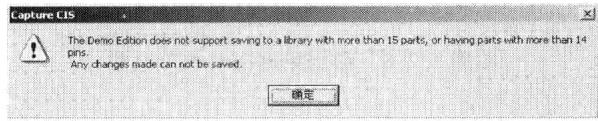  

图附 1.2.5 Demo 版限制提示窗口

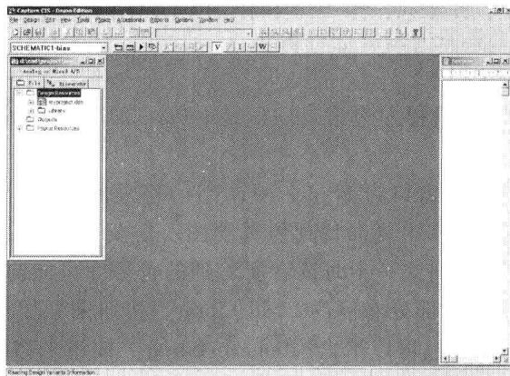  

图附 1.2.6 新建项目完成后的显示窗口

## 三、元器件的放置与属性设置

## 开始绘制电路图

在图附 1.2.6 所示的项目管理视图里, 双击 “Design Resources/myproject.dsn/SCHE-MATIC1/PAGE1” (也可以单击每个选项左边的“+”号展开来进行选取), 直至出现图附 1.2.7 所示的空白原理图窗口为止。

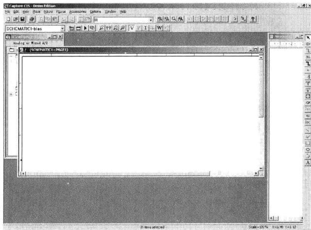  

图附 1.2.7 空白原理图窗口

此时 Capture CIS 窗口中将进一步出现图附 1.2.8 所示的工具栏。

  

图附 1.2.8 绘制原理图时的工具栏

将鼠标箭头在每个选项上放置若干时间后即可看到该选项的相关作用,此处不对其功能做详细说明。需要注意的是,根据设置的不同,工具栏的位置及形式也可能有所区别(例如图附1.2.7中的工具栏出现在屏幕的右边,且为纵向排列)。在以下的叙述中,将以图附1.2.8所示横向排列的工具条为基准进行说明。

## ➢ 器件库的设置与选择

单击图附 1.2.8 所示工具栏左边第二项 (Place Part) 即可弹出图附 1.2.9 所示的元器件列表。

图附 1.2.9 中, 左下角的窗口为 PSpice 中调用的符号库(关于符号库的含义及作用请参考后续小节), 从这些符号库中可以找到仿真绘图所需要的元器件。需要注意的是, 由于实际使用的环境不同在执行到这一步时读者所看到的符号库可能与图附 1.2.9 不一致。如果不一致, 可以单击图中上半部分右侧的“Add Library”按钮来添加相应的库, 此时弹出图附 1.2.10 所示的对话框。读者也可以单击“Remove Library”按钮来移除相应的符号库。

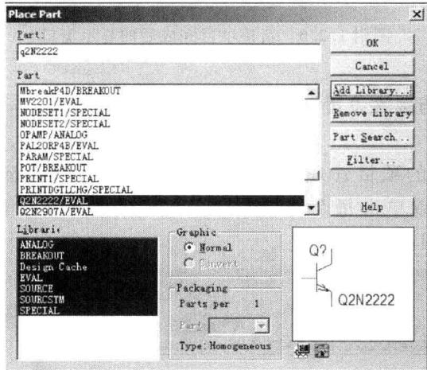

图附1.2.9 器件选择列表  

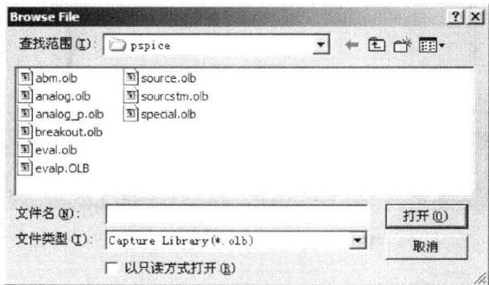  

图附 1.2.10 元件库的添加

在选择和添加元件库时,需要注意选择查找范围应选择为“Orcad 10.0 Demo 的安装目录\tools\capture\library\pspice”目录,此时可在该目录下依次添加图附 1.2.9 中所示的器件库了。

单击器件库列表中的第一项,按住“Shift”键再单击器件库列表中的最后一项,即可将所有器件库选中。

## ➢ 元器件的放置

以下依次放置图附 1.2.2 中所示的各个器件。

在图附 1.2.9 中的最上方的“Part”框中输入“q”（大小写均可），此时中部的“Part”选项

跳至以 Q 开头的器件列表。单击该图中右边的滚动条，直到出现“Q2N2222/EVAL”（该器件为一个 NPN 型晶体管）为止。单击选择该器件，然后单击右上方的“OK”按钮，即可放置相应的器件到原理图上。在原理图上左右移动鼠标，选择好合适的位置后单击鼠标左键便将一个器件放置于原理图上。在放置完毕后，单击鼠标右键，即可弹出图附 1.2.11 所示的菜单。

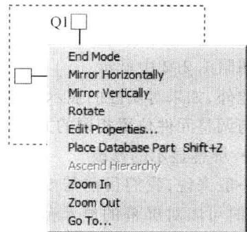

选择第一项“End Mode”，即可停止该晶体管的放置。

图附 1.2.11 放置器件时的右键菜单

再次进入图附 1.2.9 所示的窗口，在最上方的“Part”框中输入“r”（大小写均可），此时中部的“Part”选项跳至以 R 开头的器件列表。单击该图中右边的滚动条，直到出现“R/ANALOG”（该器件为一个电阻）为止。选择该器件后即可开始放置电阻到原理图上。需要注意的是，在 Capture CIS 中，当放置某一个器件之后，可以缺省地继续在原理图上放置相同器件，可以使用该方法在原理图的合适位置上放置六个电阻。当要停止放置时，可以单击鼠标右键并选择“End Mode”以停止放置。

使用类似的方法可以放置以下器件：

◇ 三个电容(在“Part”对话框中输入“C”);

◇ 一个正弦电压源(在“Part”对话框中输入“VSIN”);

◇ 一个直流电压源(在“Part”对话框中输入“VDC”)。

此后,可以单击图附1.2.8所示菜单栏的第八项(Place Power),在弹出的对话框中输入“VCC”并放置两个 $V_{cc}$ 电源;单击第九项(Place Ground),在弹出的对话框中输入“0”并放置两个地符号。

在完成以上过程之后,即已经将所需的全部器件放置在原理图中。

## ➢ 元器件的搬移及旋转

一般来说,元器件放置在原理图之后很难一下达到满意的程度,而需要搬移其位置甚至旋转其方向以达到令人满意的程度,此时可以采取如下方法:

◇ 使用鼠标左键点击某一器件，在保持按下左键的同时移动鼠标即可将器件在原理图上移动。当移动到合适位置时，放开鼠标左键即可停止移动。

◇ 使用鼠标单击某一器件后放开，再在该器件上单击鼠标右键，即可弹出图附 1.2.12 所示的菜单。该菜单中分别为将器件进行水平反转、垂直反转以及逆时针旋转的操作。

## ➢ 元器件属性值的修改

这里要修改的主要是元器件的标号以及取值属性,可以采用如下方法:双击所需要修改的属性名称,并在弹出的对话框的“Value”选项中将相应属性改为所需的值,然后点击“OK”即可。

例如,需要将图附 1.2.13 左侧所示的电阻标号改为 RB1,取值改为 9.7 kΩ,可以分别双击该元件的标号值 R1 以及取值 1 kΩ,并在所弹出的中侧及右侧所示对话框中进行修改。

使用这种方式,可以将已经放置的器件的参数值改为图附 1.2.2 中所示。

此外,如果对属性的显示位置觉得不合适,也可以使用与调整元件位置相同的方法进行修改。

## ➢ 屏幕显示的修改

一般来说,我们目前需要绘制的原理图不是很复杂,此时可以对屏幕的显示范围进行适当调整从而能够获得更好的显示结果。其方法为选择主菜单中的

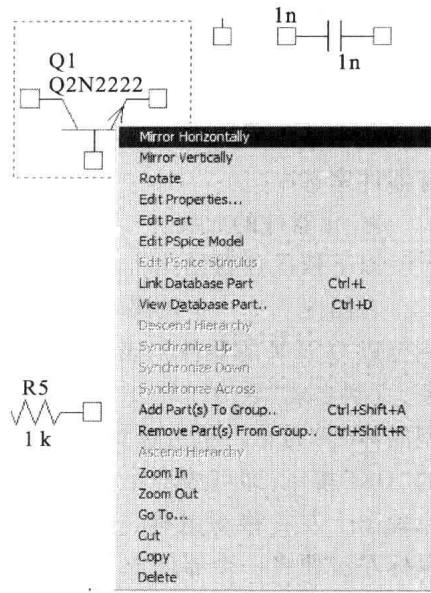  

图附1.2.12 对器件进行  

相关操作的菜单

“View->Zoom->Area”，然后单击鼠标左键并拉出一个矩形方框，再放开鼠标左键，即可调整当前显示为矩形方框中的内容。需要注意的是，若对显示的内容满意，同样要单击鼠标右键并选择“End Mode”。

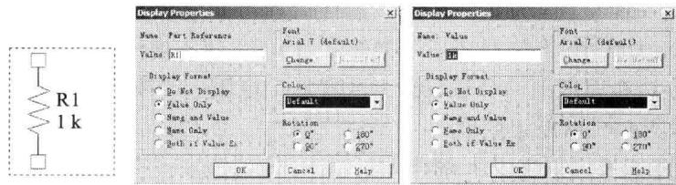  

图附 1.2.13 元器件属性值的修改

完成以上各步骤之后,屏幕的显示应类似于图附 1.2.14 所示,读者可以检查自己所绘的图并进行修改。

## 四、器件间的连线

完成器件的放置以及参数设置之后,即可以按照图附1.2.2中所示进行相应的连线:单击图附1.2.8所示菜单条的第三项(Place Wire)即可进入连线模式。在需要连线的某一个管脚上点击鼠标左键即可从该管脚引出连线,移动鼠标指针至连线的另外一个管脚上并再次点击鼠标左键即可完成该条连线。此时可以继续按照这种模式绘制下一条连线。若需要停止连线,则可以单击鼠标右键,并选择第一项“End Wire”。

使用该方法可以完成图附 1.2.14 中器件的连接, 即如图附 1.2.2 所示。需要注意的是, 图中圆点代表两条或多条交叉的连线之间存在着电气连接。

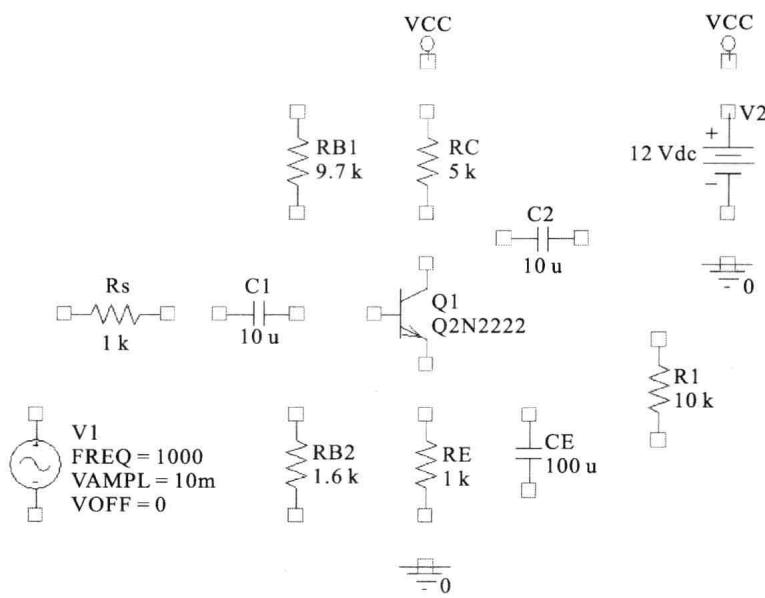  

图附 1.2.14 完成器件放置后的示意图

## 五、删除操作

在以上绘制原理图的各步操作中都有可能出现误操作,例如放置了多余元器件或连线误操作,此时可以使用鼠标左键单击误操作的元素然后按“Delete”键将其删除。

## 附录 1.2.3 Capture CIS/PSpice 绘图的基本概念及基本流程

在上一节中介绍了 Capture CIS/PSpice 绘图的一个快速流程,本节将对 Capture CIS/PSpice(为简单起见,以下将其简称为软件)中绘图和仿真的一些基本概念及通用流程做简单介绍,以使读者能够对其有更深一步的理解。

## 一、Capture CIS/PSpice 中的电路描述方法

在技术设计过程中,任何一个完整的电路,不仅要包括电路的结构,而且还应包含各元器件的有关参数;此外,为了更好地保证设计的性能,在设计时还需要考虑到信号源及电源的有关参数。同样,在使用软件进行仿真时,也必须把这些方面完整地表达出来。

事实上，电路的结构可以通过元器件符号以及它们之间的连线来描述；而器件的参数则可在元器件属性(Attributes)中描述。描述一个元器件所需要的属性通常包括元器件符号名称、元器件在电路中的标号、元器件参数值等几部分内容。由于有源器件的参数较多，一般不直接在属性中给出它们，而是用专门的模型(Model)来描述，属性中只给出它们的模型名称以简化用户的使用。为了方便用户的使用，软件通常会把一系列模型组合在一起，形成一个模型库。在仿真时，用户可以选择使用一个或多个模型库，并从这些模型库中选择所需要的元器件放置到电路中，最终PSpice将从模型库中调出该元器件的参数值进行仿真。

下面对电路元器件的描述做进一步的介绍。

## 电阻、电容和电感

在符号库(\*.slb)中分别用关键字R、C和L来标识电阻、电容和电感元件(在PSpice中的元器件关键字见附录1.4中的相应表格）。在实际电路中以关键字开头，后跟长度不超过8个字符的字母或数字作为它们的标号，例如R4、CE、L1。它们的参数在元器件属性的VALUE项中定义，例如VALUE=10 k。

## 有源器件

有源器件在符号库中的名称(NAME)通常以关键字开头,后跟长度不超过8个字符的字母或数字命名,如Q2N2222表示一种NPN型BJT。74系列的数字集成电路芯片以它们的型号作为元器件名称。

有源器件的参数均在它们的模型中描述。在 PSpice 中是按照器件类型 (DEVICE-TYPE) 来建立模型的, 这些类型见附录 1.4 中的相应表格。同一类型的器件有相同的模型结构, 只是具体参数值有所不同。例如, Q2N2222 和 Q2N3904 均属 NPN 型 BJT。

一般来说,电路仿真的精度主要是由元器件所选用的模型和模型参数来决定。PSpice 中选用了较精确的模型,其模型参数也很多,在多数情况下,可以忽略其中许多参数。PSpice 在分析时使用这些参数的缺省值(Default Value,即计算机自动给出的值,也称为默认值)。附录 1.4 中的相应表格给出了几种器件常用的模型参数。

## > 信号源及电源

在电路描述中,信号源和电源是必不可少的。实际上,电源可以看成是一种特殊的信号源。在 PSpice 中,信号源被分为两类:独立源和受控源。几种主要的独立源见表附 1.2.2。在类型名前加 V 表示电压源,加 I 表示电流源。受控源共分为四类,见表附 1.2.3,它们可用来描述等效电路。注意:在对电压源进行设定时,VOFF 表示直流基准电压,VAMPL 表示正弦幅度电压,FREQ 表示频率;对电流源进行设置时,参数的含义与电压源类似。

表附1.2.2 几种主要的独立源

<table><tr><td>类型名</td><td>电源及信号源类型</td><td>应用场合</td></tr><tr><td>DC</td><td>固定直流源</td><td>直流电源、直流特性分析</td></tr><tr><td>AC</td><td>固定交流源</td><td>正弦稳态频率响应</td></tr><tr><td>SIN</td><td>正弦信号源</td><td>瞬态分析、正弦稳态频率响应</td></tr><tr><td>PULSE</td><td>脉冲源</td><td>瞬态分析</td></tr><tr><td>PWL</td><td>分段线性源</td><td>瞬态分析</td></tr><tr><td>SRC</td><td>简单源</td><td>可当做 AC、DC 或瞬态源</td></tr></table>

表附1.2.3 受控源

<table><tr><td>元器件描述关键词</td><td>受控源类型</td></tr><tr><td>E</td><td>电压控制电压源</td></tr><tr><td>F</td><td>电流控制电流源</td></tr><tr><td>G</td><td>电压控制电流源</td></tr><tr><td>H</td><td>电流控制电压源</td></tr></table>

信号源的参数可在其属性中定义。例如，脉冲源的初始电压 V1、脉冲电压 V2、延迟时

间 TD、上升时间 TR、下降时间 TF、脉冲宽度 PW、周期 PER 等，均可在其属性窗中赋值。

## 二、Capture CIS/PSpice 中电路图的绘制流程

一般来说,在 Capture CIS/PSpice 软件中,完整的电路图是在 Schematic 窗口绘制的。通常,电路图绘制主要包括以下几个部分/步骤的内容(对于大部分其他 EDA 软件来说,也是如此)。

## 放置元器件(Place Part)

所谓元器件(Part)即为电路图中电阻、电感、电源、晶体管等。而放置元器件即为从软件的符号库调用合适的元器件，包括电阻、电容、晶体管、电源和接地符号等，并将它们放置在电路图适当位置。

在 Capture 中, 调用器件非常方便, 即使不清楚器件在库中的名称, 也可以很容易查找并调出使用。

关于元器件放置的基本流程参考附录 1.2.2 节三中的相关说明即可。

## 修改元器件属性

一般来说,刚从器件库中调出来的元器件属性值为其缺省值,此时是不能满足使用者要求的(特别是对于非有源器件来说)。因此通常在放置好器件之后要把器件的属性值设置为使用者所要求的值。

关于修改元器件属性的基本流程参考附录1.2.2节三中的相关说明即可。

## 放置连线(Place Wire)

所谓连线,即类似于实际电路中的导线。而在 EDA 软件中,这一步的作用是把电路中需要的元器件用线连起来成为一个连通电路。单击“Place Wire”按钮进入连线状态,此时鼠标变成十字形,移动鼠标,点击左键即可开始连线。

关于放置连线的基本流程参考附录 1.2.2 节四中的相关说明即可。

此外,根据需要,在绘制电路图时还可能要进行如下操作:

## 修改电路图

根据需要通过删除无用元素、改变元器件放置位置、修改属性参数等修改绘制好的电路图。

## 电路图的后处理和结果输出

可以打印输出或者生成供 PSpice 电路模拟仿真的程序、PCB 设计等其他 CAD 应用软件使用的电连接网络表。

对于本文的读者来说,由于需要利用 PSpice 进行仿真,在绘制原理图时还需要特别注意以下事项:

（1）原理图中至少必须有一条网络名称为0，即接地。

（2）必须有激励源。原理图中的端口符号并不具有电源特性，所有的激励源都存储在Source和SourcSTM库中。

（3）电源两端不允许短路，不允许仅由电源和电感组成回路，也不允许仅由电源和电容组成的割集。其解决方法：电容并联一个大电阻，电感串联一个小电阻。

（4）最好不要使用负值电阻、电容和电感，因为它们容易引起不收敛。

## 三、Capture CIS 和 PSpice 中的其他有关规定

## > 数字的表示方法

在 Capture CIS/PSpice 中, 可以使用以下方法来表示数字:

◇ 整数,如 12,-5;

◇ 浮点数, 如 2.384 5, 5.986 01;

◇ 科学计数法(即整数或浮点数后面跟整数指数),如 $6E-14,3.743E+3$ ;

◇ 在整数或浮点数后面跟比例因子, 如 10.18 k。

## > 比例因子

为了使用方便, PSpice 中规定了 10 种比例因子。它们用特殊符号表示不同的数量级, 这 10 种比例因子为:

$T(t) = 1E + 12, G(g) = 1E + 9, MEG(meg) = 1E + 6, K(k) = 1E + 3, MIL(mil) = 25.4E - 6, M(m) = 1E - 3, U(u) = 1E - 6, N(n) = 1E - 9, P(p) = 1E - 12, F(f) = 1E - 15$ 。

其中括号内为小写表示,事实上,PSpice 中不区分大小写。

<Note title="注">
底数为 10 时用字母 E 表示。
</Note>

## 单位

PSpice 以工程单位米、千克和秒(m、kg、s)为基本单位。由此得到的其他电学单位可省略，如 10,10 V 表示同一电压数；1 000 Hz, 1 000, 1E+3, 1 k, 1 kHz 都表示同一个频率值。同样，Ω、A 等标准单位在描述时均可省略。

## > 分隔符

在 PSpice 的有关编辑窗中输入多个参数值或表达式时, 数值之间或表达式之间用逗号或空格分开, 多个空格等效于一个空格。

## ➢ 表达式编写规则

PSpice 中可以用表达式定义元器件参数值。如，电阻值为 $\{1k*(1+P*Pcoeff/Pnom)\}$ ，给定 $Pcoeff=-0.6, Pnom=1.0, P$ 从 0 变到 5 时，可以分析电阻值按表达式的函数关系变化时电路的响应（例如在进行 Global Parameter 分析时）。注意：参数值以变量或表达式出现时要用花括号“\{\}”括起来。

此外，在使用波形后处理程序 Probe 时，还可以用表达式来对仿真结果做更多的分析，从而有助于开发人员获得更多有用的结果。关于在 Probe 中使用表达式的方法请参考附录 1.3.2 节。

## 附加项含义

## 见表附 1.2.4。

表附1.2.4 附加项含义

<table><tr><td>附加项</td><td>含义</td></tr><tr><td>(不加)</td><td>幅值量</td></tr><tr><td>M</td><td>幅值量</td></tr><tr><td>DB</td><td>幅值分贝数,等同于 $DB(x)$ </td></tr><tr><td>P</td><td>相位量</td></tr><tr><td>G</td><td>群延迟量( $d$  PHASE/ $dF$ ),即相位相对频率的偏导数</td></tr><tr><td>R</td><td>实部</td></tr><tr><td>I</td><td>虚部</td></tr></table>

## 附录1.3 使用PSpice进行电路特性仿真

## 附录1.3.1 PSpice软件的构成

PSpice 软件的构成以及 OrCAD 软件包中与 PSpice 运行有关的软件(模块)之间的相互关系如图附 1.3.1 所示。

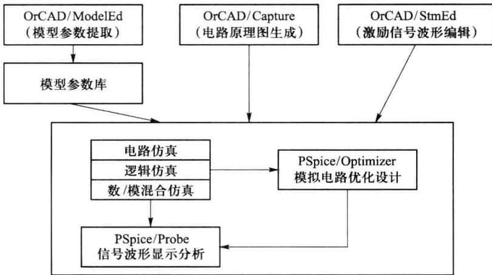  

图附 1.3.1 PSpice 软件构成以及与其他软件(模块)的关系

事实上，PSpice 以 OrCAD/Capture CIS 作为前端模块，实现了 OrCAD 中设计项目的统一管理，用户可以在同一个 Capture 环境下创建和仿真整个设计。

此外，PSpice不仅可以对模拟电路进行计算机辅助分析，而且可以对数字电路、数模混合电路进行计算机仿真。具体分析功能见表附1.3.1。

表附 1.3.1 PSpice A/D 分析的电路特性

<table><tr><td>类别</td><td>电路特性</td></tr><tr><td>直流特性</td><td>(1) 直流工作点(Bias Point Detail)(2) 直流灵敏度(DC Sensitivity)(3) 直流传输特性(Transfer Function,TF)(4) 直流特性扫描(DC Sweep)</td></tr><tr><td>交流特性</td><td>(1) 交流小信号频率特性(AC Sweep)(2) 噪声特性(Noise)</td></tr><tr><td>瞬态特性</td><td>(1) 瞬态响应(Transient Analysis)(2) 傅里叶分析(Fourier Analysis)</td></tr><tr><td>参数扫描</td><td>(1) 温度特性(Temperature Analysis)(2) 参数扫描(Parametric Analysis)</td></tr><tr><td>统计分析</td><td>(1) 蒙特卡洛分析(Monte Carlo,MC)(2) 最坏情况分析(Worst Case,WC)</td></tr><tr><td>逻辑仿真</td><td>(1) 逻辑仿真(Digital Simulation)(2) 数模混合仿真(Mix A/D Simulation)(3) 最坏情况时序分析(Worst-case Timing Analysis)</td></tr></table>

根据本书中所涉及的主要内容和相关要求,本部分将重点介绍直流工作点分析、直流特性扫描分析、交流小信号频率特性分析、瞬态特性分析以及参数扫描分析。若读者对其他仿真感兴趣的话,可以自行参考相关资料。

## 附录 1.3.2 PSpice 电路仿真快速入门之一: 静态工作点仿真

与附录 1.2 中的原理图绘制类似, 此处先用一个已知的图作为例子, 读者可以跟随相应的操作来实现一个简单的仿真。

在本章仿真过程中,继续使用图附 1.2.2 所示的范例作为仿真对象。若读者已经关闭了该工程,请自行打开并切换到原理图窗口中。

## 一、建立仿真类型分组

从菜单中选择执行“PSpice/New Simulation Profile”子命令,屏幕弹出如图附1.3.2所示的对话框。

在“Name”下的文本框中键入仿真类型组的名称,本例中设置名字为“mysim”。

“Inherit From”下面的框中显示为“none”，本例中不对其进行修改。

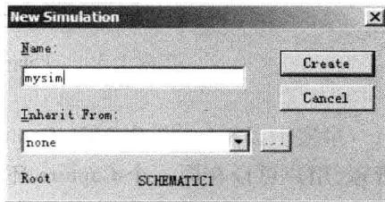

“Inherit From”文本框右侧的下拉式列表中有当前电路中已建立的仿真类型分组。如果在某个已有仿真图附1.3.2 New Simulation对话框

类型分组设置内容的基础上稍加修改即可得到新的设置,可从下拉列表中选取该仿真类型组的名称;如果新建仿真类型分组中的参数需要重新设置,应从下拉式列表中选取 none。

在设置好仿真类型组名称后单击“Create”键。此时出现图附1.3.3所示的仿真类型和参数设置对话框。

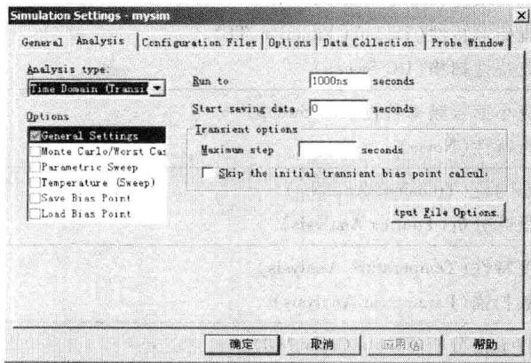  

图附 1.3.3 设置仿真类型和参数对话框

## 二、设置仿真类型和参数

在图附 1.3.3 中, 点击“Analysis type”下方输入框右边的下拉箭头, 出现图附 1.3.4 所示的下拉列表, 选择最后一项, 即“Bias Point”。

“Bias Point”的含义即为进行静态工作点仿真，对于该项仿真，目前没有必要设置其他参数，因此单击窗口最下方的“确定”键即可。

## 三、进行仿真

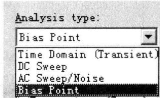

从菜单中选择执行“PSpice/Run”命令（从菜单中可以看出，直接按下 F11 快捷键也可以执行该命令），启动仿真。若

图附 1.3.4 分析类型选择

此前的原理图绘制及其他设置没有错误的话,会出现图附1.3.5所示窗口。

读者可以注意观察窗口左下侧的消息,最后一条为“Simulation Complete”,表明仿真已经顺利完成。此时可以使用 Alt+Tab 切换回到原理图窗口。若仿真中出现故障,则可根据故障提示自行查找出现问题的原因。

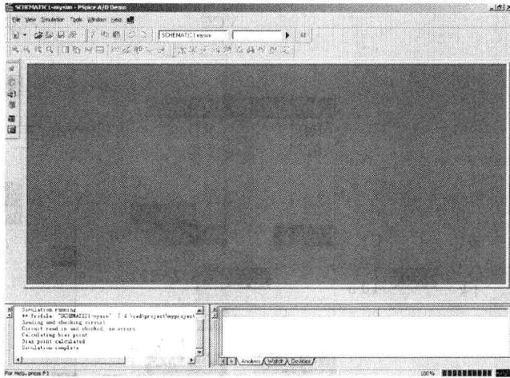  

图附 1.3.5 PSpice A/D Demo 窗口

## 四、查看仿真结果

若没有进行过其他设置,则在切换回原理图窗口时,并不能看到仿真结果。此时可以单击菜单“PSpice/Bias Point”,出现图附1.3.6所示窗口。

从图附 1.3.6 中看出,此时可以分别通过选择“Enable Bias Current Display”、“Enable Bias Voltage Display”和“Enable Bias Power Display”来查看各点的静态工作点电压、电流及功率。图附 1.3.7 所示为选择了静态工作点电压、电流之后的显示结果,读者可自行手动计算静态工作点并与仿真结果进行对比。需要注意的是,在 PSpice 中显示器件上某个管脚的电流值时,是以流进器件为正方向的,因此在计算 Q1 发射极电流时,给出的是负值。

事实上,读者也可以通过单击图附1.3.6中所看到的快捷按钮中的V或I来打开或关闭静态工作点的仿真结果显示。

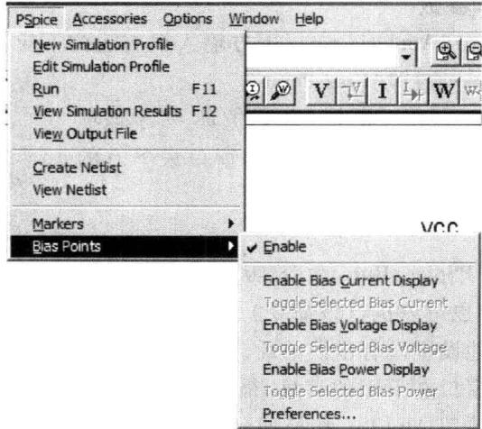  

图附 1.3.6 静态工作点仿真结果的查看

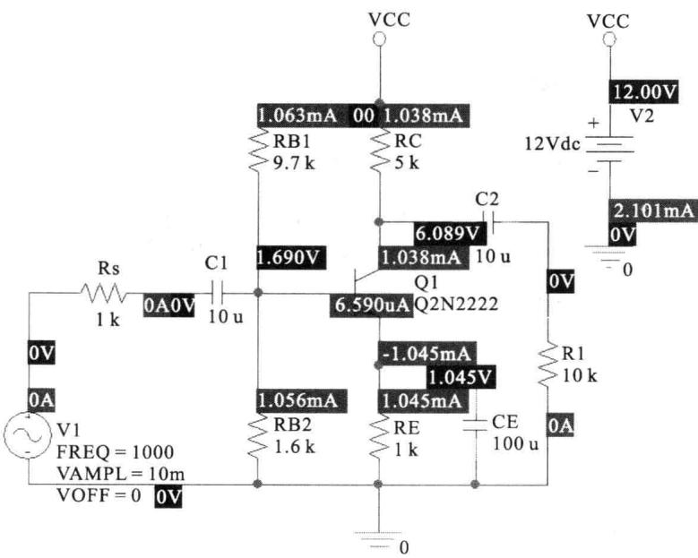  

图附 1.3.7 静态工作点电流、电压的显示结果

## 附录 1.3.3 PSpice 电路仿真快速入门之二: 直流扫描仿真

在上一小节中,并没有对仿真的参数做出设置,本小节仍然以图附1.2.2为例,通过直流扫描仿真介绍一些关于仿真参数的简单设置方法。

## 一、建立仿真类型分组

该步骤与附录 1.3.2 节一相同, 不再赘述, 读者可在建立时自行取名。

## 二、设置仿真类型和参数

此时需要在图附 1.3.4 所示的菜单中选择“DC Sweep”方式,从而出现图附 1.3.8 所示的对话框。

图附 1.3.8 右上侧显示的是以哪个直流电源作为自变量，而右下侧显示的是直流电源的变化方式。在本例中，选择电压源 V2 作为自变量，并设置其变化方式为线性变化：起始值为 6 V，步进值为 1 V，终值为 12 V。在按照图附 1.3.8 所示设置完参数后，单击“确定”按钮。

## 三、进行仿真

该步骤与附录 1.3.2 节三相同, 此处不再赘述。

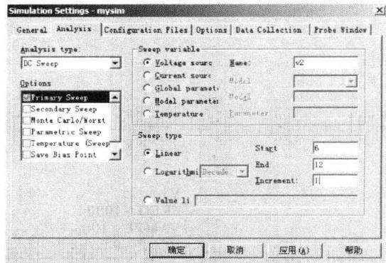  

图附 1.3.8 DC Sweep 的参数设置

## 四、查看仿真结果

与附 1.3.2 节所进行的仿真不同，在本次仿真中出现了一张空白的图，原因在于没有为 “DC Sweep” 仿真设置相应的探针。现在可以切换回原理图窗口，选择 “PSpice/Markers” 菜单，出现如图附 1.3.9 所示的选择菜单。

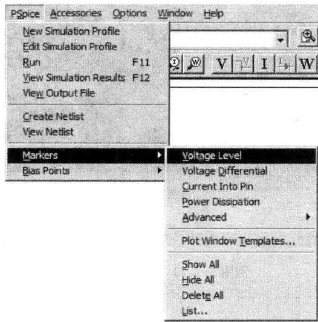  

图附1.3.9 探针的选择菜单

“Markers”子菜单的上四项分别为观测电压值、差分电压、流进管脚的电流、功率消耗，在本例中选择观测电压值，并将相应的探针放置在所需观察的节点上，如图附1.3.10所示（放置探针的方法与放置元器件相同）。

图附 1.3.10 中 Q1 基极节点处下斜 $45^{\circ}$ 的器件即是一个电压探针。当然，读者也可以在快捷按钮中寻找具有相同功能的按钮。将当前窗口切换回仿真结果的显示窗口，如图附 1.3.11 所示。

图附 1.3.11 说明了当 V2 电压按照预定值变化时, Q1 基极电压的变化情况。

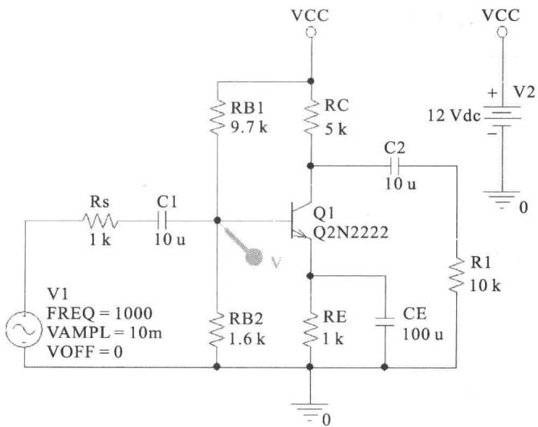  

图附 1.3.10 放置电压探针后的情况

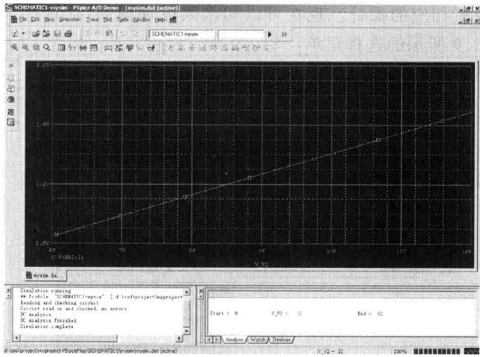  

图附 1.3.11 仿真结果显示

## 附录1.3.4 电路仿真的基本过程

采用 PSpice 软件对电路进行仿真的基本过程共分 8 个阶段, 如图附 1.3.12 所示。

在本书中,仅要求掌握前五个步骤即可。其中,新建设计项目、电路图生成这两个步骤已经在附录1.2中说明,本小节对后三个步骤进行说明。

## 一、电路特性分析要求设置

该步骤的目的为在生成电路原理图以后,根据电路设计任务确定要分析的电路特性类型并设置与分析有关的参数,又可分为如下几个步骤。

## 建立网表(Netlist)

在“Capture”主命令菜单中选择“PSpice”命令菜单，屏幕上将出现“PSpice”命令菜单，如

图附 1.3.13 所示。

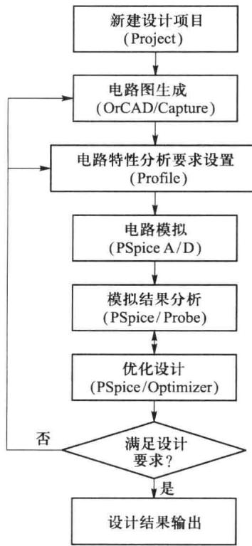  

图附1.3.12 利用PSpice仿真的基本过程

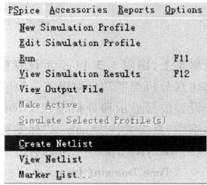  

图附1.3.13 PSpice命令菜单

OrCAD/Capture 软件与 OrCAD/Layout、PSpice 模块或其他的 CAD 应用软件之间交换电路设计是通过电连接网络表文件进行的。该文件描述了电路中包括的所有元器件、元器件属性参数以及元器件相互之间的连接关系。图附 1.3.13 中的“Creat Netlist”就是将自动生成的连接网络表文件传送给 PSpice 软件，以便进行电路仿真。

<Note title="注意">
PSpice 仿真时这步可以省略, PSpice 会自动连接。
</Note>

## 建立仿真类型分组

为了更好地组织仿真过程，PSpice A/D 引入了仿真类型分组（Simulation Profile）的概念，将基本直流工作点计算、直流 DC 扫描、交流小信号 AC 分析和瞬态 TRAN 分析作为四种基本的分析类型。在每一种电路的一个仿真类型分组中，只能包括这四种基本分析类型中的一种分析，但均可以同时包括灵敏度分析、温度特性、参数扫描、蒙特卡洛分析和直流工作点的存取等。每个仿真类型分组均有各自的名称，分析结果的数据单独存放在一个文件中，同一个电路可建立多个仿真类型分组，不同分组也可以针对同一种特性分析类型，只是分析参数不同。PSpice 是通过仿真类型分组来完成特性分析类型的确定和参数设置的。

该步骤的执行即为附录 1.3.2 节一中所示, 此处不再赘述。

## 设置仿真类型和参数

该步骤用于设置执行何种仿真,仿真时的具体参数设置等内容。一般来说,在建立了新的“Simulation Profile”后即会自动进入这一步;用户也可以通过执行菜单命令“PSpice/Edit

Simulation Profile”来进行设置。设置时弹出如图附1.3.14所示窗口。

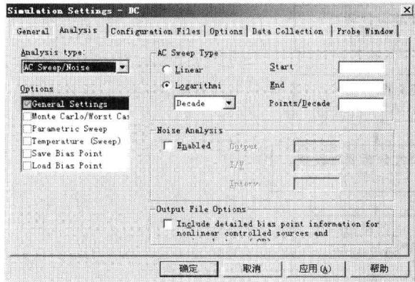  

图附 1.3.14 仿真类型和参数设置框

事实上，图附1.3.14所示设置框可用于多种类型的参数设置。“Analysis”标签页用于电路仿真分析类型和参数设置。“Option”、“Data Collection”和“Probe Window”三个标签页用于设置波形显示和分析模块Probe参数，其余标签页用于电路仿真中有关文件的设置。在本书中，只需关注“Analysis”标签页即可。

在“Analysis type”中,可以有以下四种选择。

◇ “Time Domain(Transient)”: 时域(瞬态)分析。

◇ “DC Sweep”: 直流分析。

◇ “AC Sweep/Noise”: 交流/噪声分析。

◇ “Bias Point”: 基本偏置点分析。

在“Options”选项中可以选择在每种基本分析类型上要附加进行的分析,其中“General Setting”是最基本的必选项(系统默认已选)。关于这四种基本分析类型的具体介绍见下一小节。

用户确定某种分析类型名之后,其右侧即显示出该种分析中需要设置的参数。不同的电路分析类型需要设置的分析参数也不相同。在完成参数设置后,单击“确定”按钮即可完成仿真类型与参数的设定。

## 二、运行 PSpice A/D 程序

该步骤已在附录 1.3.2 节三中说明,此处不再赘述。

## 三、仿真结果的显示与分析

仿真分析结束后，将在相应窗口中显示出分析结果。当然，前提是用户已经放置了合适的探针，探针可以在开始仿真之前放置，也可以在完成仿真之后放置，这并不会影响仿真结果。并且用户可以在该窗口中对仿真结果做出各种运算，从而获得一些进一步的结果。在附录1.3.6小节，将就该窗口的使用方法做出进一步的说明。

此外，PSpice 还将按照电路特性分析的类型，分别将计算结果存入扩展名为“.out”的 ASCII 码输出文件以及扩展名为“.dat”的二进制文件中。分析这两个文件的内容，可以确定电路设计是否满足预定要求。

## 附录 1.3.5 基本电路特性的仿真分析计算

本小节将对直流工作点、直流扫描、交流小信号分析、瞬态特性分析以及参数扫描等五种分析进行进一步的介绍。由于篇幅限制，对于各种仿真的结果将不再给出示意图，读者可以自行试验。

## 一、直流工作点分析(Bias Point)

PSpice 的直流工作点分析是在电路中电感短路、电容开路的情况下,计算电路的静态工作点,其结果通常可用于电路的进一步分析。要特别注意的是,在进行瞬态分析和交流小信号分析之前,程序将自动先进行直流工作点分析,以确定瞬间的初始条件分析和交流小信号情况下非线性器件的线性化模型参数。

进行该项分析之后,将获得如下结果:

◇ 电路所有节点电位；

◇ 所有电压源的电流和电路总的直流功耗；

◇ 所有晶体管的偏置电压、各极电流等信息；

◇ 所有晶体管在此工作点下的交流小信号线性模型参数。

在进行该项分析时,可以设置的参数如下:

单击“PSpice->Edit Simulation Profile”，调出“Simulation Setting”对话框，在“Analysis type”中选择“Bias Point”，在“Options”中选中“General Settings”，如图附1.3.15所示。

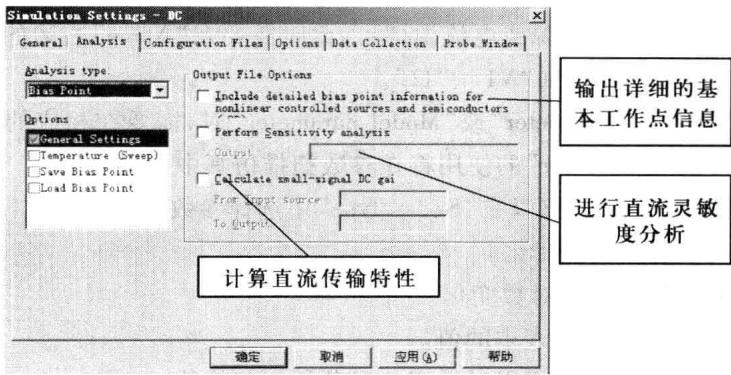  

图附 1.3.15 直流工作点设置

一般来说,图附1.3.15中右侧三项均无需选择。单击“确定”后按照附录1.3.2节三所示的方法运行仿真即可。

## 二、直流特性扫描分析(DC Sweep)

直流特性扫描分析就是使电路中某个元器件参数(称为自变量)在一定范围内变化,在自变量的每个取值上计算电路的直流偏置特性并显示分析结果(称为输出变量)。在进行直流特性扫描分析时,还可以指定一个参变量并确定其变化范围。对参变量的每一个取值,均使自变量在其变化范围内按每一个设定值,计算输出变量的变化情况。

单击“PSpice->Edit Simulation Profile”，调出“Simulation Setting”对话框，在“Analysis type”中选择“DC Sweep”，在“Options”中选中“Primary Sweep”，如图附1.3.16所示。

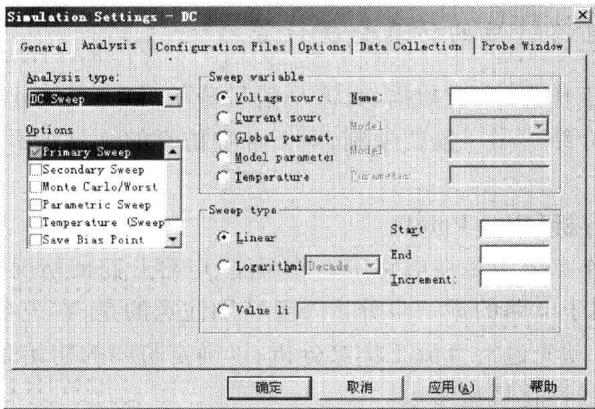  

图附 1.3.16 DC Sweep: 直流分析设置

“Sweep variable”: 用于选择直流扫描自变量类型, 可选如下对象。

◇ “Voltage source”: 电压源。

◇ “Current source”: 电流源。

◇ “Global parameter”: 全局参数变量。

◇ “Model parameter”: 以模型参数为自变量。

◇ “Temperature”: 以温度为自变量。

<Note title="注 1">
一般来说,选择电压源或电流源即可,此时需要在“Name”右边的对话框里输入电压源或电流源的“Reference”,如“V1”、“I2”。
</Note>

<Note title="注 2">
在使用“Global parameter”或“Model parameter”时, 需要在相应的对话框中输入参数名称。关于“Global parameter”的使用将在参数扫描仿真中描述。

对于所选定的自变量,还可以在“Sweep type”中选择参数的变化方式(扫描方式)。

◇ “Linear”: 参数以线性变化。

◇ “Logarithmic”: 参数以对数变化。

◇ “Value list”: 只分析列表中的值。

◇ “Start”: 参数线性变化或以对数变化时分析的起始值。

◇ “End”: 参数线性变化或以对数变化时分析的终止值。

◇ “Increment”、“Points/Decade”、“Points/Octave”: 参数线性变化时的增量, 以对数变化时倍频的取样点个数。

此外,从图附 1.3.16 中可以看到,除了“Primary Sweep”以外,还有“Secondary Sweep”选项,该选项用于选择另外一个直流电源进行扫描。在将两个变量都利用起来后,可以进行晶体管输入输出特性曲线等的仿真。
</Note>

## 三、交流小信号频率特性分析(AC Sweep)

交流小信号频率特性分析即分析计算电路的交流小信号频率响应特性。分析时首先计算电路的直流工作点，并在工作点处对电路中各个非线性元件做线性化处理，得到线性化的交流小信号等效电路，然后使电路中交流信号源的频率在一定范围内变化，并用交流小信号等效电路计算电路输出交流信号的变化。本项分析又可简称为 AC 分析。

单击“PSpice->Edit Simulation Profile”，调出“Simulation Setting”对话框，在“Analysis type”中选择“AC Sweep/Noise”，在“Options”中选中“General Settings”，如图附1.3.17所示。“AC Sweep Type”：

其中参数的含义与“DC Sweep”的“Sweep Type”中的参数含义一样。

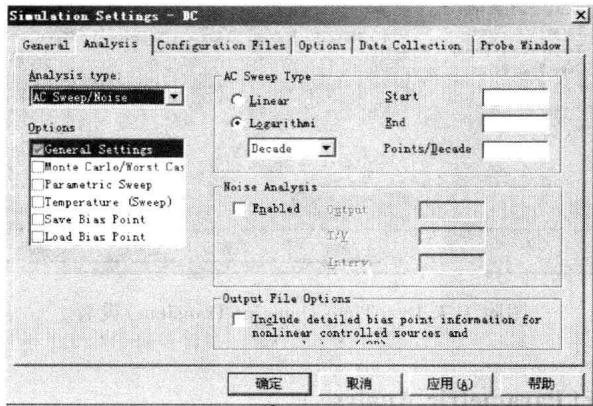  

图附 1.3.17 AC Sweep/Noise: 交流/噪声分析设置

需要注意的是在进行“AC Sweep”时，必须具有 AC 激励源。产生 AC 激励源的方法有以下两种：一是调用 VAC 或 IAC 激励源；二是在已有的激励源（如 VSIN）的属性中加入属性“AC”，并输入它的幅值。

“Noise Analysis”: 噪声分析

◆ “Enabled”: 在 AC Sweep 的同时是否进行“Noise Analysis”。

◇ “Output”: 选定的输出节点。

◇ “I/V”: 选定的等效输入噪声源的位置。

◇ “Interval”: 输出结果的点频间隔。

对于“Noise Analysis”，选定的等效输入噪声源必须是独立的电压源或电流源。分析的结果只存入“.out”输出文件，查看结果只能采用文本的形式进行观测。

## 四、瞬态特性分析(Transient Analysis)

瞬态特性分析是指在给定输入激励信号作用下，计算电路输出端的瞬态响应。进行瞬态分析时，首先计算 t=0 时刻的电路初始状态，然后从 t=0 到某一给定的时间范围内选取一定的时间步长，计算输出端在不同时刻的输出电平。瞬态特性分析又称为 TRAN 分析。

在 PSpice 瞬态分析中, 用户需要确定相关参数以及输入激励信号的波形。

单击“PSpice->Edit Simulation Profile”，调出“Simulation Setting”对话框，在“Analysis type”中选择“Time Domain（Transient）”，在“Options”中选中“General Settings”，如图附1.3.18所示。

◇ “Run to”: 瞬态分析终止的时间。

◇ “Start saving data”: 开始保存分析数据的时刻。

◇ “Maximum step”: 允许的最大时间计算间隔。

◇ “Skip the initial transient bias point calculation”: 是否进行基本工作点运算。

◇ “Output File Options”: 控制输出文件内容, 对于本书来说, 无需掌握该选项的内容。

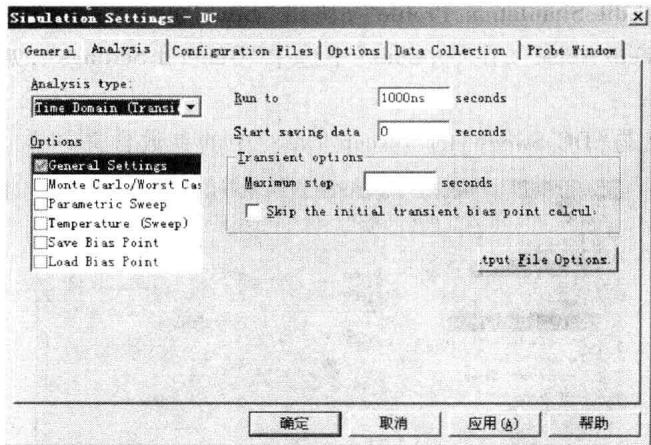  

图附 1.3.18 Time Domain(Transient) 设置

## 五、参数扫描分析(Parametric Analysis)

参数扫描分析是指对指定的每个参数变化值，均执行一次指定的电路分析。在参数扫描分析中，可变化的参数包括独立电压源、独立电流源、温度、模型参数和全局参数五种，并且还可以设置参数的变化方式。显然温度分析也可以通过参数扫描分析来完成。参数扫描分析在电路优化设计方面有重要的作用，将其与波形显示处理模块Probe的电路设计性能分析（Performance Analysis）功能结合在一起，可用于优化确定元器件参数设计值。

进行参数扫描分析的步骤如下。

### 1. 选择进行参数扫描分析

单击“PSpice->Edit Simulation Profile”，调出“Simulation Setting”对话框，在“Analysis type”中选择基本特性分析类型并设置好相关参数，在“Options”中选中“Parametric Sweep”，此时窗口显示如图附1.3.19所示。

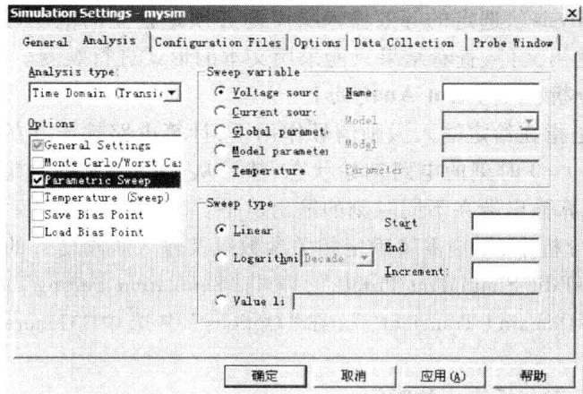  

图附 1.3.19 参数扫描设置(瞬态分析)

### 2. 设置需要产生变化的参数

可以看出,能够被扫描的变量与 DC Sweep 的设置方法完全一样。

下面以图附 1.2.2 所示电路为例,介绍在参数扫描时,使用“Global Parameter”来仿真 RB2 变化时对 out2 输出信号的瞬态特性影响的过程。

## Step 1 电路图的修改

为了进行参数扫描分析,需要对图附 1.2.2 进行两项修改。

将电阻 RB2 设置为全局参数: 双击电阻 RB2 的阻值 1.6 k, 在屏幕上出现“Display Properties”设置框, 将其值 1.6 k 改为 \{Rb\}。其中大括号不可少, 括号中的参数名可由用户设置, 然后单击“OK”按钮, 则将电路图中的 RB2 阻值改为此设置值。

☐ 用参数符号设置阻值参数:执行“Place->Part”,从“Special”符号库中调出名称为“PARAM”的符号放置于电路图空位置上,然后双击该符号,在屏幕上出现的元器件属性参数设置框中,单击“New Column”按钮,屏幕上将出现图附1.3.20所示的对话框。在“Name”下方键入阻值参数名“Rb”(注意:此处不要加大括号),在“Value”一项键入1.6 k,表示进行其他特性分析时,该阻值的缺省值为“1.6 k”。单击“OK”按钮,则元器件属性参数设置框中将新增一项设置为1.6 k的参数Rb,如图附1.3.21所示。在电路分析中,参数Rb的取值将决定电路中每个\{Rb\}的数值,因此成为全局参数(Global)。

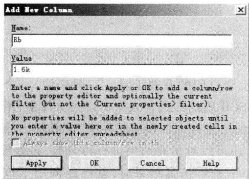  

图附 1.3.20 新增属性参数对话框

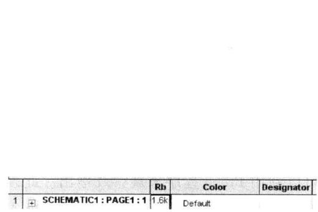  

图附 1.3.21 新增属性参数的设置

## Step 2 参数扫描分析的参数设置

◇ 首先进行瞬态分析的参数设置,读者可按照自己的要求进行设置。

◇ 扫描分析参数设置,如图附 1.3.22 所示。

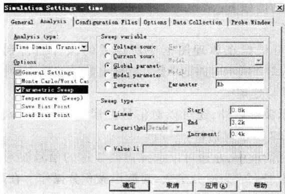  

图附 1.3.22 扫描分析参数设置

## Step 3 参数扫描分析结果显示

参数扫描分析结果如图附 1.3.23 所示。

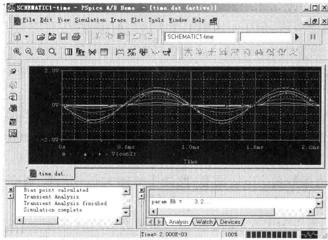  

图附 1.3.23 参数扫描分析结果

## 附录 1.3.6 波形后处理程序 Probe

Probe 是 PSpice 对分析结果进行波形处理、显示和打印的有效工具。一般来说，一个电路在经过 PSpice 仿真以后，仿真的结果一部分以 ASCII 码的形式存入“.out”的文件中，用户可以用文本方式进行查阅，另一部分则以二进制数的形式存入“.dat”文件中，波形输出的结果可以利用 Probe 程序来观察及输出。此外，Probe 还可以对仿真结果进行再分析、再处理。

事实上,每次完成仿真之后在 PSpice A/D 窗口中查看仿真结果时,就已经调用了该程序。因此,本小节的叙述过程中不再区分 PSpice A/D 窗口与 Probe 窗口。

## 一、Probe窗口简介

图附 1.3.24 所示为 Probe 窗口的截屏图及一些主要部分的说明, 图附 1.3.25 所示为快捷工具窗口的说明, 读者可根据这些说明来自行理解其含义。

## 二、Probe 功能简述

具体来说,Probe 的功能如下:

显示信号的波形

运行 PSpice 后, 即可根据在原理图框中所设置的探针而得到该信号的波形。图附 1.3.26 显示的是图附 1.2.2 所示电路的 R1 上端输出信号的瞬态特性分析。

## ➢ 信号波形的运算与处理

Probe 除了可以显示波形以外, 还可以对信号波形进行运算与处理, 单击“Trace->Add Trace”得到如图附 1.3.27 所示对话框。

图附 1.3.27 所示对话框中, 左边可以选择需要显示的信号波形, 右边可以显示对该波形做何种操作, 例如图中“S()”为积分函数, 对波形做积分操作。在附录 1.3.6 节三中将对一些常用的表达式进行说明。

## ➢ 使用宏表达式对信号进行分析

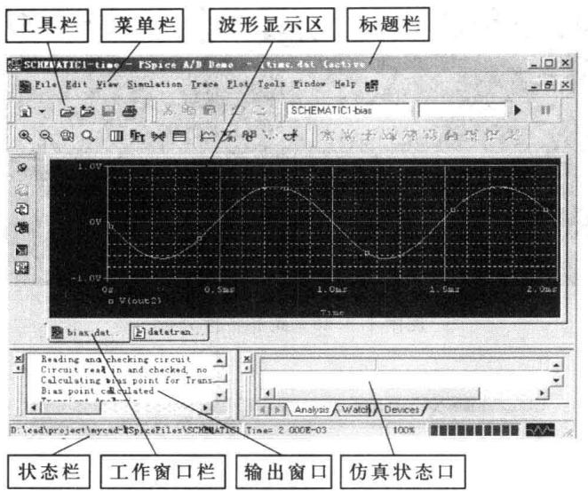  

图附 1.3.24 Probe 窗口结构

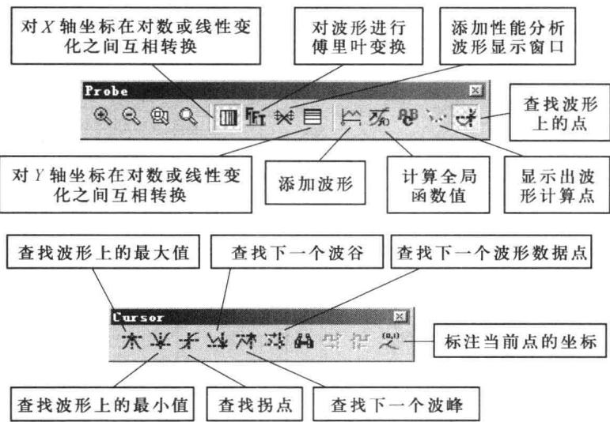  

图附 1.3.25 快捷工具窗口

在 Probe 工具中提供了很多方便的宏命令来对仿真产生的数据进行分析。例如，图附 1.3.28 所示为对图附 1.2.2 所示电路进行交流小信号频率特性分析的结果。

从图附 1.3.28 中可看出, 这个电路存在着上、下两个截止频率, 可选择 “Trace” 菜单中的 “Measurements” 命令对仿真结果进行分析, 此时弹出如图附 1.3.29 所示的窗口。

在图附 1.3.29 中任意选择一个测量项, 并单击右边的 “Eval” 按键, 则会出现图附 1.3.30 所示的窗口, 在该窗口中输入需要进行测量的数据, 即可获得所需的结果。

## 其他功能

除了以上功能外,使用 Probe 还能完成以下功能:

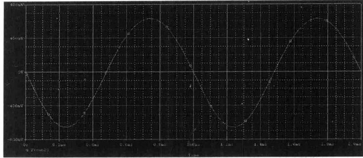  

图附1.3.26 瞬态特性分析

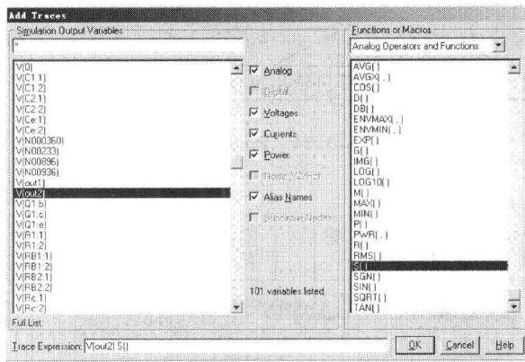  

图附1.3.27 Add Trace对话框

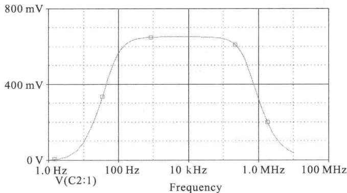  

图附 1.3.28 交流小信号频率特性分析结果

◇ 信号波形的数据显示与处理；

◇ 电路设计的性能分析；

◇ 绘制直方图。

由于篇幅所限,这里就不再做进一步讲解了。

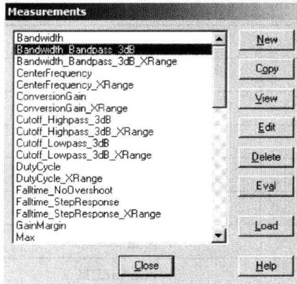  

图附 1.3.29 Measurements 窗口选项

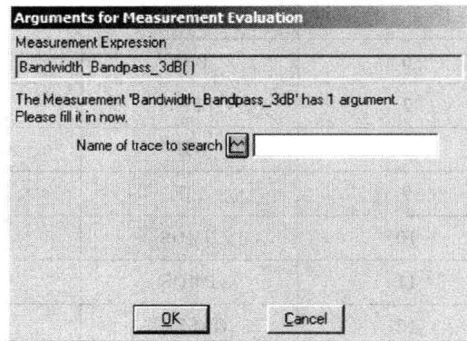  

图附 1.3.30 输入测量表达式的入口参数

## 三、表达式简述

在波形后处理程序 Probe 中, 允许各种变量经过简单数学运算后输出显示。例如, 在 “Trace|Add” 编辑窗中送入 “(V(Q1:c)-V(Q1:e)) \* IC(Q1)”, 可得到 BJT 的功耗曲线。

<Note title="注意">
上式中, $V(Q1:c)$ 代表Q1器件C管脚的电压,其余的表达方式可以依次类推。

在构造表达式时可以使用的运算符号有：“+”、“-”、“\*”、“/”、“（）”，此外还可以进行下列函数运算（字母大小写均可）：

$$

\begin{array}{l l} \text {ABS(x)} & | x | \\ \text {SGN(x)} & \text {符号函数} \left\{ \begin{array}{l l} + 1 & x > 0 \\ 0 & x = 0 \\ - 1 & x <   0 \end{array} \right. \\ \text {SQRT(x)} & \sqrt {x} \\ \text {EXP(x)} & e ^ {x} \\ \text {LOG(x)} & \ln x \\ \text {LOG10(x)} & \lg x \\ \text {DB(x)} & 2 0 \lg | x | \end{array}

$$
</Note>

## 附录1.4 相关表格

表附 1.4.1 PSpice 中的元器件关键字

<table><tr><td>序号</td><td>类型名称</td><td>描述关键字</td><td>元器件类型</td></tr><tr><td>1</td><td>RES</td><td>R</td><td>电阻器</td></tr><tr><td>2</td><td>CAP</td><td>C</td><td>电容器</td></tr><tr><td>3</td><td>IND</td><td>L</td><td>电感器</td></tr><tr><td>4</td><td>D</td><td>D</td><td>二极管</td></tr><tr><td>5</td><td>NPN</td><td>Q</td><td>NPN BJT 晶体管</td></tr><tr><td>6</td><td>PNP</td><td>Q</td><td>PNP BJT 晶体管</td></tr><tr><td>7</td><td>LPNP</td><td>Q</td><td>横向 PNP BJT 晶体管</td></tr><tr><td>8</td><td>NJF</td><td>J</td><td>N 沟道 JFET</td></tr><tr><td>9</td><td>PJF</td><td>J</td><td>P 沟道 JFET</td></tr><tr><td>10</td><td>NMOS</td><td>M</td><td>N 沟道 MOSFET</td></tr><tr><td>11</td><td>PMOS</td><td>M</td><td>P 沟道 MOSFET</td></tr><tr><td>12</td><td>GASFET</td><td>B</td><td>GaASFET</td></tr><tr><td>13</td><td>CORE</td><td>K</td><td>非线性磁心(变压器)</td></tr><tr><td>14</td><td>VSWITCH</td><td>S</td><td>电压控制开关</td></tr><tr><td>15</td><td>ISWITCH</td><td>W</td><td>电流控制开关</td></tr><tr><td>16</td><td>DINPUT</td><td>N</td><td>数字输入器件</td></tr><tr><td>17</td><td>DOUTPUT</td><td>O</td><td>数字输出器件</td></tr><tr><td>18</td><td>UIO</td><td>U</td><td>数字输入、输出模型</td></tr><tr><td>19</td><td>UGATE</td><td>U</td><td>标准门</td></tr><tr><td>20</td><td>UTGATE</td><td>U</td><td>三态门</td></tr><tr><td>21</td><td>UEFF</td><td>U</td><td>边缘触发器</td></tr><tr><td>22</td><td>UGFF</td><td>U</td><td>门触发器</td></tr><tr><td>23</td><td>UWDTH</td><td>U</td><td>脉宽校验器</td></tr><tr><td>24</td><td>USHUD</td><td>U</td><td>复位和保持校验器</td></tr><tr><td>25</td><td>UDLY</td><td>U</td><td>数字延迟线</td></tr></table>

表附 1.4.2 器件常用模型参数

<table><tr><td>元器件模型</td><td>参数名</td><td>定义</td><td>缺省值</td><td>单位</td></tr><tr><td rowspan="7">D</td><td>IS</td><td>饱和电流</td><td>1E-14</td><td>A</td></tr><tr><td>RS</td><td>寄生串联电阻</td><td>0</td><td> $\Omega$ </td></tr><tr><td>N</td><td>发射系数</td><td>1</td><td></td></tr><tr><td>CJO</td><td>零偏PN结电容</td><td>0</td><td>F</td></tr><tr><td>VJ</td><td>结电势</td><td>1</td><td>V</td></tr><tr><td>BV</td><td>反向击穿电压</td><td> $\infty$ </td><td>V</td></tr><tr><td>IBV</td><td>反向击穿电流</td><td>1E-10</td><td>A</td></tr><tr><td rowspan="12">BJT</td><td>BF</td><td>正向电流放大系数</td><td>100</td><td></td></tr><tr><td>NF</td><td>正向电流发射系数</td><td>1</td><td></td></tr><tr><td>VAF</td><td>正向Early电压</td><td>∞</td><td>V</td></tr><tr><td>BR</td><td>反向电流放大系数</td><td>1</td><td></td></tr><tr><td>NR</td><td>反向电流发射系数</td><td>1</td><td></td></tr><tr><td>VAR</td><td>反向Early电压</td><td>∞</td><td>V</td></tr><tr><td>CJE</td><td>b-e结零偏电容</td><td>0</td><td>F</td></tr><tr><td>CJC</td><td>b-c结零偏电容</td><td>0</td><td>F</td></tr><tr><td>RB</td><td>零偏压基极电阻</td><td>0</td><td>Ω</td></tr><tr><td>RE</td><td>发射极电阻</td><td>0</td><td>Ω</td></tr><tr><td>RC</td><td>集电极电阻</td><td>0</td><td>Ω</td></tr><tr><td>VJE</td><td>b-e结内建电位</td><td>0.75</td><td>V</td></tr><tr><td rowspan="8">MOSFET</td><td>VTO</td><td>零偏压阈值电压</td><td>0</td><td>V</td></tr><tr><td>KP</td><td>跨导系数</td><td>0.02</td><td>mA/V2</td></tr><tr><td>CBD</td><td>零偏压漏极-衬底结电容</td><td>0</td><td>F</td></tr><tr><td>CBS</td><td>零偏压源极-衬底结电容</td><td>0</td><td>F</td></tr><tr><td>TOX</td><td>氧化层厚度</td><td>1E-7</td><td>m</td></tr><tr><td>CGDO</td><td>单位宽度的栅源覆盖电容</td><td>0</td><td>F/m</td></tr><tr><td>CGSO</td><td>单位宽度的栅漏覆盖电容</td><td>0</td><td>F/m</td></tr><tr><td>CGBO</td><td>单位长度的栅-衬底覆盖电容</td><td>0</td><td>F/m</td></tr><tr><td rowspan="7">JFET</td><td>VTO</td><td>夹断电压</td><td>-2</td><td>V</td></tr><tr><td>BETA</td><td>跨导系数</td><td>0.1</td><td>mA/V2</td></tr><tr><td>LAMBDA</td><td>沟道长度调制系数</td><td>0</td><td>V-1</td></tr><tr><td>RD</td><td>漏极电阻</td><td>0</td><td>Ω</td></tr><tr><td>RS</td><td>源极电阻</td><td>0</td><td>Ω</td></tr><tr><td>CGS</td><td>零偏压栅源电容</td><td>0</td><td>F</td></tr><tr><td>CGD</td><td>零偏压栅漏电容</td><td>0</td><td>F</td></tr><tr><td rowspan="3">GaAS MOSFET</td><td>VTO</td><td>夹断电压</td><td>-2.5</td><td>V</td></tr><tr><td>BETA</td><td>跨导系数</td><td>0.1</td><td>A/V2</td></tr><tr><td>IS</td><td>栅PN结饱和电流(其他与JFET相同)</td><td>1E-14</td><td>A</td></tr></table>
